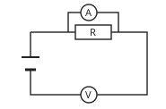
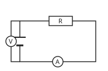
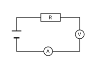
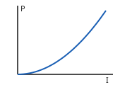
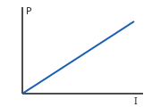
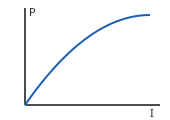
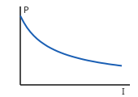

# Current Electricity sample: teacher review

_Draft, not reviewed. Every item was written by AI, inspired by 20 past-paper MCQs (2016–2025). Nothing here is copied from a paper._

## How to review (about 3 hours)

UniKey is a daily practice app for A/L Physics students, in Sinhala medium. Each item below is a short multiple-choice question. The app marks it, and each wrong option records the mistake a student who picks it probably made. So we need you to check three things for every item:

1. **The physics is right**, and the bold answer is the only correct one.
2. **Each wrong option is a mistake students really make.** Tick ☐ *Real mistake?* if it is. If no student would pick it, leave it unticked and say why under *Fix*.
3. **The Sinhala reads like an A/L paper or the NIE textbook.** The Sinhala was drafted by AI from the English. Correct any word directly in the *Fix* line.

Then tick ☐ *OK*, or write what to change under ☐ *Fix*. Each skill also asks once whether it is the right skill for the item.

- **What's here:** 53 cards · 3 scenario pools (18 scenarios) · 15 templates and statement banks, which the code expands into 1031 checked variants. Templates show 3 examples; check the listed mistakes once, then just read the examples.
- **Layers:** L1 = recall a fact, L2 = one idea, L3 = choose the method, L4 = a full problem with numbers that change each time.
- **Correct answer** is in bold. The code beside each wrong option, like `series-parallel-swap`, is the mistake it records. Their meanings are in the spec and in the tag table below.
- **Already checked by code:** the arithmetic of every variant, units, that no wording is copied from a past paper, option spacing, and answer positions. **Not checked by code:** teaching quality, whether the mistakes are real, and the Sinhala.
- **Figures:** only a few cards have drawings. Real papers draw most circuits; here the templates describe them in words, because the app can't yet draw circuits for changing values.

## New mistake tags to approve

These Electricity mistake tags are proposed and not yet approved (content spec §12). Tick each one you agree is a real, distinct mistake. Change the student message if it would confuse a student.

| ☐ | Tag | Meaning | Message the student sees |
|---|---|---|---|
| ☐ | `drift-thin-slower` | Thinks drift speed is the same or lower where the wire is thinner | Same current through less area: the electrons drift faster. |
| ☐ | `power-formula-choice` | Uses P = I²R when the voltage is fixed, or V²/R when the current is fixed | Use the power formula with the quantity that stays fixed. |
| ☐ | `max-power-efficiency` | Thinks maximum power transfer is also maximum efficiency | At maximum power, half the power is lost inside the source. |
| ☐ | `pot-draws-current` | Thinks the cell being tested gives current at balance | At balance no current flows from the cell being tested. |
| ☐ | `pot-driver-too-small` | Thinks any driver cell gives a balance point | The pd across the wire must be larger than the e.m.f. you measure. |
| ☐ | `meter-resistance` | Wants a high-resistance ammeter or a low-resistance voltmeter | Ammeters need a tiny resistance. Voltmeters need a huge one. |
| ☐ | `flux-not-change` | Links the e.m.f. to the flux, not to its rate of change | E.m.f. depends on how fast the flux changes. |
| ☐ | `forgot-turns` | Left out the number of turns of a coil | A coil has N turns: multiply by N. |
| ☐ | `lenz-opposes-field` | Has the induced current oppose the field, not the change in it | The induced current opposes the change in flux, not the flux. |
| ☐ | `lenz-same-direction` | Has the induced current help the change in flux | If it helped the change, energy would come from nowhere. |
| ☐ | `transformer-dc` | Thinks a transformer works on steady d.c. | A transformer needs a changing current. |
| ☐ | `back-emf-start` | Thinks a motor's back e.m.f. is largest when it starts | Back e.m.f. grows with the motor's speed. |

## Sinhala terms to confirm first

These are the term choices that change many items. Confirm each against the NIE textbook. Tell us the right word once and it changes everywhere.

| English | Used here | Why it needs checking |
|---|---|---|
| e.m.f. | වි.ගා.බ. (විද්‍යුත් ගාමක බලය) | The glossary has both විද්‍යුත් ගාමක බලය and විද්‍යුත් චාලක බලය |
| power (electrical) | ජවය | The glossary's "electrical power" is විද්‍යුත් බලය, which means force |
| cell (electric) | කෝෂය | The glossary's "driver cell" is ධාවක සෛලය, which is a biological cell |
| bridge | සේතුව | The glossary's "balanced bridge" is තුලිත බ්‍රිජය, a transliteration |
| flux density | චුම්බක ස්‍රාව ඝනත්වය | The glossary's "flux density" is ෆ්ලක්ස් ඝනත්වය, a transliteration |
| turns (of a coil) | වට | The glossary's "turns ratio" is වකුටු අනුපාතය |
| load (electrical) | භාරය | The glossary's පැටවුම is a mechanical load |
| drift speed | ප්ලාවිත වේගය | The glossary has ප්ලාවිත (drift velocity) and ප්ලවනය (drift) |
| pd | විභව අන්තරය | Written out in full; is an abbreviation used in papers? |
| not in the glossary | පුඩුව (loop), තාපකය (heater), ප්‍රධාන සැපයුම (mains), බෙදුම්කරය (divider), දක්ෂිණාවර්ත / වාමාවර්ත (clockwise / anticlockwise) | AI's own choices |

## Coverage against spec §9

| Skill | Type | L1 | L2 | Trap card | L3 pools | L4 | Small pool |
|---|---|---|---|---|---|---|---|
| Resistors in series and parallel | procedural | 1 | 4 | yes | 1 | 1 | 0 |
| Potential divider | procedural | 1 | 3 | yes | 0 | 1 | 0 |
| Resistance and resistivity | procedural | 1 | 2 | no | 0 | 1 | 0 |
| Drift velocity and current density | procedural | 1 | 1 | no | 0 | 1 | 0 |
| Electrical power | procedural | 1 | 1 | yes | 0 | 1 | 0 |
| How power varies with current, voltage and resistance | conceptual | 1 | 2 | no | 0 | 0 | 0 |
| Joule heating | procedural | 1 | 1 | no | 0 | 0 | 1 |
| Terminal pd and internal resistance | procedural | 1 | 2 | no | 0 | 0 | 1 |
| Cells in series and in parallel | procedural | 1 | 2 | yes | 0 | 1 | 0 |
| Maximum power transfer | procedural | 1 | 2 | yes | 0 | 0 | 1 |
| Ammeters, voltmeters and ideal meters | conceptual | 0 | 3 | yes | 0 | 0 | 0 |
| Balanced Wheatstone bridge | procedural | 1 | 1 | yes | 1 | 1 | 0 |
| Potentiometer principle and sensitivity | conceptual | 1 | 0 | no | 0 | 1 | 0 |
| Potential gradient along a potentiometer wire | procedural | 1 | 1 | yes | 0 | 1 | 0 |
| Internal resistance with a potentiometer | procedural | 0 | 2 | yes | 0 | 1 | 0 |
| Faraday's law | procedural | 2 | 2 | yes | 0 | 1 | 0 |
| Lenz's law | conceptual | 1 | 2 | yes | 1 | 0 | 0 |
| Back e.m.f. of a motor | conceptual | 0 | 3 | yes | 0 | 0 | 0 |
| Transformer power and current ratio | procedural | 1 | 2 | yes | 0 | 1 | 0 |

## Source 2016-25

### phy.elec.c024 · L2 · F13

Skill: `phy.elec.emf.cell-combinations` (ශ්‍රේණිගත සහ සමාන්තරගත කෝෂ / Cells in series and in parallel). Draft difficulty: 2.

- [ ] This skill is right (asked once per skill)
- [ ] OK
- [ ] Fix:

එක එකක් වි.ගා.බ. E සහ අභ්‍යන්තර ප්‍රතිරෝධය r වූ සර්වසම කෝෂ දෙකක් සමාන්තරගතව සම්බන්ධ කර ඇත. යුගලයේ වි.ගා.බ. සහ අභ්‍යන්තර ප්‍රතිරෝධය කුමක් ද?  
Two identical cells, each of e.m.f. E and internal resistance r, are joined in parallel. E.m.f. and internal resistance of the pair?

- **E සහ r/2 / E and r/2**
- [ ] 2E සහ 2r / 2E and 2r (`series-parallel-swap`). Real mistake?
- [ ] 2E සහ r/2 / 2E and r/2 (`wrong-law`). Student sees: "සමාන්තරගත සර්වසම කෝෂවල වි.ගා.බ. නොවෙනස්ව පවතී." Real mistake?
- [ ] E සහ 2r / E and 2r (`inverted`). Real mistake?

Explanation: වි.ගා.බ. E ලෙසම පවතී. අභ්‍යන්තර ප්‍රතිරෝධ දෙක සමාන්තරගත නිසා r/2 ලැබේ.  
The e.m.f. stays E. The two internal resistances are in parallel, giving r/2.

### phy.elec.c025 · L2 · F12

Skill: `phy.elec.emf.cell-combinations` (ශ්‍රේණිගත සහ සමාන්තරගත කෝෂ / Cells in series and in parallel). Draft difficulty: 2.

- [ ] OK
- [ ] Fix:

ශ්‍රේණිගත සර්වසම කෝෂ n කි. මුළු අභ්‍යන්තර ප්‍රතිරෝධය ÷ එක් කෝෂයක අභ්‍යන්තර ප්‍රතිරෝධය?  
n identical cells in series. Total internal resistance ÷ one cell's?

- **n**
- [ ] 1/n (`series-parallel-swap`). Real mistake?
- [ ] 1 (`ignored-condition`). Student sees: "ශ්‍රේණිගත විට එක් එක් කෝෂයේ r එකතු වේ." Real mistake?
- [ ] n² (`wrong-power`). Real mistake?

Explanation: ශ්‍රේණිගත අභ්‍යන්තර ප්‍රතිරෝධ එකතු වේ.  
Internal resistances in series add.

### phy.elec.c051 · L1 · F01

Skill: `phy.elec.emf.cell-combinations` (ශ්‍රේණිගත සහ සමාන්තරගත කෝෂ / Cells in series and in parallel). Draft difficulty: 1.

- [ ] OK
- [ ] Fix:

සර්වසම 1.5 V කෝෂ දෙකක් ඒවායේ වි.ගා.බ. එකතු වන පරිදි ශ්‍රේණිගතව සම්බන්ධ කර ඇත. සංයුක්ත වි.ගා.බ. කීය ද?  
Two identical 1.5 V cells are joined in series so their e.m.f.s add. What is their combined e.m.f.?

- **3 V**
- 1.5 V (`recall-gap`).
- 0.75 V (`recall-gap`).
- 0 V (`recall-gap`).

Explanation: මෙම සම්බන්ධයේ දී කෝෂ දෙක හරහා සිදුවන විභව වැඩිවීම් එකතු වේ.  
In this orientation the potential rises across the two cells add.

### phy.elec.t08 · L4 · F40 · 67 variants · skill mastery

Skill: `phy.elec.emf.cell-combinations` (ශ්‍රේණිගත සහ සමාන්තරගත කෝෂ / Cells in series and in parallel). Draft difficulty: 4.

- [ ] OK
- [ ] Fix:

Mistakes in this template:

- [ ] `forgot-half`: `(E2 - E1)/r`. Real mistake?
- [ ] `sign`: `(E1 + E2)/(2*r)`. Real mistake?
- [ ] `ignored-condition`: `E2/(2*r)`. Student sees: "අනෙක් කෝෂය ආපසු තල්ලු කරයි, එබැවින් වි.ගා.බ. වල වෙනස භාවිත කරන්න." (The other cell pushes back, so use the difference in e.m.f.) Real mistake?
- [ ] `series-parallel-swap`: `2*(E2 - E1)/r`. Real mistake?
- [ ] `wrong-quantity`: `(E2 - E1)**2/(2*r)`. Student sees: "එය ධාරාව නොව, නාස්ති වන ජවයයි." (That's the power wasted, not the current.) Real mistake?

**Example 1:** වි.ගා.බ. 1.5 V සහ 1.7 V වූ, එක එකෙහි අභ්‍යන්තර ප්‍රතිරෝධය 1 Ω වූ කෝෂ දෙකක් + සිට + ට සමාන්තරගතව සම්බන්ධ කර ඇත, වෙනත් කිසිවක් සම්බන්ධ කර නැත. ඒවා වටා ගලන ධාරාව කීය ද?  
Two cells of e.m.f. 1.5 V and 1.7 V, each with internal resistance 1 Ω, are joined in parallel, + to +, with nothing else connected. Current flowing round them?

- 0.02 A (`wrong-quantity`)
- **0.1 A**
- 0.2 A (`forgot-half`)
- 0.4 A (`series-parallel-swap`)
- 0.85 A (`ignored-condition`)

**Example 2:** වි.ගා.බ. 1.5 V සහ 1.9 V වූ, එක එකෙහි අභ්‍යන්තර ප්‍රතිරෝධය 0.2 Ω වූ කෝෂ දෙකක් + සිට + ට සමාන්තරගතව සම්බන්ධ කර ඇත, වෙනත් කිසිවක් සම්බන්ධ කර නැත. ඒවා වටා ගලන ධාරාව කීය ද?  
Two cells of e.m.f. 1.5 V and 1.9 V, each with internal resistance 0.2 Ω, are joined in parallel, + to +, with nothing else connected. Current flowing round them?

- 0.4 A (`wrong-quantity`)
- **1 A**
- 4 A (`series-parallel-swap`)
- 4.75 A (`ignored-condition`)
- 8.5 A (`sign`)

**Example 3:** වි.ගා.බ. 6 V සහ 7.5 V වූ, එක එකෙහි අභ්‍යන්තර ප්‍රතිරෝධය 0.1 Ω වූ කෝෂ දෙකක් + සිට + ට සමාන්තරගතව සම්බන්ධ කර ඇත, වෙනත් කිසිවක් සම්බන්ධ කර නැත. ඒවා වටා ගලන ධාරාව කීය ද?  
Two cells of e.m.f. 6 V and 7.5 V, each with internal resistance 0.1 Ω, are joined in parallel, + to +, with nothing else connected. Current flowing round them?

- **7.5 A**
- 15 A (`forgot-half`)
- 30 A (`series-parallel-swap`)
- 37.5 A (`ignored-condition`)
- 67.5 A (`sign`)

Explanation: ශුද්ධ වි.ගා.බ. E₂ − E₁ ශ්‍රේණිගත අභ්‍යන්තර ප්‍රතිරෝධ දෙක හරහා ධාරාව යවයි.  
The net e.m.f. E₂ − E₁ drives current through both internal resistances in series.

## Source 2016-26

### phy.elec.c009 · L1 · F02

Skill: `phy.elec.res.resistivity` (ප්‍රතිරෝධය සහ ප්‍රතිරෝධකතාව / Resistance and resistivity). Draft difficulty: 1.

- [ ] This skill is right (asked once per skill)
- [ ] OK
- [ ] Fix:

R = ρ ▢ ÷ A  
R = ρ ▢ ÷ A

- **l**
- d (`recall-gap`).
- A (`recall-gap`).
- l² (`recall-gap`).

Explanation: ප්‍රතිරෝධය දිග සමඟ වැඩි වන අතර හරස්කඩ වර්ගඵලය සමඟ අඩු වේ.  
Resistance grows with the length and falls with the cross-sectional area.

### phy.elec.c010 · L2 · F12

Skill: `phy.elec.res.resistivity` (ප්‍රතිරෝධය සහ ප්‍රතිරෝධකතාව / Resistance and resistivity). Draft difficulty: 2.

- [ ] OK
- [ ] Fix:

කම්බියක පරිමාව නොවෙනස්ව, එය දිග මෙන් දෙගුණයක් දක්වා අදිනු ලැබේ. ප්‍රතිරෝධය × ?  
A wire is stretched to twice its length, with its volume unchanged. Resistance × ?

- **4**
- [ ] 2 (`ignored-condition`). Student sees: "ඇදීමෙන් හරස්කඩ වර්ගඵලය ද අඩක් වේ." Real mistake?
- [ ] ½ (`inverted`). Real mistake?
- [ ] 8 (`wrong-power`). Real mistake?

Explanation: l × 2 සහ A × ½, එබැවින් ρl/A 4 ගුණයකින් වැඩි වේ.  
l × 2 and A × ½, so ρl/A goes up 4 times.

### phy.elec.c011 · L2 · F12

Skill: `phy.elec.res.resistivity` (ප්‍රතිරෝධය සහ ප්‍රතිරෝධකතාව / Resistance and resistivity). Draft difficulty: 2.

- [ ] OK
- [ ] Fix:

එකම ලෝහය සහ දිග, නමුත් විෂ්කම්භය × 2. ප්‍රතිරෝධය × ?  
Same metal and length, but the diameter × 2. Resistance × ?

- **¼**
- [ ] ½ (`forgot-square`). Real mistake?
- [ ] 2 (`wrong-power`). Real mistake?
- [ ] 4 (`inverted`). Real mistake?

Explanation: A ∝ d², එබැවින් A × 4 සහ R × ¼.  
A ∝ d², so A × 4 and R × ¼.

### phy.elec.t03 · L4 · F40 · 49 variants · skill mastery

Skill: `phy.elec.res.resistivity` (ප්‍රතිරෝධය සහ ප්‍රතිරෝධකතාව / Resistance and resistivity). Draft difficulty: 3.

- [ ] OK
- [ ] Fix:

Mistakes in this template:

- [ ] `forgot-square`: `R*(l2/l)*(d/d2)`. Real mistake?
- [ ] `inverted`: `R*(l/l2)*(d/d2)**2`. Real mistake?
- [ ] `wrong-law`: `R*(l2/l)*(d2/d)**2`. Student sees: "කම්බිය ඝන වන විට R අඩු වේ: R ∝ l/d²." (R falls as the wire gets thicker: R ∝ l/d².) Real mistake?
- [ ] `ignored-condition`: `R*l2/l`. Student sees: "විෂ්කම්භය ද වෙනස් වේ, සහ R ∝ 1/d²." (The diameter changes too, and R ∝ 1/d².) Real mistake?
- [ ] `stopped-early`: `(l2/l)*(d/d2)**2`. Student sees: "එය අනුපාතය පමණි. පළමු ප්‍රතිරෝධයෙන් ගුණ කරන්න." (That's only the ratio. Multiply by the first resistance.) Real mistake?

**Example 1:** දිග 1 m සහ විෂ්කම්භය 0.2 mm වූ කම්බියක ප්‍රතිරෝධය 2 Ω වේ. එම ලෝහයෙන්ම, දිග 2 m සහ විෂ්කම්භය 0.4 mm වූ කම්බියක ප්‍රතිරෝධය කීය ද?  
A wire 1 m long and 0.2 mm in diameter has a resistance of 2 Ω. Resistance of a wire of the same metal, 2 m long and 0.4 mm in diameter?

- 0.25 Ω (`inverted`)
- 0.5 Ω (`stopped-early`)
- **1 Ω**
- 2 Ω (`forgot-square`)
- 4 Ω (`ignored-condition`)

**Example 2:** දිග 4 m සහ විෂ්කම්භය 0.6 mm වූ කම්බියක ප්‍රතිරෝධය 4 Ω වේ. එම ලෝහයෙන්ම, දිග 3 m සහ විෂ්කම්භය 0.2 mm වූ කම්බියක ප්‍රතිරෝධය කීය ද?  
A wire 4 m long and 0.6 mm in diameter has a resistance of 4 Ω. Resistance of a wire of the same metal, 3 m long and 0.2 mm in diameter?

- 3 Ω (`ignored-condition`)
- 6.75 Ω (`stopped-early`)
- 9 Ω (`forgot-square`)
- **27 Ω**
- 48 Ω (`inverted`)

**Example 3:** දිග 1 m සහ විෂ්කම්භය 0.6 mm වූ කම්බියක ප්‍රතිරෝධය 8 Ω වේ. එම ලෝහයෙන්ම, දිග 2 m සහ විෂ්කම්භය 0.2 mm වූ කම්බියක ප්‍රතිරෝධය කීය ද?  
A wire 1 m long and 0.6 mm in diameter has a resistance of 8 Ω. Resistance of a wire of the same metal, 2 m long and 0.2 mm in diameter?

- 16 Ω (`ignored-condition`)
- 18 Ω (`stopped-early`)
- 36 Ω (`inverted`)
- 48 Ω (`forgot-square`)
- **144 Ω**

Explanation: R = ρl/A සහ A ∝ d², එබැවින් R ∝ l/d².  
R = ρl/A and A ∝ d², so R ∝ l/d².

## Source 2016-5

### phy.elec.c033 · L1 · F01

Skill: `phy.elec.pot.principle` (විභවමාන මූලධර්මය සහ සංවේදීතාව / Potentiometer principle and sensitivity). Draft difficulty: 1.

- [ ] This skill is right (asked once per skill)
- [ ] OK
- [ ] Fix:

කෝෂයක විද්‍යුත් ගාමක බලය මැනීමේ දී විභවමානයක් භාවිත කිරීමෙන් තුලිත අවස්ථාවේ ලැබෙන වාසිය කුමක් ද?  
What is the advantage of measuring a cell’s e.m.f. with a potentiometer at balance?

- **පරීක්ෂා කරන කෝෂයෙන් ධාරාවක් නොගනී / Zero current from the test cell**
- එයට වැඩි ප්‍රතිරෝධයක් ඇත / It has a higher resistance (`recall-gap`).
- එය ඉක්මන් පාඨාංකයක් දෙයි / It gives a faster reading (`recall-gap`).
- එයට ධාවක කෝෂයක් අවශ්‍ය නැත / It needs no driver cell (`recall-gap`).

Explanation: ධාවක පරිපථයේ ධාරාව ගලා යයි. තුලිත අවස්ථාවේ පරීක්ෂා කරන කෝෂය අයත් ශාඛාවේ ධාරාව ශුන්‍ය බැවින් එම කෝෂයේ අභ්‍යන්තර ප්‍රතිරෝධය හරහා විභව අන්තරය ද ශුන්‍ය වේ.  
The driver circuit carries current. At balance the test branch carries none, so there is no internal potential difference in the test cell.

### phy.elec.b02 · L4 · F42 · 25 variants · skill mastery

Skill: `phy.elec.pot.principle` (විභවමාන මූලධර්මය සහ සංවේදීතාව / Potentiometer principle and sensitivity). Draft difficulty: 3.

- [ ] OK
- [ ] Fix:

Statement bank (tick each false statement if students really believe it):

- True: ඒකාකාර කම්බියක් හරහා නියත ධාරාවක් ගලන විට තුලන දිග පරීක්ෂා කරන කෝෂයේ වි.ගා.බ. ට අනුලෝමව සමානුපාතික වේ. / For a uniform wire at constant current, the balance length is proportional to the test e.m.f.
- True: එකම ධාවක කෝෂය සමඟ, දිගු කම්බියක විභව අනුක්‍රමණය කුඩා ය. / A longer wire, with the same driver cell, has a smaller potential gradient.
- True: තුලිත අවස්ථාවේ දී පරීක්ෂා කරන කෝෂය විභවමානයට ධාරාවක් සපයන්නේ නැත. / At balance the test cell supplies no current to the potentiometer.
- True: ධාවක පරිපථයට ප්‍රතිරෝධයක් එක් කිරීම විභව අනුක්‍රමණය අඩු කරයි. / Adding resistance to the driver circuit lowers the potential gradient.
- [ ] False (`pot-draws-current`): තුලනයේ දී, පරීක්ෂා කරන කෝෂය ගැල්වනෝමීටරය හරහා කුඩා ධාරාවක් යවයි. / At balance, the cell being tested drives a small current through the galvanometer.
- [ ] False (`inverted`): කම්බිය හරහා වෝල්ටීයතාව වැඩි කිරීම විභවමානය වඩා සංවේදී කරයි. / Raising the voltage across the wire makes the potentiometer more sensitive.
- [ ] False (`pot-driver-too-small`): පරීක්ෂා කරන කෝෂයට වඩා දුර්වල වුවත්, ඕනෑම ධාවක කෝෂයක් තුලන ලක්ෂ්‍යයක් ලබා දෙයි. / Any driver cell gives a balance point, even one weaker than the cell tested.
- [ ] False (`inverted`): එකම ධාවක කෝෂය සමඟ, කෙටි කම්බියක විභව අනුක්‍රමණය කුඩා ය. / A shorter wire, with the same driver cell, has a smaller potential gradient.

**Example 1:** A: තුලිත අවස්ථාවේ දී පරීක්ෂා කරන කෝෂය විභවමානයට ධාරාවක් සපයන්නේ නැත.  
B: එකම ධාවක කෝෂය සමඟ, දිගු කම්බියක විභව අනුක්‍රමණය කුඩා ය.  
C: ඒකාකාර කම්බියක් හරහා නියත ධාරාවක් ගලන විට තුලන දිග පරීක්ෂා කරන කෝෂයේ වි.ගා.බ. ට අනුලෝමව සමානුපාතික වේ.  
සත්‍ය වන්නේ කුමක් ද?  
A: At balance the test cell supplies no current to the potentiometer. / B: A longer wire, with the same driver cell, has a smaller potential gradient. / C: For a uniform wire at constant current, the balance length is proportional to the test e.m.f. / Which are true?

- A පමණි / A only (`missed-true-statement`)
- A සහ B පමණි / A and B only (`missed-true-statement`)
- A සහ C පමණි / A and C only (`missed-true-statement`)
- B සහ C පමණි / B and C only (`missed-true-statement`)
- **A, B සහ C සියල්ල / A, B and C**

**Example 2:** A: ඒකාකාර කම්බියක් හරහා නියත ධාරාවක් ගලන විට තුලන දිග පරීක්ෂා කරන කෝෂයේ වි.ගා.බ. ට අනුලෝමව සමානුපාතික වේ.  
B: එකම ධාවක කෝෂය සමඟ, දිගු කම්බියක විභව අනුක්‍රමණය කුඩා ය.  
C: කම්බිය හරහා වෝල්ටීයතාව වැඩි කිරීම විභවමානය වඩා සංවේදී කරයි.  
සත්‍ය වන්නේ කුමක් ද?  
A: For a uniform wire at constant current, the balance length is proportional to the test e.m.f. / B: A longer wire, with the same driver cell, has a smaller potential gradient. / C: Raising the voltage across the wire makes the potentiometer more sensitive. / Which are true?

- A පමණි / A only (`missed-true-statement`)
- **A සහ B පමණි / A and B only**
- A සහ C පමණි / A and C only (`inverted`)
- B සහ C පමණි / B and C only (`inverted`)
- A, B සහ C සියල්ල / A, B and C (`inverted`)

**Example 3:** A: පරීක්ෂා කරන කෝෂයට වඩා දුර්වල වුවත්, ඕනෑම ධාවක කෝෂයක් තුලන ලක්ෂ්‍යයක් ලබා දෙයි.  
B: ඒකාකාර කම්බියක් හරහා නියත ධාරාවක් ගලන විට තුලන දිග පරීක්ෂා කරන කෝෂයේ වි.ගා.බ. ට අනුලෝමව සමානුපාතික වේ.  
C: එකම ධාවක කෝෂය සමඟ, දිගු කම්බියක විභව අනුක්‍රමණය කුඩා ය.  
සත්‍ය වන්නේ කුමක් ද?  
A: Any driver cell gives a balance point, even one weaker than the cell tested. / B: For a uniform wire at constant current, the balance length is proportional to the test e.m.f. / C: A longer wire, with the same driver cell, has a smaller potential gradient. / Which are true?

- A පමණි / A only (`pot-driver-too-small`)
- A සහ B පමණි / A and B only (`pot-driver-too-small`)
- A සහ C පමණි / A and C only (`pot-driver-too-small`)
- **B සහ C පමණි / B and C only**
- A, B සහ C සියල්ල / A, B and C (`pot-driver-too-small`)

Explanation: කුඩා විභව අනුක්‍රමණයක් යනු එකම වි.ගා.බ. සඳහා දිගු තුලන දිගකි, එබැවින් පාඨාංකය වඩා සංවේදී ය.  
A smaller potential gradient means a longer balance length for the same e.m.f., so the reading is more sensitive.

## Source 2016-7

### phy.elec.c028 · L2 · F13

Skill: `phy.elec.meter.ammeter-voltmeter` (ඇමීටර, වෝල්ට්මීටර සහ පරිපූර්ණ මීටර / Ammeters, voltmeters and ideal meters). Draft difficulty: 2.

- [ ] This skill is right (asked once per skill)
- [ ] OK
- [ ] Fix:

1 kΩ ප්‍රතිරෝධකයක ධාරාව සහ ඒ හරහා විභව අන්තරය මනින විට පරිපථයට අවම බලපෑමක් කරන්නේ කුමන මීටර ද?  
Which meters disturb a circuit least when measuring the current in, and pd across, a 1 kΩ resistor?

- **ඇමීටරය 1 Ω, වෝල්ට්මීටරය 1 MΩ / Ammeter 1 Ω, voltmeter 1 MΩ**
- [ ] ඇමීටරය 1 MΩ, වෝල්ට්මීටරය 1 Ω / Ammeter 1 MΩ, voltmeter 1 Ω (`meter-resistance`). Real mistake?
- [ ] දෙකම 1 kΩ / Both 1 kΩ (`assumed-symmetry`). Real mistake?
- [ ] ඇමීටරය 1 kΩ, වෝල්ට්මීටරය 1 MΩ / Ammeter 1 kΩ, voltmeter 1 MΩ (`ignored-condition`). Student sees: "ඇමීටරයේ ප්‍රතිරෝධය පරිපථයට එකතු වේ, එබැවින් එය ඉතා කුඩා විය යුතු ය." Real mistake?

Explanation: ඇමීටරයේ ප්‍රතිරෝධය 1 kΩ ට වඩා බොහෝ අඩු ද, වෝල්ට්මීටරයේ ප්‍රතිරෝධය ඊට වඩා බොහෝ වැඩි ද විය යුතු ය.  
The ammeter's resistance must be far below 1 kΩ, and the voltmeter's far above it.

### phy.elec.c029 · L2 · F23

Skill: `phy.elec.meter.ammeter-voltmeter` (ඇමීටර, වෝල්ට්මීටර සහ පරිපූර්ණ මීටර / Ammeters, voltmeters and ideal meters). Draft difficulty: 2.

- [ ] OK
- [ ] Fix:

වෝල්ට්මීටරයේ අග්‍ර දෙක R හි දෙකෙළවරට සෘජුව සම්බන්ධ කර ඇමීටරය ප්‍රධාන ශාඛාවට ශ්‍රේණිගතව සම්බන්ධ කර ඇති රූපය තෝරන්න.  
Which diagram connects the voltmeter directly to both ends of R and the ammeter in the main branch?

- **ඇමීටරය පරිපථයේ ශ්‍රේණිගතව, වෝල්ට්මීටරය R හරහා / Ammeter in the loop, voltmeter across R**

  

- [ ] වෝල්ට්මීටරය පරිපථයේ ශ්‍රේණිගතව, ඇමීටරය R හරහා / Voltmeter in the loop, ammeter across R (`meter-placement`). Real mistake?

  

- [ ] ඇමීටරය පරිපථයේ ශ්‍රේණිගතව, වෝල්ට්මීටරය කෝෂය හරහා / Ammeter in the loop, voltmeter across the cell (`wrong-quantity`). Student sees: "එම සම්බන්ධක දෙක සෘජුව සම්බන්ධ වී ඇත්තේ කෝෂයේ අග්‍රවලට ය." Real mistake?

  

- [ ] මීටර දෙකම පරිපථයේ ශ්‍රේණිගතව / Both meters in the loop (`series-parallel-swap`). Real mistake?

  

Explanation: වෝල්ට්මීටරයේ සම්බන්ධක දෙක R හි දෙකෙළවරට යයි. ප්‍රධාන ශාඛාවේ ඇමීටරයෙන් කියවෙන්නේ මුළු ධාරාවයි.  
Trace both voltmeter leads to the ends of R. The ammeter is in the main branch and reads the total current.

### phy.elec.c030 · L2 · F10

Skill: `phy.elec.meter.ammeter-voltmeter` (ඇමීටර, වෝල්ට්මීටර සහ පරිපූර්ණ මීටර / Ammeters, voltmeters and ideal meters). Draft difficulty: 2.

- [ ] OK
- [ ] Fix:

පරිපූර්ණ වෝල්ට්මීටරයක ප්‍රතිරෝධය ශුන්‍ය වේ.  
An ideal voltmeter has zero resistance.

- **අසත්‍ය / False**
- [ ] සත්‍ය / True (`meter-resistance`). Real mistake?

Explanation: පරිපූර්ණ වෝල්ට්මීටරයක ප්‍රතිරෝධය අනන්ත ය, එබැවින් එය ධාරාවක් නොගනී.  
An ideal voltmeter has infinite resistance, so it draws no current.

## Source 2020-33

### phy.elec.c026 · L2 · F13

Skill: `phy.elec.emf.max-power` (උපරිම ජව සංක්‍රාමණය / Maximum power transfer). Draft difficulty: 2.

- [ ] This skill is right (asked once per skill)
- [ ] OK
- [ ] Fix:

කෝෂයක අභ්‍යන්තර ප්‍රතිරෝධය 2 Ω වේ. එයින් වැඩිම ජවය ලබා ගන්නේ කුමන භාරය ද?  
A cell has an internal resistance of 2 Ω. Which load takes the most power from it?

- **2 Ω**
- [ ] 0 Ω (`wrong-quantity`). Student sees: "ශුන්‍ය භාරයක් විශාලතම ධාරාව දෙයි, නමුත් භාරයේ ජවයක් නැත." Real mistake?
- [ ] හැකි තරම් විශාල / As large as possible (`inverted`). Real mistake?
- [ ] 4 Ω (`wrong-law`). Student sees: "උපරිම ජවය සඳහා R = 2r නොව, R = r අවශ්‍ය ය." Real mistake?

Explanation: භාරයේ ප්‍රතිරෝධය අභ්‍යන්තර ප්‍රතිරෝධයට සමාන වන විට එයට වැඩිම ජවය ලැබේ.  
The load gets the most power when its resistance equals the internal resistance.

### phy.elec.c027 · L2 · F14

Skill: `phy.elec.emf.max-power` (උපරිම ජව සංක්‍රාමණය / Maximum power transfer). Draft difficulty: 2.

- [ ] OK
- [ ] Fix:

සිසුවා පවසයි: "උපරිම ජව සංක්‍රාමණයේ දී කෝෂය වඩාත්ම කාර්යක්ෂම ය." වැරැද්ද කුමක් ද?  
Student says: "At maximum power transfer, the cell is at its most efficient." What's wrong?

- **එහි දී කාර්යක්ෂමතාව 50% ක් පමණි / The efficiency is only 50% there**
- [ ] කිසිවක් නැත: වැඩිම ජවය යනු අවම නාස්තියයි / Nothing: most power means the least waste (`max-power-efficiency`). Real mistake?
- [ ] එහි දී කාර්යක්ෂමතාව 100% කි / The efficiency is 100% there (`wrong-quantity`). Student sees: "ජවයෙන් අඩක් කෝෂය තුළ නාස්ති වේ." Real mistake?
- [ ] භාරය ශුන්‍ය විට කාර්යක්ෂමතාව ඉහළම ය / The efficiency is highest when the load is zero (`inverted`). Real mistake?

Explanation: R = r විට, භාරය භාවිත කරන තරම්ම ජවයක් කෝෂයේම ප්‍රතිරෝධය නාස්ති කරයි.  
With R = r, the cell's own resistance wastes as much power as the load uses.

### phy.elec.c052 · L1 · F01

Skill: `phy.elec.emf.max-power` (උපරිම ජව සංක්‍රාමණය / Maximum power transfer). Draft difficulty: 1.

- [ ] OK
- [ ] Fix:

අභ්‍යන්තර ප්‍රතිරෝධය r වන කෝෂයකට විචල්‍ය භාර ප්‍රතිරෝධයක් R සම්බන්ධ කරයි. භාරයට උපරිම ජවය ලැබෙන්නේ කවර කොන්දේසිය යටතේ ද?  
A cell of internal resistance r supplies a variable load R. Which condition gives maximum power to the load?

- **R = r**
- R = 0 (`recall-gap`).
- R = 2r (`recall-gap`).
- R = r/2 (`recall-gap`).

Explanation: භාරයට ලැබෙන ජවය E²R/(R + r)² වේ. ප්‍රතිරෝධ දෙක සමාන වන විට එය උපරිම වේ.  
The load power is E²R/(R + r)² and reaches its peak when the two resistances match.

### phy.elec.t07 · L2 · F40 · 14 variants · FSRS card pool

Skill: `phy.elec.emf.max-power` (උපරිම ජව සංක්‍රාමණය / Maximum power transfer). Draft difficulty: 4.

- [ ] OK
- [ ] Fix:

Mistakes in this template:

- [ ] `assumed-symmetry`: `(R1 + R2)/2`. Real mistake?
- [ ] `wrong-law`: `R2 - R1`. Student sees: "සමාන ජවයෙන් r = R₂ − R₁ නොලැබේ. භාර දෙකටම I²R සමාන කරන්න." (Equal power doesn't give r = R₂ − R₁. Set I²R equal for both loads.) Real mistake?
- [ ] `stopped-early`: `R1*R2`. Student sees: "එය r² වේ. වර්ගමූලය ගන්න." (That's r². Take the square root.) Real mistake?
- [ ] `series-parallel-swap`: `R1*R2/(R1 + R2)`. Real mistake?
- [ ] `wrong-quantity`: `R2`. Student sees: "එය කෝෂය නොව, එක් භාරයකි." (That's one of the loads, not the cell.) Real mistake?

**Example 1:** වරකට එකක් බැගින් සම්බන්ධ කළ විට, කෝෂයක් 1 Ω ප්‍රතිරෝධකයකට හා 4 Ω ප්‍රතිරෝධකයකට එකම ජවය ලබා දෙයි. කෝෂයේ අභ්‍යන්තර ප්‍රතිරෝධය කීය ද?  
A cell gives the same power to a 1 Ω resistor as to a 4 Ω resistor, joined one at a time. Internal resistance of the cell?

- 0.8 Ω (`series-parallel-swap`)
- **2 Ω**
- 2.5 Ω (`assumed-symmetry`)
- 3 Ω (`wrong-law`)
- 4 Ω (`stopped-early`)

**Example 2:** වරකට එකක් බැගින් සම්බන්ධ කළ විට, කෝෂයක් 4 Ω ප්‍රතිරෝධකයකට හා 16 Ω ප්‍රතිරෝධකයකට එකම ජවය ලබා දෙයි. කෝෂයේ අභ්‍යන්තර ප්‍රතිරෝධය කීය ද?  
A cell gives the same power to a 4 Ω resistor as to a 16 Ω resistor, joined one at a time. Internal resistance of the cell?

- 3.2 Ω (`series-parallel-swap`)
- **8 Ω**
- 10 Ω (`assumed-symmetry`)
- 12 Ω (`wrong-law`)
- 64 Ω (`stopped-early`)

**Example 3:** වරකට එකක් බැගින් සම්බන්ධ කළ විට, කෝෂයක් 9 Ω ප්‍රතිරෝධකයකට හා 36 Ω ප්‍රතිරෝධකයකට එකම ජවය ලබා දෙයි. කෝෂයේ අභ්‍යන්තර ප්‍රතිරෝධය කීය ද?  
A cell gives the same power to a 9 Ω resistor as to a 36 Ω resistor, joined one at a time. Internal resistance of the cell?

- 7.2 Ω (`series-parallel-swap`)
- **18 Ω**
- 22.5 Ω (`assumed-symmetry`)
- 27 Ω (`wrong-law`)
- 36 Ω (`wrong-quantity`)

Explanation: E²R₁/(R₁ + r)² = E²R₂/(R₂ + r)² න් r² = R₁R₂ ලැබේ.  
E²R₁/(R₁ + r)² = E²R₂/(R₂ + r)² gives r² = R₁R₂.

## Source 2021-31

### phy.elec.c036 · L2 · F13

Skill: `phy.elec.pot.internal-resistance` (විභවමානයෙන් අභ්‍යන්තර ප්‍රතිරෝධය / Internal resistance with a potentiometer). Draft difficulty: 2.

- [ ] This skill is right (asked once per skill)
- [ ] OK
- [ ] Fix:

විභවමානය: කෝෂයක් විවෘත පරිපථයේ දී 60 cm දී ද, 5 Ω ප්‍රතිරෝධකයක් හරහා ධාරාව යවන විට 50 cm දී ද තුලනය වේ. අභ්‍යන්තර ප්‍රතිරෝධය කීය ද?  
Potentiometer: a cell balances at 60 cm on open circuit, and at 50 cm when it drives a 5 Ω resistor. Internal resistance?

- **1 Ω**
- [ ] 6 Ω (`stopped-early`). Student sees: "එය R × l₁ ÷ l₂ වේ. R අඩු කරන්න." Real mistake?
- [ ] 0.83 Ω (`inverted`). Real mistake?
- [ ] 10 Ω (`wrong-law`). Student sees: "r = R(l₁ − l₂) ÷ l₂ භාවිත කරන්න. දිග යනු ඕම් නොව, අනුපාතයකි." Real mistake?

Explanation: E ÷ V = l₁ ÷ l₂ = 1.2, so r = 0.2 × 5 Ω.  
E ÷ V = l₁ ÷ l₂ = 1.2, so r = 0.2 × 5 Ω.

### phy.elec.c037 · L2 · F10

Skill: `phy.elec.pot.internal-resistance` (විභවමානයෙන් අභ්‍යන්තර ප්‍රතිරෝධය / Internal resistance with a potentiometer). Draft difficulty: 2.

- [ ] OK
- [ ] Fix:

තුලනයේ දී, පරීක්ෂා කරන කෝෂය විභවමාන පරිපථයට කුඩා ධාරාවක් දෙයි.  
At balance, the cell being tested gives a small current to the potentiometer circuit.

- **අසත්‍ය / False**
- [ ] සත්‍ය / True (`pot-draws-current`). Real mistake?

Explanation: ගැල්වනෝමීටරය ශුන්‍ය පෙන්වයි, එබැවින් එම කෝෂයෙන් ධාරාවක් නොගලයි.  
The galvanometer reads zero, so no current flows from that cell.

### phy.elec.t09 · L4 · F40 · 40 variants · skill mastery

Skill: `phy.elec.pot.internal-resistance` (විභවමානයෙන් අභ්‍යන්තර ප්‍රතිරෝධය / Internal resistance with a potentiometer). Draft difficulty: 3.

- [ ] OK
- [ ] Fix:

Mistakes in this template:

- [ ] `inverted`: `R*(l1 - l2)/l1`. Real mistake?
- [ ] `stopped-early`: `R*l1/l2`. Student sees: "එය R × l₁ ÷ l₂ වේ. R අඩු කරන්න." (That's R × l₁ ÷ l₂. Subtract R.) Real mistake?
- [ ] `wrong-law`: `R*l2/l1`. Student sees: "E ÷ V = l₁ ÷ l₂ න් r = R(l₁ − l₂) ÷ l₂ ලැබේ." (E ÷ V = l₁ ÷ l₂ gives r = R(l₁ − l₂) ÷ l₂.) Real mistake?
- [ ] `ignored-condition`: `(l1 - l2)/l2`. Student sees: "R න් ගුණ කරන්න. දිග අනුපාතයට පමණක් ඒකකයක් නැත." (Multiply by R. The length ratio alone has no unit.) Real mistake?
- [ ] `sign`: `R*(l1 + l2)/l2`. Real mistake?

**Example 1:** විවෘත පරිපථයේ දී විභවමානයක් කෝෂයක් 60 cm දී ද, කෝෂය හරහා 3 Ω ප්‍රතිරෝධකයක් සම්බන්ධ කළ විට 50 cm දී ද තුලනය කරයි. කෝෂයේ අභ්‍යන්තර ප්‍රතිරෝධය කීය ද?  
A potentiometer balances a cell at 60 cm on open circuit, and at 50 cm when a 3 Ω resistor is joined across the cell. Internal resistance of the cell?

- 0.2 Ω (`ignored-condition`)
- 0.5 Ω (`inverted`)
- **0.6 Ω**
- 2.5 Ω (`wrong-law`)
- 3.6 Ω (`stopped-early`)

**Example 2:** විවෘත පරිපථයේ දී විභවමානයක් කෝෂයක් 50 cm දී ද, කෝෂය හරහා 10 Ω ප්‍රතිරෝධකයක් සම්බන්ධ කළ විට 40 cm දී ද තුලනය කරයි. කෝෂයේ අභ්‍යන්තර ප්‍රතිරෝධය කීය ද?  
A potentiometer balances a cell at 50 cm on open circuit, and at 40 cm when a 10 Ω resistor is joined across the cell. Internal resistance of the cell?

- 0.25 Ω (`ignored-condition`)
- 2 Ω (`inverted`)
- **2.5 Ω**
- 8 Ω (`wrong-law`)
- 12.5 Ω (`stopped-early`)

**Example 3:** විවෘත පරිපථයේ දී විභවමානයක් කෝෂයක් 100 cm දී ද, කෝෂය හරහා 8 Ω ප්‍රතිරෝධකයක් සම්බන්ධ කළ විට 40 cm දී ද තුලනය කරයි. කෝෂයේ අභ්‍යන්තර ප්‍රතිරෝධය කීය ද?  
A potentiometer balances a cell at 100 cm on open circuit, and at 40 cm when a 8 Ω resistor is joined across the cell. Internal resistance of the cell?

- 1.5 Ω (`ignored-condition`)
- 3.2 Ω (`wrong-law`)
- 4.8 Ω (`inverted`)
- **12 Ω**
- 20 Ω (`stopped-early`)

Explanation: E ÷ V = l₁ ÷ l₂, සහ E ÷ V = (R + r) ÷ R.  
E ÷ V = l₁ ÷ l₂, and E ÷ V = (R + r) ÷ R.

## Source 2021-46

### phy.elec.c014 · L1 · F01

Skill: `phy.elec.pow.power-formulas` (විද්‍යුත් ජවය / Electrical power). Draft difficulty: 1.

- [ ] This skill is right (asked once per skill)
- [ ] OK
- [ ] Fix:

R ප්‍රතිරෝධකයක් හරහා V විභව අන්තරයක් ඇත. ජවය කුමක් ද?  
A resistor R has a pd V across it. Power?

- **V²/R**
- VR (`recall-gap`).
- V/R (`recall-gap`).
- V²R (`recall-gap`).

Explanation: P = VI සහ I = V/R, එබැවින් P = V²/R.  
P = VI and I = V/R, so P = V²/R.

### phy.elec.c015 · L2 · F13

Skill: `phy.elec.pow.power-formulas` (විද්‍යුත් ජවය / Electrical power). Draft difficulty: 2.

- [ ] OK
- [ ] Fix:

230 V සඳහා නිපදවූ 60 W ලාම්පුවක් හා 100 W ලාම්පුවක් සලකන්න. එක් එක් ලාම්පුවේ ප්‍රතිරෝධය එහි නාමික ක්‍රියාකාරී අගයේ නියතව පවතී යැයි ගන්න. ඒවා ශ්‍රේණිගතව සම්බන්ධ කළ විට වැඩි ජවයක් වැය වන්නේ කුමන ලාම්පුවේ ද?  
A 60 W lamp and a 100 W lamp are each rated for 230 V. Treat their resistances as fixed at their rated values. Connected in series, which dissipates more power?

- **60 W ලාම්පුව / The 60 W lamp**
- [ ] 100 W ලාම්පුව / The 100 W lamp (`power-formula-choice`). Real mistake?
- [ ] දෙකම සමානව / Both equally (`assumed-symmetry`). Real mistake?
- [ ] + අග්‍රයට ආසන්න ලාම්පුව / The lamp nearer the + terminal (`current-used-up`). Real mistake?

Explanation: 60 W ලාම්පුවට විශාල R ඇත. ශ්‍රේණිගතව ධාරාව සමාන ය, එබැවින් එයට P = I²R විශාල ය.  
The 60 W lamp has the larger R. In series the current is the same, so P = I²R is larger for it.

### phy.elec.t05 · L4 · F40 · 57 variants · skill mastery

Skill: `phy.elec.pow.power-formulas` (විද්‍යුත් ජවය / Electrical power). Draft difficulty: 4.

- [ ] OK
- [ ] Fix:

Mistakes in this template:

- [ ] `ignored-condition`: `E**2/R`. Student sees: "අභ්‍යන්තර ප්‍රතිරෝධය වි.ගා.බ. යෙන් කොටසක් ගනී." (The internal resistance takes part of the e.m.f.) Real mistake?
- [ ] `wrong-quantity`: `E**2/(R + r)`. Student sees: "එය කෝෂය තුළ නාස්තිය ද ඇතුළුව කෝෂයේ මුළු ජවයයි." (That's the cell's total power, including the loss inside it.) Real mistake?
- [ ] `wrong-quantity`: `E**2*r/(R + r)**2`. Student sees: "එය කෝෂය තුළ නාස්ති වන ජවයයි." (That's the power wasted inside the cell.) Real mistake?
- [ ] `stopped-early`: `E/(R + r)`. Student sees: "එය ධාරාවයි. දැන් P = I²R භාවිත කරන්න." (That's the current. Now use P = I²R.) Real mistake?
- [ ] `forgot-square`: `E**2*R/(R + r)`. Real mistake?

**Example 1:** 8 Ω ප්‍රතිරෝධකයක් වි.ගා.බ. 2 V සහ අභ්‍යන්තර ප්‍රතිරෝධය 2 Ω වූ සැපයුමකට සම්බන්ධ කර ඇත. ප්‍රතිරෝධකයේ වැය වන ජවය කීය ද?  
A 8 Ω resistor is connected to a supply with an e.m.f. of 2 V and an internal resistance of 2 Ω. Power used in the resistor?

- 0.2 W (`stopped-early`)
- **0.32 W**
- 0.4 W (`wrong-quantity`)
- 0.5 W (`ignored-condition`)
- 3.2 W (`forgot-square`)

**Example 2:** 2 Ω ප්‍රතිරෝධකයක් වි.ගා.බ. 4 V සහ අභ්‍යන්තර ප්‍රතිරෝධය 0.5 Ω වූ සැපයුමකට සම්බන්ධ කර ඇත. ප්‍රතිරෝධකයේ වැය වන ජවය කීය ද?  
A 2 Ω resistor is connected to a supply with an e.m.f. of 4 V and an internal resistance of 0.5 Ω. Power used in the resistor?

- 1.28 W (`wrong-quantity`)
- 1.6 W (`stopped-early`)
- **5.12 W**
- 6.4 W (`wrong-quantity`)
- 8 W (`ignored-condition`)

**Example 3:** 1 Ω ප්‍රතිරෝධකයක් වි.ගා.බ. 12 V සහ අභ්‍යන්තර ප්‍රතිරෝධය 0.5 Ω වූ සැපයුමකට සම්බන්ධ කර ඇත. ප්‍රතිරෝධකයේ වැය වන ජවය කීය ද?  
A 1 Ω resistor is connected to a supply with an e.m.f. of 12 V and an internal resistance of 0.5 Ω. Power used in the resistor?

- 8 W (`stopped-early`)
- 32 W (`wrong-quantity`)
- **64 W**
- 96 W (`wrong-quantity`)
- 144 W (`ignored-condition`)

Explanation: I = E/(R + r), ඉන්පසු P = I²R.  
I = E/(R + r), then P = I²R.

## Source 2022-23

### phy.elec.c021 · L1 · F01

Skill: `phy.elec.emf.internal-resistance` (අග්‍ර විභව අන්තරය සහ අභ්‍යන්තර ප්‍රතිරෝධය / Terminal pd and internal resistance). Draft difficulty: 1.

- [ ] This skill is right (asked once per skill)
- [ ] OK
- [ ] Fix:

වි.ගා.බ. E සහ අභ්‍යන්තර ප්‍රතිරෝධය r වූ කෝෂයක් I ධාරාවක් දෙයි. අග්‍ර විභව අන්තරය කුමක් ද?  
A cell of e.m.f. E and internal resistance r gives current I. Terminal pd?

- **E − Ir**
- E + Ir (`recall-gap`).
- E (`recall-gap`).
- Ir (`recall-gap`).

Explanation: වි.ගා.බ. යෙන් කොටසක් වන Ir කෝෂය තුළ වැය වේ.  
Part of the e.m.f., Ir, is used up inside the cell.

### phy.elec.c022 · L2 · F10

Skill: `phy.elec.emf.internal-resistance` (අග්‍ර විභව අන්තරය සහ අභ්‍යන්තර ප්‍රතිරෝධය / Terminal pd and internal resistance). Draft difficulty: 2.

- [ ] OK
- [ ] Fix:

වෙනත් කිසිවක් සම්බන්ධ නොකළ කෝෂයක් හරහා ඇති පරිපූර්ණ වෝල්ට්මීටරයක් කෝෂයේ වි.ගා.බ. පෙන්වයි.  
An ideal voltmeter across a cell with nothing else connected reads the cell's e.m.f.

- **සත්‍ය / True**
- [ ] අසත්‍ය / False (`emf-vs-terminal-pd`). Real mistake?

Explanation: ධාරාවක් නොගලයි, එබැවින් කෝෂය තුළ විභව අන්තරයක් නාස්ති නොවේ.  
No current flows, so no pd is lost inside the cell.

### phy.elec.c023 · L2 · F10

Skill: `phy.elec.emf.internal-resistance` (අග්‍ර විභව අන්තරය සහ අභ්‍යන්තර ප්‍රතිරෝධය / Terminal pd and internal resistance). Draft difficulty: 2.

- [ ] OK
- [ ] Fix:

කෝෂයක් විශාල ධාරාවක් සපයන විට එහි අග්‍ර විභව අන්තරය වැඩි වේ.  
A cell's terminal pd rises when it supplies a larger current.

- **අසත්‍ය / False**
- [ ] සත්‍ය / True (`emf-vs-terminal-pd`). Real mistake?

Explanation: V = E − Ir, එබැවින් විශාල ධාරාවක් යනු කුඩා අග්‍ර විභව අන්තරයකි.  
V = E − Ir, so a larger current means a smaller terminal pd.

### phy.elec.t06 · L2 · F40 · 32 variants · FSRS card pool

Skill: `phy.elec.emf.internal-resistance` (අග්‍ර විභව අන්තරය සහ අභ්‍යන්තර ප්‍රතිරෝධය / Terminal pd and internal resistance). Draft difficulty: 3.

- [ ] OK
- [ ] Fix:

Mistakes in this template:

- [ ] `ignored-condition`: `E/Rp`. Student sees: "අභ්‍යන්තර ප්‍රතිරෝධය තවමත් ධාරාව සීමා කරයි." (The internal resistance still limits the current.) Real mistake?
- [ ] `stopped-early`: `E/(R1 + r)`. Student sees: "එය දෙවැනි ප්‍රතිරෝධකය එකතු කිරීමට පෙර ධාරාවයි." (That's the current before the second resistor was added.) Real mistake?
- [ ] `series-parallel-swap`: `E/(R1 + R2 + r)`. Real mistake?
- [ ] `assumed-symmetry`: `2*E/(R1 + r)`. Real mistake?
- [ ] `wrong-law`: `E/r`. Student sees: "එය අගු කෙටි පරිපථ කළ විට ධාරාවයි. ප්‍රතිරෝධක තවමත් පරිපථයේ ඇත." (That's the current with the terminals shorted. The resistors are still in the circuit.) Real mistake?

**Example 1:** වි.ගා.බ. 3 V සහ අභ්‍යන්තර ප්‍රතිරෝධය 2 Ω වූ කෝෂයක් 6 Ω ප්‍රතිරෝධකයක් හරහා ධාරාව යවයි. ඉන්පසු 12 Ω ප්‍රතිරෝධකයක් එයට සමාන්තරගතව සම්බන්ධ කෙරේ. කෝෂයෙන් ලැබෙන නව ධාරාව කීය ද?  
A cell of e.m.f. 3 V and internal resistance 2 Ω drives a 6 Ω resistor. A 12 Ω resistor is then joined in parallel with it. New current from the cell?

- 0.15 A (`series-parallel-swap`)
- 0.375 A (`stopped-early`)
- **0.5 A**
- 0.75 A (`ignored-condition`)
- 1.5 A (`wrong-law`)

**Example 2:** වි.ගා.බ. 6 V සහ අභ්‍යන්තර ප්‍රතිරෝධය 1 Ω වූ කෝෂයක් 4 Ω ප්‍රතිරෝධකයක් හරහා ධාරාව යවයි. ඉන්පසු 4 Ω ප්‍රතිරෝධකයක් එයට සමාන්තරගතව සම්බන්ධ කෙරේ. කෝෂයෙන් ලැබෙන නව ධාරාව කීය ද?  
A cell of e.m.f. 6 V and internal resistance 1 Ω drives a 4 Ω resistor. A 4 Ω resistor is then joined in parallel with it. New current from the cell?

- 1.2 A (`stopped-early`)
- **2 A**
- 2.4 A (`assumed-symmetry`)
- 3 A (`ignored-condition`)
- 6 A (`wrong-law`)

**Example 3:** වි.ගා.බ. 12 V සහ අභ්‍යන්තර ප්‍රතිරෝධය 0.5 Ω වූ කෝෂයක් 2 Ω ප්‍රතිරෝධකයක් හරහා ධාරාව යවයි. ඉන්පසු 6 Ω ප්‍රතිරෝධකයක් එයට සමාන්තරගතව සම්බන්ධ කෙරේ. කෝෂයෙන් ලැබෙන නව ධාරාව කීය ද?  
A cell of e.m.f. 12 V and internal resistance 0.5 Ω drives a 2 Ω resistor. A 6 Ω resistor is then joined in parallel with it. New current from the cell?

- 4.8 A (`stopped-early`)
- **6 A**
- 8 A (`ignored-condition`)
- 9.6 A (`assumed-symmetry`)
- 24 A (`wrong-law`)

Explanation: R₁ සහ R₂ සමාන්තරගතව සංයෝජනය කර, r එකතු කර, ඉන්පසු I = E ÷ මුළු ප්‍රතිරෝධය.  
Combine R₁ and R₂ in parallel, add r, then I = E ÷ total.

## Source 2022-31

### phy.elec.c012 · L1 · F02

Skill: `phy.elec.cur.drift-velocity` (ප්ලාවිත ප්‍රවේගය සහ ධාරා ඝනත්වය / Drift velocity and current density). Draft difficulty: 1.

- [ ] This skill is right (asked once per skill)
- [ ] OK
- [ ] Fix:

I = n ▢ v e  
I = n ▢ v e

- **A**
- l (`recall-gap`).
- R (`recall-gap`).
- V (`recall-gap`).

Explanation: I = nAve: වාහක ඝනත්වය × වර්ගඵලය × ප්ලාවිත වේගය × ආරෝපණය.  
I = nAve: carrier density × area × drift speed × charge.

### phy.elec.c013 · L2 · F19

Skill: `phy.elec.cur.drift-velocity` (ප්ලාවිත ප්‍රවේගය සහ ධාරා ඝනත්වය / Drift velocity and current density). Draft difficulty: 2.

- [ ] OK
- [ ] Fix:

කම්බියක වර්ගඵලය A වූ සිහින් කොටසක් සහ 3A වූ ඝන කොටසක් ඇත. ප්ලාවිත වේගය, සිහින් : ඝන?  
A wire has a thin part of area A and a thick part of area 3A. Drift speed, thin : thick?

- **3 : 1**
- [ ] 1 : 3 (`drift-thin-slower`). Real mistake?
- [ ] 1 : 1 (`ignored-condition`). Student sees: "කුඩා වර්ගඵලයක් හරහා එකම ධාරාවට වේගවත් ප්ලාවිත වේගයක් අවශ්‍ය ය." Real mistake?
- [ ] 9 : 1 (`wrong-power`). Real mistake?

Explanation: කොටස් දෙකේම ධාරාව සමාන ය, එබැවින් v ∝ 1/A.  
The current is the same in both parts, so v ∝ 1/A.

### phy.elec.b01 · L4 · F42 · 18 variants · skill mastery

Skill: `phy.elec.cur.drift-velocity` (ප්ලාවිත ප්‍රවේගය සහ ධාරා ඝනත්වය / Drift velocity and current density). Draft difficulty: 3.

- [ ] OK
- [ ] Fix:

Statement bank (tick each false statement if students really believe it):

- True: කම්බියක ඝන සහ සිහින් කොටස් දෙකේම ධාරාව සමාන ය. / The current is the same in the thick and the thin part of a wire.
- True: කම්බියක සිහින් කොටසේ ඉලෙක්ට්‍රෝන වේගයෙන් ප්ලාවනය වේ. / Electrons drift faster in the thin part of a wire.
- True: කම්බියක සිහින් කොටසට මීටරයකට වැඩි ප්‍රතිරෝධයක් ඇත. / The thin part of a wire has more resistance per metre.
- True: කම්බියේ සිහින් කොටසේ ඒකක දිගකින් තත්පරයකට නිකුත් වන තාප ප්‍රමාණය වැඩි ය. / The thin part of the wire releases more heat per unit length each second.
- [ ] False (`current-used-up`): කම්බියක සිහින් කොටසේ ධාරාව කුඩා ය. / The current is smaller in the thin part of a wire.
- [ ] False (`drift-thin-slower`): ඝන සහ සිහින් කොටස් දෙකේම ඉලෙක්ට්‍රෝන එකම වේගයෙන් ප්ලාවනය වේ. / Electrons drift at the same speed in the thick and the thin part.
- [ ] False (`drift-thin-slower`): කම්බියක සිහින් කොටසේ ඉලෙක්ට්‍රෝන සෙමින් ප්ලාවනය වේ. / Electrons drift more slowly in the thin part of a wire.
- [ ] False (`inverted`): කම්බියක සිහින් කොටසට මීටරයකට අඩු ප්‍රතිරෝධයක් ඇත. / The thin part of a wire has less resistance per metre.

**Example 1:** A: කම්බියක ඝන සහ සිහින් කොටස් දෙකේම ධාරාව සමාන ය.  
B: කම්බියක සිහින් කොටසට මීටරයකට වැඩි ප්‍රතිරෝධයක් ඇත.  
C: කම්බියක සිහින් කොටසේ ඉලෙක්ට්‍රෝන වේගයෙන් ප්ලාවනය වේ.  
සත්‍ය වන්නේ කුමක් ද?  
A: The current is the same in the thick and the thin part of a wire. / B: The thin part of a wire has more resistance per metre. / C: Electrons drift faster in the thin part of a wire. / Which are true?

- A පමණි / A only (`missed-true-statement`)
- A සහ B පමණි / A and B only (`missed-true-statement`)
- A සහ C පමණි / A and C only (`missed-true-statement`)
- B සහ C පමණි / B and C only (`missed-true-statement`)
- **A, B සහ C සියල්ල / A, B and C**

**Example 2:** A: කම්බියක සිහින් කොටසට මීටරයකට අඩු ප්‍රතිරෝධයක් ඇත.  
B: කම්බියක සිහින් කොටසේ ඉලෙක්ට්‍රෝන වේගයෙන් ප්ලාවනය වේ.  
C: කම්බියක ඝන සහ සිහින් කොටස් දෙකේම ධාරාව සමාන ය.  
සත්‍ය වන්නේ කුමක් ද?  
A: The thin part of a wire has less resistance per metre. / B: Electrons drift faster in the thin part of a wire. / C: The current is the same in the thick and the thin part of a wire. / Which are true?

- A පමණි / A only (`inverted`)
- A සහ B පමණි / A and B only (`inverted`)
- A සහ C පමණි / A and C only (`inverted`)
- **B සහ C පමණි / B and C only**
- A, B සහ C සියල්ල / A, B and C (`inverted`)

**Example 3:** A: කම්බියක ඝන සහ සිහින් කොටස් දෙකේම ධාරාව සමාන ය.  
B: කම්බියේ සිහින් කොටසේ ඒකක දිගකින් තත්පරයකට නිකුත් වන තාප ප්‍රමාණය වැඩි ය.  
C: කම්බියක සිහින් කොටසේ ඉලෙක්ට්‍රෝන සෙමින් ප්ලාවනය වේ.  
සත්‍ය වන්නේ කුමක් ද?  
A: The current is the same in the thick and the thin part of a wire. / B: The thin part of the wire releases more heat per unit length each second. / C: Electrons drift more slowly in the thin part of a wire. / Which are true?

- A පමණි / A only (`missed-true-statement`)
- **A සහ B පමණි / A and B only**
- A සහ C පමණි / A and C only (`drift-thin-slower`)
- B සහ C පමණි / B and C only (`drift-thin-slower`)
- A, B සහ C සියල්ල / A, B and C (`drift-thin-slower`)

Explanation: දිගේම එකම ධාරාව ගලයි, එබැවින් වර්ගඵලය කුඩා තැන ඉලෙක්ට්‍රෝන වේගයෙන් ප්ලාවනය වන අතර, සිහින් කොටසට මීටරයකට වැඩි ප්‍රතිරෝධයක් ඇත.  
The same current flows all along, so the electrons drift faster where the area is smaller, and the thin part has more resistance per metre.

## Source 2022-5

### phy.elec.c044 · L2 · F13

Skill: `phy.elec.emi.back-emf` (මෝටරයක ප්‍රති වි.ගා.බ. / Back e.m.f. of a motor). Draft difficulty: 2.

- [ ] This skill is right (asked once per skill)
- [ ] OK
- [ ] Fix:

මෝටරයක් නිශ්චලතාවයේ සිට ආරම්භ වී පූර්ණ වේගයට ළඟා වේ. එහි ප්‍රති වි.ගා.බ. විශාලතම වන්නේ කවදා ද?  
A motor starts from rest and speeds up to full speed. When is its back e.m.f. largest?

- **පූර්ණ වේගයේ දී / At full speed**
- [ ] ආරම්භ වන මොහොතේ / At the moment it starts (`back-emf-start`). Real mistake?
- [ ] මුළු කාලය පුරාම සමාන ය / The same throughout (`ignored-condition`). Student sees: "දඟරය වේගයෙන් කැරකෙන විට ප්‍රති වි.ගා.බ. වැඩි වේ." Real mistake?
- [ ] වේගය වැඩි වෙමින් පවතින අතරතුර / While it is speeding up (`wrong-quantity`). Student sees: "එය වේගය විශාලතම වන විට නොව, වේගය වෙනස් වන විටයි." Real mistake?

Explanation: ප්‍රති වි.ගා.බ. භ්‍රමණ වේගයට අනුලෝමව සමානුපාතික ය.  
Back e.m.f. is proportional to the speed of rotation.

### phy.elec.c045 · L2 · F14

Skill: `phy.elec.emi.back-emf` (මෝටරයක ප්‍රති වි.ගා.බ. / Back e.m.f. of a motor). Draft difficulty: 2.

- [ ] OK
- [ ] Fix:

සිසුවා පවසයි: "මෝටරයක් වැඩිම කාර්යය කරන නිසා පූර්ණ වේගයේ දී වැඩිම ධාරාව ගනී." වැරැද්ද කුමක් ද?  
Student says: "A motor draws the most current at full speed, because it is doing the most work." What's wrong?

- **එවිට ප්‍රති වි.ගා.බ. විශාලතම ය, එබැවින් ධාරාව කුඩාතම ය / Back e.m.f. is largest then, so the current is smallest**
- [ ] සෑම වේගයකදීම ධාරාව සමාන ය / The current is the same at every speed (`ignored-condition`). Student sees: "ප්‍රති වි.ගා.බ. වේගය සමඟ වෙනස් වේ, එබැවින් ධාරාව ද වෙනස් වේ." Real mistake?
- [ ] ප්‍රති වි.ගා.බ. ආරම්භයේ දී විශාලතම ය, එබැවින් එවිට ධාරාව කුඩාතම ය / Back e.m.f. is largest at the start, so the current is smallest then (`back-emf-start`). Real mistake?
- [ ] ධාරාව රඳා පවතින්නේ සැපයුම් වෝල්ටීයතාව මත පමණි / The current depends only on the supply voltage (`wrong-law`). Student sees: "I = (V − ප්‍රති වි.ගා.බ.) ÷ R, එබැවින් වේගය වැදගත් වේ." Real mistake?

Explanation: I = (V − E_back) ÷ R, සහ වේගය සමඟ E_back වැඩි වේ.  
I = (V − E_back) ÷ R, and E_back rises with speed.

### phy.elec.c046 · L2 · F10

Skill: `phy.elec.emi.back-emf` (මෝටරයක ප්‍රති වි.ගා.බ. / Back e.m.f. of a motor). Draft difficulty: 2.

- [ ] OK
- [ ] Fix:

මෝටරයක් පණගන්වන විට එහි ප්‍රති වි.ගා.බ. ශුන්‍ය නිසා ආරම්භක ප්‍රතිරෝධකයක් අවශ්‍ය වේ.  
A motor needs a starter resistor because its back e.m.f. is zero when it starts.

- **සත්‍ය / True**
- [ ] අසත්‍ය / False (`back-emf-start`). Real mistake?

Explanation: ප්‍රති වි.ගා.බ. නැති විට, දඟරයේ කුඩා ප්‍රතිරෝධය පමණක් ධාරාව සීමා කරයි.  
With no back e.m.f., only the coil's small resistance would limit the current.

## Source 2023-18

### phy.elec.c019 · L1 · F05

Skill: `phy.elec.pow.joule-heating` (ජූල් තාපනය / Joule heating). Draft difficulty: 1.

- [ ] This skill is right (asked once per skill)
- [ ] OK
- [ ] Fix:

1 kWh ජූල් වලින් කීය ද?  
1 kWh in joules?

- **3.6 × 10⁶ J**
- [ ] 1000 J (`unit-conversion`). Real mistake?
- [ ] 3600 J (`unit-conversion`). Real mistake?
- [ ] 3.6 × 10⁵ J (`unit-conversion`). Real mistake?

Explanation: 1 kW × 3600 s = 3.6 × 10⁶ J.  
1 kW × 3600 s = 3.6 × 10⁶ J.

### phy.elec.c020 · L2 · F12

Skill: `phy.elec.pow.joule-heating` (ජූල් තාපනය / Joule heating). Draft difficulty: 2.

- [ ] OK
- [ ] Fix:

තාපකයක් නියත ප්‍රධාන වෝල්ටීයතාවයක ක්‍රියා කරයි. එහි කම්බිය එම ලෝහයෙන්ම, එම ඝනකමින්ම, දිග අඩක් වූ කම්බියකින් ප්‍රතිස්ථාපනය කෙරේ. එම ජලය රත් කිරීමට ගතවන කාලය × ?  
A heater runs on fixed mains voltage. Its wire is swapped for one of the same metal and thickness, half as long. Time to heat the same water × ?

- **½**
- [ ] 2 (`power-formula-choice`). Real mistake?
- [ ] ¼ (`wrong-power`). Real mistake?
- [ ] 1 (`ignored-condition`). Student sees: "R අඩක් කිරීම ජවය වෙනස් කරයි, එබැවින් කාලය වෙනස් වේ." Real mistake?

Explanation: R අඩක් වේ, එබැවින් P = V²/R දෙගුණ වන අතර කාලය අඩක් වේ.  
R halves, so P = V²/R doubles and the time halves.

### phy.elec.t04 · L2 · F40 · 32 variants · FSRS card pool

Skill: `phy.elec.pow.joule-heating` (ජූල් තාපනය / Joule heating). Draft difficulty: 3.

- [ ] OK
- [ ] Fix:

Mistakes in this template:

- [ ] `power-formula-choice`: `t*m**2/k`. Real mistake?
- [ ] `forgot-square`: `t*k/m`. Real mistake?
- [ ] `ignored-condition`: `t*k`. Student sees: "විෂ්කම්භය ද වෙනස් වේ, සහ R ∝ 1/d²." (The diameter changes too, and R ∝ 1/d².) Real mistake?
- [ ] `wrong-power`: `t*k/m**4`. Real mistake?
- [ ] `stopped-early`: `k/m**2`. Student sees: "එය R වෙනස් වන ආකාරයයි. පළමු කාලයෙන් ගුණ කරන්න." (That's how R changes. Multiply by the first time.) Real mistake?

**Example 1:** නියත ප්‍රධාන වෝල්ටීයතාවයක ක්‍රියා කරන තාපකයක් ජලය යම් ප්‍රමාණයක් 2 min කින් රත් කරයි. එහි කම්බිය එම ලෝහයෙන්ම, දිග 1 ගුණයක් ද විෂ්කම්භය 2 ගුණයක් ද වූ කම්බියකින් ප්‍රතිස්ථාපනය කෙරේ. එම ජලය එම ප්‍රමාණයෙන්ම රත් කිරීමට ගතවන කාලය කීය ද?  
A heater on fixed mains voltage warms some water in 2 min. Its wire is swapped for one of the same metal, 1 times as long and with 2 times the diameter. Time to warm the same water by the same amount?

- 0.125 min (`wrong-power`)
- 0.25 min (`stopped-early`)
- **0.5 min**
- 1 min (`forgot-square`)
- 2 min (`ignored-condition`)

**Example 2:** නියත ප්‍රධාන වෝල්ටීයතාවයක ක්‍රියා කරන තාපකයක් ජලය යම් ප්‍රමාණයක් 5 min කින් රත් කරයි. එහි කම්බිය එම ලෝහයෙන්ම, දිග 4 ගුණයක් ද විෂ්කම්භය 2 ගුණයක් ද වූ කම්බියකින් ප්‍රතිස්ථාපනය කෙරේ. එම ජලය එම ප්‍රමාණයෙන්ම රත් කිරීමට ගතවන කාලය කීය ද?  
A heater on fixed mains voltage warms some water in 5 min. Its wire is swapped for one of the same metal, 4 times as long and with 2 times the diameter. Time to warm the same water by the same amount?

- 1 min (`stopped-early`)
- 1.25 min (`wrong-power`)
- **5 min**
- 10 min (`forgot-square`)
- 20 min (`ignored-condition`)

**Example 3:** නියත ප්‍රධාන වෝල්ටීයතාවයක ක්‍රියා කරන තාපකයක් ජලය යම් ප්‍රමාණයක් 10 min කින් රත් කරයි. එහි කම්බිය එම ලෝහයෙන්ම, දිග 8 ගුණයක් ද විෂ්කම්භය 2 ගුණයක් ද වූ කම්බියකින් ප්‍රතිස්ථාපනය කෙරේ. එම ජලය එම ප්‍රමාණයෙන්ම රත් කිරීමට ගතවන කාලය කීය ද?  
A heater on fixed mains voltage warms some water in 10 min. Its wire is swapped for one of the same metal, 8 times as long and with 2 times the diameter. Time to warm the same water by the same amount?

- 2 min (`stopped-early`)
- 5 min (`power-formula-choice`)
- **20 min**
- 40 min (`forgot-square`)
- 80 min (`ignored-condition`)

Explanation: R × k/m². V නියත විට P = V²/R, එබැවින් කාලය R ලෙසම වෙනස් වේ.  
R × k/m². With V fixed, P = V²/R, so the time scales the same way as R.

## Source 2023-23

### phy.elec.c042 · L2 · F18

Skill: `phy.elec.emi.lenz` (ලෙන්ස් නියමය / Lenz's law). Draft difficulty: 2.

- [ ] This skill is right (asked once per skill)
- [ ] OK
- [ ] Fix:

චුම්බකයක N ධ්‍රැවය දඟරයක් දෙසට තල්ලු කෙරේ. ප්‍රේරිත ධාරාව නිසා දඟරයේ ආසන්න මුහුණත ක්‍රියා කරන්නේ කුමක් ලෙස ද?  
A magnet's N pole is pushed towards a coil. The induced current makes the near face of the coil act as?

- **N ධ්‍රැවයක්, චුම්බකය ආපසු තල්ලු කරමින් / A N pole, pushing the magnet back**
- [ ] S ධ්‍රැවයක්, චුම්බකය ඇතුළට අදිමින් / A S pole, pulling the magnet in (`lenz-same-direction`). Real mistake?
- [ ] කිසිදු ධ්‍රැවයක් නැත / No pole at all (`wrong-law`). Student sees: "ඕනෑම ධාරාවක් ක්ෂේත්‍රයක් ඇති කරයි, මෙය වෙනසට විරුද්ධ වේ." Real mistake?
- [ ] N ධ්‍රැවයක්, නමුත් චුම්බකය නැවතුණු පසුව පමණි / A N pole, but only once the magnet stops (`flux-not-change`). Real mistake?

Explanation: ප්‍රේරිත ධාරාව වෙනසට විරුද්ධ වේ: ළඟා වන N ධ්‍රැවය විකර්ෂණය වේ.  
The induced current opposes the change: the approaching N pole is repelled.

### phy.elec.c043 · L2 · F13

Skill: `phy.elec.emi.lenz` (ලෙන්ස් නියමය / Lenz's law). Draft difficulty: 2.

- [ ] OK
- [ ] Fix:

සංවෘත සන්නායක පුඩුවක් හා දිගු සෘජු කම්බියක් එකම තලයක පිහිටයි. මුළු පුඩුවම කම්බියේ එක් පැත්තක ඇත. කම්බියේ ධාරාව අඩු වේ. පුඩුව තුළ ප්‍රේරිත ධාරාව නිසා හටගන්නා චුම්බක ක්ෂේත්‍රයේ දිශාව කුමක් ද?  
A closed conducting loop and a long straight wire lie in one plane. The loop is entirely on one side of the wire. The wire’s current decreases. Which way is the induced field inside the loop?

- **කම්බියේ ක්ෂේත්‍රයේ දිශාවටම යොමු වේ / Points the same way as the wire's field**
- [ ] කම්බියේ ක්ෂේත්‍රයට විරුද්ධ දිශාවට යොමු වේ / Points against the wire's field (`lenz-opposes-field`). Real mistake?
- [ ] ශුන්‍ය වේ, මන්ද කම්බියේ ක්ෂේත්‍රය තවමත් පවතින නිසා / Is zero, because the wire's field is still there (`flux-not-change`). Real mistake?
- [ ] පවතින්නේ ධාරාව වැඩි වන අතරතුර පමණි / Exists only while the current rises (`ignored-condition`). Student sees: "අඩු වන ධාරාවක් ද ස්‍රාවය වෙනස් කරයි, එබැවින් එය ද ධාරාවක් ප්‍රේරණය කරයි." Real mistake?

Explanation: ස්‍රාවය අඩු වෙමින් පවතී, එබැවින් ප්‍රේරිත ධාරාව එය පවත්වා ගැනීමට උත්සාහ කරයි.  
The flux is falling, so the induced current tries to keep it up.

### phy.elec.c053 · L1 · F01

Skill: `phy.elec.emi.lenz` (ලෙන්ස් නියමය / Lenz's law). Draft difficulty: 1.

- [ ] OK
- [ ] Fix:

සංවෘත සන්නායක පුඩුවක් හරහා පිටුව තුළට යොමු වූ චුම්බක ස්‍රාවය වැඩි වෙයි. පුඩුව තුළ ප්‍රේරිත ධාරාව නිසා හටගන්නා චුම්බක ක්ෂේත්‍රය යොමු වන්නේ කුමන දිශාවට ද?  
The magnetic flux into a closed loop is increasing. Which way does the induced magnetic field point through the loop?

- **පිටුවෙන් පිටතට / Out of the page**
- පිටුව තුළට / Into the page (`recall-gap`).
- කම්බිය දිගේ / Along the wire (`recall-gap`).
- පිටුව දිගේ දකුණට / Along the page to the right (`recall-gap`).

Explanation: ඇතුළට යොමු වූ ස්‍රාවය වැඩි වීමට විරුද්ධ වන සේ ප්‍රේරිත චුම්බක ක්ෂේත්‍රය පිටතට යොමු වේ.  
The induced field opposes the increase in inward flux.

### phy.elec.p02 · L3 · F31 · scenario pool

Skill: `phy.elec.emi.lenz` (ලෙන්ස් නියමය / Lenz's law). Draft difficulty: 2.

- [ ] OK
- [ ] Fix:

All scenarios are below.

**phy.elec.p02-01**

පුඩුවක් හරහා ක්ෂේත්‍රය ඒකාකාරව වැඩි වේ. ප්‍රේරිත ධාරාව? (ක්ෂේත්‍රය පිටුව තුළට; පුඩුව ඉදිරියෙන් බලයි.)  
The field through a loop grows steadily. Induced current? (Field into the page, loop viewed from the front.)

- **වාමාවර්ත / Anticlockwise**
- [ ] දක්ෂිණාවර්ත / Clockwise (`lenz-same-direction`). Real mistake?
- [ ] ධාරාවක් නැත / No current (`flux-not-change`). Real mistake?
- [ ] දක්ෂිණාවර්ත, ඉන්පසු වාමාවර්ත / Clockwise, then anticlockwise (`ignored-condition`). Student sees: "ස්‍රාවය වෙනස් වන්නේ එක් දිශාවකට පමණි, එබැවින් ධාරාව එක් දිශාවක් පවත්වා ගනී." Real mistake?

Explanation: වැඩි වන ස්‍රාවයට විරුද්ධ වීමට ප්‍රේරිත ක්ෂේත්‍රය පිටුවෙන් පිටතට යොමු විය යුතු ය.  
The induced field must point out of the page to oppose the growing flux.

**phy.elec.p02-02**

පුඩුවක් හරහා ක්ෂේත්‍රය ඒකාකාරව අඩු වේ. ප්‍රේරිත ධාරාව? (ක්ෂේත්‍රය පිටුව තුළට; පුඩුව ඉදිරියෙන් බලයි.)  
The field through a loop shrinks steadily. Induced current? (Field into the page, loop viewed from the front.)

- **දක්ෂිණාවර්ත / Clockwise**
- [ ] වාමාවර්ත / Anticlockwise (`lenz-opposes-field`). Real mistake?
- ධාරාවක් නැත / No current (`flux-not-change`).
- දක්ෂිණාවර්ත, ඉන්පසු වාමාවර්ත / Clockwise, then anticlockwise (`ignored-condition`). Student sees: "ස්‍රාවය වෙනස් වන්නේ එක් දිශාවකට පමණි, එබැවින් ධාරාව එක් දිශාවක් පවත්වා ගනී."

Explanation: ස්‍රාවය පවත්වා ගැනීමට ප්‍රේරිත ක්ෂේත්‍රය පිටුව තුළට යොමු වේ.  
The induced field points into the page, to keep the flux up.

**phy.elec.p02-03**

පුඩුවක් නියත ක්ෂේත්‍රයක නිසලව ඇත. ප්‍රේරිත ධාරාව? (ක්ෂේත්‍රය පිටුව තුළට; පුඩුව ඉදිරියෙන් බලයි.)  
A loop sits still in a steady field. Induced current? (Field into the page, loop viewed from the front.)

- **ධාරාවක් නැත / No current**
- [ ] දක්ෂිණාවර්ත / Clockwise (`flux-not-change`). Real mistake?
- වාමාවර්ත / Anticlockwise (`lenz-opposes-field`).
- දක්ෂිණාවර්ත, ඉන්පසු වාමාවර්ත / Clockwise, then anticlockwise (`ignored-condition`). Student sees: "කිසිවක් වෙනස් නොවේ, එබැවින් කිසිම විටෙක ධාරාවක් නැත."

Explanation: කිසිවක් වෙනස් නොවේ, එබැවින් වි.ගා.බ. ප්‍රේරණය නොවේ.  
Nothing changes, so no e.m.f. is induced.

**phy.elec.p02-04**

පුඩුවක් ක්ෂේත්‍ර ප්‍රදේශයකින් ඒකාකාරව ඉවතට අදිනු ලැබේ. ප්‍රේරිත ධාරාව? (ක්ෂේත්‍රය පිටුව තුළට; පුඩුව ඉදිරියෙන් බලයි.)  
A loop is pulled steadily out of a field region. Induced current? (Field into the page, loop viewed from the front.)

- **දක්ෂිණාවර්ත / Clockwise**
- වාමාවර්ත / Anticlockwise (`lenz-opposes-field`).
- ධාරාවක් නැත / No current (`flux-not-change`).
- දක්ෂිණාවර්ත, ඉන්පසු වාමාවර්ත / Clockwise, then anticlockwise (`ignored-condition`). Student sees: "ස්‍රාවය වෙනස් වන්නේ එක් දිශාවකට පමණි, එබැවින් ධාරාව එක් දිශාවක් පවත්වා ගනී."

Explanation: පුඩුවෙන් අඩු කොටසක් ක්ෂේත්‍රයේ ඇත, එබැවින් ස්‍රාවය අඩු වන අතර ධාරාව එය පවත්වා ගැනීමට උත්සාහ කරයි.  
Less of the loop is in the field, so the flux falls and the current tries to keep it up.

**phy.elec.p02-05**

පුඩුවක් විශාල ඒකාකාර ක්ෂේත්‍රයක් තුළ, එහි දාරයට නොපැමිණ, ඒකාකාරව චලනය වේ. ප්‍රේරිත ධාරාව? (ක්ෂේත්‍රය පිටුව තුළට; පුඩුව ඉදිරියෙන් බලයි.)  
A loop moves steadily inside a large uniform field, never reaching its edge. Induced current? (Field into the page, loop viewed from the front.)

- **ධාරාවක් නැත / No current**
- දක්ෂිණාවර්ත / Clockwise (`flux-not-change`).
- වාමාවර්ත / Anticlockwise (`lenz-opposes-field`).
- දක්ෂිණාවර්ත, ඉන්පසු වාමාවර්ත / Clockwise, then anticlockwise (`ignored-condition`). Student sees: "මුළු පුඩුවම ක්ෂේත්‍රයේ පවතී, එබැවින් ස්‍රාවය කිසිවිටෙක වෙනස් නොවේ."

Explanation: පුඩුව හරහා ස්‍රාවය නොවෙනස්ව පවතී, එබැවින් වි.ගා.බ. නැත.  
The flux through the loop stays the same, so there is no e.m.f.

**phy.elec.p02-06**

පුඩුවක් ක්ෂේත්‍ර ප්‍රදේශයකට ඒකාකාරව තල්ලු කරනු ලැබේ. ප්‍රේරිත ධාරාව? (ක්ෂේත්‍රය පිටුව තුළට; පුඩුව ඉදිරියෙන් බලයි.)  
A loop is pushed steadily into a field region. Induced current? (Field into the page, loop viewed from the front.)

- **වාමාවර්ත / Anticlockwise**
- දක්ෂිණාවර්ත / Clockwise (`lenz-same-direction`).
- ධාරාවක් නැත / No current (`flux-not-change`).
- දක්ෂිණාවර්ත, ඉන්පසු වාමාවර්ත / Clockwise, then anticlockwise (`ignored-condition`). Student sees: "ස්‍රාවය වෙනස් වන්නේ එක් දිශාවකට පමණි, එබැවින් ධාරාව එක් දිශාවක් පවත්වා ගනී."

Explanation: පුඩුවෙන් වැඩි කොටසක් ක්ෂේත්‍රයේ ඇත, එබැවින් ප්‍රේරිත ක්ෂේත්‍රය එම වැඩි වීමට විරුද්ධ වේ.  
More of the loop is in the field, so the induced field opposes the rise.

## Source 2023-40

### phy.elec.c031 · L1 · F01

Skill: `phy.elec.bridge.wheatstone-balance` (තුලිත විට්ස්ටන් සේතුව / Balanced Wheatstone bridge). Draft difficulty: 1.

- [ ] This skill is right (asked once per skill)
- [ ] OK
- [ ] Fix:

විට්ස්ටන් සේතුවක එක් පැත්තක P, Q ද අනෙක් පැත්තේ R, S ද ඇත. තුලන තත්ත්වය කුමක් ද?  
A Wheatstone bridge has P, Q on one side and R, S on the other. Balance condition?

- **P/Q = R/S**
- PQ = RS (`recall-gap`).
- P + Q = R + S (`recall-gap`).
- P − Q = R − S (`recall-gap`).

Explanation: තුලනයේ දී මැද ලක්ෂ්‍ය දෙක එකම විභවයේ ඇත, එබැවින් අනුපාත සමාන වේ.  
At balance, the two middle points are at the same potential, so the ratios match.

### phy.elec.c032 · L2 · F13

Skill: `phy.elec.bridge.wheatstone-balance` (තුලිත විට්ස්ටන් සේතුව / Balanced Wheatstone bridge). Draft difficulty: 2.

- [ ] OK
- [ ] Fix:

සේතුවක එක් පැත්තක 2 Ω සහ 4 Ω ද, අනෙක් පැත්තේ 3 Ω සහ 6 Ω ද, මැද ලක්ෂ්‍ය යා කරමින් 10 Ω ප්‍රතිරෝධකයක් ද ඇත. 10 Ω හි ධාරාව කීය ද?  
A bridge has 2 Ω and 4 Ω on one side, 3 Ω and 6 Ω on the other, and a 10 Ω resistor joining the middle points. Current in the 10 Ω?

- **ශුන්‍ය / Zero**
- [ ] කෝෂයේ වෝල්ටීයතාව මත රඳා පවතී / Depends on the cell's voltage (`ignored-condition`). Student sees: "සේතුව තුලිත ය, එබැවින් මැද ලක්ෂ්‍ය සමාන විභවයේ ඇත." Real mistake?
- [ ] කෝෂයේ ධාරාවෙන් අඩක් / Half the cell's current (`assumed-symmetry`). Real mistake?
- [ ] මාර්ගය කෙටි නිසා සියල්ලටම වඩා විශාල ය / Largest of all, because the path is short (`wrong-law`). Student sees: "එහි ප්‍රතිරෝධය කුමක් වුවත්, ඒ හරහා විභව අන්තරයක් නැති නිසා ධාරාවක් නැත." Real mistake?

Explanation: 2 : 4 = 3 : 6 නිසා සේතුව තුලිත ය.  
2 : 4 = 3 : 6, so the bridge is balanced.

### phy.elec.p01 · L3 · F30 · scenario pool

Skill: `phy.elec.bridge.wheatstone-balance` (තුලිත විට්ස්ටන් සේතුව / Balanced Wheatstone bridge). Draft difficulty: 2.

- [ ] OK
- [ ] Fix:

All scenarios are below.

**phy.elec.p01-01**

සමාන්තරගත 4 Ω සහ 12 Ω ප්‍රතිරෝධක, 2 Ω සමඟ ශ්‍රේණිගතව, එක් කෝෂයක් හරහා ඇත. කෝෂයේ ධාරාව සෙවීමට වඩාත්ම සෘජු ක්‍රමය කුමක් ද?  
A 4 Ω and a 12 Ω resistor in parallel, in series with 2 Ω, across one cell. Most direct way to find the cell's current?

- **ශ්‍රේණිගත සහ සමාන්තරගත ප්‍රතිරෝධක සංයෝජනය කරන්න / Combine series and parallel resistors**
- [ ] තුලිත සේතුව: මැද ප්‍රතිරෝධකය ඉවත් කරන්න / Balanced bridge: leave out the middle resistor (`assumed-symmetry`). Real mistake?
- [ ] කර්චොෆ්ගේ නියම / Kirchhoff's laws (`unknown-not-eliminated`). Real mistake?
- [ ] සියලු ප්‍රතිරෝධ එකතු කරන්න / Add all the resistances (`series-parallel-swap`). Real mistake?

Explanation: සෑම ප්‍රතිරෝධකයක්ම තවත් එකක් සමඟ ශ්‍රේණිගත හෝ සමාන්තරගත ය.  
Every resistor is in series or in parallel with another.

**phy.elec.p01-02**

සමාන්තරගත ප්‍රතිරෝධක තුනක්, එම කාණ්ඩය හතරවැන්නක් සමඟ ශ්‍රේණිගතව, එක් කෝෂයක් හරහා ඇත. කෝෂයේ ධාරාව සෙවීමට වඩාත්ම සෘජු ක්‍රමය කුමක් ද?  
Three resistors in parallel, with the group in series with a fourth, across one cell. Most direct way to find the cell's current?

- **ශ්‍රේණිගත සහ සමාන්තරගත ප්‍රතිරෝධක සංයෝජනය කරන්න / Combine series and parallel resistors**
- තුලිත සේතුව: මැද ප්‍රතිරෝධකය ඉවත් කරන්න / Balanced bridge: leave out the middle resistor (`assumed-symmetry`).
- කර්චොෆ්ගේ නියම / Kirchhoff's laws (`unknown-not-eliminated`).
- සියලු ප්‍රතිරෝධ එකතු කරන්න / Add all the resistances (`series-parallel-swap`).

Explanation: සමාන්තරගත කාණ්ඩය සංයෝජනය කර, ඉන්පසු ශ්‍රේණිගත ප්‍රතිරෝධකය එකතු කරන්න.  
Combine the parallel group, then add the series resistor.

**phy.elec.p01-03**

කෝෂයේ ධන අග්‍රයේ සිට ඍණ අග්‍රය දක්වා එක් ශාඛාවක 2 Ω හා 4 Ω ද අනෙකෙහි 3 Ω හා 6 Ω ද පිළිවෙළින් ඇත. ශාඛා දෙකේ මධ්‍ය ලක්ෂ්‍ය අතර 5 Ω ප්‍රතිරෝධකයක් ඇත. කෝෂයේ ධාරාව සෙවීමට සරලම ක්‍රමය කුමක් ද?  
From + to −, one branch has 2 Ω then 4 Ω. Another has 3 Ω then 6 Ω. A 5 Ω link joins their midpoints. Simplest way to find the cell current?

- **තුලිත සේතුව: මැද ප්‍රතිරෝධකය ඉවත් කරන්න / Balanced bridge: leave out the middle resistor**
- [ ] ශ්‍රේණිගත සහ සමාන්තරගත ප්‍රතිරෝධක සංයෝජනය කරන්න / Combine series and parallel resistors (`wrong-law`). Student sees: "මෙහි සමහර ප්‍රතිරෝධක ශ්‍රේණිගත හෝ සමාන්තරගත නොවේ." Real mistake?
- කර්චොෆ්ගේ නියම / Kirchhoff's laws (`unknown-not-eliminated`).
- සියලු ප්‍රතිරෝධ එකතු කරන්න / Add all the resistances (`series-parallel-swap`).

Explanation: 2 : 4 = 3 : 6 නිසා 5 Ω හරහා ධාරාවක් නොගලයි.  
2 : 4 = 3 : 6, so no current flows in the 5 Ω.

**phy.elec.p01-04**

කෝෂයේ ධන අග්‍රයේ සිට ඍණ අග්‍රය දක්වා එක් ශාඛාවක 1 Ω හා 2 Ω ද අනෙකෙහි 5 Ω හා 10 Ω ද පිළිවෙළින් ඇත. ශාඛා දෙකේ මධ්‍ය ලක්ෂ්‍ය අතර 8 Ω ප්‍රතිරෝධකයක් ඇත. කෝෂයේ ධාරාව සෙවීමට සරලම ක්‍රමය කුමක් ද?  
From + to −, one branch has 1 Ω then 2 Ω. Another has 5 Ω then 10 Ω. A 8 Ω link joins their midpoints. Simplest way to find the cell current?

- **තුලිත සේතුව: මැද ප්‍රතිරෝධකය ඉවත් කරන්න / Balanced bridge: leave out the middle resistor**
- ශ්‍රේණිගත සහ සමාන්තරගත ප්‍රතිරෝධක සංයෝජනය කරන්න / Combine series and parallel resistors (`wrong-law`). Student sees: "මෙහි සමහර ප්‍රතිරෝධක ශ්‍රේණිගත හෝ සමාන්තරගත නොවේ."
- කර්චොෆ්ගේ නියම / Kirchhoff's laws (`unknown-not-eliminated`).
- සියලු ප්‍රතිරෝධ එකතු කරන්න / Add all the resistances (`series-parallel-swap`).

Explanation: 1 : 2 = 5 : 10 නිසා මැද ප්‍රතිරෝධකය හරහා ධාරාවක් නොගලයි.  
1 : 2 = 5 : 10, so the middle resistor carries no current.

**phy.elec.p01-05**

කෝෂ දෙකක් වෙනත් ශාඛාවල, එක එකක් තමන්ගේම ප්‍රතිරෝධකයක් සමඟ ඇති අතර, ශාඛා දෙකම තුන්වන ප්‍රතිරෝධකයක් බෙදා ගනී. ශාඛා ධාරාවක් සෙවීමට වඩාත්ම සෘජු ක්‍රමය කුමක් ද?  
Two cells sit in different branches, each with its own resistor, and both branches share a third resistor. Most direct way to find a branch current?

- **කර්චොෆ්ගේ නියම / Kirchhoff's laws**
- ශ්‍රේණිගත සහ සමාන්තරගත ප්‍රතිරෝධක සංයෝජනය කරන්න / Combine series and parallel resistors (`wrong-law`). Student sees: "මෙහි සමහර ප්‍රතිරෝධක ශ්‍රේණිගත හෝ සමාන්තරගත නොවේ."
- තුලිත සේතුව: මැද ප්‍රතිරෝධකය ඉවත් කරන්න / Balanced bridge: leave out the middle resistor (`assumed-symmetry`).
- සියලු ප්‍රතිරෝධ එකතු කරන්න / Add all the resistances (`series-parallel-swap`).

Explanation: ප්‍රභව දෙකක් ඇති විට, පුඩු සමීකරණ ලියන්න.  
With two sources, write loop equations.

**phy.elec.p01-06**

X හා Y අතර සමාන්තර ශාඛා තුනකි. එක් ශාඛාවක කෝෂයක් හා ප්‍රතිරෝධකයක් ශ්‍රේණිගතව ඇත. තවත් ශාඛාවක වෙනත් විද්‍යුත් ගාමක බලයක් ඇති කෝෂයක් හා ප්‍රතිරෝධකයක් ශ්‍රේණිගතව ඇත. ඉතිරි ශාඛාවේ ඇත්තේ ප්‍රතිරෝධකයක් පමණි. ශාඛා ධාරා තුන සෙවීමට සුදුසු ක්‍රමය කුමක් ද?  
Three parallel branches join points X and Y. One contains a cell and resistor in series, another a different cell and resistor in series, and the third a resistor alone. Which method directly gives the three branch currents?

- **කර්චොෆ්ගේ නියම / Kirchhoff's laws**
- ශ්‍රේණිගත සහ සමාන්තරගත ප්‍රතිරෝධක සංයෝජනය කරන්න / Combine series and parallel resistors (`wrong-law`). Student sees: "මෙහි සමහර ප්‍රතිරෝධක ශ්‍රේණිගත හෝ සමාන්තරගත නොවේ."
- තුලිත සේතුව: මැද ප්‍රතිරෝධකය ඉවත් කරන්න / Balanced bridge: leave out the middle resistor (`assumed-symmetry`).
- සියලු ප්‍රතිරෝධ එකතු කරන්න / Add all the resistances (`series-parallel-swap`).

Explanation: ශාඛා ධාරා තුන සඳහා සන්ධි සමීකරණයක් හා ස්වාධීන පුඩු සමීකරණ දෙකක් ලියන්න.  
Use a junction equation and two independent loop equations for the three branch currents.

### phy.elec.t11 · L4 · F40 · 105 variants · skill mastery

Skill: `phy.elec.bridge.wheatstone-balance` (තුලිත විට්ස්ටන් සේතුව / Balanced Wheatstone bridge). Draft difficulty: 4.

- [ ] OK
- [ ] Fix:

Mistakes in this template:

- [ ] `ignored-condition`: `E/(P + Q)`. Student sees: "පැති දෙකම ධාරාව ගෙන යයි. ඒවා සමාන්තරගතව සංයෝජනය කරන්න." (Both sides carry current. Combine them in parallel.) Real mistake?
- [ ] `wrong-quantity`: `E/(R + S)`. Student sees: "එය එක් පැත්තක ධාරාව පමණි." (That's the current in one side only.) Real mistake?
- [ ] `series-parallel-swap`: `E/(P + Q + R + S)`. Real mistake?
- [ ] `stopped-early`: `(P + Q)*(R + S)/(P + Q + R + S)`. Student sees: "එය මුළු ප්‍රතිරෝධයයි. දැන් I = E/R සොයන්න." (That's the total resistance. Now find I = E/R.) Real mistake?
- [ ] `wrong-law`: `E*(1/(P + Q) + 1/(R + S) + 1/G)`. Student sees: "මැද ප්‍රතිරෝධකය හරහා ධාරාවක් නොගලයි, එබැවින් එය ඉවත් කරන්න." (No current flows in the middle resistor, so leave it out.) Real mistake?

**Example 1:** 2 Ω සහ 8 Ω ප්‍රතිරෝධක සේතුවක එක් පැත්තක් ද, 6 Ω සහ 24 Ω අනෙක් පැත්ත ද සාදයි, මැද ලක්ෂ්‍ය 5 Ω ප්‍රතිරෝධකයකින් යා කර ඇත. අභ්‍යන්තර ප්‍රතිරෝධයක් නැති 3 V කෝෂයක් එය ක්‍රියා කරවයි. කෝෂය හරහා ධාරාව කීය ද?  
Resistors of 2 Ω and 8 Ω form one side of a bridge, and 6 Ω and 24 Ω the other, with a 5 Ω resistor joining the middle points. A 3 V cell with no internal resistance drives it. Current through the cell?

- 0.075 A (`series-parallel-swap`)
- 0.1 A (`wrong-quantity`)
- 0.3 A (`ignored-condition`)
- **0.4 A**
- 1 A (`wrong-law`)

**Example 2:** 2 Ω සහ 8 Ω ප්‍රතිරෝධක සේතුවක එක් පැත්තක් ද, 6 Ω සහ 24 Ω අනෙක් පැත්ත ද සාදයි, මැද ලක්ෂ්‍ය 10 Ω ප්‍රතිරෝධකයකින් යා කර ඇත. අභ්‍යන්තර ප්‍රතිරෝධයක් නැති 12 V කෝෂයක් එය ක්‍රියා කරවයි. කෝෂය හරහා ධාරාව කීය ද?  
Resistors of 2 Ω and 8 Ω form one side of a bridge, and 6 Ω and 24 Ω the other, with a 10 Ω resistor joining the middle points. A 12 V cell with no internal resistance drives it. Current through the cell?

- 0.3 A (`series-parallel-swap`)
- 0.4 A (`wrong-quantity`)
- **1.6 A**
- 2.8 A (`wrong-law`)
- 7.5 A (`stopped-early`)

**Example 3:** 2 Ω සහ 2 Ω ප්‍රතිරෝධක සේතුවක එක් පැත්තක් ද, 2 Ω සහ 2 Ω අනෙක් පැත්ත ද සාදයි, මැද ලක්ෂ්‍ය 10 Ω ප්‍රතිරෝධකයකින් යා කර ඇත. අභ්‍යන්තර ප්‍රතිරෝධයක් නැති 12 V කෝෂයක් එය ක්‍රියා කරවයි. කෝෂය හරහා ධාරාව කීය ද?  
Resistors of 2 Ω and 2 Ω form one side of a bridge, and 2 Ω and 2 Ω the other, with a 10 Ω resistor joining the middle points. A 12 V cell with no internal resistance drives it. Current through the cell?

- 1.5 A (`series-parallel-swap`)
- 2 A (`stopped-early`)
- 3 A (`ignored-condition`)
- **6 A**
- 7.2 A (`wrong-law`)

Explanation: P : Q = R : S නිසා මැද ප්‍රතිරෝධකය හරහා ධාරාවක් නොගලයි. පැති දෙක සමාන්තරගත ය.  
P : Q = R : S, so no current flows in the middle resistor. The two sides are in parallel.

## Source 2023-43

### phy.elec.c006 · L2 · F19

Skill: `phy.elec.cur.potential-divider` (විභව බෙදුම්කරය / Potential divider). Draft difficulty: 2.

- [ ] This skill is right (asked once per skill)
- [ ] OK
- [ ] Fix:

බෙදුම්කරයක කෝෂයක් හරහා R සහ 3R ශ්‍රේණිගතව ඇත. 3R හරහා විභව අන්තරය ÷ කෝෂයේ වෝල්ටීයතාව?  
A divider has R and 3R in series across a cell. Pd across 3R ÷ cell voltage?

- **¾**
- [ ] ⅓ (`inverted`). Real mistake?
- [ ] ½ (`assumed-symmetry`). Real mistake?
- [ ] ¼ (`wrong-quantity`). Student sees: "එය 3R හි නොව, R හරහා කොටසයි." Real mistake?

Explanation: දෙක හරහාම එකම ධාරාව, එබැවින් විභව අන්තරය ∝ R: 3R ÷ 4R.  
Same current through both, so pd ∝ R: 3R ÷ 4R.

### phy.elec.c007 · L2 · F13

Skill: `phy.elec.cur.potential-divider` (විභව බෙදුම්කරය / Potential divider). Draft difficulty: 2.

- [ ] OK
- [ ] Fix:

අභ්‍යන්තර ප්‍රතිරෝධයක් නැති 6 V කෝෂයක් ශ්‍රේණිගත 1 kΩ සහ 2 kΩ හරහා ධාරාව යවයි. පරිපූර්ණ වෝල්ට්මීටරයක් 2 kΩ හරහා විභව අන්තරය මනියි. පාඨාංකය කීය ද?  
A 6 V cell with no internal resistance drives 1 kΩ and 2 kΩ in series. An ideal voltmeter reads the pd across the 2 kΩ. Reading?

- **4 V**
- [ ] 2 V (`wrong-quantity`). Student sees: "එය 1 kΩ හරහා විභව අන්තරයයි." Real mistake?
- [ ] 3 V (`assumed-symmetry`). Real mistake?
- [ ] 6 V (`ignored-condition`). Student sees: "කෝෂයේ වෝල්ටීයතාව ප්‍රතිරෝධක දෙකම විසින් බෙදා ගනී." Real mistake?

Explanation: 2 kΩ ට මුළු ප්‍රතිරෝධයෙන් ⅔ ක් ඇත, එබැවින් එය 6 V න් ⅔ ක් ගනී.  
The 2 kΩ has ⅔ of the total resistance, so it takes ⅔ of 6 V.

### phy.elec.c008 · L2 · F14

Skill: `phy.elec.cur.potential-divider` (විභව බෙදුම්කරය / Potential divider). Draft difficulty: 2.

- [ ] OK
- [ ] Fix:

බෙදුම්කරයක එක් ප්‍රතිරෝධකයක් හරහා ඇති පරිපූර්ණ වෝල්ට්මීටරය, ඊට සමාන ප්‍රතිරෝධයක් ඇති සැබෑ එකකින් ප්‍රතිස්ථාපනය කෙරේ. සිසුවා පවසයි: "පාඨාංකය නොවෙනස්ව පවතී." වැරැද්ද කුමක් ද?  
In a divider, an ideal voltmeter across one resistor is swapped for a real one with a similar resistance. Student says: "The reading stays the same." What's wrong?

- **මීටරය ධාරාව ගනී, එබැවින් පාඨාංකය අඩු වේ / The meter draws current, so the reading falls**
- [ ] මීටරය ප්‍රතිරෝධය එකතු කරයි, එබැවින් පාඨාංකය වැඩි වේ / The meter adds resistance, so the reading rises (`inverted`). Real mistake?
- [ ] වෝල්ට්මීටරයක් කිසිවිටෙක පරිපථයක් වෙනස් නොකරයි / A voltmeter never changes a circuit (`meter-resistance`). Real mistake?
- [ ] පාඨාංකය අඩු වන්නේ කෝෂයට අභ්‍යන්තර ප්‍රතිරෝධයක් ඇත්නම් පමණි / The reading falls only if the cell has internal resistance (`ignored-condition`). Student sees: "සමාන්තරගත මීටරය එම කොටසේ ප්‍රතිරෝධය අඩු කරයි, එබැවින් එය බෙදුම්කරය වෙනස් කරයි." Real mistake?

Explanation: සමාන්තරගත මීටරය එම කොටසේ ප්‍රතිරෝධය අඩු කරයි, එබැවින් එයට විභව අන්තරයෙන් කුඩා කොටසක් ලැබේ.  
The meter in parallel lowers the resistance of that part, so it takes a smaller share of the pd.

### phy.elec.c050 · L1 · F01

Skill: `phy.elec.cur.potential-divider` (විභව බෙදුම්කරය / Potential divider). Draft difficulty: 1.

- [ ] OK
- [ ] Fix:

සමාන ප්‍රතිරෝධක දෙකක් පරිපූර්ණ 6 V ප්‍රභවයක අග්‍ර අතර ශ්‍රේණිගතව සම්බන්ධ කර ඇත. එක් ප්‍රතිරෝධකයක් හරහා විභව අන්තරය කීය ද?  
Two equal resistors are in series across an ideal 6 V source. What is the pd across one resistor?

- **3 V**
- 6 V (`recall-gap`).
- 12 V (`recall-gap`).
- 1 V (`recall-gap`).

Explanation: සමාන ප්‍රතිරෝධ දෙක හරහා එකම ධාරාව ගලා යන බැවින් එක් එක් ප්‍රතිරෝධකය හරහා විභව අන්තරය සැපයුම් වෝල්ටීයතාවෙන් අඩකි.  
The same current passes through equal resistances, so each takes half the supply voltage.

### phy.elec.t02 · L4 · F40 · 122 variants · skill mastery

Skill: `phy.elec.cur.potential-divider` (විභව බෙදුම්කරය / Potential divider). Draft difficulty: 3.

- [ ] OK
- [ ] Fix:

Mistakes in this template:

- [ ] `wrong-quantity`: `E*R1/(R1 + R2)`. Student sees: "එය අනෙක් ප්‍රතිරෝධකය හරහා විභව අන්තරයයි." (That's the pd across the other resistor.) Real mistake?
- [ ] `assumed-symmetry`: `E/2`. Real mistake?
- [ ] `ignored-condition`: `E`. Student sees: "කෝෂයේ වෝල්ටීයතාව ප්‍රතිරෝධක දෙක අතර බෙදී යයි." (The cell's voltage is shared between the two resistors.) Real mistake?
- [ ] `wrong-law`: `E*R2/R1`. Student sees: "අනෙක් ප්‍රතිරෝධකයෙන් නොව, මුළු ප්‍රතිරෝධයෙන් බෙදන්න." (Divide by the total resistance, not by the other resistor.) Real mistake?
- [ ] `stopped-early`: `E/(R1 + R2)`. Student sees: "එය ධාරාවයි. ප්‍රතිරෝධයෙන් ගුණ කරන්න." (That's the current. Multiply by the resistance.) Real mistake?

**Example 1:** අභ්‍යන්තර ප්‍රතිරෝධයක් නැති 3 V කෝෂයක් ශ්‍රේණිගත 10 Ω සහ 2 Ω ප්‍රතිරෝධක හරහා සම්බන්ධ කර ඇත. 2 Ω ප්‍රතිරෝධකය හරහා විභව අන්තරය කීය ද?  
A 3 V cell with no internal resistance is joined across a 10 Ω and a 2 Ω resistor in series. Pd across the 2 Ω resistor?

- 0.25 V (`stopped-early`)
- **0.5 V**
- 0.6 V (`wrong-law`)
- 2.5 V (`wrong-quantity`)
- 3 V (`ignored-condition`)

**Example 2:** අභ්‍යන්තර ප්‍රතිරෝධයක් නැති 18 V කෝෂයක් ශ්‍රේණිගත 10 Ω සහ 5 Ω ප්‍රතිරෝධක හරහා සම්බන්ධ කර ඇත. 5 Ω ප්‍රතිරෝධකය හරහා විභව අන්තරය කීය ද?  
A 18 V cell with no internal resistance is joined across a 10 Ω and a 5 Ω resistor in series. Pd across the 5 Ω resistor?

- 1.2 V (`stopped-early`)
- **6 V**
- 9 V (`assumed-symmetry`)
- 12 V (`wrong-quantity`)
- 18 V (`ignored-condition`)

**Example 3:** අභ්‍යන්තර ප්‍රතිරෝධයක් නැති 24 V කෝෂයක් ශ්‍රේණිගත 1 Ω සහ 5 Ω ප්‍රතිරෝධක හරහා සම්බන්ධ කර ඇත. 5 Ω ප්‍රතිරෝධකය හරහා විභව අන්තරය කීය ද?  
A 24 V cell with no internal resistance is joined across a 1 Ω and a 5 Ω resistor in series. Pd across the 5 Ω resistor?

- 4 V (`wrong-quantity`)
- 12 V (`assumed-symmetry`)
- **20 V**
- 24 V (`ignored-condition`)
- 120 V (`wrong-law`)

Explanation: ධාරාව E/(R₁ + R₂) වන අතර R₂ හරහා විභව අන්තරය එම ධාරාව × R₂ වේ.  
The current is E/(R₁ + R₂), and the pd across R₂ is that current × R₂.

## Source 2024-14

### phy.elec.c047 · L1 · F01

Skill: `phy.elec.tr.power-current` (පරිණාමකයේ ජවය සහ ධාරා අනුපාතය / Transformer power and current ratio). Draft difficulty: 1.

- [ ] This skill is right (asked once per skill)
- [ ] OK
- [ ] Fix:

පරිපූර්ණ පරිණාමකය: Vs ÷ Vp = ?  
Ideal transformer: Vs ÷ Vp = ?

- **Ns ÷ Np**
- Np ÷ Ns (`recall-gap`).
- Is ÷ Ip (`recall-gap`).
- (Ns ÷ Np)² (`recall-gap`).

Explanation: සෑම වටයකටම එකම වි.ගා.බ. ඇත, එබැවින් වෝල්ටීයතාව ∝ වට ගණන.  
Each turn has the same e.m.f., so voltage ∝ turns.

### phy.elec.c048 · L2 · F14

Skill: `phy.elec.tr.power-current` (පරිණාමකයේ ජවය සහ ධාරා අනුපාතය / Transformer power and current ratio). Draft difficulty: 2.

- [ ] OK
- [ ] Fix:

සිසුවා පවසයි: "පරිණාමකයකට 12 V මෝටර් රථ බැටරියක් 240 V දක්වා වැඩි කළ හැක." වැරැද්ද කුමක් ද?  
Student says: "A transformer can step a 12 V car battery up to 240 V." What's wrong?

- **පරිණාමකයකට ප්‍රත්‍යාවර්ත ධාරාව අවශ්‍ය වන අතර බැටරියක් ඍජු ධාරාව දෙයි / A transformer needs a.c., and a battery gives d.c.**
- [ ] වට අනුපාතය 20 නම් කිසිවක් නැත / Nothing, if the turns ratio is 20 (`transformer-dc`). Real mistake?
- [ ] ඒ වෙනුවට එය වෝල්ටීයතාව අඩු කරයි / It would step the voltage down instead (`inverted`). Real mistake?
- [ ] එය ක්‍රියා කරයි, නමුත් ධාරාව ද වැඩි වේ / It works, but the current rises as well (`wrong-law`). Student sees: "පරිපූර්ණ පරිණාමකයක VI නොවෙනස්ව පවතී, තවද නියත ඍජු ධාරාවකින් කිසිදු ප්‍රතිදානයක් නොලැබේ." Real mistake?

Explanation: නියත ධාරාවක් නියත ස්‍රාවයක් දෙයි, එබැවින් ද්විතීයිකයේ වි.ගා.බ. ප්‍රේරණය නොවේ.  
Steady current gives steady flux, so no e.m.f. is induced in the secondary.

### phy.elec.c049 · L2 · F10

Skill: `phy.elec.tr.power-current` (පරිණාමකයේ ජවය සහ ධාරා අනුපාතය / Transformer power and current ratio). Draft difficulty: 2.

- [ ] OK
- [ ] Fix:

පරිපූර්ණ අධිකර පරිණාමකයක, ද්විතීයික ධාරාව ප්‍රාථමික ධාරාවට වඩා විශාල ය.  
In an ideal step-up transformer, the secondary current is larger than the primary current.

- **අසත්‍ය / False**
- [ ] සත්‍ය / True (`inverted`). Real mistake?

Explanation: ප්‍රදාන ජවය = ප්‍රතිදාන ජවය, එබැවින් V වැඩි වුවහොත් I අඩු වේ.  
Power in = power out, so if V goes up, I comes down.

### phy.elec.t13 · L4 · F40 · 57 variants · skill mastery

Skill: `phy.elec.tr.power-current` (පරිණාමකයේ ජවය සහ ධාරා අනුපාතය / Transformer power and current ratio). Draft difficulty: 2.

- [ ] OK
- [ ] Fix:

Mistakes in this template:

- [ ] `inverted`: `Ip*Ns/Np`. Real mistake?
- [ ] `ignored-condition`: `Ip`. Student sees: "ධාරාව වෝල්ටීයතාවට ප්‍රතිවිරුද්ධ ලෙස වෙනස් වේ." (The current changes the opposite way to the voltage.) Real mistake?
- [ ] `wrong-quantity`: `Vp*Ns/Np`. Student sees: "එය ධාරාව නොව, ද්විතීයික වෝල්ටීයතාවයි." (That's the secondary voltage, not the current.) Real mistake?
- [ ] `stopped-early`: `Vp*Ip`. Student sees: "එය ජවයයි. ද්විතීයික වෝල්ටීයතාවෙන් බෙදන්න." (That's the power. Divide by the secondary voltage.) Real mistake?
- [ ] `wrong-power`: `Ip*(Np/Ns)**2`. Real mistake?

**Example 1:** පරිපූර්ණ පරිණාමකයක ප්‍රාථමික වට 500 ක් සහ ද්විතීයික වට 200 ක් ඇත. ප්‍රාථමිකය 12 V r.m.s. සැපයුමකින් 0.5 A r.m.s. ගනී. ද්විතීයික ධාරාව කීය ද?  
An ideal transformer has 500 primary turns and 200 secondary turns. The primary takes 0.5 A r.m.s. from a 12 V r.m.s. supply. Secondary current?

- 0.2 A (`inverted`)
- 0.5 A (`ignored-condition`)
- **1.25 A**
- 4.8 A (`wrong-quantity`)
- 6 A (`stopped-early`)

**Example 2:** පරිපූර්ණ පරිණාමකයක ප්‍රාථමික වට 1200 ක් සහ ද්විතීයික වට 400 ක් ඇත. ප්‍රාථමිකය 24 V r.m.s. සැපයුමකින් 2 A r.m.s. ගනී. ද්විතීයික ධාරාව කීය ද?  
An ideal transformer has 1200 primary turns and 400 secondary turns. The primary takes 2 A r.m.s. from a 24 V r.m.s. supply. Secondary current?

- 2 A (`ignored-condition`)
- **6 A**
- 8 A (`wrong-quantity`)
- 18 A (`wrong-power`)
- 48 A (`stopped-early`)

**Example 3:** පරිපූර්ණ පරිණාමකයක ප්‍රාථමික වට 1200 ක් සහ ද්විතීයික වට 400 ක් ඇත. ප්‍රාථමිකය 24 V r.m.s. සැපයුමකින් 10 A r.m.s. ගනී. ද්විතීයික ධාරාව කීය ද?  
An ideal transformer has 1200 primary turns and 400 secondary turns. The primary takes 10 A r.m.s. from a 24 V r.m.s. supply. Secondary current?

- 8 A (`wrong-quantity`)
- 10 A (`ignored-condition`)
- **30 A**
- 90 A (`wrong-power`)
- 240 A (`stopped-early`)

Explanation: ප්‍රදාන ජවය = ප්‍රතිදාන ජවය, එබැවින් Is = Ip × Np ÷ Ns.  
Power in = power out, so Is = Ip × Np ÷ Ns.

## Source 2024-24

### phy.elec.c016 · L1 · F03

Skill: `phy.elec.pow.power-graphs` (ධාරාව, වෝල්ටීයතාව සහ ප්‍රතිරෝධය සමඟ ජවය වෙනස් වන ආකාරය / How power varies with current, voltage and resistance). Draft difficulty: 1.

- [ ] This skill is right (asked once per skill)
- [ ] OK
- [ ] Fix:

ප්‍රතිරෝධය නියතව පවතින ප්‍රතිරෝධකයක විභව අන්තරය × 3. ජවය × ?  
A fixed resistor's pd × 3. Power × ?

- **9**
- 3 (`recall-gap`).
- 27 (`recall-gap`).
- ⅓ (`recall-gap`).

Explanation: P = V²/R, so P ∝ V².  
P = V²/R, so P ∝ V².

### phy.elec.c017 · L2 · F15

Skill: `phy.elec.pow.power-graphs` (ධාරාව, වෝල්ටීයතාව සහ ප්‍රතිරෝධය සමඟ ජවය වෙනස් වන ආකාරය / How power varies with current, voltage and resistance). Draft difficulty: 2.

- [ ] OK
- [ ] Fix:

නියත උෂ්ණත්වයක තබා ඇති කම්බියක් I ධාරාවක් ගෙන යයි. I ට එරෙහිව එහි ජවය P හි ප්‍රස්තාරය තෝරන්න.  
A wire kept at constant temperature carries current I. Pick the graph of its power P against I.

- **මූල ලක්ෂ්‍යයේ සිට, ක්‍රමයෙන් බෑවුම වැඩි වන වක්‍රය / Curve from the origin, getting steeper**

  

- [ ] මූල ලක්ෂ්‍යයේ සිට ඉහළ යන සරල රේඛාව / Straight line rising from the origin (`forgot-square`). Real mistake?

  

- [ ] ඉහළ ගොස්, ඉන්පසු සමතලා වන වක්‍රය / Curve that rises, then levels off (`wrong-power`). Real mistake?

  

- [ ] I වැඩි වන විට පහළ යන වක්‍රය / Curve that falls as I grows (`inverted`). Real mistake?

  

Explanation: R නියත ය, එබැවින් P = I²R මූල ලක්ෂ්‍යය හරහා යන පරාවලයකි.  
R is constant, so P = I²R is a parabola through the origin.

### phy.elec.c018 · L2 · F11

Skill: `phy.elec.pow.power-graphs` (ධාරාව, වෝල්ටීයතාව සහ ප්‍රතිරෝධය සමඟ ජවය වෙනස් වන ආකාරය / How power varies with current, voltage and resistance). Draft difficulty: 2.

- [ ] OK
- [ ] Fix:

නියත වෝල්ටීයතා සැපයුමක් ප්‍රතිරෝධකයක් හරහා ධාරාව යවයි. ප්‍රතිරෝධය වැඩි වන විට ජවය?  
A fixed-voltage supply drives a resistor. As the resistance increases, the power?

- **අඩු වේ / Decreases**
- [ ] වැඩි වේ / Increases (`power-formula-choice`). Real mistake?
- [ ] නොවෙනස්ව පවතී / Stays the same (`ignored-condition`). Student sees: "V නියත විට R වැඩි වන විට ධාරාව අඩු වේ, එබැවින් P වෙනස් වේ." Real mistake?
- [ ] වැඩි වී, ඉන්පසු අඩු වේ / Rises, then falls (`wrong-law`). Student sees: "එම හැඩයට අභ්‍යන්තර ප්‍රතිරෝධයක් ඇති ප්‍රභවයක් අවශ්‍ය ය. මෙහි V නියත ය." Real mistake?

Explanation: V නියත විට P = V²/R, එය R වැඩි වන විට අඩු වේ.  
With V fixed, P = V²/R, which falls as R rises.

## Source 2024-26

### phy.elec.c034 · L1 · F02

Skill: `phy.elec.pot.potential-gradient` (විභවමාන කම්බියක් දිගේ විභව අනුක්‍රමණය / Potential gradient along a potentiometer wire). Draft difficulty: 1.

- [ ] This skill is right (asked once per skill)
- [ ] OK
- [ ] Fix:

විභවමාන කම්බියක විභව අනුක්‍රමණය = කම්බිය හරහා විභව අන්තරය ÷ ▢  
Potential gradient of a potentiometer wire = pd across the wire ÷ ▢

- **එහි දිග / its length**
- එහි ප්‍රතිරෝධය / its resistance (`recall-gap`).
- ධාරාව / the current (`recall-gap`).
- කෝෂයේ වි.ගා.බ. / the cell's e.m.f. (`recall-gap`).

Explanation: විභව අනුක්‍රමණය යනු කම්බියේ මීටරයකට වෝල්ට් ගණනයි.  
Potential gradient is volts per metre of wire.

### phy.elec.c035 · L2 · F13

Skill: `phy.elec.pot.potential-gradient` (විභවමාන කම්බියක් දිගේ විභව අනුක්‍රමණය / Potential gradient along a potentiometer wire). Draft difficulty: 2.

- [ ] OK
- [ ] Fix:

100 cm, 10 Ω විභවමාන කම්බියක් 2 V කෝෂයක් හා ප්‍රතිරෝධකයක් සමඟ ශ්‍රේණිගතව ඇත. 10 mV ප්‍රභවයක් 50 cm දී තුලනය වේ. කම්බියේ ධාරාව කීය ද?  
A 100 cm, 10 Ω potentiometer wire is in series with a 2 V cell and a resistor. A 10 mV source balances at 50 cm. Current in the wire?

- **2 mA**
- [ ] 20 mA (`unit-conversion`). Real mistake?
- [ ] 0.2 mA (`stopped-early`). Student sees: "cm එකකට 0.2 mV යනු අනුක්‍රමණයයි. මුළු කම්බිය හරහා විභව අන්තරය සොයා, ඉන්පසු I සොයන්න." Real mistake?
- [ ] 200 mA (`wrong-law`). Student sees: "කෝෂයේ වි.ගා.බ. නොව, කම්බියේම විභව අන්තරය වන 20 mV භාවිත කරන්න." Real mistake?

Explanation: අනුක්‍රමණය = 0.2 mV cm⁻¹, එබැවින් කම්බිය හරහා 20 mV ඇත, සහ I = 20 mV ÷ 10 Ω.  
Gradient = 0.2 mV cm⁻¹, so the wire has 20 mV across it, and I = 20 mV ÷ 10 Ω.

### phy.elec.t10 · L4 · F40 · 176 variants · skill mastery

Skill: `phy.elec.pot.potential-gradient` (විභවමාන කම්බියක් දිගේ විභව අනුක්‍රමණය / Potential gradient along a potentiometer wire). Draft difficulty: 4.

- [ ] OK
- [ ] Fix:

Mistakes in this template:

- [ ] `inverted`: `V*L/l`. Real mistake?
- [ ] `ignored-condition`: `V`. Student sees: "කම්බියේ කොටසක් පමණක් කෝෂය තුලනය කරයි." (Only part of the wire balances the cell.) Real mistake?
- [ ] `wrong-quantity`: `V*(L - l)/L`. Student sees: "එය කම්බියේ ඉතිරි කොටස හරහා විභව අන්තරයයි." (That's the pd across the rest of the wire.) Real mistake?
- [ ] `wrong-law`: `V*l/100`. Student sees: "100 cm න් නොව, මෙම කම්බියේ දිගින් බෙදන්න." (Divide by the length of this wire, not by 100 cm.) Real mistake?
- [ ] `assumed-symmetry`: `V/2`. Real mistake?

**Example 1:** 200 cm විභවමාන කම්බියක් හරහා 1.5 V ඇත. කෝෂයක් 20 cm දී තුලනය වේ. කෝෂයේ වි.ගා.බ. කීය ද?  
A 200 cm potentiometer wire has 1.5 V across it. A cell balances at 20 cm. E.m.f. of the cell?

- **0.15 V**
- 0.3 V (`wrong-law`)
- 0.75 V (`assumed-symmetry`)
- 1.35 V (`wrong-quantity`)
- 1.5 V (`ignored-condition`)

**Example 2:** 200 cm විභවමාන කම්බියක් හරහා 1.5 V ඇත. කෝෂයක් 168 cm දී තුලනය වේ. කෝෂයේ වි.ගා.බ. කීය ද?  
A 200 cm potentiometer wire has 1.5 V across it. A cell balances at 168 cm. E.m.f. of the cell?

- 0.24 V (`wrong-quantity`)
- 0.75 V (`assumed-symmetry`)
- **1.26 V**
- 1.5 V (`ignored-condition`)
- 2.52 V (`wrong-law`)

**Example 3:** 200 cm විභවමාන කම්බියක් හරහා 4 V ඇත. කෝෂයක් 180 cm දී තුලනය වේ. කෝෂයේ වි.ගා.බ. කීය ද?  
A 200 cm potentiometer wire has 4 V across it. A cell balances at 180 cm. E.m.f. of the cell?

- 0.4 V (`wrong-quantity`)
- 2 V (`assumed-symmetry`)
- **3.6 V**
- 4 V (`ignored-condition`)
- 7.2 V (`wrong-law`)

Explanation: විභව අනුක්‍රමණය = V ÷ L. වි.ගා.බ. = අනුක්‍රමණය × තුලන දිග.  
Potential gradient = V ÷ L. The e.m.f. = gradient × balance length.

## Source 2024-34

### phy.elec.c002 · L2 · F10

Skill: `phy.elec.res.series-parallel` (ශ්‍රේණිගත සහ සමාන්තරගත ප්‍රතිරෝධක / Resistors in series and parallel). Draft difficulty: 2.

- [ ] This skill is right (asked once per skill)
- [ ] OK
- [ ] Fix:

තවත් ප්‍රතිරෝධකයක් සමාන්තරගතව එක් කිරීම සැමවිටම මුළු ප්‍රතිරෝධය අඩු කරයි.  
Adding one more resistor in parallel always lowers the total resistance.

- **සත්‍ය / True**
- [ ] අසත්‍ය / False (`series-parallel-swap`). Real mistake?

Explanation: එකම විභව අන්තරය සඳහා සෑම නව මාර්ගයක්ම වැඩි ධාරාවක් ගැලීමට ඉඩ දෙයි.  
Each new path lets more current through for the same pd.

### phy.elec.c004 · L2 · F13

Skill: `phy.elec.res.series-parallel` (ශ්‍රේණිගත සහ සමාන්තරගත ප්‍රතිරෝධක / Resistors in series and parallel). Draft difficulty: 2.

- [ ] OK
- [ ] Fix:

4 Ω සහ 12 Ω ප්‍රතිරෝධක සමාන්තරගතව සම්බන්ධ කර ඇත. සමක ප්‍රතිරෝධය කීය ද?  
A 4 Ω and a 12 Ω resistor are joined in parallel. Equivalent resistance?

- **3 Ω**
- [ ] 16 Ω (`series-parallel-swap`). Real mistake?
- [ ] 8 Ω (`wrong-law`). Student sees: "සමාන්තරගත ප්‍රතිරෝධකවල සාමාන්‍යය නොගනී. ගුණිතය ÷ එකතුව භාවිත කරන්න." Real mistake?
- [ ] 0.33 Ω (`stopped-early`). Student sees: "එය 1/R වේ. එහි පරස්පරය ගන්න." Real mistake?

Explanation: 4 × 12 ÷ 16 = 3 Ω, එය කුඩා ප්‍රතිරෝධකයටත් වඩා අඩු ය.  
4 × 12 ÷ 16 = 3 Ω, which is less than the smaller resistor.

### phy.elec.c005 · L2 · F14

Skill: `phy.elec.res.series-parallel` (ශ්‍රේණිගත සහ සමාන්තරගත ප්‍රතිරෝධක / Resistors in series and parallel). Draft difficulty: 2.

- [ ] OK
- [ ] Fix:

සිසුවා පවසයි: "සමාන්තරගත වෙනස් ප්‍රතිරෝධක දෙකක් ධාරාව සමානව බෙදා ගනී." වැරැද්ද කුමක් ද?  
Student says: "Two different resistors in parallel share the current equally." What's wrong?

- **කුඩා ප්‍රතිරෝධය හරහා වැඩි ධාරාවක් ගලයි / More current flows through the smaller resistance**
- [ ] කිසිවක් නැත: විභව අන්තරය සමාන නිසා ධාරාව ද සමාන ය / Nothing: the pd is equal, so the current is too (`assumed-symmetry`). Real mistake?
- [ ] විශාල ප්‍රතිරෝධය හරහා වැඩි ධාරාවක් ගලයි / More current flows through the larger resistance (`inverted`). Real mistake?
- [ ] පළමු ප්‍රතිරෝධකය ධාරාවෙන් වැඩි කොටසක් වැය කරයි / The first resistor uses up most of the current (`current-used-up`). Real mistake?

Explanation: දෙක හරහාම විභව අන්තරය සමාන ය, එබැවින් R කුඩා තැන I = V/R විශාල ය.  
The pd is the same across both, so I = V/R is larger where R is smaller.

### phy.elec.p03 · L3 · F31 · scenario pool

Skill: `phy.elec.res.series-parallel` (ශ්‍රේණිගත සහ සමාන්තරගත ප්‍රතිරෝධක / Resistors in series and parallel). Draft difficulty: 2.

- [ ] OK
- [ ] Fix:

All scenarios are below.

**phy.elec.p03-01**

2 Ω සහ 5 Ω ප්‍රතිරෝධක දෙකක් කෝෂයක් හරහා ශ්‍රේණිගතව ඇත. දෙකටම සමාන වන්නේ කුමක් ද?  
A 2 Ω and a 5 Ω resistor are in series across a cell. Which is the same for both?

- **ධාරාව / Current**
- [ ] විභව අන්තරය / Pd (`series-parallel-swap`). Real mistake?
- [ ] ජවය / Power (`power-formula-choice`). Real mistake?
- [ ] ප්‍රතිරෝධය / Resistance (`assumed-symmetry`). Real mistake?

Explanation: ශ්‍රේණිගතව ඇත්තේ එක් මාර්ගයක් පමණි, එබැවින් ධාරාව සමාන ය.  
In series there is only one path, so the current is the same.

**phy.elec.p03-02**

2 Ω සහ 5 Ω ප්‍රතිරෝධක දෙකක් කෝෂයක් හරහා සමාන්තරගතව ඇත. දෙකටම සමාන වන්නේ කුමක් ද?  
A 2 Ω and a 5 Ω resistor are in parallel across a cell. Which is the same for both?

- **විභව අන්තරය / Pd**
- [ ] ධාරාව / Current (`series-parallel-swap`). Real mistake?
- ජවය / Power (`power-formula-choice`).
- ප්‍රතිරෝධය / Resistance (`assumed-symmetry`).

Explanation: දෙකම එකම ලක්ෂ්‍ය දෙක හරහා සම්බන්ධ කර ඇත.  
Both are joined across the same two points.

**phy.elec.p03-03**

එකම ලෝහයේ ඝන කම්බියක් සහ සිහින් කම්බියක් පරිපථයක කෙළවරින් කෙළවරට සම්බන්ධ කර ඇත. දෙකටම සමාන වන්නේ කුමක් ද?  
A thick wire and a thin wire of the same metal are joined end to end in a circuit. Which is the same for both?

- **ධාරාව / Current**
- විභව අන්තරය / Pd (`series-parallel-swap`).
- ජවය / Power (`power-formula-choice`).
- ප්‍රතිරෝධය / Resistance (`assumed-symmetry`).

Explanation: කෙළවරින් කෙළවරට යනු ශ්‍රේණිගත වීමයි, එබැවින් ධාරාව සමාන ය.  
End to end is series, so the current is the same.

**phy.elec.p03-04**

60 W සහ 100 W ලාම්පු දෙකම ප්‍රධාන සැපයුමට සම්බන්ධ කර ඇත. දෙකටම සමාන වන්නේ කුමක් ද?  
A 60 W and a 100 W lamp are both plugged into the mains. Which is the same for both?

- **විභව අන්තරය / Pd**
- ධාරාව / Current (`series-parallel-swap`).
- ජවය / Power (`power-formula-choice`).
- ප්‍රතිරෝධය / Resistance (`assumed-symmetry`).

Explanation: ප්‍රධාන සැපයුමේ කෙවෙනි සමාන්තරගත ය, එබැවින් සෑම ලාම්පුවකටම සම්පූර්ණ ප්‍රධාන වෝල්ටීයතාව ලැබේ.  
Mains sockets are in parallel, so each lamp has the full mains voltage.

**phy.elec.p03-05**

ඇමීටරයක් ප්‍රතිරෝධකයක් සමඟ ශ්‍රේණිගතව සම්බන්ධ කර ඇත. දෙකටම සමාන වන්නේ කුමක් ද?  
An ammeter is joined in series with a resistor. Which is the same for both?

- **ධාරාව / Current**
- විභව අන්තරය / Pd (`series-parallel-swap`).
- ජවය / Power (`power-formula-choice`).
- ප්‍රතිරෝධය / Resistance (`assumed-symmetry`).

Explanation: දෙක හරහාම එකම ධාරාව ගලයි.  
The same current flows through both.

**phy.elec.p03-06**

වෝල්ට්මීටරයක් ප්‍රතිරෝධකයක් හරහා සම්බන්ධ කර ඇත. දෙකටම සමාන වන්නේ කුමක් ද?  
A voltmeter is joined across a resistor. Which is the same for both?

- **විභව අන්තරය / Pd**
- ධාරාව / Current (`series-parallel-swap`).
- ජවය / Power (`power-formula-choice`).
- ප්‍රතිරෝධය / Resistance (`assumed-symmetry`).

Explanation: වෝල්ට්මීටරය ප්‍රතිරෝධකය සමඟ සමාන්තරගත ය.  
The voltmeter is in parallel with the resistor.

## Source 2025-6

### phy.elec.c001 · L1 · F01

Skill: `phy.elec.res.series-parallel` (ශ්‍රේණිගත සහ සමාන්තරගත ප්‍රතිරෝධක / Resistors in series and parallel). Draft difficulty: 1.

- [ ] OK
- [ ] Fix:

R₁ සහ R₂ ප්‍රතිරෝධක සමාන්තරගත ය. සමක ප්‍රතිරෝධය කුමක් ද?  
Resistors R₁ and R₂ are in parallel. Equivalent resistance?

- **R₁R₂/(R₁ + R₂)**
- R₁ + R₂ (`recall-gap`).
- (R₁ + R₂)/2 (`recall-gap`).
- (R₁ + R₂)/(R₁R₂) (`recall-gap`).

Explanation: 1/R = 1/R₁ + 1/R₂, එය නැවත සැකසූ විට ගුණිතය ÷ එකතුව ලැබේ.  
1/R = 1/R₁ + 1/R₂, which rearranges to product ÷ sum.

### phy.elec.c003 · L2 · F19

Skill: `phy.elec.res.series-parallel` (ශ්‍රේණිගත සහ සමාන්තරගත ප්‍රතිරෝධක / Resistors in series and parallel). Draft difficulty: 2.

- [ ] OK
- [ ] Fix:

සර්වසම ප්‍රතිරෝධක තුනකි. ලබා ගත හැකි විශාලතම සමක ප්‍රතිරෝධය ÷ කුඩාතම?  
Three identical resistors. Largest possible equivalent resistance ÷ smallest?

- **9**
- [ ] 3 (`stopped-early`). Student sees: "3R යනු විශාලතම අගය පමණි. එය කුඩාතම අගය වන R/3 න් බෙදන්න." Real mistake?
- [ ] 6 (`wrong-law`). Student sees: "කුඩාතම අගය තුනම සමාන්තරගත කළ විට ලැබෙන R/3 වේ." Real mistake?
- [ ] 1 (`series-parallel-swap`). Real mistake?

Explanation: සියල්ල ශ්‍රේණිගත කළ විට 3R ලැබේ. සියල්ල සමාන්තරගත කළ විට R/3 ලැබේ. අනුපාතය 9 කි.  
All in series gives 3R. All in parallel gives R/3. The ratio is 9.

### phy.elec.t01 · L4 · F40 · 25 variants · skill mastery

Skill: `phy.elec.res.series-parallel` (ශ්‍රේණිගත සහ සමාන්තරගත ප්‍රතිරෝධක / Resistors in series and parallel). Draft difficulty: 2.

- [ ] OK
- [ ] Fix:

Mistakes in this template:

- [ ] `series-parallel-swap`: `R + S + T`. Real mistake?
- [ ] `stopped-early`: `R*S/(R + S)`. Student sees: "එය සමාන්තරගත යුගලය පමණි. ශ්‍රේණිගත ප්‍රතිරෝධකය එකතු කරන්න." (That's only the parallel pair. Add the series resistor.) Real mistake?
- [ ] `wrong-law`: `T + (R + S)/2`. Student sees: "සමාන්තරගත ප්‍රතිරෝධක දෙකක සාමාන්‍යය නොගනී. ගුණිතය ÷ එකතුව භාවිත කරන්න." (Two resistors in parallel don't average. Use product ÷ sum.) Real mistake?
- [ ] `ignored-condition`: `T + R`. Student sees: "යුගලයේ ප්‍රතිරෝධක දෙක හරහාම ධාරාව ගලයි, එබැවින් S ද ඇතුළත් කරන්න." (Current flows through both resistors of the pair, so include S.) Real mistake?
- [ ] `inverted`: `1/(1/T + 1/(R + S))`. Real mistake?

**Example 1:** 3 Ω සහ 6 Ω ප්‍රතිරෝධක සමාන්තරගතව සම්බන්ධ කර, එම යුගලය සමඟ 1 Ω ප්‍රතිරෝධකයක් ශ්‍රේණිගතව සම්බන්ධ කර ඇත. මුළු ප්‍රතිරෝධය කීය ද?  
A 3 Ω and a 6 Ω resistor are joined in parallel, and a 1 Ω resistor is joined in series with the pair. Total resistance?

- 0.9 Ω (`inverted`)
- 2 Ω (`stopped-early`)
- **3 Ω**
- 4 Ω (`ignored-condition`)
- 5.5 Ω (`wrong-law`)

**Example 2:** 8 Ω සහ 24 Ω ප්‍රතිරෝධක සමාන්තරගතව සම්බන්ධ කර, එම යුගලය සමඟ 2 Ω ප්‍රතිරෝධකයක් ශ්‍රේණිගතව සම්බන්ධ කර ඇත. මුළු ප්‍රතිරෝධය කීය ද?  
A 8 Ω and a 24 Ω resistor are joined in parallel, and a 2 Ω resistor is joined in series with the pair. Total resistance?

- 6 Ω (`stopped-early`)
- **8 Ω**
- 10 Ω (`ignored-condition`)
- 18 Ω (`wrong-law`)
- 34 Ω (`series-parallel-swap`)

**Example 3:** 12 Ω සහ 20 Ω ප්‍රතිරෝධක සමාන්තරගතව සම්බන්ධ කර, එම යුගලය සමඟ 8 Ω ප්‍රතිරෝධකයක් ශ්‍රේණිගතව සම්බන්ධ කර ඇත. මුළු ප්‍රතිරෝධය කීය ද?  
A 12 Ω and a 20 Ω resistor are joined in parallel, and a 8 Ω resistor is joined in series with the pair. Total resistance?

- 6.4 Ω (`inverted`)
- 7.5 Ω (`stopped-early`)
- **15.5 Ω**
- 24 Ω (`wrong-law`)
- 40 Ω (`series-parallel-swap`)

Explanation: යුගලයෙන් RS/(R + S) ලැබේ. T ශ්‍රේණිගතව එකතු කරන්න.  
The pair gives RS/(R + S). Add T in series.

## Source 2025-9

### phy.elec.c038 · L1 · F01

Skill: `phy.elec.emi.faraday` (ෆැරඩේ නියමය / Faraday's law). Draft difficulty: 1.

- [ ] This skill is right (asked once per skill)
- [ ] OK
- [ ] Fix:

දඟරයක ප්‍රේරිත විද්‍යුත් ගාමක බලයේ විශාලත්වය ලබා දෙන්නේ කුමන ප්‍රකාශනයෙන් ද?  
Which expression gives the magnitude of the e.m.f. induced in a coil?

- **|d(NΦ)/dt|**
- ස්‍රාව බන්ධනය / The flux linkage (`recall-gap`).
- චුම්බක ස්‍රාව ඝනත්වය × වර්ගඵලය / Flux density × area (`recall-gap`).
- ධාරාවේ වෙනස් වීමේ ශීඝ්‍රතාව / The rate of change of current (`recall-gap`).

Explanation: විශාලත්වය |d(NΦ)/dt| වේ. E = −d(NΦ)/dt සමීකරණයේ ඍණ ලකුණෙන් ලෙන්ස්ගේ නියමයට අනුව ප්‍රේරිත විද්‍යුත් ගාමක බලයේ දිශාව දැක්වේ.  
The magnitude is |d(NΦ)/dt|. In the signed equation, E = −d(NΦ)/dt, the minus sign gives the direction required by Lenz’s law.

### phy.elec.c039 · L1 · F04

Skill: `phy.elec.emi.faraday` (ෆැරඩේ නියමය / Faraday's law). Draft difficulty: 1.

- [ ] OK
- [ ] Fix:

චුම්බක ස්‍රාවයේ SI ඒකකය කුමක් ද?  
SI unit of magnetic flux?

- **Wb (T m²)**
- T (`recall-gap`).
- T m⁻² (`recall-gap`).
- Wb m⁻² (`recall-gap`).

Explanation: Φ = BA, එබැවින් එහි ඒකකය T m² වන අතර එය වෙබර් ලෙස හැඳින්වේ.  
Φ = BA, so its unit is T m², called the weber.

### phy.elec.c040 · L2 · F12

Skill: `phy.elec.emi.faraday` (ෆැරඩේ නියමය / Faraday's law). Draft difficulty: 2.

- [ ] OK
- [ ] Fix:

එකම විචලනය වන ක්ෂේත්‍රයේ දඟරයක වට ගණන × 2. ප්‍රේරිත වි.ගා.බ. × ?  
A coil's turns × 2, in the same changing field. Induced e.m.f. × ?

- **2**
- [ ] 1 (`forgot-turns`). Real mistake?
- [ ] 4 (`wrong-power`). Real mistake?
- [ ] ½ (`inverted`). Real mistake?

Explanation: E = N dΦ/dt, so E ∝ N.  
E = N dΦ/dt, so E ∝ N.

### phy.elec.c041 · L2 · F14

Skill: `phy.elec.emi.faraday` (ෆැරඩේ නියමය / Faraday's law). Draft difficulty: 2.

- [ ] OK
- [ ] Fix:

දඟරයක් ප්‍රබල, නියත චුම්බක ක්ෂේත්‍රයක නිසලව ඇත. සිසුවා පවසයි: "ස්‍රාවය විශාල නිසා ප්‍රේරිත වි.ගා.බ. ද විශාල ය." වැරැද්ද කුමක් ද?  
A coil sits still in a strong, steady magnetic field. Student says: "The flux is large, so the induced e.m.f. is large." What's wrong?

- **ස්‍රාවය වෙනස් නොවේ, එබැවින් වි.ගා.බ. නැත / The flux isn't changing, so there is no e.m.f.**
- [ ] කිසිවක් නැත: වැඩි ස්‍රාවයක් සැමවිටම වැඩි වි.ගා.බ. අදහස් කරයි / Nothing: more flux always means more e.m.f. (`flux-not-change`). Real mistake?
- [ ] වි.ගා.බ. දඟරයේ ප්‍රතිරෝධය මත රඳා පවතී / The e.m.f. depends on the coil's resistance (`wrong-law`). Student sees: "වි.ගා.බ. රඳා පවතින්නේ ප්‍රතිරෝධය මත නොව, ස්‍රාවයේ වෙනස් වීමේ ශීඝ්‍රතාව මත ය." Real mistake?
- [ ] වි.ගා.බ. විශාල වන්නේ යකඩ හරයක් ඇති විට පමණි / The e.m.f. is large only with an iron core (`ignored-condition`). Student sees: "හරය කුමක් වුවත්, ස්‍රාවයේ වෙනසක් නැත්නම් වි.ගා.බ. නැත." Real mistake?

Explanation: ප්‍රේරිත වි.ගා.බ. සඳහා වෙනස් වන ස්‍රාවයක් අවශ්‍ය ය.  
Induced e.m.f. needs a changing flux.

### phy.elec.t12 · L4 · F40 · 212 variants · skill mastery

Skill: `phy.elec.emi.faraday` (ෆැරඩේ නියමය / Faraday's law). Draft difficulty: 2.

- [ ] OK
- [ ] Fix:

Mistakes in this template:

- [ ] `forgot-turns`: `A*1e-4*(B2 - B1)/t`. Real mistake?
- [ ] `flux-not-change`: `N*A*1e-4*B2/t`. Real mistake?
- [ ] `sign`: `N*A*1e-4*(B2 + B1)/t`. Real mistake?
- [ ] `stopped-early`: `N*A*1e-4*(B2 - B1)`. Student sees: "එය ස්‍රාව බන්ධනයේ වෙනසයි. කාලයෙන් බෙදන්න." (That's the change in flux linkage. Divide by the time.) Real mistake?
- [ ] `wrong-law`: `N*A*1e-4*(B2 - B1)*t`. Student sees: "වි.ගා.බ. යනු ශීඝ්‍රතාවකි: කාලයෙන් බෙදන්න, ගුණ නොකරන්න." (E.m.f. is a rate: divide by the time, don't multiply.) Real mistake?

**Example 1:** වට 50 ක් සහ වර්ගඵලය 40 cm² වූ දඟරයක් චුම්බක ක්ෂේත්‍රයකට ලම්බකව ඇත. චුම්බක ස්‍රාව ඝනත්වය 2 s තුළ 0.04 T සිට 0.05 T දක්වා ඒකාකාරව වැඩි වේ. ප්‍රේරිත වි.ගා.බ. කීය ද?  
A 50-turn coil of area 40 cm² lies perpendicular to a magnetic field. The flux density rises steadily from 0.04 T to 0.05 T in 2 s. Induced e.m.f.?

- **0.001 V**
- 0.002 V (`stopped-early`)
- 0.004 V (`wrong-law`)
- 0.005 V (`flux-not-change`)
- 0.009 V (`sign`)

**Example 2:** වට 50 ක් සහ වර්ගඵලය 40 cm² වූ දඟරයක් චුම්බක ක්ෂේත්‍රයකට ලම්බකව ඇත. චුම්බක ස්‍රාව ඝනත්වය 0.4 s තුළ 0.02 T සිට 0.3 T දක්වා ඒකාකාරව වැඩි වේ. ප්‍රේරිත වි.ගා.බ. කීය ද?  
A 50-turn coil of area 40 cm² lies perpendicular to a magnetic field. The flux density rises steadily from 0.02 T to 0.3 T in 0.4 s. Induced e.m.f.?

- 0.0224 V (`wrong-law`)
- 0.056 V (`stopped-early`)
- **0.14 V**
- 0.15 V (`flux-not-change`)
- 0.16 V (`sign`)

**Example 3:** වට 500 ක් සහ වර්ගඵලය 100 cm² වූ දඟරයක් චුම්බක ක්ෂේත්‍රයකට ලම්බකව ඇත. චුම්බක ස්‍රාව ඝනත්වය 0.4 s තුළ 0.04 T සිට 0.5 T දක්වා ඒකාකාරව වැඩි වේ. ප්‍රේරිත වි.ගා.බ. කීය ද?  
A 500-turn coil of area 100 cm² lies perpendicular to a magnetic field. The flux density rises steadily from 0.04 T to 0.5 T in 0.4 s. Induced e.m.f.?

- 0.92 V (`wrong-law`)
- 2.3 V (`stopped-early`)
- **5.75 V**
- 6.25 V (`flux-not-change`)
- 6.75 V (`sign`)

Explanation: E = N × A × ΔB ÷ Δt, A m² වලින්.  
E = N × A × ΔB ÷ Δt, with A in m².
