# Mechanics sample: teacher review

Built to content authoring spec v0.5. Every item is a draft inspired by 20 past-paper MCQs. Please check the physics, the wording, the skill, and whether each wrong option is a mistake students really make.

- **Cards:** 44 · **Scenario pools:** 5 (30 scenarios) · **Templates and banks:** 17, giving 1143 checked variants
- **Correct answer** is in bold. The tag beside each wrong option is the mistake it records.
- **Constants:** the app shows g = 10 m s⁻² beside numeric items, so stems don't repeat it.
- **Not checked by code:** teaching quality, most tag accuracy, and the conceptual cards' physics.
- **To save time:** each template lists its mistakes once. Tick those, then just read the examples.

## Sinhala terms to confirm first

Everything is draft Sinhala written by AI from the English. These are the term choices to confirm against the NIE textbook, because they change many items. Tell us the right word once and it changes everywhere.

| English | Used here | Why it needs checking |
|---|---|---|
| beam | බාල්කය | The glossary's කදම්භය means a beam of light |
| lift (elevator) | සෝපානය | The glossary's ඔසවන බලය means aerodynamic lift |
| slope (physical) | ආනත තලය | The glossary's අනුක්‍රමණය means a graph's gradient |
| projectile | ප්‍රක්ෂිප්තය | The glossary's ප්‍රක්ෂේපණය means the act of projecting |
| torque | ව්‍යාවර්තය | The glossary also has ව්‍යවර්තනය |
| conservation | සංස්ථිතිය | The glossary also has සංස්ථීතිය |
| moment, moment of inertia | සූර්ණය, අවස්ථිති සූර්ණය | Existing material mostly writes ඝූර්ණ |
| smooth | සිනිඳු | Existing material also uses සුමට |
| uniform acceleration | නියත ත්වරණය | From the glossary; ඒකාකාර ත්වරණය may be the textbook's word |
| not in the glossary | වළල්ල (hoop), කරත්තය (cart), අසව්ව (hinge), පොළා පැනීම (bounce), පරිවහන (translational), දෘශ්‍ය බර (apparent weight), ලිස්සන්නා (skater) | My own choices |

## Coverage against spec §9

| Skill | Type | L1 | L2 | Trap card | L3 pools | L4 | Small pool |
|---|---|---|---|---|---|---|---|
| Range of a resultant force | procedural | 1 | 1 | no | 0 | 1 | 0 |
| Vertical throw symmetry | procedural | 0 | 1 | yes | 0 | 0 | 1 |
| Gradient and area of motion graphs | conceptual | 2 | 1 | no | 0 | 0 | 0 |
| Average velocity | procedural | 0 | 1 | yes | 0 | 1 | 0 |
| Newton's third-law pairs | conceptual | 0 | 5 | yes | 0 | 1 | 0 |
| Apparent weight in a lift | procedural | 0 | 2 | yes | 0 | 1 | 0 |
| Stopping distance under friction | procedural | 0 | 4 | no | 0 | 1 | 0 |
| Friction limit on acceleration | procedural | 1 | 1 | yes | 0 | 0 | 1 |
| Momentum or energy conservation | procedural | 0 | 2 | yes | 2 | 1 | 0 |
| Impulse from a force–time graph | procedural | 2 | 1 | yes | 0 | 1 | 0 |
| Projectile velocity components | procedural | 0 | 3 | yes | 1 | 0 | 1 |
| Friction limit in circular motion | procedural | 1 | 2 | no | 0 | 0 | 1 |
| Moment balance on a beam | procedural | 0 | 1 | no | 1 | 1 | 0 |
| Power, force and speed | procedural | 2 | 1 | no | 0 | 1 | 0 |
| Rebound height and speed | procedural | 0 | 2 | yes | 0 | 1 | 0 |
| Angular momentum conservation | procedural | 0 | 2 | no | 1 | 0 | 1 |
| Energy of a rolling body | procedural | 1 | 2 | no | 0 | 0 | 1 |
| What moment of inertia depends on | conceptual | 1 | 1 | no | 0 | 1 | 0 |

## Source 2016-32

### phy.mech.c038 · L2 · F12

Skill: `phy.mech.rot.angular-momentum` (කෝණික ගම්‍යතා සංස්ථිතිය / Angular momentum conservation). Draft difficulty: 2.

- [ ] This skill is right (asked once per skill)
- [ ] OK
- [ ] Fix:

ලිස්සන්නෙක් අත් ඇතුළට ගන්නා විට I අඩක් වේ. ω × ?  
A skater pulls in their arms, and I halves. ω × ?

- **2**
- [ ] ½ (`inverted`). Real mistake?
- [ ] √2 (`ke-conserved-rotation`). Real mistake?
- [ ] 4 (`wrong-power`). Real mistake?

Explanation: Iω නියත ය.  
Iω is constant.

### phy.mech.c039 · L2 · F12

Skill: `phy.mech.rot.angular-momentum` (කෝණික ගම්‍යතා සංස්ථිතිය / Angular momentum conservation). Draft difficulty: 2.

- [ ] OK
- [ ] Fix:

ලිස්සන්නෙක් අත් ඇතුළට ගන්නා විට I අඩක් වේ. භ්‍රමණ චාලක ශක්තිය × ?  
A skater pulls in their arms, and I halves. Rotational KE × ?

- **2**
- [ ] 1 (`ke-conserved-rotation`). Real mistake?
- [ ] 4 (`wrong-power`). Real mistake?
- [ ] ½ (`inverted`). Real mistake?

Explanation: චාලක ශක්තිය = L²/(2I) නිසා එය දෙගුණ වේ. අමතර ශක්තිය සපයන්නේ ලිස්සන්නාගේ පේශි ය.  
KE = L²/(2I), so it doubles. The skater's muscles supply the extra energy.

### phy.mech.p05 · L3 · F30 · scenario pool

Skill: `phy.mech.rot.angular-momentum` (කෝණික ගම්‍යතා සංස්ථිතිය / Angular momentum conservation). Draft difficulty: 2.

- [ ] OK
- [ ] Fix:

All scenarios are below.

**phy.mech.p05-01**

කිමිදුම්කරුවෙක් අහසේ දී ශරීරය හකුළා වේගයෙන් කැරකෙයි. නව භ්‍රමණ සීඝ්‍රතාව සෙවීමට වඩාත් සෘජු මූලධර්මය කුමක් ද?  
A diver tucks in mid-air and spins faster. Most direct principle for the new spin rate?

- **කෝණික ගම්‍යතා සංස්ථිතිය / Conservation of angular momentum**
- [ ] ශක්ති සංස්ථිතිය / Conservation of energy (`ke-conserved-rotation`). Real mistake?
- [ ] τ = Iα (`wrong-law`). Student sees: "τ = Iα සඳහා දන්නා නියත ව්‍යාවර්තයක් අවශ්‍ය වේ. මෙහි එය නැත." Real mistake?
- [ ] රේඛීය ගම්‍යතා සංස්ථිතිය / Conservation of linear momentum (`linear-vs-angular`). Real mistake?

Explanation: ස්කන්ධ කේන්ද්‍රය වටා බාහිර ව්‍යාවර්තයක් ක්‍රියා නොකරන නිසා Iω නියත ය.  
No external torque acts about the centre of mass, so Iω is constant.

**phy.mech.p05-02**

මැටි කැටියක් කැරකෙන තැටියක් මතට වැටී ඇලී යයි. නව භ්‍රමණ සීඝ්‍රතාව සෙවීමට වඩාත් සෘජු මූලධර්මය කුමක් ද?  
Clay drops onto a spinning disc and sticks. Most direct principle for the new spin rate?

- **කෝණික ගම්‍යතා සංස්ථිතිය / Conservation of angular momentum**
- ශක්ති සංස්ථිතිය / Conservation of energy (`ke-conserved-rotation`).
- τ = Iα (`wrong-law`). Student sees: "τ = Iα සඳහා දන්නා නියත ව්‍යාවර්තයක් අවශ්‍ය වේ. මෙහි එය නැත."
- රේඛීය ගම්‍යතා සංස්ථිතිය / Conservation of linear momentum (`linear-vs-angular`).

Explanation: ඇලීම අභ්‍යන්තර ක්‍රියාවක් වන අතර චාලක ශක්තිය හානි වේ.  
The sticking is internal, and KE is lost.

**phy.mech.p05-03**

ඝන සිලින්ඩරයක් නිශ්චලතාවෙන් ආනත තලයක පහළට පෙරළේ. පහළදී එහි වේගය සෙවීමට වඩාත් සෘජු මූලධර්මය කුමක් ද?  
A solid cylinder rolls down a slope from rest. Most direct principle for its speed at the bottom?

- **ශක්ති සංස්ථිතිය / Conservation of energy**
- [ ] කෝණික ගම්‍යතා සංස්ථිතිය / Conservation of angular momentum (`wrong-conservation-law`). Real mistake?
- τ = Iα (`wrong-law`). Student sees: "τ = Iα සඳහා දන්නා නියත ව්‍යාවර්තයක් අවශ්‍ය වේ. මෙහි එය නැත."
- රේඛීය ගම්‍යතා සංස්ථිතිය / Conservation of linear momentum (`linear-vs-angular`).

Explanation: හානි වන විභව ශක්තිය පරිවහන හා භ්‍රමණ චාලක ශක්ති බවට පත් වේ.  
PE lost becomes translational and rotational KE.

**phy.mech.p05-04**

රෝදයක් එහි අක්ෂ දණ්ඩ වටා ඔතා ඇති තන්තුවක් ලිහමින් පහළට වැටේ. දන්නා උසක් වැටුණු පසු එහි වේගය සෙවීමට වඩාත් සෘජු මූලධර්මය කුමක් ද?  
A wheel falls, unwinding a string round its axle. Most direct principle for its speed after a known drop?

- **ශක්ති සංස්ථිතිය / Conservation of energy**
- කෝණික ගම්‍යතා සංස්ථිතිය / Conservation of angular momentum (`wrong-conservation-law`).
- τ = Iα (`wrong-law`). Student sees: "τ = Iα සඳහා දන්නා නියත ව්‍යාවර්තයක් අවශ්‍ය වේ. මෙහි එය නැත."
- රේඛීය ගම්‍යතා සංස්ථිතිය / Conservation of linear momentum (`linear-vs-angular`).

Explanation: හානි වන විභව ශක්තිය චාලක ශක්ති දෙවර්ගයම බවට පත් වන අතර තන්තුව ශුද්ධ කාර්යයක් නොකරයි.  
PE lost becomes both kinds of KE, and the string does no net work.

**phy.mech.p05-05**

නියත ව්‍යාවර්තයක් නිශ්චලව ඇති භ්‍රමණ රෝදයක් කරකවයි. දන්නා කාලයකට පසු එහි කෝණික වේගය සෙවීමට වඩාත් සෘජු මූලධර්මය කුමක් ද?  
A constant torque spins up a flywheel from rest. Most direct principle for its angular speed after a known time?

- **τ = Iα**
- කෝණික ගම්‍යතා සංස්ථිතිය / Conservation of angular momentum (`wrong-conservation-law`).
- ශක්ති සංස්ථිතිය / Conservation of energy (`ke-conserved-rotation`).
- රේඛීය ගම්‍යතා සංස්ථිතිය / Conservation of linear momentum (`linear-vs-angular`).

Explanation: නියත ව්‍යාවර්තයෙන් නියත α ලැබෙන නිසා ω = αt.  
Constant torque gives constant α, so ω = αt.

**phy.mech.p05-06**

නියත ඝර්ෂණ ව්‍යාවර්තයක් රෝදයක වේගය අඩු කරයි. නතර වීමට ගත වන කාලය සෙවීමට වඩාත් සෘජු මූලධර්මය කුමක් ද?  
A constant friction torque slows a wheel. Most direct principle for the time it takes to stop?

- **τ = Iα**
- කෝණික ගම්‍යතා සංස්ථිතිය / Conservation of angular momentum (`wrong-conservation-law`).
- ශක්ති සංස්ථිතිය / Conservation of energy (`ke-conserved-rotation`).
- රේඛීය ගම්‍යතා සංස්ථිතිය / Conservation of linear momentum (`linear-vs-angular`).

Explanation: නියත ව්‍යාවර්තයෙන් නියත α ලැබෙන නිසා t = ω/α.  
Constant torque gives constant α, so t = ω/α.

### phy.mech.t14 · L2 · F40 · 22 variants · FSRS card pool

Skill: `phy.mech.rot.angular-momentum` (කෝණික ගම්‍යතා සංස්ථිතිය / Angular momentum conservation). Draft difficulty: 2.

- [ ] OK
- [ ] Fix:

Mistakes in this template:

- [ ] `ignored-condition`: `w0`. Student sees: "බර ඇතුළට ගැනීමෙන් I වෙනස් වන නිසා ω ද වෙනස් විය යුතු ය." (Pulling in the weights changes I, so ω must change.) Real mistake?
- [ ] `inverted`: `I1*w0/I0`. Real mistake?
- [ ] `ke-conserved-rotation`: `w0*sqrt(I0/I1)`. Real mistake?
- [ ] `wrong-power`: `w0*(I0/I1)**2`. Real mistake?
- [ ] `stopped-early`: `I0*w0`. Student sees: "එය කෝණික ගම්‍යතාවයි. දැන් නව I වලින් බෙදන්න." (That's the angular momentum. Now divide by the new I.) Real mistake?

**Example 1:** ශිෂ්‍යයෙක් I = 6 kg m² සමඟ සිනිඳු භ්‍රමණ තලයක 2 rad s⁻¹ කින් කැරකෙයි. බර ඇතුළට ගත් විට I = 3 kg m² වේ. නව කෝණික වේගය කුමක් ද?  
A student spins on a smooth turntable at 2 rad s⁻¹ with I = 6 kg m². Pulling in the weights makes I = 3 kg m². New angular speed?

- 1 rad s⁻¹ (`inverted`)
- 2 rad s⁻¹ (`ignored-condition`)
- **4 rad s⁻¹**
- 8 rad s⁻¹ (`wrong-power`)
- 12 rad s⁻¹ (`stopped-early`)

**Example 2:** ශිෂ්‍යයෙක් I = 8 kg m² සමඟ සිනිඳු භ්‍රමණ තලයක 5 rad s⁻¹ කින් කැරකෙයි. බර ඇතුළට ගත් විට I = 4 kg m² වේ. නව කෝණික වේගය කුමක් ද?  
A student spins on a smooth turntable at 5 rad s⁻¹ with I = 8 kg m². Pulling in the weights makes I = 4 kg m². New angular speed?

- 2.5 rad s⁻¹ (`inverted`)
- 5 rad s⁻¹ (`ignored-condition`)
- **10 rad s⁻¹**
- 20 rad s⁻¹ (`wrong-power`)
- 40 rad s⁻¹ (`stopped-early`)

**Example 3:** ශිෂ්‍යයෙක් I = 8 kg m² සමඟ සිනිඳු භ්‍රමණ තලයක 10 rad s⁻¹ කින් කැරකෙයි. බර ඇතුළට ගත් විට I = 2 kg m² වේ. නව කෝණික වේගය කුමක් ද?  
A student spins on a smooth turntable at 10 rad s⁻¹ with I = 8 kg m². Pulling in the weights makes I = 2 kg m². New angular speed?

- 10 rad s⁻¹ (`ignored-condition`)
- 20 rad s⁻¹ (`ke-conserved-rotation`)
- **40 rad s⁻¹**
- 80 rad s⁻¹ (`stopped-early`)
- 160 rad s⁻¹ (`wrong-power`)

Explanation: බාහිර ව්‍යාවර්තයක් ක්‍රියා නොකරන නිසා Iω නියත ය.  
No external torque acts, so Iω is constant.

## Source 2018-14

### phy.mech.c015 · L2 · F12

Skill: `phy.mech.fric.stopping-distance` (ඝර්ෂණය යටතේ නැවතුම් දුර / Stopping distance under friction). Draft difficulty: 2.

- [ ] This skill is right (asked once per skill)
- [ ] OK
- [ ] Fix:

කුට්ටියක් රළු පෘෂ්ඨයක ලිස්සා ගොස් නතර වේ. ආරම්භක වේගය × 2. නැවතුම් දුර × ?  
A block slides to rest on a rough surface. Initial speed × 2. Stopping distance × ?

- **4**
- [ ] 2 (`forgot-square`). Real mistake?
- [ ] 8 (`wrong-power`). Real mistake?
- [ ] √2 (`inverted`). Real mistake?

Explanation: s = v²/(2μg) නිසා s ∝ v².  
s = v²/(2μg), so s ∝ v².

### phy.mech.c016 · L2 · F12

Skill: `phy.mech.fric.stopping-distance` (ඝර්ෂණය යටතේ නැවතුම් දුර / Stopping distance under friction). Draft difficulty: 2.

- [ ] OK
- [ ] Fix:

කුට්ටියක් රළු පෘෂ්ඨයක ලිස්සා ගොස් නතර වේ. ස්කන්ධය × 2, ආරම්භක වේගය එලෙසම ය. නැවතුම් දුර × ?  
A block slides to rest on a rough surface. Mass × 2, same initial speed. Stopping distance × ?

- **1**
- [ ] 2 (`mass-matters`). Real mistake?
- [ ] ½ (`inverted`). Real mistake?
- [ ] 4 (`wrong-power`). Real mistake?

Explanation: ස්කන්ධය කැපී යයි: චාලක ශක්තිය හා ඝර්ෂණ බලය යන දෙකම m ට අනුලෝමව සමානුපාතික ය.  
Mass cancels: both the KE and the friction force are proportional to m.

### phy.mech.c017 · L2 · F19

Skill: `phy.mech.fric.stopping-distance` (ඝර්ෂණය යටතේ නැවතුම් දුර / Stopping distance under friction). Draft difficulty: 2.

- [ ] OK
- [ ] Fix:

X සහ Y කුට්ටි එකම රළු බිමක 2 m s⁻¹ හා 6 m s⁻¹ වේගවලින් ලිස්සයි. නැවතුම් දුරවල අනුපාතය X : Y කුමක් ද?  
Blocks X and Y slide on the same rough floor, at 2 m s⁻¹ and 6 m s⁻¹. Ratio of stopping distances, X : Y?

- **1 : 9**
- [ ] 1 : 3 (`forgot-square`). Real mistake?
- [ ] 3 : 1 (`wrong-power`). Real mistake?
- [ ] 9 : 1 (`inverted`). Real mistake?

Explanation: s = v²/(2μg) නිසා s ∝ v². ස්කන්ධය බලපාන්නේ නැත.  
s = v²/(2μg), so s ∝ v². Mass doesn't matter.

### phy.mech.c018 · L2 · F23

Skill: `phy.mech.fric.stopping-distance` (ඝර්ෂණය යටතේ නැවතුම් දුර / Stopping distance under friction). Draft difficulty: 2.

- [ ] OK
- [ ] Fix:

කුට්ටියක් රළු ආනත තලයක ලිස්සා නොගොස් නිශ්චලව ඇත. එය මත බල දැක්වෙන රූපසටහන තෝරන්න.  
A block rests on a rough slope without sliding. Pick the diagram of the forces on it.

- **බර පහළට, N ආනත තලයට ලම්බව, ඝර්ෂණය තලය දිගේ ඉහළට / Weight down, N perpendicular to the slope, friction up the slope**

  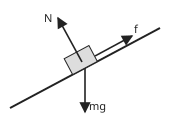

- [ ] බර පහළට, N ආනත තලයට ලම්බව, ඝර්ෂණය තලය දිගේ පහළට / Weight down, N perpendicular to the slope, friction down the slope (`friction-direction`). Real mistake?

  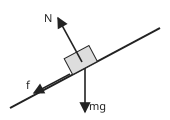

- [ ] බර පහළට, N ආනත තලයට ලම්බව, ඝර්ෂණය නැත / Weight down, N perpendicular to the slope, no friction (`omitted-friction`). Real mistake?

  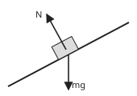

- [ ] බර පහළට, N සිරස්ව ඉහළට, ඝර්ෂණය තලය දිගේ ඉහළට / Weight down, N straight up, friction up the slope (`normal-vertical`). Real mistake?

  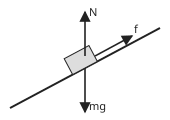

Explanation: ඝර්ෂණය නැතිනම් කුට්ටිය පහළට ලිස්සයි. එබැවින් ඝර්ෂණය තලය දිගේ ඉහළට ක්‍රියා කරයි. N පෘෂ්ඨයට ලම්බ වේ.  
Without friction the block would slide down, so friction acts up the slope. N is perpendicular to the surface.

### phy.mech.t05 · L4 · F40 · 45 variants · skill mastery

Skill: `phy.mech.fric.stopping-distance` (ඝර්ෂණය යටතේ නැවතුම් දුර / Stopping distance under friction). Draft difficulty: 2.

- [ ] OK
- [ ] Fix:

Mistakes in this template:

- [ ] `forgot-half`: `v**2/(mu*g)`. Real mistake?
- [ ] `forgot-mu`: `v**2/(2*g)`. Real mistake?
- [ ] `forgot-square`: `v/(2*mu*g)`. Real mistake?
- [ ] `inverted`: `mu*v**2/(2*g)`. Real mistake?
- [ ] `forgot-g`: `v**2/(2*mu)`. Real mistake?
- [ ] `wrong-law`: `2*v**2/(mu*g)`. Student sees: "½mv² = μmgs අනුව 2 පවතින්නේ හරයේ මිස ලවයේ නොවේ." (½mv² = μmgs puts the 2 below the line, not above it.) Real mistake?

**Example 1:** රළු තිරස් බිමක 2 m s⁻¹ කින් ලිස්සන කුට්ටියක් නතර වේ. μ = 0.5. ගමන් කළ දුර කුමක් ද?  
A block sliding at 2 m s⁻¹ on a rough level floor comes to rest. μ = 0.5. Distance moved?

- 0.1 m (`inverted`)
- 0.2 m (`forgot-mu`)
- **0.4 m**
- 0.8 m (`forgot-half`)
- 1.6 m (`wrong-law`)

**Example 2:** රළු තිරස් බිමක 5 m s⁻¹ කින් ලිස්සන කුට්ටියක් නතර වේ. μ = 0.1. ගමන් කළ දුර කුමක් ද?  
A block sliding at 5 m s⁻¹ on a rough level floor comes to rest. μ = 0.1. Distance moved?

- 1.25 m (`forgot-mu`)
- 2.5 m (`forgot-square`)
- **12.5 m**
- 25 m (`forgot-half`)
- 50 m (`wrong-law`)

**Example 3:** රළු තිරස් බිමක 20 m s⁻¹ කින් ලිස්සන කුට්ටියක් නතර වේ. μ = 0.2. ගමන් කළ දුර කුමක් ද?  
A block sliding at 20 m s⁻¹ on a rough level floor comes to rest. μ = 0.2. Distance moved?

- 20 m (`forgot-mu`)
- **100 m**
- 200 m (`forgot-half`)
- 400 m (`wrong-law`)
- 1000 m (`forgot-g`)

Explanation: ඝර්ෂණයෙන් කරන ලද කාර්යය = චාලක ශක්ති හානිය: μmgs = ½mv² නිසා s = v²/(2μg).  
Work done by friction = loss of KE: μmgs = ½mv², so s = v²/(2μg).

## Source 2019-31

### phy.mech.c036 · L2 · F12

Skill: `phy.mech.energy.bounce-height` (පොළා පැනීමේ උස හා වේගය / Rebound height and speed). Draft difficulty: 2.

- [ ] This skill is right (asked once per skill)
- [ ] OK
- [ ] Fix:

පන්දුවක පොළා පැනීමේ වේගය × ½. පොළා පැනීමේ උස × ?  
A ball's rebound speed × ½. Rebound height × ?

- **¼**
- [ ] ½ (`forgot-square`). Real mistake?
- [ ] 2 (`inverted`). Real mistake?
- [ ] √½ (`wrong-power`). Real mistake?

Explanation: h = v²/(2g) නිසා h ∝ v².  
h = v²/(2g), so h ∝ v².

### phy.mech.c037 · L2 · F14

Skill: `phy.mech.energy.bounce-height` (පොළා පැනීමේ උස හා වේගය / Rebound height and speed). Draft difficulty: 2.

- [ ] OK
- [ ] Fix:

ශිෂ්‍යයෙක් මෙසේ කියයි: "පොළා පැනීමේ දී වේගය 25% කින් අඩු වන නිසා උස ද 25% කින් අඩු වේ." එහි වැරැද්ද කුමක් ද?  
Student says: "Speed falls by 25% at a bounce, so height falls by 25%." What's wrong?

- **උස ∝ v² නිසා උස 56% පමණ දක්වා අඩු වේ / Height ∝ v², so height falls to about 56%**
- [ ] උස ∝ v² නිසා උස 2 × 25% = 50% කින් අඩු වේ / Height ∝ v², so height falls by 2 × 25% = 50% (`forgot-square`). Real mistake?
- [ ] උස ∝ √v නිසා උස 87% පමණ දක්වා අඩු වේ / Height ∝ √v, so height falls to about 87% (`wrong-power`). Real mistake?
- [ ] ශක්තිය හානි නොවන නිසා උස වෙනස් නොවේ / Energy isn't lost, so height doesn't change (`wrong-conservation-law`). Real mistake?

Explanation: 0.75² ≈ 0.56 නිසා උස 44% පමණ කින් අඩු වේ.  
0.75² ≈ 0.56, so the height falls by about 44%.

### phy.mech.t13 · L4 · F41 · 24 variants · skill mastery

Skill: `phy.mech.energy.bounce-height` (පොළා පැනීමේ උස හා වේගය / Rebound height and speed). Draft difficulty: 3.

- [ ] OK
- [ ] Fix:

Mistakes in this template:

- [ ] `forgot-square`: `h0*k**n`. Real mistake?
- [ ] `stopped-early`: `h0*k**2`. Student sees: "එය එක් පොළා පැනීමක් පමණි." (That's only one bounce.) Real mistake?
- [ ] `wrong-power`: `h0*k**(3*n)`. Real mistake?
- [ ] `misread-interval`: `h0*k**(n + 1)`. Student sees: "එක් පොළා පැනීමකට k හි බල දෙකක් ගන්න." (Count two powers of k for each bounce.) Real mistake?

**Example 1:** පන්දුවක් 2 m උසකින් අත හරිනු ලැබේ. එක් එක් පොළා පැනීමේ දී වේගය 50% කින් අඩු වේ. පොළා පැනීම් 4 කට පසු ළඟා වන උස කුමක් ද?  
A ball is dropped from 2 m. Each bounce cuts its speed by 50%. Height reached after 4 bounces?

- 2 × (0.5)⁵ m (`misread-interval`)
- 2 × (0.5)⁴ m (`forgot-square`)
- 2 × (0.5)² m (`stopped-early`)
- 2 × (0.5)¹² m (`wrong-power`)
- **2 × (0.5)⁸ m**

**Example 2:** පන්දුවක් 2 m උසකින් අත හරිනු ලැබේ. එක් එක් පොළා පැනීමේ දී වේගය 20% කින් අඩු වේ. පොළා පැනීම් 3 කට පසු ළඟා වන උස කුමක් ද?  
A ball is dropped from 2 m. Each bounce cuts its speed by 20%. Height reached after 3 bounces?

- **2 × (0.8)⁶ m**
- 2 × (0.8)⁹ m (`wrong-power`)
- 2 × (0.8)³ m (`forgot-square`)
- 2 × (0.8)² m (`stopped-early`)
- 2 × (0.8)⁴ m (`misread-interval`)

**Example 3:** පන්දුවක් 5 m උසකින් අත හරිනු ලැබේ. එක් එක් පොළා පැනීමේ දී වේගය 10% කින් අඩු වේ. පොළා පැනීම් 3 කට පසු ළඟා වන උස කුමක් ද?  
A ball is dropped from 5 m. Each bounce cuts its speed by 10%. Height reached after 3 bounces?

- 5 × (0.9)² m (`stopped-early`)
- 5 × (0.9)⁹ m (`wrong-power`)
- 5 × (0.9)³ m (`forgot-square`)
- 5 × (0.9)⁴ m (`misread-interval`)
- **5 × (0.9)⁶ m**

Explanation: සෑම පොළා පැනීමකම වේගය k වලින් ගුණ වේ. උස ∝ v² නිසා උස k² වලින් ගුණ වේ.  
Each bounce multiplies the speed by k, and height ∝ v², so each bounce multiplies the height by k².

## Source 2020-4

### phy.mech.c007 · L2 · F14

Skill: `phy.mech.kin.average-velocity` (සාමාන්‍ය ප්‍රවේගය / Average velocity). Draft difficulty: 2.

- [ ] This skill is right (asked once per skill)
- [ ] OK
- [ ] Fix:

ධාවකයෙක් 1 s ක් 5 m s⁻¹ කින් ද, පසුව 3 s ක් 1 m s⁻¹ කින් ද දුවයි. ශිෂ්‍යයෙක් මෙසේ කියයි: "සාමාන්‍යය = (5 + 1) ÷ 2 = 3 m s⁻¹." එහි වැරැද්ද කුමක් ද?  
A runner goes 5 m s⁻¹ for 1 s, then 1 m s⁻¹ for 3 s. Student says: "Average = (5 + 1) ÷ 2 = 3 m s⁻¹." What's wrong?

- **කාල අසමාන නිසා මුළු දුර මුළු කාලයෙන් බෙදිය යුතු ය / The times are unequal, so divide total distance by total time**
- [ ] ධාවකයා වේගය අඩු කළ නිසා අවසාන වේගය යොදා ගත යුතු ය / The runner slowed down, so use the final speed instead (`misread-interval`). Student sees: "සාමාන්‍ය ප්‍රවේගය අදාළ වන්නේ අවසානයට පමණක් නොව මුළු චලිතයට ම ය." Real mistake?
- [ ] වේගවත් කොටසට වැඩි බරක් ලැබෙන නිසා සාමාන්‍යය 3 m s⁻¹ ට වැඩි ය / The faster part counts more, so the average is above 3 m s⁻¹ (`mean-of-speeds`). Real mistake?
- [ ] කාලවල ද සාමාන්‍යය ගත යුතු නිසා 3, 2 න් බෙදිය යුතු ය / The times need averaging too, so divide 3 by 2 (`wrong-law`). Student sees: "සාමාන්‍ය ප්‍රවේගය = මුළු විස්ථාපනය ÷ මුළු කාලය." Real mistake?

Explanation: සාමාන්‍ය ප්‍රවේගය = මුළු විස්ථාපනය ÷ මුළු කාලය. මෙහි 8 m ÷ 4 s = 2 m s⁻¹.  
Average velocity = total displacement ÷ total time, here 8 m ÷ 4 s = 2 m s⁻¹.

### phy.mech.t03 · L4 · F44 · 55 variants · skill mastery

Skill: `phy.mech.kin.average-velocity` (සාමාන්‍ය ප්‍රවේගය / Average velocity). Draft difficulty: 2.

- [ ] OK
- [ ] Fix:

Mistakes in this template:

- [ ] `mean-of-speeds`: `(v1 + v2)/2`. Real mistake?
- [ ] `misread-interval`: `(v1*t1 + v2*t2)/t1`. Student sees: "පළමු කොටසින් නොව මුළු කාලයෙන් බෙදන්න." (Divide by the total time, not the first part.) Real mistake?
- [ ] `wrong-law`: `(v1*t1 + v2*t2)/2`. Student sees: "අවධි ගණනින් නොව මුළු කාලයෙන් බෙදන්න." (Divide by the total time, not by the number of stages.) Real mistake?
- [ ] `stopped-early`: `v1*t1 + v2*t2`. Student sees: "එය විස්ථාපනයයි. දැන් මුළු කාලයෙන් බෙදන්න." (That's the displacement. Now divide by the total time.) Real mistake?
- [ ] `wrong-quantity`: `v2`. Student sees: "එය අවසාන ප්‍රවේගය පමණි." (That's only the final velocity.) Real mistake?
- [ ] `ignored-condition`: `v1`. Student sees: "වස්තුව පළමු ප්‍රවේගයේම නොරැඳේ." (The object doesn't stay at its first velocity.) Real mistake?

**Example 1:** ප්‍රස්තාරයෙන් සරල රේඛාවක ගමන් කරන වස්තුවක ප්‍රවේගය දැක්වේ. මුළු චලිතය සඳහා සාමාන්‍ය ප්‍රවේගය කුමක් ද?  
The graph shows the velocity of an object moving in a straight line. Average velocity over the whole motion?

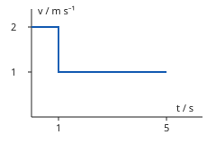

- **1.2 m s⁻¹**
- 1.5 m s⁻¹ (`mean-of-speeds`)
- 2 m s⁻¹ (`ignored-condition`)
- 3 m s⁻¹ (`wrong-law`)
- 6 m s⁻¹ (`misread-interval`)

**Example 2:** ප්‍රස්තාරයෙන් සරල රේඛාවක ගමන් කරන වස්තුවක ප්‍රවේගය දැක්වේ. මුළු චලිතය සඳහා සාමාන්‍ය ප්‍රවේගය කුමක් ද?  
The graph shows the velocity of an object moving in a straight line. Average velocity over the whole motion?

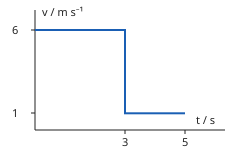

- 1 m s⁻¹ (`wrong-quantity`)
- **4 m s⁻¹**
- 6 m s⁻¹ (`ignored-condition`)
- 10 m s⁻¹ (`wrong-law`)
- 20 m s⁻¹ (`stopped-early`)

**Example 3:** ප්‍රස්තාරයෙන් සරල රේඛාවක ගමන් කරන වස්තුවක ප්‍රවේගය දැක්වේ. මුළු චලිතය සඳහා සාමාන්‍ය ප්‍රවේගය කුමක් ද?  
The graph shows the velocity of an object moving in a straight line. Average velocity over the whole motion?

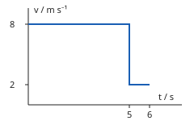

- 2 m s⁻¹ (`wrong-quantity`)
- 5 m s⁻¹ (`mean-of-speeds`)
- **7 m s⁻¹**
- 8 m s⁻¹ (`ignored-condition`)
- 42 m s⁻¹ (`stopped-early`)

Explanation: සාමාන්‍ය ප්‍රවේගය = ප්‍රස්තාරයට යටින් ඇති මුළු වර්ගඵලය ÷ මුළු කාලය.  
Average velocity = total area under the graph ÷ total time.

## Source 2021-15

### phy.mech.c043 · L2 · F11

Skill: `phy.mech.rot.moi-factors` (අවස්ථිති සූර්ණය රඳා පවතින දේ / What moment of inertia depends on). Draft difficulty: 2.

- [ ] This skill is right (asked once per skill)
- [ ] OK
- [ ] Fix:

මුද්දකට සහ තැටියකට සමාන ස්කන්ධ හා අරය ඇත. කේන්ද්‍රීය අක්ෂය වටා විශාල I ඇත්තේ කුමකට ද?  
A ring and a disc have equal mass and radius. Which has the larger I about the central axis?

- **මුද්ද / Ring**
- [ ] තැටිය / Disc (`moi-shape-swap`). Real mistake?
- [ ] සමාන ය / Equal (`moi-mass-only`). Real mistake?
- [ ] වේගය මත රඳා පවතී / Depends on speed (`moi-depends-on-omega`). Real mistake?

Explanation: මුද්දේ මුළු ස්කන්ධයම r දුරින් ඇත: එහි අගය MR² වන අතර තැටියේ අගය ½MR² වේ.  
All of the ring's mass is at distance r: MR², against ½MR² for the disc.

### phy.mech.c044 · L1 · F04

Skill: `phy.mech.rot.moi-factors` (අවස්ථිති සූර්ණය රඳා පවතින දේ / What moment of inertia depends on). Draft difficulty: 1.

- [ ] OK
- [ ] Fix:

අවස්ථිති සූර්ණයේ මාන මොනවා ද?  
Dimensions of moment of inertia?

- **ML²**
- ML (`recall-gap`).
- ML⁻² (`recall-gap`).
- ML²T⁻² (`recall-gap`).

Explanation: I = Σmr².  
I = Σmr².

### phy.mech.b02 · L4 · F42 · 21 variants · skill mastery

Skill: `phy.mech.rot.moi-factors` (අවස්ථිති සූර්ණය රඳා පවතින දේ / What moment of inertia depends on). Draft difficulty: 2.

- [ ] OK
- [ ] Fix:

Statement bank (tick each false statement if students really believe it):

- True: අවස්ථිති සූර්ණය තෝරා ගන්නා අක්ෂය මත රඳා පවතී. / Moment of inertia depends on the axis chosen.
- True: එකම පිහිටීම්වල සියලු ස්කන්ධ දෙගුණ කළ විට අවස්ථිති සූර්ණය දෙගුණ වේ. / Doubling every mass, at the same positions, doubles the moment of inertia.
- True: ස්කන්ධය අක්ෂයෙන් ඈතට ගෙන ගිය විට අවස්ථිති සූර්ණය වැඩි වේ. / Moving mass further from the axis increases the moment of inertia.
- True: කේන්ද්‍රීය අක්ෂය වටා, මුද්දක අවස්ථිති සූර්ණය සමාන ස්කන්ධ හා අරය ඇති තැටියක අගයට වඩා වැඩි ය. / About the central axis, a ring has a larger moment of inertia than a disc of equal mass and radius.
- [ ] False (`moi-depends-on-omega`): වස්තුව වේගයෙන් කැරකෙන විට අවස්ථිති සූර්ණය වැඩි වේ. / Moment of inertia increases when the body spins faster.
- [ ] False (`moi-axis-free`): සෑම අක්ෂයක් වටාම අවස්ථිති සූර්ණයේ අගය සමාන ය. / Moment of inertia has the same value about every axis.
- [ ] False (`moi-mass-only`): සමාන ස්කන්ධ ඇති වස්තු දෙකක අවස්ථිති සූර්ණ සැමවිටම සමාන ය. / Two bodies of equal mass always have equal moments of inertia.
- [ ] False (`wrong-power`): අවස්ථිති සූර්ණයේ SI ඒකකය kg m වේ. / The SI unit of moment of inertia is kg m.

**Example 1:** A: අවස්ථිති සූර්ණය තෝරා ගන්නා අක්ෂය මත රඳා පවතී.  
B: එකම පිහිටීම්වල සියලු ස්කන්ධ දෙගුණ කළ විට අවස්ථිති සූර්ණය දෙගුණ වේ.  
C: ස්කන්ධය අක්ෂයෙන් ඈතට ගෙන ගිය විට අවස්ථිති සූර්ණය වැඩි වේ.  
සත්‍ය වන්නේ කුමක් ද?  
A: Moment of inertia depends on the axis chosen. / B: Doubling every mass, at the same positions, doubles the moment of inertia. / C: Moving mass further from the axis increases the moment of inertia. / Which are true?

- A පමණි / A only (`missed-true-statement`)
- A සහ B පමණි / A and B only (`missed-true-statement`)
- A සහ C පමණි / A and C only (`missed-true-statement`)
- B සහ C පමණි / B and C only (`missed-true-statement`)
- **A, B සහ C සියල්ල / A, B and C**

**Example 2:** A: එකම පිහිටීම්වල සියලු ස්කන්ධ දෙගුණ කළ විට අවස්ථිති සූර්ණය දෙගුණ වේ.  
B: අවස්ථිති සූර්ණය තෝරා ගන්නා අක්ෂය මත රඳා පවතී.  
C: වස්තුව වේගයෙන් කැරකෙන විට අවස්ථිති සූර්ණය වැඩි වේ.  
සත්‍ය වන්නේ කුමක් ද?  
A: Doubling every mass, at the same positions, doubles the moment of inertia. / B: Moment of inertia depends on the axis chosen. / C: Moment of inertia increases when the body spins faster. / Which are true?

- A පමණි / A only (`missed-true-statement`)
- **A සහ B පමණි / A and B only**
- A සහ C පමණි / A and C only (`moi-depends-on-omega`)
- B සහ C පමණි / B and C only (`moi-depends-on-omega`)
- A, B සහ C සියල්ල / A, B and C (`moi-depends-on-omega`)

**Example 3:** A: අවස්ථිති සූර්ණය තෝරා ගන්නා අක්ෂය මත රඳා පවතී.  
B: වස්තුව වේගයෙන් කැරකෙන විට අවස්ථිති සූර්ණය වැඩි වේ.  
C: ස්කන්ධය අක්ෂයෙන් ඈතට ගෙන ගිය විට අවස්ථිති සූර්ණය වැඩි වේ.  
සත්‍ය වන්නේ කුමක් ද?  
A: Moment of inertia depends on the axis chosen. / B: Moment of inertia increases when the body spins faster. / C: Moving mass further from the axis increases the moment of inertia. / Which are true?

- A පමණි / A only (`missed-true-statement`)
- A සහ B පමණි / A and B only (`moi-depends-on-omega`)
- **A සහ C පමණි / A and C only**
- B සහ C පමණි / B and C only (`moi-depends-on-omega`)
- A, B සහ C සියල්ල / A, B and C (`moi-depends-on-omega`)

Explanation: I = Σmr² රඳා පවතින්නේ ස්කන්ධ හා අක්ෂයේ සිට ඒවායේ දුර මත මිස වස්තුව කැරකෙන වේගය මත නොවේ.  
I = Σmr² depends on the masses and their distances from the axis, not on how fast the body spins.

## Source 2021-48

### phy.mech.c003 · L2 · F14

Skill: `phy.mech.kin.vertical-throw` (සිරස් විසි කිරීමේ සමමිතිය / Vertical throw symmetry). Draft difficulty: 2.

- [ ] This skill is right (asked once per skill)
- [ ] OK
- [ ] Fix:

පන්දුවක් ඉහළ යන විට ජනේලයක් පසු කර, 6 s කට පසු පහළ එන විට නැවත එය පසු කරයි. ශිෂ්‍යයෙක් මෙසේ කියයි: "ජනේලයේ සිට ඉහළම ලක්ෂ්‍යයට යාමට 6 s ගත වේ." එහි වැරැද්ද කුමක් ද?  
A ball passes a window going up, then again coming down, 6 s later. Student says: "It takes 6 s to go from the window to the top." What's wrong?

- **6 s යනු ඉහළ යාමට හා පහළ ඒමට ගත වන කාලය නිසා ජනේලයේ සිට ඉහළටම 3 s වේ / The 6 s covers up and down, so window to top is 3 s**
- [ ] ඉහළ යන විට පන්දුව සෙමින් ගමන් කරන නිසා ජනේලයේ සිට ඉහළටම 3 s ට වැඩි ය / The ball is slower going up, so window to top is over 3 s (`up-down-time`). Real mistake?
- [ ] ඉහළටම ළඟා වීමට ගත වන කාලය තීරණය වන්නේ පන්දුවේ ස්කන්ධයෙනි / The ball's mass decides how long it takes to reach the top (`mass-matters`). Real mistake?
- [ ] වැරැද්දක් නැත: 6 s යනු ඉහළ යාමට පමණක් ගත වන කාලයයි / Nothing is wrong: the 6 s only counts the way up (`misread-interval`). Student sees: "මෙම කාල පරතරයට ඉහළ යාම හා පහළ ඒම යන දෙකම අයත් ය." Real mistake?

Explanation: වායු ප්‍රතිරෝධය නැති විට පථය සමමිතික ය. කාල පරතරයෙන් අඩක් ඉහළටම යාමට ගත වේ.  
With no air resistance, the path is symmetric. Half the gap is spent going up to the top.

### phy.mech.t02 · L2 · F40 · 6 variants · FSRS card pool

Skill: `phy.mech.kin.vertical-throw` (සිරස් විසි කිරීමේ සමමිතිය / Vertical throw symmetry). Draft difficulty: 4.

- [ ] OK
- [ ] Fix:

Mistakes in this template:

- [ ] `stopped-early`: `v_h`. Student sees: "එය විසි කළ වේගය නොව එම උසේ දී වේගයයි." (That's the speed at that height, not at launch.) Real mistake?
- [ ] `misread-interval`: `g*dt`. Student sees: "එම උසේ සිට ඉහළ යාමට ගත වන්නේ කාල පරතරයෙන් අඩක් පමණි." (Only half the gap is spent rising from that height.) Real mistake?
- [ ] `ignored-condition`: `sqrt(2*g*h)`. Student sees: "එයින් උපකල්පනය වන්නේ පන්දුව එම උසේ දී නතර වන බවයි. නමුත් එය තවමත් ගමන් කරයි." (That assumes the ball stops at that height, but it's still moving there.) Real mistake?
- [ ] `forgot-square`: `v_h + sqrt(2*g*h)`. Real mistake?
- [ ] `sign`: `sqrt(abs(2*g*h - v_h**2))`. Real mistake?
- [ ] `wrong-law`: `h/dt`. Student sees: "උස ÷ කාල පරතරය මෙහි කිසිදු ලක්ෂ්‍යයක වේගය නොවේ." (Height ÷ gap isn't the speed at any point here.) Real mistake?

**Example 1:** පොළොවේ සිට සිරස්ව ඉහළට විසි කළ පන්දුවක් 20 m උසකින් ඇති ලක්ෂ්‍යයක් 3 s ක පරතරයකින් දෙවරක් පසු කරයි. විසි කළ වේගය කුමක් ද?  
A ball thrown straight up from the ground passes a point 20 m high twice, 3 s apart. Launch speed?

- 15 m s⁻¹ (`stopped-early`)
- 20 m s⁻¹ (`ignored-condition`)
- **25 m s⁻¹**
- 30 m s⁻¹ (`misread-interval`)
- 35 m s⁻¹ (`forgot-square`)

**Example 2:** පොළොවේ සිට සිරස්ව ඉහළට විසි කළ පන්දුවක් 80 m උසකින් ඇති ලක්ෂ්‍යයක් 6 s ක පරතරයකින් දෙවරක් පසු කරයි. විසි කළ වේගය කුමක් ද?  
A ball thrown straight up from the ground passes a point 80 m high twice, 6 s apart. Launch speed?

- 30 m s⁻¹ (`stopped-early`)
- 40 m s⁻¹ (`ignored-condition`)
- **50 m s⁻¹**
- 60 m s⁻¹ (`misread-interval`)
- 70 m s⁻¹ (`forgot-square`)

**Example 3:** පොළොවේ සිට සිරස්ව ඉහළට විසි කළ පන්දුවක් 180 m උසකින් ඇති ලක්ෂ්‍යයක් 5 s ක පරතරයකින් දෙවරක් පසු කරයි. විසි කළ වේගය කුමක් ද?  
A ball thrown straight up from the ground passes a point 180 m high twice, 5 s apart. Launch speed?

- 25 m s⁻¹ (`stopped-early`)
- 36 m s⁻¹ (`wrong-law`)
- 50 m s⁻¹ (`misread-interval`)
- **65 m s⁻¹**
- 85 m s⁻¹ (`forgot-square`)

Explanation: කාල පරතරයෙන් අඩකින් එම උසේ දී වේගය ලැබේ: v = gt. ඉන්පසු u² = v² + 2gh.  
Half the gap gives the speed at that height, v = gt. Then u² = v² + 2gh.

## Source 2021-6

### phy.mech.c021 · L2 · F13

Skill: `phy.mech.mom.momentum-vs-energy` (ගම්‍යතා හෝ ශක්ති සංස්ථිතිය / Momentum or energy conservation). Draft difficulty: 2.

- [ ] This skill is right (asked once per skill)
- [ ] OK
- [ ] Fix:

සමාන ස්කන්ධ ඇති කුට්ටි දෙකක් 6 m s⁻¹ හා 2 m s⁻¹ වේගවලින් එකිනෙක දෙසට ගමන් කර ඇලී යයි. ඉන්පසු ඒවායේ වේගය කුමක් ද?  
Equal-mass blocks move towards each other at 6 m s⁻¹ and 2 m s⁻¹, then stick. Their speed after?

- **2 m s⁻¹**
- [ ] 4 m s⁻¹ (`sign`). Real mistake?
- [ ] 8 m s⁻¹ (`forgot-mass`). Real mistake?
- [ ] 0 (`assumed-symmetry`). Real mistake?

Explanation: දිශා ප්‍රතිවිරුද්ධ ය: (6 − 2) ÷ 2 = 2 m s⁻¹, වේගවත් කුට්ටියේ දිශාවට.  
Opposite directions: (6 − 2) ÷ 2 = 2 m s⁻¹, in the direction of the faster block.

### phy.mech.p01 · L3 · F30 · scenario pool

Skill: `phy.mech.mom.momentum-vs-energy` (ගම්‍යතා හෝ ශක්ති සංස්ථිතිය / Momentum or energy conservation). Draft difficulty: 2.

- [ ] OK
- [ ] Fix:

All scenarios are below.

**phy.mech.p01-01**

දුම්රිය මැදිරි දෙකක් ගැටී එකට සම්බන්ධ වේ. පොදු වේගය සෙවීමට වඩාත් සෘජු මූලධර්මය කුමක් ද?  
Two rail wagons collide and couple together. Most direct principle for their common speed?

- **ගම්‍යතා සංස්ථිතිය / Conservation of momentum**
- [ ] ශක්ති සංස්ථිතිය / Conservation of energy (`ke-conserved-inelastic`). Real mistake?
- [ ] නියත බලයක් සමඟ F = ma / F = ma with a constant force (`unknown-not-eliminated`). Real mistake?
- [ ] නියත ත්වරණයේ සමීකරණ / Equations of uniform acceleration (`suvat-nonuniform`). Real mistake?

Explanation: බාහිර තිරස් බලයක් ක්‍රියා නොකරයි. සම්බන්ධ වීමේ දී චාලක ශක්තිය හානි වන නිසා ශක්තියෙන් මෙය නොලැබේ.  
No external horizontal force acts. Coupling loses KE, so energy won't give it.

**phy.mech.p01-02**

වෙඩි උණ්ඩයක් සිනිඳු මේසයක් මත ඇති කුට්ටියක කාවැදේ. ඉන් මොහොතකට පසු වේගය සෙවීමට වඩාත් සෘජු මූලධර්මය කුමක් ද?  
A bullet embeds in a block on a smooth table. Most direct principle for the speed just after?

- **ගම්‍යතා සංස්ථිතිය / Conservation of momentum**
- ශක්ති සංස්ථිතිය / Conservation of energy (`ke-conserved-inelastic`).
- නියත බලයක් සමඟ F = ma / F = ma with a constant force (`unknown-not-eliminated`).
- නියත ත්වරණයේ සමීකරණ / Equations of uniform acceleration (`suvat-nonuniform`).

Explanation: ගැටුම් බලය අභ්‍යන්තර වන අතර නොදනී. චාලක ශක්තිය තාපය බවට පත් වේ.  
The impact force is internal and unknown. KE turns into heat.

**phy.mech.p01-03**

තුවක්කුවක් උණ්ඩයක් විදින විට පසුපසට පැන යයි. පසුපසට පැනීමේ වේගය සෙවීමට වඩාත් සෘජු මූලධර්මය කුමක් ද?  
A gun recoils when it fires a shell. Most direct principle for the recoil speed?

- **ගම්‍යතා සංස්ථිතිය / Conservation of momentum**
- ශක්ති සංස්ථිතිය / Conservation of energy (`ke-conserved-inelastic`).
- නියත බලයක් සමඟ F = ma / F = ma with a constant force (`unknown-not-eliminated`).
- නියත ත්වරණයේ සමීකරණ / Equations of uniform acceleration (`suvat-nonuniform`).

Explanation: මුළු ගම්‍යතාව ශුන්‍යව පවතී. රසායනික ශක්තිය නිසා මෙහි චාලක ශක්තිය යොදා ගත නොහැක.  
Total momentum stays zero. Chemical energy makes KE unusable here.

**phy.mech.p01-04**

පන්දුවක් ඝර්ෂණයෙන් තොරව වක්‍ර ධාවන පථයක පහළට යයි. පහළදී එහි වේගය සෙවීමට වඩාත් සෘජු මූලධර්මය කුමක් ද?  
A ball rolls without friction down a curved track. Most direct principle for its speed at the bottom?

- **ශක්ති සංස්ථිතිය / Conservation of energy**
- [ ] ගම්‍යතා සංස්ථිතිය / Conservation of momentum (`momentum-external-force`). Real mistake?
- නියත බලයක් සමඟ F = ma / F = ma with a constant force (`unknown-not-eliminated`).
- නියත ත්වරණයේ සමීකරණ / Equations of uniform acceleration (`suvat-nonuniform`).

Explanation: වක්‍රයක් දිගේ ත්වරණය වෙනස් වේ. හානි වන විභව ශක්තිය චාලක ශක්තිය බවට පත් වේ.  
The acceleration changes along a curve. PE lost becomes KE.

**phy.mech.p01-05**

සරල අවලම්බයක ගෝලය නිශ්චලතාවෙන් පහළට පැද්දේ. පහළම ලක්ෂ්‍යයේ වේගය සෙවීමට වඩාත් සෘජු මූලධර්මය කුමක් ද?  
A pendulum bob swings down from rest. Most direct principle for its speed at the lowest point?

- **ශක්ති සංස්ථිතිය / Conservation of energy**
- ගම්‍යතා සංස්ථිතිය / Conservation of momentum (`momentum-external-force`).
- නියත බලයක් සමඟ F = ma / F = ma with a constant force (`unknown-not-eliminated`).
- නියත ත්වරණයේ සමීකරණ / Equations of uniform acceleration (`suvat-nonuniform`).

Explanation: ආතතිය කාර්යයක් නොකරන නිසා හානි වන විභව ශක්තිය චාලක ශක්තිය බවට පත් වේ. ත්වරණය ඒකාකාර නොවේ.  
Tension does no work, so PE lost becomes KE. The acceleration isn't uniform.

**phy.mech.p01-06**

සම්පීඩිත දුන්නක් සිනිඳු මේසයක් හරහා කුට්ටියක් විදියි. විදින වේගය සෙවීමට වඩාත් සෘජු මූලධර්මය කුමක් ද?  
A compressed spring launches a block across a smooth table. Most direct principle for the launch speed?

- **ශක්ති සංස්ථිතිය / Conservation of energy**
- ගම්‍යතා සංස්ථිතිය / Conservation of momentum (`momentum-external-force`).
- නියත බලයක් සමඟ F = ma / F = ma with a constant force (`unknown-not-eliminated`).
- නියත ත්වරණයේ සමීකරණ / Equations of uniform acceleration (`suvat-nonuniform`).

Explanation: දුනු බලය වෙනස් වේ. ගබඩා වූ ශක්තිය චාලක ශක්තිය බවට පත් වේ.  
The spring force varies. Stored energy becomes KE.

### phy.mech.t07 · L4 · F40 · 57 variants · skill mastery

Skill: `phy.mech.mom.momentum-vs-energy` (ගම්‍යතා හෝ ශක්ති සංස්ථිතිය / Momentum or energy conservation). Draft difficulty: 2.

- [ ] OK
- [ ] Fix:

Mistakes in this template:

- [ ] `mean-of-speeds`: `(u1 + u2)/2`. Real mistake?
- [ ] `sign`: `(m1*u1 - m2*u2)/(m1 + m2)`. Real mistake?
- [ ] `forgot-mass`: `(m1*u1 + m2*u2)/m1`. Real mistake?
- [ ] `ke-conserved-inelastic`: `sqrt((m1*u1**2 + m2*u2**2)/(m1 + m2))`. Real mistake?
- [ ] `stopped-early`: `m1*u1 + m2*u2`. Student sees: "එය මුළු ගම්‍යතාවයි. දැන් මුළු ස්කන්ධයෙන් බෙදන්න." (That's the total momentum. Now divide by the total mass.) Real mistake?
- [ ] `forgot-mass`: `(m1*u1 + m2*u2)/m2`. Real mistake?

**Example 1:** 4 m s⁻¹ කින් යන 2 kg කරත්තයක්, එම දිශාවටම 1 m s⁻¹ කින් යන 3 kg කරත්තයක් අල්ලා ගනී. ඒවා එකට සම්බන්ධ වේ. පොදු වේගය කුමක් ද?  
A 2 kg cart at 4 m s⁻¹ catches a 3 kg cart moving the same way at 1 m s⁻¹. They couple. Common speed?

- 1 m s⁻¹ (`sign`)
- **2.2 m s⁻¹**
- 2.5 m s⁻¹ (`mean-of-speeds`)
- 5.5 m s⁻¹ (`forgot-mass`)
- 11 m s⁻¹ (`stopped-early`)

**Example 2:** 6 m s⁻¹ කින් යන 3 kg කරත්තයක්, එම දිශාවටම 3 m s⁻¹ කින් යන 2 kg කරත්තයක් අල්ලා ගනී. ඒවා එකට සම්බන්ධ වේ. පොදු වේගය කුමක් ද?  
A 3 kg cart at 6 m s⁻¹ catches a 2 kg cart moving the same way at 3 m s⁻¹. They couple. Common speed?

- 2.4 m s⁻¹ (`sign`)
- 4.5 m s⁻¹ (`mean-of-speeds`)
- **4.8 m s⁻¹**
- 12 m s⁻¹ (`forgot-mass`)
- 24 m s⁻¹ (`stopped-early`)

**Example 3:** 10 m s⁻¹ කින් යන 4 kg කරත්තයක්, එම දිශාවටම 2 m s⁻¹ කින් යන 1 kg කරත්තයක් අල්ලා ගනී. ඒවා එකට සම්බන්ධ වේ. පොදු වේගය කුමක් ද?  
A 4 kg cart at 10 m s⁻¹ catches a 1 kg cart moving the same way at 2 m s⁻¹. They couple. Common speed?

- 6 m s⁻¹ (`mean-of-speeds`)
- 7.6 m s⁻¹ (`sign`)
- **8.4 m s⁻¹**
- 10.5 m s⁻¹ (`forgot-mass`)
- 42 m s⁻¹ (`stopped-early`)

Explanation: ගම්‍යතාව සංස්ථිතික වේ: m₁u₁ + m₂u₂ = (m₁ + m₂)v.  
Momentum is conserved: m₁u₁ + m₂u₂ = (m₁ + m₂)v.

## Source 2022-18

### phy.mech.c023 · L1 · F03

Skill: `phy.mech.imp.graph-area` (බල–කාල ප්‍රස්තාරයකින් ආවේගය / Impulse from a force–time graph). Draft difficulty: 1.

- [ ] This skill is right (asked once per skill)
- [ ] OK
- [ ] Fix:

බල–කාල ප්‍රස්තාරයකට යටින් ඇති වර්ගඵලයෙන් ලැබෙන්නේ කුමක් ද?  
The area under a force–time graph gives?

- **ආවේගය / Impulse**
- කරන ලද කාර්යය / Work done (`recall-gap`).
- ජවය / Power (`recall-gap`).
- ත්වරණය / Acceleration (`recall-gap`).

Explanation: ආවේගය = ∫F dt = ගම්‍යතාවේ වෙනස. කාර්යය යනු බල–දුර ප්‍රස්තාරයට යටින් ඇති වර්ගඵලයයි.  
Impulse = ∫F dt = change in momentum. Work is the area under force–distance.

### phy.mech.c024 · L1 · F04

Skill: `phy.mech.imp.graph-area` (බල–කාල ප්‍රස්තාරයකින් ආවේගය / Impulse from a force–time graph). Draft difficulty: 1.

- [ ] OK
- [ ] Fix:

ආවේගයේ මාන මොනවා ද?  
Dimensions of impulse?

- **MLT⁻¹**
- MLT⁻² (`recall-gap`).
- ML²T⁻² (`recall-gap`).
- MT⁻¹ (`recall-gap`).

Explanation: ආවේගය = බලය × කාලය = MLT⁻² × T.  
Impulse = force × time = MLT⁻² × T.

### phy.mech.c025 · L2 · F13

Skill: `phy.mech.imp.graph-area` (බල–කාල ප්‍රස්තාරයකින් ආවේගය / Impulse from a force–time graph). Draft difficulty: 2.

- [ ] OK
- [ ] Fix:

F–t ප්‍රස්තාරයකට යටින් ඇති වර්ගඵලය 30 N s කි. එය නිශ්චලව ඇති 3 kg වස්තුවක් මත ක්‍රියා කරයි. අවසාන වේගය කුමක් ද?  
The area under an F–t graph is 30 N s. It acts on a 3 kg body at rest. Final speed?

- **10 m s⁻¹**
- [ ] 30 m s⁻¹ (`forgot-mass`). Real mistake?
- [ ] 90 m s⁻¹ (`inverted`). Real mistake?
- [ ] 5 m s⁻¹ (`forgot-half`). Real mistake?

Explanation: ආවේගය = ගම්‍යතාවේ වෙනස. එබැවින් v = 30 ÷ 3.  
Impulse = change in momentum, so v = 30 ÷ 3.

### phy.mech.t08 · L4 · F44 · 122 variants · skill mastery

Skill: `phy.mech.imp.graph-area` (බල–කාල ප්‍රස්තාරයකින් ආවේගය / Impulse from a force–time graph). Draft difficulty: 2.

- [ ] OK
- [ ] Fix:

Mistakes in this template:

- [ ] `area-shape`: `F*(t1 + t2)/m`. Real mistake?
- [ ] `misread-interval`: `F*t2/m`. Student sees: "ඉහළ යන කොටසෙන් ද වර්ගඵලය එකතු වේ." (The rising part adds area too.) Real mistake?
- [ ] `forgot-mass`: `F*(t1/2 + t2)`. Real mistake?
- [ ] `inverted`: `F*(t1/2 + t2)*m`. Real mistake?
- [ ] `stopped-early`: `F*t1/(2*m)`. Student sees: "එය ඉහළ යන කොටස පමණි. තිරස් කොටස ද එකතු කරන්න." (That's only the rising part. Add the flat part.) Real mistake?
- [ ] `wrong-quantity`: `F/m`. Student sees: "එය අවසාන වේගය නොව උපරිම බලයේ දී ත්වරණයයි." (That's the acceleration at full force, not the final speed.) Real mistake?

**Example 1:** ප්‍රස්තාරයෙන් සිනිඳු පෘෂ්ඨයක මුලින් නිශ්චලව ඇති 5 kg වස්තුවක් මත බලය දැක්වේ. අවසාන වේගය කුමක් ද?  
The graph shows the force on a 5 kg body, at rest at first on a smooth surface. Final speed?

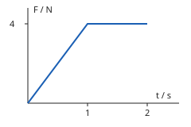

- 0.4 m s⁻¹ (`stopped-early`)
- 0.8 m s⁻¹ (`misread-interval`)
- **1.2 m s⁻¹**
- 1.6 m s⁻¹ (`area-shape`)
- 6 m s⁻¹ (`forgot-mass`)

**Example 2:** ප්‍රස්තාරයෙන් සිනිඳු පෘෂ්ඨයක මුලින් නිශ්චලව ඇති 5 kg වස්තුවක් මත බලය දැක්වේ. අවසාන වේගය කුමක් ද?  
The graph shows the force on a 5 kg body, at rest at first on a smooth surface. Final speed?

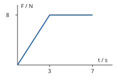

- 1.6 m s⁻¹ (`wrong-quantity`)
- 2.4 m s⁻¹ (`stopped-early`)
- 6.4 m s⁻¹ (`misread-interval`)
- **8.8 m s⁻¹**
- 11.2 m s⁻¹ (`area-shape`)

**Example 3:** ප්‍රස්තාරයෙන් සිනිඳු පෘෂ්ඨයක මුලින් නිශ්චලව ඇති 2 kg වස්තුවක් මත බලය දැක්වේ. අවසාන වේගය කුමක් ද?  
The graph shows the force on a 2 kg body, at rest at first on a smooth surface. Final speed?

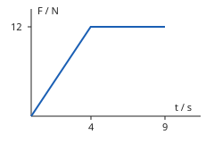

- 6 m s⁻¹ (`wrong-quantity`)
- 12 m s⁻¹ (`stopped-early`)
- 30 m s⁻¹ (`misread-interval`)
- **42 m s⁻¹**
- 168 m s⁻¹ (`inverted`)

Explanation: ආවේගය = ප්‍රස්තාරයට යටින් ඇති වර්ගඵලය = ගම්‍යතාවේ වෙනස.  
Impulse = area under the graph = change in momentum.

## Source 2022-2

### phy.mech.c001 · L1 · F01

Skill: `phy.mech.vec.resultant-range` (සම්ප්‍රයුක්ත බලයේ පරාසය / Range of a resultant force). Draft difficulty: 1.

- [ ] This skill is right (asked once per skill)
- [ ] OK
- [ ] Fix:

A > B වන සේ A සහ B බල එක් ලක්ෂ්‍යයක ක්‍රියා කරයි. සම්ප්‍රයුක්තයේ කුඩාම අගය කුමක් ද?  
Forces A and B act at one point, with A > B. Smallest possible resultant?

- **A − B**
- 0 (`recall-gap`).
- A + B (`recall-gap`).
- √(A² − B²) (`recall-gap`).

Explanation: බල ප්‍රතිවිරුද්ධ දිශාවලට ක්‍රියා කරන විට සම්ප්‍රයුක්තය කුඩාම වන අතර එය A − B වේ.  
Forces in opposite directions give the smallest resultant, A − B.

### phy.mech.c002 · L2 · F10

Skill: `phy.mech.vec.resultant-range` (සම්ප්‍රයුක්ත බලයේ පරාසය / Range of a resultant force). Draft difficulty: 2.

- [ ] OK
- [ ] Fix:

එකිනෙකට ලම්බක බල දෙකක සම්ප්‍රයුක්තය සැමවිටම විශාල බලයට වඩා වැඩි ය.  
Two forces at right angles always have a resultant larger than the bigger force.

- **සත්‍ය / True**
- [ ] අසත්‍ය / False (`no-resolve`). Real mistake?

Explanation: R = √(A² + B²) වන අතර එය සැමවිටම A ට හෝ B ට වඩා විශාල ය.  
R = √(A² + B²), which is always larger than A or B alone.

### phy.mech.t01 · L4 · F40 · 295 variants · skill mastery

Skill: `phy.mech.vec.resultant-range` (සම්ප්‍රයුක්ත බලයේ පරාසය / Range of a resultant force). Draft difficulty: 2.

- [ ] OK
- [ ] Fix:

Mistakes in this template:

- [ ] `boundary`: `hi + 2`. Real mistake?
- [ ] `boundary`: `hi + 4`. Real mistake?
- [ ] `boundary`: `hi + 7`. Real mistake?
- [ ] `boundary`: `lo - 2`. Real mistake?
- [ ] `boundary`: `lo - 4`. Real mistake?
- [ ] `boundary`: `lo - 7`. Real mistake?

**Example 1:** 6 N සහ 3 N බල එක් ලක්ෂ්‍යයක ක්‍රියා කරයි. ඒවායේ සම්ප්‍රයුක්තයේ විශාලත්වය විය හැක්කේ කුමක් ද?  
Forces of 6 N and 3 N act at one point. Which can be the size of their resultant?

- 1 N (`boundary`)
- **3 N**
- 11 N (`boundary`)
- 13 N (`boundary`)
- 16 N (`boundary`)

**Example 2:** 15 N සහ 9 N බල එක් ලක්ෂ්‍යයක ක්‍රියා කරයි. ඒවායේ සම්ප්‍රයුක්තයේ විශාලත්වය විය හැක්කේ කුමක් ද?  
Forces of 15 N and 9 N act at one point. Which can be the size of their resultant?

- 4 N (`boundary`)
- **22 N**
- 26 N (`boundary`)
- 28 N (`boundary`)
- 31 N (`boundary`)

**Example 3:** 30 N සහ 18 N බල එක් ලක්ෂ්‍යයක ක්‍රියා කරයි. ඒවායේ සම්ප්‍රයුක්තයේ විශාලත්වය විය හැක්කේ කුමක් ද?  
Forces of 30 N and 18 N act at one point. Which can be the size of their resultant?

- 5 N (`boundary`)
- 8 N (`boundary`)
- **46 N**
- 52 N (`boundary`)
- 55 N (`boundary`)

Explanation: සම්ප්‍රයුක්තය බල දෙකේ අන්තරය හා ඓක්‍යය අතර පිහිටයි.  
The resultant lies between the difference and the sum of the two forces.

## Source 2023-16

### phy.mech.c022 · L2 · F10

Skill: `phy.mech.mom.momentum-vs-energy` (ගම්‍යතා හෝ ශක්ති සංස්ථිතිය / Momentum or energy conservation). Draft difficulty: 2.

- [ ] OK
- [ ] Fix:

පූර්ණ අප්‍රත්‍යාස්ථ ගැටීමක දී චාලක ශක්තිය සංස්ථිතික වේ.  
KE is conserved in a perfectly inelastic collision.

- **අසත්‍ය / False**
- [ ] සත්‍ය / True (`ke-conserved-inelastic`). Real mistake?

Explanation: ගම්‍යතාව සංස්ථිතික වේ. නමුත් චාලක ශක්තියෙන් කොටසක් තාපය හා ශබ්දය බවට පත් වේ.  
Momentum is conserved, but some KE becomes heat and sound.

### phy.mech.p02 · L3 · F32 · scenario pool

Skill: `phy.mech.mom.momentum-vs-energy` (ගම්‍යතා හෝ ශක්ති සංස්ථිතිය / Momentum or energy conservation). Draft difficulty: 2.

- [ ] OK
- [ ] Fix:

All scenarios are below.

**phy.mech.p02-01**

"ගැටීමෙන් පසු මැදිරි එකට සම්බන්ධ වේ." සහ "ලිස්සන්නෙක් පන්දුවක් විසි කර පසුපසට යයි." ක්‍රමය එකම ද?  
"Wagons couple after a collision." and "A skater throws a ball and recoils." Same method?

- **එකම ක්‍රමය / Same method**
- [ ] වෙනස් ක්‍රම / Different methods (`wrong-conservation-law`). Real mistake?

Explanation: බාහිර බලයක් ක්‍රියා නොකරන නිසා දෙකටම ගම්‍යතා සංස්ථිතිය යොදයි.  
Both use conservation of momentum, as no external force acts.

**phy.mech.p02-02**

"වෙඩි උණ්ඩයක් කුට්ටියක කාවැදේ." සහ "වෙඩි තබන විට තුවක්කුව පසුපසට පැන යයි." ක්‍රමය එකම ද?  
"A bullet embeds in a block." and "A gun recoils on firing." Same method?

- **එකම ක්‍රමය / Same method**
- වෙනස් ක්‍රම / Different methods (`wrong-conservation-law`).

Explanation: දෙකටම ගම්‍යතාව යොදයි. දෙකේම චාලක ශක්තිය වෙනස් වේ.  
Both use momentum. KE changes in both.

**phy.mech.p02-03**

"පන්දුවක් සිනිඳු වක්‍ර ධාවන පථයක පහළට යයි." සහ "සරල අවලම්බයක ගෝලය පහළම ලක්ෂ්‍යයට පැද්දේ." ක්‍රමය එකම ද?  
"A ball rolls down a smooth curved track." and "A pendulum bob swings to its lowest point." Same method?

- **එකම ක්‍රමය / Same method**
- වෙනස් ක්‍රම / Different methods (`wrong-conservation-law`).

Explanation: දෙකටම ශක්ති සංස්ථිතිය යොදයි.  
Both use energy conservation.

**phy.mech.p02-04**

"ගැටීමෙන් පසු මැදිරි එකට සම්බන්ධ වේ." සහ "කුට්ටියක් සිනිඳු වක්‍ර ආනතියක පහළට ලිස්සයි; පහළදී වේගය සොයන්න." ක්‍රමය එකම ද?  
"Wagons couple after a collision." and "A block slides down a smooth curved slope; find its speed at the bottom." Same method?

- **වෙනස් ක්‍රම / Different methods**
- [ ] එකම ක්‍රමය / Same method (`wrong-conservation-law`). Real mistake?

Explanation: මැදිරිවලට ගම්‍යතාව යොදයි. ආනතියේ දී ශක්තිය යොදයි.  
Wagons use momentum. On the slope, use energy.

**phy.mech.p02-05**

"වෙඩි උණ්ඩයක් කුට්ටියක කාවැදේ." සහ "දුන්නක් කුට්ටියක් විදියි." ක්‍රමය එකම ද?  
"A bullet embeds in a block." and "A spring launches a block." Same method?

- **වෙනස් ක්‍රම / Different methods**
- එකම ක්‍රමය / Same method (`wrong-conservation-law`).

Explanation: උණ්ඩයට ගම්‍යතාව යොදයි. දුන්නට ශක්තිය යොදයි.  
The bullet uses momentum. The spring uses energy.

**phy.mech.p02-06**

"සරල අවලම්බයක ගෝලය පහළම ලක්ෂ්‍යයට පැද්දේ." සහ "උණ්ඩයක් ඉහළම ලක්ෂ්‍යයේ දී දෙකට කැඩේ." ක්‍රමය එකම ද?  
"A pendulum bob swings to its lowest point." and "A shell splits into two at its highest point." Same method?

- **වෙනස් ක්‍රම / Different methods**
- එකම ක්‍රමය / Same method (`wrong-conservation-law`).

Explanation: අවලම්බයට ශක්තිය යොදයි. කැඩුණු උණ්ඩයට ගම්‍යතාව යොදයි.  
The pendulum uses energy. The split shell uses momentum.

## Source 2023-17

### phy.mech.c026 · L2 · F14

Skill: `phy.mech.proj.components` (ප්‍රක්ෂිප්තයක ප්‍රවේග සංරචක / Projectile velocity components). Draft difficulty: 2.

- [ ] This skill is right (asked once per skill)
- [ ] OK
- [ ] Fix:

ශිෂ්‍යයෙක් මෙසේ කියයි: "පථයේ ඉහළම ලක්ෂ්‍යයේ දී පන්දුවේ v = 0 නිසා එහි චාලක ශක්තිය = 0." එහි වැරැද්ද කුමක් ද?  
Student says: "At the top of its path the ball has v = 0, so its KE = 0." What's wrong?

- **තිරස් ප්‍රවේගය ඉතිරි වන නිසා චාලක ශක්තිය ශුන්‍ය නොවේ / Horizontal velocity remains, so KE isn't zero**
- [ ] ඕනෑම කෝණයක දී ඉහළම ලක්ෂ්‍යයේ චාලක ශක්තිය සැමවිටම K ගෙන් අඩකි / KE at the top is always half of K, at any angle (`ke-half-at-top`). Real mistake?
- [ ] චාලක ශක්තිය ශුන්‍ය වන්නේ විභව ශක්තිය ද ශුන්‍ය වන විට පමණි / KE is zero only when PE is zero as well (`ke-pe-confusion`). Real mistake?
- [ ] v = 0 නිවැරදි ය, නමුත් චාලක ශක්තිය උස මත ද රඳා පවතී / v = 0 is right, but KE also depends on height (`v-zero-at-top`). Real mistake?

Explanation: ඉහළම ලක්ෂ්‍යයේ දී ශුන්‍ය වන්නේ සිරස් සංරචකය පමණි.  
Only the vertical component is zero at the top.

### phy.mech.c027 · L2 · F10

Skill: `phy.mech.proj.components` (ප්‍රක්ෂිප්තයක ප්‍රවේග සංරචක / Projectile velocity components). Draft difficulty: 2.

- [ ] OK
- [ ] Fix:

ප්‍රක්ෂිප්තයක ත්වරණය එහි පථයේ ඉහළම ලක්ෂ්‍යයේ දී ශුන්‍ය වේ.  
A projectile's acceleration is zero at the top of its path.

- **අසත්‍ය / False**
- [ ] සත්‍ය / True (`accel-zero-at-top`). Real mistake?

Explanation: මුළු ගමන පුරාම ත්වරණය පහළට g වේ.  
Acceleration is g downward throughout the flight.

### phy.mech.c028 · L2 · F23

Skill: `phy.mech.proj.components` (ප්‍රක්ෂිප්තයක ප්‍රවේග සංරචක / Projectile velocity components). Draft difficulty: 2.

- [ ] OK
- [ ] Fix:

පියාසර කරන පන්දුවක් පථයේ ඉහළම ලක්ෂ්‍යයේ දී දකුණට ගමන් කරයි. වායු ප්‍රතිරෝධය නැත. එය මත බල දැක්වෙන රූපසටහන තෝරන්න.  
A ball in flight is at the top of its path, moving right. No air resistance. Pick the diagram of the forces on it.

- **mg පමණි, පහළට / Only mg, downward**

  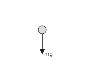

- [ ] පහළට mg සහ ඉදිරියට බලයක් / mg downward and a forward force (`force-along-motion`). Real mistake?

  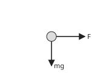

- [ ] ඉදිරියට බලයක් පමණි / Only a forward force (`gravity-off-in-flight`). Real mistake?

  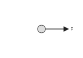

- [ ] ඉහළම ලක්ෂ්‍යයේ බල නැත / No forces at the top (`accel-zero-at-top`). Real mistake?

  

Explanation: පන්දුව ඉදිරියට කිසිවක් තල්ලු නොකරයි. තිරස් බලයක් ක්‍රියා නොකරන නිසා එය දිගටම ගමන් කරයි.  
Nothing pushes the ball forward. It keeps moving because no horizontal force acts.

### phy.mech.p03 · L3 · F31 · scenario pool

Skill: `phy.mech.proj.components` (ප්‍රක්ෂිප්තයක ප්‍රවේග සංරචක / Projectile velocity components). Draft difficulty: 2.

- [ ] OK
- [ ] Fix:

All scenarios are below.

**phy.mech.p03-01**

ගලක් තිරසට 40° ක් ආනතව විසි කෙරේ. වායු ප්‍රතිරෝධය නැත. නියතව පවතින රාශිය කුමක් ද?  
A stone is thrown at 40° to the horizontal, with no air resistance. Which quantity stays constant?

- **තිරස් ප්‍රවේගය / Horizontal velocity**
- [ ] සිරස් ප්‍රවේගය / Vertical velocity (`gravity-off-in-flight`). Real mistake?
- [ ] වේගය / Speed (`speed-constant`). Real mistake?
- [ ] චාලක ශක්තිය / Kinetic energy (`ke-pe-confusion`). Real mistake?

Explanation: තිරස් බලයක් ක්‍රියා නොකරන නිසා තිරස් ප්‍රවේගය වෙනස් නොවේ.  
No horizontal force acts, so the horizontal velocity doesn't change.

**phy.mech.p03-02**

කිරිබිත්තරයක් මේසයකින් පෙරළී බිමට වැටේ. වායු ප්‍රතිරෝධය නැත. නියතව පවතින රාශිය කුමක් ද?  
A marble rolls off a table and falls to the floor, with no air resistance. Which quantity stays constant?

- **තිරස් ප්‍රවේගය / Horizontal velocity**
- සිරස් ප්‍රවේගය / Vertical velocity (`gravity-off-in-flight`).
- වේගය / Speed (`speed-constant`).
- චාලක ශක්තිය / Kinetic energy (`ke-pe-confusion`).

Explanation: ගුරුත්වය වෙනස් කරන්නේ සිරස් ප්‍රවේගය පමණි.  
Gravity changes only the vertical velocity.

**phy.mech.p03-03**

තිරස්ව පියාසර කරන ගුවන් යානයකින් පාර්සලයක් වැටේ. වායු ප්‍රතිරෝධය නැත. නියතව පවතින රාශිය කුමක් ද?  
A parcel drops from a plane flying level, with no air resistance. Which quantity stays constant?

- **තිරස් ප්‍රවේගය / Horizontal velocity**
- [ ] පොළොවේ සිට උස / Height above ground (`gravity-off-in-flight`). Real mistake?
- වේගය / Speed (`speed-constant`).
- චාලක ශක්තිය / Kinetic energy (`ke-pe-confusion`).

Explanation: වැටෙන අතර එය ගුවන් යානයේ තිරස් ප්‍රවේගය රඳවා ගනී.  
It keeps the plane's horizontal velocity as it falls.

**phy.mech.p03-04**

පන්දුවක් සිරස්ව ඉහළට විසි කෙරේ. වායු ප්‍රතිරෝධය නැත. නියතව පවතින රාශිය කුමක් ද?  
A ball is thrown straight up, with no air resistance. Which quantity stays constant?

- **ත්වරණය / Acceleration**
- [ ] ප්‍රවේගය / Velocity (`gravity-off-in-flight`). Real mistake?
- වේගය / Speed (`speed-constant`).
- චාලක ශක්තිය / Kinetic energy (`ke-pe-confusion`).

Explanation: ඉහළම ලක්ෂ්‍යය ඇතුළුව මුළු ගමන පුරාම ත්වරණය g වේ.  
Acceleration is g throughout, including at the top.

**phy.mech.p03-05**

පන්දුවක් තිරසට 30° ක් ආනතව විසි කෙරේ. වායු ප්‍රතිරෝධය නැත. නියතව පවතින රාශිය කුමක් ද?  
A ball is thrown at 30° to the horizontal, with no air resistance. Which quantity stays constant?

- **ත්වරණය / Acceleration**
- සිරස් ප්‍රවේගය / Vertical velocity (`gravity-off-in-flight`).
- වේගය / Speed (`speed-constant`).
- චාලක ශක්තිය / Kinetic energy (`ke-pe-confusion`).

Explanation: එකම බලය ගුරුත්වය නිසා ත්වරණය පහළට g ලෙස පවතී.  
Gravity is the only force, so acceleration stays at g downward.

**phy.mech.p03-06**

ගලක් පාලමක සිට නිශ්චලතාවෙන් වැටේ. වායු ප්‍රතිරෝධය නැත. නියතව පවතින රාශිය කුමක් ද?  
A stone falls from a bridge from rest, with no air resistance. Which quantity stays constant?

- **ත්වරණය / Acceleration**
- ප්‍රවේගය / Velocity (`gravity-off-in-flight`).
- වේගය / Speed (`speed-constant`).
- චාලක ශක්තිය / Kinetic energy (`ke-pe-confusion`).

Explanation: ප්‍රවේගය g නියත සීඝ්‍රතාවෙන් වැඩි වේ.  
Velocity grows at a steady rate g.

### phy.mech.t09 · L2 · F40 · 28 variants · FSRS card pool

Skill: `phy.mech.proj.components` (ප්‍රක්ෂිප්තයක ප්‍රවේග සංරචක / Projectile velocity components). Draft difficulty: 3.

- [ ] OK
- [ ] Fix:

Mistakes in this template:

- [ ] `sin-cos-swap`: `K*(s2 if ask.startswith('KE') else c2)`. Real mistake?
- [ ] `forgot-square`: `K*cos(radians(angle))`. Real mistake?
- [ ] `ignored-condition`: `K`. Student sees: "ඉහළම ලක්ෂ්‍යය වන විට සිරස් වේගය නැති වන නිසා එය මුළු K නොවේ." (The vertical speed is lost by the top, so it isn't all of K.) Real mistake?
- [ ] `v-zero-at-top`: `0`. Real mistake?
- [ ] `ke-half-at-top`: `K/2`. Real mistake?
- [ ] `wrong-power`: `K/4`. Real mistake?

**Example 1:** පන්දුවක් 40 J චාලක ශක්තියක් සහිතව තිරසට 30° ක් ආනතව විසි කෙරේ. පථයේ ඉහළම ලක්ෂ්‍යයේ දී චාලක ශක්තිය කුමක් ද? (වායු ප්‍රතිරෝධය නැත)  
A ball is thrown at 30° to the horizontal with 40 J of KE. KE at the top of its path? (No air resistance)

- 0 J (`v-zero-at-top`)
- 10 J (`sin-cos-swap`)
- 20 J (`ke-half-at-top`)
- **30 J**
- 40 J (`ignored-condition`)

**Example 2:** පන්දුවක් 40 J චාලක ශක්තියක් සහිතව තිරසට 30° ක් ආනතව විසි කෙරේ. පථයේ ඉහළම ලක්ෂ්‍යය වන විට ලබාගත් විභව ශක්තිය කුමක් ද? (වායු ප්‍රතිරෝධය නැත)  
A ball is thrown at 30° to the horizontal with 40 J of KE. PE gained by the top of its path? (No air resistance)

- 0 J (`v-zero-at-top`)
- **10 J**
- 20 J (`ke-half-at-top`)
- 30 J (`sin-cos-swap`)
- 40 J (`ignored-condition`)

Explanation: ඉහළම ලක්ෂ්‍යයේ ඉතිරි වන්නේ u cos θ පමණි. එබැවින් චාලක ශක්තිය = K cos²θ වන අතර ලබාගත් විභව ශක්තිය K sin²θ වේ.  
At the top, only u cos θ remains, so KE = K cos²θ and the PE gained is K sin²θ.

## Source 2023-3

### phy.mech.c008 · L2 · F18

Skill: `phy.mech.newton.n3-pairs` (නිව්ටන්ගේ තුන්වන නියමයේ බල යුගල / Newton's third-law pairs). Draft difficulty: 2.

- [ ] This skill is right (asked once per skill)
- [ ] OK
- [ ] Fix:

ඇවිදින පුද්ගලයෙකු ඉදිරියට තල්ලු කරන්නේ කුමක් ද?  
What pushes a walking person forward?

- **පොළොව, පුද්ගලයා මත / The ground, on the person**
- [ ] පුද්ගලයා, පොළොව මත / The person, on the ground (`force-on-wrong-body`). Real mistake?
- [ ] පුද්ගලයාගේ පාද, පුද්ගලයා මත / The person's legs, on the person (`internal-force`). Real mistake?
- [ ] වාතය, පුද්ගලයා මත / The air, on the person (`force-wrong-source`). Real mistake?

Explanation: පාදය පොළොව පිටුපසට තල්ලු කරයි. පොළොව පුද්ගලයා ඉදිරියට තල්ලු කරයි.  
The foot pushes the ground backward. The ground pushes the person forward.

### phy.mech.c009 · L2 · F18

Skill: `phy.mech.newton.n3-pairs` (නිව්ටන්ගේ තුන්වන නියමයේ බල යුගල / Newton's third-law pairs). Draft difficulty: 2.

- [ ] OK
- [ ] Fix:

මෝටර් රථයක් තිරස් මාර්ගයක වේගය වැඩි කරයි. එය ඉදිරියට තල්ලු කරන බලය කුමක් ද?  
A car speeds up on a level road. What force pushes it forward?

- **මාර්ගය, ටයර මත / The road, on the tyres**
- [ ] එන්ජිම, මෝටර් රථය මත / The engine, on the car (`internal-force`). Real mistake?
- [ ] ටයර, මාර්ගය මත / The tyres, on the road (`force-on-wrong-body`). Real mistake?
- [ ] වාතය, මෝටර් රථය මත / The air, on the car (`force-wrong-source`). Real mistake?

Explanation: එන්ජිම රෝද කරකවයි. නමුත් අභ්‍යන්තර බලයකට රථය ත්වරණය කළ නොහැකි ය. එය කරන්නේ මාර්ගයේ ඝර්ෂණයයි.  
The engine turns the wheels, but an internal force can't accelerate the car. Road friction does.

### phy.mech.c010 · L2 · F10

Skill: `phy.mech.newton.n3-pairs` (නිව්ටන්ගේ තුන්වන නියමයේ බල යුගල / Newton's third-law pairs). Draft difficulty: 2.

- [ ] OK
- [ ] Fix:

ට්‍රක් රථයක් ට්‍රේලරයක් ඇදගෙන යමින් වේගය වැඩි කරයි. ට්‍රේලරය මත ට්‍රක් රථයේ ඇදීම, ට්‍රක් රථය මත ට්‍රේලරයේ ඇදීමට සමාන ය.  
A truck speeds up while pulling a trailer. The truck's pull on the trailer equals the trailer's pull on the truck.

- **සත්‍ය / True**
- [ ] අසත්‍ය / False (`pair-unequal`). Real mistake?

Explanation: තුන්වන නියමයේ බල යුගලය ත්වරණය වන විට පවා සැමවිටම සමාන ය.  
A third-law pair is always equal, even during acceleration.

## Source 2023-45

### phy.mech.c033 · L1 · F02

Skill: `phy.mech.pow.force-speed` (ජවය, බලය හා වේගය / Power, force and speed). Draft difficulty: 1.

- [ ] This skill is right (asked once per skill)
- [ ] OK
- [ ] Fix:

ජවය = ධාවක බලය × ▢  
Power = driving force × ▢

- **ප්‍රවේගය / velocity**
- කාලය / time (`recall-gap`).
- ත්වරණය / acceleration (`recall-gap`).
- දුර / distance (`recall-gap`).

Explanation: සෑම මොහොතකම P = Fv.  
P = Fv at every instant.

### phy.mech.c034 · L1 · F04

Skill: `phy.mech.pow.force-speed` (ජවය, බලය හා වේගය / Power, force and speed). Draft difficulty: 1.

- [ ] OK
- [ ] Fix:

ජවයේ මාන මොනවා ද?  
Dimensions of power?

- **ML²T⁻³**
- ML²T⁻² (`recall-gap`).
- MLT⁻¹ (`recall-gap`).
- MLT⁻³ (`recall-gap`).

Explanation: ජවය = ශක්තිය ÷ කාලය = ML²T⁻² ÷ T.  
Power = energy ÷ time = ML²T⁻² ÷ T.

### phy.mech.c035 · L2 · F10

Skill: `phy.mech.pow.force-speed` (ජවය, බලය හා වේගය / Power, force and speed). Draft difficulty: 2.

- [ ] OK
- [ ] Fix:

මෝටර් රථයක් නියත වේගයකින් ආනත තලයක් නගියි. ධාවක බලය = ප්‍රතිරෝධය + mg sin θ.  
A car climbs a slope at constant speed. Driving force = resistance + mg sin θ.

- **සත්‍ය / True**
- [ ] අසත්‍ය / False (`no-resolve`). Real mistake?

Explanation: නියත වේගය යනු තලය දිගේ ශුද්ධ බලය ශුන්‍ය වීමයි.  
Constant speed means zero net force along the slope.

### phy.mech.t12 · L4 · F40 · 102 variants · skill mastery

Skill: `phy.mech.pow.force-speed` (ජවය, බලය හා වේගය / Power, force and speed). Draft difficulty: 4.

- [ ] OK
- [ ] Fix:

Mistakes in this template:

- [ ] `ignored-condition`: `m*g*s*v/1000`. Student sees: "තිරස් මාර්ගයේ ප්‍රතිරෝධය ආනත තලයේ දී ද ක්‍රියා කරයි." (The level-road resistance still acts on the slope.) Real mistake?
- [ ] `no-resolve`: `p0 + m*g*v/1000`. Real mistake?
- [ ] `forgot-g`: `p0 + m*s*v/1000`. Real mistake?
- [ ] `wrong-quantity`: `p0`. Student sees: "එය තිරස් මාර්ගයේ ජවයයි." (That's the power on the level road.) Real mistake?
- [ ] `wrong-law`: `p0*(1 + s)`. Student sees: "ගුරුත්වයට එරෙහිව අවශ්‍ය ජවය එකතු කරන්න. ආනතියෙන් ගුණ නොකරන්න." (Add the power needed against gravity. Don't scale by the slope.) Real mistake?
- [ ] `misread-interval`: `2*p0 + m*g*s*v/1000`. Student sees: "තිරස් මාර්ගයේ ජවය එක් වරක් පමණක් ගන්න." (Count the level-road power once.) Real mistake?

**Example 1:** 800 kg මෝටර් රථයකට තිරස් මාර්ගයක 10 m s⁻¹ පවත්වා ගැනීමට 12 kW අවශ්‍ය වේ. ප්‍රතිරෝධය එලෙසම තිබිය දී, sin θ = 0.05 වූ ආනත තලයක් නගිමින් එම වේගයම පවත්වා ගැනීමට අවශ්‍ය ජවය කුමක් ද?  
An 800 kg car needs 12 kW to hold 10 m s⁻¹ on a level road. Power to hold the same speed up a slope with sin θ = 0.05, same resistance?

- 4 kW (`ignored-condition`)
- 12 kW (`wrong-quantity`)
- **16 kW**
- 28 kW (`misread-interval`)
- 92 kW (`no-resolve`)

**Example 2:** 1000 kg මෝටර් රථයකට තිරස් මාර්ගයක 15 m s⁻¹ පවත්වා ගැනීමට 20 kW අවශ්‍ය වේ. ප්‍රතිරෝධය එලෙසම තිබිය දී, sin θ = 0.1 වූ ආනත තලයක් නගිමින් එම වේගයම පවත්වා ගැනීමට අවශ්‍ය ජවය කුමක් ද?  
A 1000 kg car needs 20 kW to hold 15 m s⁻¹ on a level road. Power to hold the same speed up a slope with sin θ = 0.1, same resistance?

- 15 kW (`ignored-condition`)
- 20 kW (`wrong-quantity`)
- 22 kW (`wrong-law`)
- **35 kW**
- 170 kW (`no-resolve`)

**Example 3:** 1500 kg මෝටර් රථයකට තිරස් මාර්ගයක 25 m s⁻¹ පවත්වා ගැනීමට 24 kW අවශ්‍ය වේ. ප්‍රතිරෝධය එලෙසම තිබිය දී, sin θ = 0.1 වූ ආනත තලයක් නගිමින් එම වේගයම පවත්වා ගැනීමට අවශ්‍ය ජවය කුමක් ද?  
A 1500 kg car needs 24 kW to hold 25 m s⁻¹ on a level road. Power to hold the same speed up a slope with sin θ = 0.1, same resistance?

- 24 kW (`wrong-quantity`)
- 26.4 kW (`wrong-law`)
- **61.5 kW**
- 85.5 kW (`misread-interval`)
- 399 kW (`no-resolve`)

Explanation: ධාවක බලය = ප්‍රතිරෝධය + mg sin θ වන අතර P = Fv.  
Driving force = resistance + mg sin θ, and P = Fv.

## Source 2024-15

### phy.mech.c029 · L1 · F05

Skill: `phy.mech.circ.friction-limit` (වෘත්ත චලිතයේ ඝර්ෂණ සීමාව / Friction limit in circular motion). Draft difficulty: 1.

- [ ] This skill is right (asked once per skill)
- [ ] OK
- [ ] Fix:

60 rpm යනු rad s⁻¹ කීය ද?  
60 rpm in rad s⁻¹?

- **2π**
- [ ] 60 (`unit-conversion`). Real mistake?
- [ ] π (`unit-conversion`). Real mistake?
- [ ] 120π (`unit-conversion`). Real mistake?

Explanation: ω = 2π × (rpm ÷ 60) = 2π rad s⁻¹.  
ω = 2π × (rpm ÷ 60) = 2π rad s⁻¹.

### phy.mech.c030 · L2 · F18

Skill: `phy.mech.circ.friction-limit` (වෘත්ත චලිතයේ ඝර්ෂණ සීමාව / Friction limit in circular motion). Draft difficulty: 2.

- [ ] OK
- [ ] Fix:

කාසියක් ලිස්සා නොගොස් භ්‍රමණ තලයක් සමඟ කැරකෙයි. එය වෘත්තයක ගමන් කරවන බලය කුමක් ද?  
A coin turns with a turntable without sliding. What force keeps it moving in a circle?

- **ස්ථිතික ඝර්ෂණය, කේන්ද්‍රය දෙසට / Static friction, towards the centre**
- [ ] කේන්ද්‍රාපසාරී බලය, පිටතට / Centrifugal force, outwards (`centrifugal`). Real mistake?
- [ ] අභිලම්බ ප්‍රතික්‍රියාව / The normal reaction (`force-wrong-source`). Real mistake?
- [ ] චලිත දිශාව ඔස්සේ ක්‍රියා කරන බලයක් / A force along its direction of motion (`force-along-motion`). Real mistake?

Explanation: එකම තිරස් බලය ඝර්ෂණය වන අතර එයින් mrω² සැපයේ.  
Friction is the only horizontal force, and it provides mrω².

### phy.mech.c031 · L2 · F12

Skill: `phy.mech.circ.friction-limit` (වෘත්ත චලිතයේ ඝර්ෂණ සීමාව / Friction limit in circular motion). Draft difficulty: 2.

- [ ] OK
- [ ] Fix:

කාසියක් භ්‍රමණ තලයක් මත ඇත. භ්‍රමණ සීඝ්‍රතාව × 2. ලිස්සා නොයන විශාලතම අරය × ?  
A coin rests on a turntable. Rotation rate × 2. Largest radius without sliding × ?

- **¼**
- [ ] ½ (`forgot-square`). Real mistake?
- [ ] 2 (`wrong-power`). Real mistake?
- [ ] 4 (`inverted`). Real mistake?

Explanation: r = μg/ω² නිසා r ∝ 1/ω².  
r = μg/ω², so r ∝ 1/ω².

### phy.mech.t10 · L2 · F40 · 16 variants · FSRS card pool

Skill: `phy.mech.circ.friction-limit` (වෘත්ත චලිතයේ ඝර්ෂණ සීමාව / Friction limit in circular motion). Draft difficulty: 3.

- [ ] OK
- [ ] Fix:

Mistakes in this template:

- [ ] `forgot-square`: `mu*g/w*100`. Real mistake?
- [ ] `forgot-mu`: `g/w**2*100`. Real mistake?
- [ ] `radius-diameter`: `2*mu*g/w**2*100`. Real mistake?
- [ ] `radius-diameter`: `mu*g/w**2*50`. Real mistake?
- [ ] `wrong-power`: `mu**2*g/w**2*100`. Real mistake?
- [ ] `unit-conversion`: `mu*g/w**2`. Real mistake?

**Example 1:** 100 rpm කින් කැරකෙන භ්‍රමණ තලයක් මත කාසියක් ඇත. μₛ = 0.2. ලිස්සා නොයන, කේන්ද්‍රයේ සිට විශාලතම දුර කුමක් ද? (π = 3 ලෙස ගන්න)  
A coin sits on a turntable spinning at 100 rpm. μₛ = 0.2. Largest distance from the centre without sliding? (Take π = 3)

- 0.4 cm (`wrong-power`)
- **2 cm**
- 4 cm (`radius-diameter`)
- 10 cm (`forgot-mu`)
- 20 cm (`forgot-square`)

**Example 2:** 100 rpm කින් කැරකෙන භ්‍රමණ තලයක් මත කාසියක් ඇත. μₛ = 0.9. ලිස්සා නොයන, කේන්ද්‍රයේ සිට විශාලතම දුර කුමක් ද? (π = 3 ලෙස ගන්න)  
A coin sits on a turntable spinning at 100 rpm. μₛ = 0.9. Largest distance from the centre without sliding? (Take π = 3)

- 4.5 cm (`radius-diameter`)
- 8.1 cm (`wrong-power`)
- **9 cm**
- 10 cm (`forgot-mu`)
- 90 cm (`forgot-square`)

**Example 3:** 40 rpm කින් කැරකෙන භ්‍රමණ තලයක් මත කාසියක් ඇත. μₛ = 0.4. ලිස්සා නොයන, කේන්ද්‍රයේ සිට විශාලතම දුර කුමක් ද? (π = 3 ලෙස ගන්න)  
A coin sits on a turntable spinning at 40 rpm. μₛ = 0.4. Largest distance from the centre without sliding? (Take π = 3)

- 10 cm (`wrong-power`)
- 12.5 cm (`radius-diameter`)
- **25 cm**
- 62.5 cm (`forgot-mu`)
- 100 cm (`forgot-square`)

Explanation: සීමාවේ දී μmg = mrω² නිසා r = μg/ω².  
At the limit, μmg = mrω², so r = μg/ω².

## Source 2024-4

### phy.mech.c011 · L2 · F18

Skill: `phy.mech.newton.n3-pairs` (නිව්ටන්ගේ තුන්වන නියමයේ බල යුගල / Newton's third-law pairs). Draft difficulty: 2.

- [ ] OK
- [ ] Fix:

පොතක් මේසයක් මත නිශ්චලව ඇත. පොත මත පෘථිවියේ ඇදීම සමඟ බල යුගලයක් වන්නේ කුමන බලය ද?  
A book rests on a table. Which force pairs with Earth's pull on the book?

- **පෘථිවිය මත පොතේ ඇදීම / The book's pull on Earth**
- [ ] පොත මත මේසයේ තෙරපුම / The table's push on the book (`balance-vs-pair`). Real mistake?
- [ ] මේසය මත පොතේ තෙරපුම / The book's push on the table (`force-on-wrong-body`). Real mistake?
- [ ] පෘථිවිය මත මේසයේ ඇදීම / The table's pull on Earth (`pair-wrong-bodies`). Real mistake?

Explanation: බල යුගලයකට අයත් වන්නේ එකම වස්තු දෙකයි. මේසයේ තෙරපුම බර තුලනය කළ ද එය එහි යුගලය නොවේ.  
A pair involves the same two bodies. The table's push balances the weight, but it isn't the pair.

### phy.mech.c012 · L2 · F14

Skill: `phy.mech.newton.n3-pairs` (නිව්ටන්ගේ තුන්වන නියමයේ බල යුගල / Newton's third-law pairs). Draft difficulty: 2.

- [ ] OK
- [ ] Fix:

ශිෂ්‍යයෙක් මෙසේ කියයි: "ක්‍රියාව හා ප්‍රතික්‍රියාව සමාන හා ප්‍රතිවිරුද්ධ නිසා කිසිවක් කිසිදා ත්වරණය විය නොහැක." එහි වැරැද්ද කුමක් ද?  
Student says: "Action and reaction are equal and opposite, so nothing can ever accelerate." What's wrong?

- **ඒවා වෙනස් වස්තු මත ක්‍රියා කරන නිසා එකිනෙක අවලංගු නොවේ / They act on different bodies, so they don't cancel**
- [ ] ප්‍රතික්‍රියාව මඳක් කුඩා නිසා ශුද්ධ බලයක් ඉතිරි වේ / The reaction is a little smaller, so a net force remains (`pair-unequal`). Real mistake?
- [ ] ප්‍රතික්‍රියාව පසුව ඇති වන නිසා ඒවා එකවර අවලංගු නොවේ / The reaction comes later, so they don't cancel at once (`pair-delay`). Real mistake?
- [ ] ඒවා අවලංගු වන්නේ වස්තු දෙක ස්පර්ශ වී ඇති විට පමණි / They only cancel when the two bodies are touching (`pair-contact-only`). Real mistake?

Explanation: වස්තුවක ත්වරණය සෙවීමේ දී එම වස්තුව මත ක්‍රියා කරන බල පමණක් එකතු කරන්න.  
Add forces only on the same body when finding its acceleration.

### phy.mech.b01 · L4 · F42 · 28 variants · skill mastery

Skill: `phy.mech.newton.n3-pairs` (නිව්ටන්ගේ තුන්වන නියමයේ බල යුගල / Newton's third-law pairs). Draft difficulty: 2.

- [ ] OK
- [ ] Fix:

Statement bank (tick each false statement if students really believe it):

- True: බල යුගලයක බල දෙක විශාලත්වයෙන් සමාන ය. / The two forces of a pair are equal in size.
- True: බල යුගලයක බල දෙක එකම වර්ගයේ ය. / The two forces of a pair are of the same type.
- True: පොත මත පෘථිවියේ ඇදීම හා පෘථිවිය මත පොතේ ඇදීම බල යුගලයකි. / Earth's pull on a book and the book's pull on Earth form a pair.
- True: බල යුගලයක බල දෙක වෙනස් වස්තු මත ක්‍රියා කරයි. / The two forces of a pair act on different bodies.
- [ ] False (`pair-cancels`): බල යුගලයක බල දෙක එකිනෙක අවලංගු කරයි. / The two forces of a pair cancel each other.
- [ ] False (`pair-contact-only`): බල යුගලයක් ඇති විය හැක්කේ ස්පර්ශ වී ඇති වස්තු අතර පමණි. / A pair of forces can exist only between bodies in contact.
- [ ] False (`pair-delay`): ප්‍රතික්‍රියාව ඇති වන්නේ ක්‍රියාවට මඳ වේලාවකට පසුව ය. / The reaction appears slightly after the action.
- [ ] False (`balance-vs-pair`): පොත මත මේසයේ තෙරපුම හා පොතේ බර බල යුගලයකි. / A table's push on a book and the book's weight form a pair.

**Example 1:** A: පොත මත පෘථිවියේ ඇදීම හා පෘථිවිය මත පොතේ ඇදීම බල යුගලයකි.  
B: බල යුගලයක බල දෙක එකම වර්ගයේ ය.  
C: බල යුගලයක බල දෙක විශාලත්වයෙන් සමාන ය.  
සත්‍ය වන්නේ කුමක් ද?  
A: Earth's pull on a book and the book's pull on Earth form a pair. / B: The two forces of a pair are of the same type. / C: The two forces of a pair are equal in size. / Which are true?

- A පමණි / A only (`missed-true-statement`)
- A සහ B පමණි / A and B only (`missed-true-statement`)
- A සහ C පමණි / A and C only (`missed-true-statement`)
- B සහ C පමණි / B and C only (`missed-true-statement`)
- **A, B සහ C සියල්ල / A, B and C**

**Example 2:** A: බල යුගලයක බල දෙක එකිනෙක අවලංගු කරයි.  
B: බල යුගලයක බල දෙක එකම වර්ගයේ ය.  
C: බල යුගලයක බල දෙක විශාලත්වයෙන් සමාන ය.  
සත්‍ය වන්නේ කුමක් ද?  
A: The two forces of a pair cancel each other. / B: The two forces of a pair are of the same type. / C: The two forces of a pair are equal in size. / Which are true?

- A පමණි / A only (`pair-cancels`)
- A සහ B පමණි / A and B only (`pair-cancels`)
- A සහ C පමණි / A and C only (`pair-cancels`)
- **B සහ C පමණි / B and C only**
- A, B සහ C සියල්ල / A, B and C (`pair-cancels`)

**Example 3:** A: බල යුගලයක බල දෙක විශාලත්වයෙන් සමාන ය.  
B: බල යුගලයක් ඇති විය හැක්කේ ස්පර්ශ වී ඇති වස්තු අතර පමණි.  
C: බල යුගලයක බල දෙක එකම වර්ගයේ ය.  
සත්‍ය වන්නේ කුමක් ද?  
A: The two forces of a pair are equal in size. / B: A pair of forces can exist only between bodies in contact. / C: The two forces of a pair are of the same type. / Which are true?

- A පමණි / A only (`missed-true-statement`)
- A සහ B පමණි / A and B only (`pair-contact-only`)
- **A සහ C පමණි / A and C only**
- B සහ C පමණි / B and C only (`pair-contact-only`)
- A, B සහ C සියල්ල / A, B and C (`pair-contact-only`)

Explanation: බල යුගලයක බල සමාන ය, එකවර පවතී, එකම වර්ගයේ ය, සහ වෙනස් වස්තු මත ක්‍රියා කරයි.  
The two forces of a pair are equal, simultaneous, of one type, and act on different bodies.

## Source 2024-7

### phy.mech.c004 · L1 · F03

Skill: `phy.mech.kin.graph-slope-area` (චලිත ප්‍රස්තාරවල අනුක්‍රමණය හා වර්ගඵලය / Gradient and area of motion graphs). Draft difficulty: 1.

- [ ] This skill is right (asked once per skill)
- [ ] OK
- [ ] Fix:

විස්ථාපන–කාල ප්‍රස්තාරයක අනුක්‍රමණයෙන් ලැබෙන්නේ කුමක් ද?  
On a displacement–time graph, the gradient gives?

- **ප්‍රවේගය / Velocity**
- ත්වරණය / Acceleration (`recall-gap`).
- විස්ථාපනය / Displacement (`recall-gap`).
- බලය / Force (`recall-gap`).

Explanation: s–t ප්‍රස්තාරයේ අනුක්‍රමණය යනු විස්ථාපනය වෙනස් වීමේ සීඝ්‍රතාව, එනම් ප්‍රවේගයයි.  
Gradient of s–t is the rate of change of displacement, which is velocity.

### phy.mech.c005 · L1 · F03

Skill: `phy.mech.kin.graph-slope-area` (චලිත ප්‍රස්තාරවල අනුක්‍රමණය හා වර්ගඵලය / Gradient and area of motion graphs). Draft difficulty: 1.

- [ ] OK
- [ ] Fix:

ප්‍රවේග–කාල ප්‍රස්තාරයක රේඛාවට යටින් ඇති වර්ගඵලයෙන් ලැබෙන්නේ කුමක් ද?  
On a velocity–time graph, the area under the line gives?

- **විස්ථාපනය / Displacement**
- ත්වරණය / Acceleration (`recall-gap`).
- වේගය / Speed (`recall-gap`).
- බලය / Force (`recall-gap`).

Explanation: v–t ප්‍රස්තාරයට යටින් ඇති වර්ගඵලය විස්ථාපනයයි. එහි අනුක්‍රමණය ත්වරණයයි.  
Area under v–t is displacement. Its gradient is acceleration.

### phy.mech.c006 · L2 · F15

Skill: `phy.mech.kin.graph-slope-area` (චලිත ප්‍රස්තාරවල අනුක්‍රමණය හා වර්ගඵලය / Gradient and area of motion graphs). Draft difficulty: 2.

- [ ] OK
- [ ] Fix:

වස්තුවක් නිශ්චලතාවෙන් ආරම්භ වී වේගය වැඩි කර, පසුව වේගය අඩු වී නතර වේ. එය කිසිවිටෙක ආපසු නොයයි. එහි s–t ප්‍රස්තාරය තෝරන්න.  
An object starts from rest, speeds up, then slows to a stop, never reversing. Pick its s–t graph.

- **S හැඩැති නැගීමක්: ආරම්භයේ හා අවසානයේ තිරස් ය / S-shaped rise: flat at the start and flat at the end**

  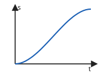

- [ ] ඉහළ යන සරල රේඛාවක් / Straight rising line (`graph-shape`). Real mistake?

  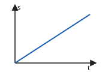

- [ ] ඉහළ ගොස් නැවත ශුන්‍යයට වැටේ / Rises, then falls back to zero (`sign`). Real mistake?

  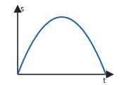

- [ ] ආරම්භයේ බෑවුම වැඩි ය, අවසානයේ පමණක් තිරස් ය / Steep at the start, flat only at the end (`ignored-condition`). Student sees: "එය නිශ්චලතාවෙන් ආරම්භ වන නිසා වක්‍රය තිරස්ව ආරම්භ වේ." Real mistake?

  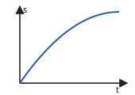

Explanation: ශුන්‍ය ප්‍රවේගය යනු ශුන්‍ය අනුක්‍රමණයයි. එබැවින් වක්‍රය දෙකෙළවරේම තිරස් ය.  
Zero velocity means zero gradient, so the curve is flat at both ends.

## Source 2025-12

### phy.mech.c019 · L1 · F05

Skill: `phy.mech.fric.traction-limit` (ත්වරණයට ඝර්ෂණයෙන් ඇති සීමාව / Friction limit on acceleration). Draft difficulty: 1.

- [ ] This skill is right (asked once per skill)
- [ ] OK
- [ ] Fix:

54 km h⁻¹ යනු m s⁻¹ කීය ද?  
54 km h⁻¹ in m s⁻¹?

- **15**
- [ ] 54 (`unit-conversion`). Real mistake?
- [ ] 30 (`unit-conversion`). Real mistake?
- [ ] 194 (`unit-conversion`). Real mistake?

Explanation: 3.6 න් බෙදන්න: 54 ÷ 3.6 = 15 m s⁻¹.  
Divide by 3.6: 54 ÷ 3.6 = 15 m s⁻¹.

### phy.mech.c020 · L2 · F13

Skill: `phy.mech.fric.traction-limit` (ත්වරණයට ඝර්ෂණයෙන් ඇති සීමාව / Friction limit on acceleration). Draft difficulty: 2.

- [ ] OK
- [ ] Fix:

මෝටර් රථයක රෝද හතරම එන්ජිමෙන් ධාවනය වේ. තිරස් මාර්ගයක ලැබිය හැකි විශාලතම ත්වරණය කුමක් ද?  
All four wheels of a car are driven. Greatest possible acceleration on a level road?

- **μₛg**
- [ ] μₛmg (`forgot-mass`). Real mistake?
- [ ] g/μₛ (`inverted`). Real mistake?
- [ ] μₛg/2 (`assumed-symmetry`). Real mistake?

Explanation: උපරිම ඝර්ෂණය μₛmg = ma නිසා a = μₛg. මුළු බරම ධාවනය වන රෝද මත පවතී.  
Maximum friction μₛmg = ma, so a = μₛg. All the weight is on the driven wheels.

### phy.mech.t06 · L2 · F40 · 14 variants · FSRS card pool

Skill: `phy.mech.fric.traction-limit` (ත්වරණයට ඝර්ෂණයෙන් ඇති සීමාව / Friction limit on acceleration). Draft difficulty: 3.

- [ ] OK
- [ ] Fix:

Mistakes in this template:

- [ ] `unit-conversion`: `kmh/(t*g)`. Real mistake?
- [ ] `assumed-symmetry`: `2*v/(t*g)`. Real mistake?
- [ ] `forgot-half`: `v/(2*t*g)`. Real mistake?
- [ ] `forgot-g`: `v/t`. Real mistake?
- [ ] `inverted`: `v/(3.6*t*g)`. Real mistake?

**Example 1:** සියලු රෝද ධාවනය වන මෝටර් රථයක් තිරස් මාර්ගයක ඒකාකාර ත්වරණයෙන් නිශ්චලතාවේ සිට 10 s තුළ 18 km h⁻¹ ට ළඟා වේ. අවශ්‍ය කුඩාම μₛ කුමක් ද?  
A car with all wheels driven reaches 18 km h⁻¹ from rest in 10 s on a level road, at uniform acceleration. Smallest μₛ needed?

- 0.025 (`forgot-half`)
- **0.05**
- 0.1 (`assumed-symmetry`)
- 0.18 (`unit-conversion`)
- 0.5 (`forgot-g`)

**Example 2:** සියලු රෝද ධාවනය වන මෝටර් රථයක් තිරස් මාර්ගයක ඒකාකාර ත්වරණයෙන් නිශ්චලතාවේ සිට 10 s තුළ 144 km h⁻¹ ට ළඟා වේ. අවශ්‍ය කුඩාම μₛ කුමක් ද?  
A car with all wheels driven reaches 144 km h⁻¹ from rest in 10 s on a level road, at uniform acceleration. Smallest μₛ needed?

- 0.2 (`forgot-half`)
- **0.4**
- 0.8 (`assumed-symmetry`)
- 1.44 (`unit-conversion`)
- 4 (`forgot-g`)

**Example 3:** සියලු රෝද ධාවනය වන මෝටර් රථයක් තිරස් මාර්ගයක ඒකාකාර ත්වරණයෙන් නිශ්චලතාවේ සිට 2 s තුළ 72 km h⁻¹ ට ළඟා වේ. අවශ්‍ය කුඩාම μₛ කුමක් ද?  
A car with all wheels driven reaches 72 km h⁻¹ from rest in 2 s on a level road, at uniform acceleration. Smallest μₛ needed?

- 0.5 (`forgot-half`)
- **1**
- 2 (`assumed-symmetry`)
- 3.6 (`unit-conversion`)
- 10 (`forgot-g`)

Explanation: ත්වරණය ලැබෙන්නේ ඝර්ෂණයෙනි: μₛmg = ma නිසා μₛ = a/g. වේගය m s⁻¹ වලින් ගන්න.  
Friction gives the acceleration: μₛmg = ma, so μₛ = a/g, with the speed in m s⁻¹.

## Source 2025-13

### phy.mech.c040 · L1 · F02

Skill: `phy.mech.rot.rolling-energy` (පෙරළෙන වස්තුවක ශක්තිය / Energy of a rolling body). Draft difficulty: 1.

- [ ] This skill is right (asked once per skill)
- [ ] OK
- [ ] Fix:

පෙරළෙන වස්තුවක චාලක ශක්තිය = ½mv² + ½ ▢ ω²  
KE of a rolling body = ½mv² + ½ ▢ ω²

- **I**
- m (`recall-gap`).
- r (`recall-gap`).
- v (`recall-gap`).

Explanation: පරිවහනය + භ්‍රමණය. මෙහි I භ්‍රමණයට අදාළ ස්කන්ධය ලෙස ක්‍රියා කරයි.  
Translation + rotation, with I as the rotational mass.

### phy.mech.c041 · L2 · F11

Skill: `phy.mech.rot.rolling-energy` (පෙරළෙන වස්තුවක ශක්තිය / Energy of a rolling body). Draft difficulty: 2.

- [ ] OK
- [ ] Fix:

සමාන ස්කන්ධ හා අරය ඇති ඝන ගෝලයක් සහ වළල්ලක් එකම ආනත තලයක පහළට පෙරළේ. පළමුව පහළට ළඟා වන්නේ කුමක් ද?  
A solid sphere and a hoop of equal mass and radius roll down the same slope. Which gets down first?

- **ගෝලය / Sphere**
- [ ] වළල්ල / Hoop (`moi-shape-swap`). Real mistake?
- [ ] දෙකම එකවර / They tie (`moi-mass-only`). Real mistake?
- [ ] ස්කන්ධය මත රඳා පවතී / Depends on the mass (`mass-matters`). Real mistake?

Explanation: ගෝලයේ I/(MR²) කුඩා නිසා භ්‍රමණයට යන ශක්තිය අඩු ය.  
The sphere has the smaller I/(MR²), so less energy goes into rotation.

### phy.mech.c042 · L2 · F19

Skill: `phy.mech.rot.rolling-energy` (පෙරළෙන වස්තුවක ශක්තිය / Energy of a rolling body). Draft difficulty: 2.

- [ ] OK
- [ ] Fix:

සමාන M හා R ඇති වළල්ලක් සහ තැටියක් සමාන වේගයෙන් පෙරළේ. භ්‍රමණ චාලක ශක්තිවල අනුපාතය, වළල්ල : තැටිය, කුමක් ද?  
A hoop and a disc have equal M and R, and roll at equal speed. Ratio of rotational KE, hoop : disc?

- **2 : 1**
- [ ] 1 : 2 (`inverted`). Real mistake?
- [ ] 1 : 1 (`moi-mass-only`). Real mistake?
- [ ] 4 : 1 (`wrong-power`). Real mistake?

Explanation: ω සමාන ය. I අගයන් MR² සහ ½MR² වේ.  
Same ω, and I is MR² against ½MR².

### phy.mech.t15 · L2 · F41 · 5 variants · FSRS card pool

Skill: `phy.mech.rot.rolling-energy` (පෙරළෙන වස්තුවක ශක්තිය / Energy of a rolling body). Draft difficulty: 3.

- [ ] OK
- [ ] Fix:

Mistakes in this template:

- [ ] `wrong-quantity`: `1 + c if target == 'rotational' else (1 + c)/c`. Student sees: "එය අනෙක් අනුපාතයයි. හරයට යන චාලක ශක්තිය කුමක් දැයි බලන්න." (That's the other ratio. Check which KE goes below the line.) Real mistake?
- [ ] `misread-interval`: `1/c`. Student sees: "එය මුළු අගය නොව පරිවහන ÷ භ්‍රමණ අනුපාතයයි." (That's translational ÷ rotational, not total.) Real mistake?
- [ ] `stopped-early`: `c`. Student sees: "c යනු I හි සාධකය පමණි. දැන් අනුපාතය ගොඩනගන්න." (c is only the factor in I. Now build the ratio.) Real mistake?
- [ ] `inverted`: `c/(1 + c) if target == 'rotational' else 1/(1 + c)`. Real mistake?

**Example 1:** ඝන ගෝලයක් (I = 2/5 MR²) ලිස්සීමකින් තොරව පෙරළේ. මුළු චාලක ශක්තිය ÷ භ්‍රමණ චාලක ශක්තිය සොයන්න.  
A solid sphere (I = 2/5 MR²) rolls without slipping. Find total KE ÷ rotational KE.

- 2/7 (`inverted`)
- 2/5 (`stopped-early`)
- 7/5 (`wrong-quantity`)
- 5/2 (`misread-interval`)
- **7/2**

**Example 2:** ඝන ගෝලයක් (I = 2/5 MR²) ලිස්සීමකින් තොරව පෙරළේ. මුළු චාලක ශක්තිය ÷ පරිවහන චාලක ශක්තිය සොයන්න.  
A solid sphere (I = 2/5 MR²) rolls without slipping. Find total KE ÷ translational KE.

- 2/5 (`stopped-early`)
- 5/7 (`inverted`)
- **7/5**
- 5/2 (`misread-interval`)
- 7/2 (`wrong-quantity`)

**Example 3:** කුහර ගෝලයක් (I = 2/3 MR²) ලිස්සීමකින් තොරව පෙරළේ. මුළු චාලක ශක්තිය ÷ භ්‍රමණ චාලක ශක්තිය සොයන්න.  
A hollow sphere (I = 2/3 MR²) rolls without slipping. Find total KE ÷ rotational KE.

- 2/5 (`inverted`)
- 2/3 (`stopped-early`)
- 3/2 (`misread-interval`)
- 5/3 (`wrong-quantity`)
- **5/2**

**Example 4:** කුහර ගෝලයක් (I = 2/3 MR²) ලිස්සීමකින් තොරව පෙරළේ. මුළු චාලක ශක්තිය ÷ පරිවහන චාලක ශක්තිය සොයන්න.  
A hollow sphere (I = 2/3 MR²) rolls without slipping. Find total KE ÷ translational KE.

- 3/5 (`inverted`)
- 2/3 (`stopped-early`)
- 3/2 (`misread-interval`)
- **5/3**
- 5/2 (`wrong-quantity`)

Explanation: මුළු චාලක ශක්තිය = ½Mv²(1 + c) වන අතර භ්‍රමණ චාලක ශක්තිය = ½Mv²c වේ.  
KE total = ½Mv²(1 + c), and rotational KE = ½Mv²c.

## Source 2025-17

### phy.mech.c013 · L2 · F13

Skill: `phy.mech.newton.apparent-weight` (සෝපානයක දෘශ්‍ය බර / Apparent weight in a lift). Draft difficulty: 2.

- [ ] This skill is right (asked once per skill)
- [ ] OK
- [ ] Fix:

ඉහළට යන සෝපානයක වේගය අඩු වෙමින් පවතී. mg හා සසඳන විට තරාදියේ පාඨාංකය කුමක් ද?  
A lift moving up is slowing down. Compared with mg, the scale reading is?

- **mg ට වඩා අඩු ය / Less than mg**
- [ ] mg ට වඩා වැඩි ය / More than mg (`motion-vs-accel`). Real mistake?
- [ ] mg ට සමාන ය / Equal to mg (`ignored-condition`). Student sees: "වේගය අඩු වීම ද ත්වරණයකි. එබැවින් පාඨාංකය වෙනස් වේ." Real mistake?
- [ ] ශුන්‍ය වේ / Zero (`free-fall-reading`). Real mistake?

Explanation: ඉහළ යන අතර වේගය අඩු වන්නේ නම් ත්වරණය පහළට ය. එබැවින් N = m(g − a).  
Slowing while moving up means the acceleration is downward, so N = m(g − a).

### phy.mech.c014 · L2 · F13

Skill: `phy.mech.newton.apparent-weight` (සෝපානයක දෘශ්‍ය බර / Apparent weight in a lift). Draft difficulty: 2.

- [ ] OK
- [ ] Fix:

සෝපානයක් නියත වේගයකින් පහළට ගමන් කරයි. mg හා සසඳන විට තරාදියේ පාඨාංකය කුමක් ද?  
A lift moves down at constant speed. Compared with mg, the scale reading is?

- **mg ට සමාන ය / Equal to mg**
- [ ] mg ට වඩා අඩු ය / Less than mg (`motion-vs-accel`). Real mistake?
- [ ] mg ට වඩා වැඩි ය / More than mg (`sign`). Real mistake?
- [ ] ශුන්‍ය වේ / Zero (`free-fall-reading`). Real mistake?

Explanation: සෝපානය කුමන දිශාවට ගියත්, නියත වේගය යනු ශුන්‍ය ත්වරණයයි.  
Constant speed means zero acceleration, whichever way the lift moves.

### phy.mech.t04 · L4 · F40 · 115 variants · skill mastery

Skill: `phy.mech.newton.apparent-weight` (සෝපානයක දෘශ්‍ය බර / Apparent weight in a lift). Draft difficulty: 3.

- [ ] OK
- [ ] Fix:

Mistakes in this template:

- [ ] `ignored-condition`: `m*g`. Student sees: "සෝපානය ත්වරණය වන නිසා බිමේ බලය mg නොවේ." (The lift is accelerating, so the floor force isn't mg.) Real mistake?
- [ ] `motion-vs-accel`: `m*(g - s_up*a)`. Real mistake?
- [ ] `wrong-law`: `m*a`. Student sees: "බිම බර ද දරා සිටින නිසා ma පමණක් ප්‍රමාණවත් නොවේ." (The floor also holds up the weight, so ma alone isn't enough.) Real mistake?
- [ ] `forgot-mass`: `g + s_up*a`. Real mistake?
- [ ] `wrong-quantity`: `m*(g + s_up*dv)`. Student sees: "Δv යනු ත්වරණය නොවේ. පළමුව කාලයෙන් බෙදන්න." (Δv isn't the acceleration. Divide by the time first.) Real mistake?

**Example 1:** සෝපානයක් වේගය වැඩි කරමින් පහළට යයි. 2 s තුළ එහි වේගය 2 m s⁻¹ කින් වෙනස් වේ. 2 kg කුට්ටියක් මත බිමෙන් ඇති වන බලය කුමක් ද?  
A lift is moving down, speeding up. Its speed changes by 2 m s⁻¹ in 2 s. Force from the floor on a 2 kg block?

- 2 N (`wrong-law`)
- 9 N (`forgot-mass`)
- 16 N (`wrong-quantity`)
- **18 N**
- 20 N (`ignored-condition`)

**Example 2:** සෝපානයක් වේගය අඩු කරමින් පහළට ගොස් නතර වේ. 2 s තුළ එහි වේගය 4 m s⁻¹ කින් වෙනස් වේ. 2 kg කුට්ටියක් මත බිමෙන් ඇති වන බලය කුමක් ද?  
A lift is moving down, slowing to a stop. Its speed changes by 4 m s⁻¹ in 2 s. Force from the floor on a 2 kg block?

- 4 N (`wrong-law`)
- 12 N (`forgot-mass`)
- 20 N (`ignored-condition`)
- **24 N**
- 28 N (`wrong-quantity`)

**Example 3:** සෝපානයක් වේගය වැඩි කරමින් ඉහළට යයි. 2 s තුළ එහි වේගය 4 m s⁻¹ කින් වෙනස් වේ. 2 kg කුට්ටියක් මත බිමෙන් ඇති වන බලය කුමක් ද?  
A lift is moving up, speeding up. Its speed changes by 4 m s⁻¹ in 2 s. Force from the floor on a 2 kg block?

- 12 N (`forgot-mass`)
- 16 N (`motion-vs-accel`)
- 20 N (`ignored-condition`)
- **24 N**
- 28 N (`wrong-quantity`)

**Example 4:** සෝපානයක් වේගය අඩු කරමින් ඉහළට ගොස් නතර වේ. 2 s තුළ එහි වේගය 2 m s⁻¹ කින් වෙනස් වේ. 2 kg කුට්ටියක් මත බිමෙන් ඇති වන බලය කුමක් ද?  
A lift is moving up, slowing to a stop. Its speed changes by 2 m s⁻¹ in 2 s. Force from the floor on a 2 kg block?

- 2 N (`wrong-law`)
- 9 N (`forgot-mass`)
- 16 N (`wrong-quantity`)
- **18 N**
- 22 N (`motion-vs-accel`)

Explanation: පළමුව ත්වරණයේ දිශාව සොයන්න. එය ඉහළට නම් N = m(g + a), පහළට නම් N = m(g − a).  
Find the direction of the acceleration first. Then N = m(g + a) if it points up, or m(g − a) if it points down.

## Source 2025-41

### phy.mech.c032 · L2 · F15

Skill: `phy.mech.eq.moment-balance` (බාල්කයක සූර්ණ තුලනය / Moment balance on a beam). Draft difficulty: 2.

- [ ] This skill is right (asked once per skill)
- [ ] OK
- [ ] Fix:

පුද්ගලයෙක් ඒකාකාර බාල්කයක් දිගේ P ආධාරකයේ සිට Q ආධාරකය දක්වා ඇවිදියි. ඇවිද ගිය දුරට එරෙහිව Q හි බලයේ ප්‍රස්තාරය තෝරන්න.  
A person walks along a uniform beam from support P to support Q. Pick the graph of the force at Q against distance walked.

- **ශුන්‍යයට ඉහළින් ආරම්භ වී ඉහළ යන සරල රේඛාවක් / Straight rising line that starts above zero**

  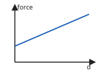

- [ ] ඉහළ යන වක්‍රයක් / Curve that rises (`wrong-power`). Real mistake?

  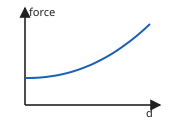

- [ ] පහළ යන සරල රේඛාවක් / Straight falling line (`swapped-support`). Real mistake?

  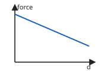

- [ ] ශුන්‍යයෙන් ආරම්භ වී ඉහළ යන සරල රේඛාවක් / Straight rising line that starts at zero (`ignored-condition`). Student sees: "පුද්ගලයා P හි සිටිය දී පවා බාල්කයේ බරින් කොටසක් Q මත පැටවේ." Real mistake?

  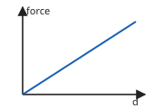

Explanation: සූර්ණ ගැනීමෙන් දුරට රේඛීය වන බලයක් ලැබේ. ආරම්භක අගය තීරණය වන්නේ බාල්කයේ බරිනි.  
Moments give a force linear in distance. The beam's own weight sets the starting value.

### phy.mech.p04 · L3 · F33 · scenario pool

Skill: `phy.mech.eq.moment-balance` (බාල්කයක සූර්ණ තුලනය / Moment balance on a beam). Draft difficulty: 2.

- [ ] OK
- [ ] Fix:

All scenarios are below.

**phy.mech.p04-01**

බාල්කයක් P සහ Q ආධාරක මත ඇති අතර එය මත පුද්ගලයෙක් සිටී. Q හි බලය සෙවිය යුතු ය. වඩාත් සෘජු පළමු පියවර කුමක් ද?  
A beam rests on supports P and Q, with a person on it. You need the force at Q. Most direct first step?

- **P වටා සූර්ණ ගන්න / Take moments about P**
- [ ] Q වටා සූර්ණ ගන්න / Take moments about Q (`unknown-not-eliminated`). Real mistake?
- [ ] පැටවුම සමානව බෙදන්න / Share the load equally (`assumed-symmetry`). Real mistake?
- [ ] ශක්ති සංස්ථිතිය යොදන්න / Use conservation of energy (`wrong-law`). Student sees: "සමතුලිතතා ගැටලුවකට අවශ්‍ය වන්නේ ශක්තිය නොව සූර්ණ ය." Real mistake?

Explanation: P වටා සූර්ණ ගැනීමෙන් P හි නොදන්නා බලය ඉවත් වේ.  
Moments about P remove the unknown force at P.

**phy.mech.p04-02**

ලෑල්ලක් A සහ B ආධාරක මත ඇති අතර එය මත තීන්ත ආලේප කරන්නෙක් සිටී. A හි බලය සෙවිය යුතු ය. වඩාත් සෘජු පළමු පියවර කුමක් ද?  
A plank rests on supports A and B, with a painter on it. You need the force at A. Most direct first step?

- **B වටා සූර්ණ ගන්න / Take moments about B**
- [ ] A වටා සූර්ණ ගන්න / Take moments about A (`unknown-not-eliminated`). Real mistake?
- පැටවුම සමානව බෙදන්න / Share the load equally (`assumed-symmetry`).
- ශක්ති සංස්ථිතිය යොදන්න / Use conservation of energy (`wrong-law`). Student sees: "සමතුලිතතා ගැටලුවකට අවශ්‍ය වන්නේ ශක්තිය නොව සූර්ණ ය."

Explanation: B වටා සූර්ණ ගැනීමෙන් B හි නොදන්නා බලය ඉවත් වේ.  
Moments about B remove the unknown force at B.

**phy.mech.p04-03**

දණ්ඩක එක් කෙළවරක් අසවු කර ඇති අතර අනෙක් කෙළවර තන්තුවකින් තිරස්ව රඳවා ඇත. තන්තුවේ ආතතිය සෙවිය යුතු ය. වඩාත් සෘජු පළමු පියවර කුමක් ද?  
A rod is hinged at one end and held level by a string at the other. You need the string's tension. Most direct first step?

- **අසව්ව වටා සූර්ණ ගන්න / Take moments about the hinge**
- [ ] තන්තුව වටා සූර්ණ ගන්න / Take moments about the string (`unknown-not-eliminated`). Real mistake?
- පැටවුම සමානව බෙදන්න / Share the load equally (`assumed-symmetry`).
- ශක්ති සංස්ථිතිය යොදන්න / Use conservation of energy (`wrong-law`). Student sees: "සමතුලිතතා ගැටලුවකට අවශ්‍ය වන්නේ ශක්තිය නොව සූර්ණ ය."

Explanation: අසව්ව වටා සූර්ණ ගැනීමෙන් අසව්වේ නොදන්නා බලය ඉවත් වේ.  
Moments about the hinge remove the unknown hinge force.

**phy.mech.p04-04**

ඉණිමගක් සිනිඳු බිත්තියකට හේත්තු වී රළු බිමක පිහිටා ඇත. බිත්තියේ බලය සෙවිය යුතු ය. වඩාත් සෘජු පළමු පියවර කුමක් ද?  
A ladder leans on a smooth wall and stands on rough ground. You need the wall's force. Most direct first step?

- **ඉණිමගේ පාදය වටා සූර්ණ ගන්න / Take moments about the ladder's foot**
- [ ] ඉණිමගේ ඉහළ කෙළවර වටා සූර්ණ ගන්න / Take moments about the top of the ladder (`unknown-not-eliminated`). Real mistake?
- පැටවුම සමානව බෙදන්න / Share the load equally (`assumed-symmetry`).
- ශක්ති සංස්ථිතිය යොදන්න / Use conservation of energy (`wrong-law`). Student sees: "සමතුලිතතා ගැටලුවකට අවශ්‍ය වන්නේ ශක්තිය නොව සූර්ණ ය."

Explanation: පාදයේ නොදන්නා බල දෙකක් ඇති අතර එය වටා සූර්ණ ගැනීමෙන් දෙකම ඉවත් වේ.  
The foot carries two unknown forces, and moments about it remove both.

**phy.mech.p04-05**

රාක්කයක් බිත්තියකට අසවු කර ආනත ආධාරක දණ්ඩකින් රඳවා ඇත. එම දණ්ඩේ බලය සෙවිය යුතු ය. වඩාත් සෘජු පළමු පියවර කුමක් ද?  
A shelf is hinged to a wall and held by a sloping strut. You need the strut's force. Most direct first step?

- **අසව්ව වටා සූර්ණ ගන්න / Take moments about the hinge**
- [ ] ආධාරක දණ්ඩේ සන්ධිය වටා සූර්ණ ගන්න / Take moments about the strut's joint (`unknown-not-eliminated`). Real mistake?
- පැටවුම සමානව බෙදන්න / Share the load equally (`assumed-symmetry`).
- ශක්ති සංස්ථිතිය යොදන්න / Use conservation of energy (`wrong-law`). Student sees: "සමතුලිතතා ගැටලුවකට අවශ්‍ය වන්නේ ශක්තිය නොව සූර්ණ ය."

Explanation: අසව්ව වටා සූර්ණ ගැනීමෙන් අසව්වේ නොදන්නා බලය ඉවත් වේ.  
Moments about the hinge remove the unknown hinge force.

**phy.mech.p04-06**

පාලමක තට්ටුවක් X සහ Y කණු මත ඇති අතර එය මත ට්‍රක් රථයක් ඇත. Y හි බලය සෙවිය යුතු ය. වඩාත් සෘජු පළමු පියවර කුමක් ද?  
A bridge deck rests on piers X and Y, with a truck on it. You need the force at Y. Most direct first step?

- **X වටා සූර්ණ ගන්න / Take moments about X**
- [ ] Y වටා සූර්ණ ගන්න / Take moments about Y (`unknown-not-eliminated`). Real mistake?
- පැටවුම සමානව බෙදන්න / Share the load equally (`assumed-symmetry`).
- ශක්ති සංස්ථිතිය යොදන්න / Use conservation of energy (`wrong-law`). Student sees: "සමතුලිතතා ගැටලුවකට අවශ්‍ය වන්නේ ශක්තිය නොව සූර්ණ ය."

Explanation: X වටා සූර්ණ ගැනීමෙන් X හි නොදන්නා බලය ඉවත් වේ.  
Moments about X remove the unknown force at X.

### phy.mech.t11 · L4 · F44 · 188 variants · skill mastery

Skill: `phy.mech.eq.moment-balance` (බාල්කයක සූර්ණ තුලනය / Moment balance on a beam). Draft difficulty: 3.

- [ ] OK
- [ ] Fix:

Mistakes in this template:

- [ ] `ignored-condition`: `m*g*d/L`. Student sees: "බාල්කයේ බර ද ආධාරක මත පැටවේ." (The beam's own weight also loads the supports.) Real mistake?
- [ ] `swapped-support`: `(M*g*L/2 + m*g*(L - d))/L`. Real mistake?
- [ ] `assumed-symmetry`: `(M + m)*g/2`. Real mistake?
- [ ] `forgot-g`: `(M*L/2 + m*d)/L`. Real mistake?
- [ ] `wrong-quantity`: `(M + m)*g`. Student sees: "එය ආධාරක දෙකේ බලවල එකතුවයි." (That's the total of both support forces.) Real mistake?
- [ ] `forgot-mass`: `M*g/2`. Real mistake?
- [ ] `stopped-early`: `m*g`. Student sees: "එය පුද්ගලයාගේ මුළු බරයි. නමුත් ආධාරක එය බෙදා ගනී." (That's the person's whole weight, but the supports share it.) Real mistake?

**Example 1:** රූපයේ P සහ Q ආධාරක මත ඇති 40 kg ඒකාකාර බාල්කයක් සහ ඒ මත සිටින 50 kg පුද්ගලයෙක් දැක්වේ. Q ආධාරකයෙන් ඇති වන බලය කුමක් ද?  
The figure shows a uniform 40 kg beam on supports at P and Q, with a 50 kg person standing on it. Force from support Q?

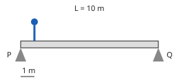

- 25 N (`forgot-g`)
- 50 N (`ignored-condition`)
- 200 N (`forgot-mass`)
- **250 N**
- 500 N (`stopped-early`)

**Example 2:** රූපයේ P සහ Q ආධාරක මත ඇති 100 kg ඒකාකාර බාල්කයක් සහ ඒ මත සිටින 60 kg පුද්ගලයෙක් දැක්වේ. Q ආධාරකයෙන් ඇති වන බලය කුමක් ද?  
The figure shows a uniform 100 kg beam on supports at P and Q, with a 60 kg person standing on it. Force from support Q?

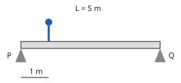

- 62 N (`forgot-g`)
- 120 N (`ignored-condition`)
- 500 N (`forgot-mass`)
- **620 N**
- 1600 N (`wrong-quantity`)

**Example 3:** රූපයේ P සහ Q ආධාරක මත ඇති 100 kg ඒකාකාර බාල්කයක් සහ ඒ මත සිටින 70 kg පුද්ගලයෙක් දැක්වේ. Q ආධාරකයෙන් ඇති වන බලය කුමක් ද?  
The figure shows a uniform 100 kg beam on supports at P and Q, with a 70 kg person standing on it. Force from support Q?

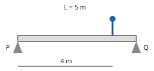

- 106 N (`forgot-g`)
- 640 N (`swapped-support`)
- 700 N (`stopped-early`)
- **1060 N**
- 1700 N (`wrong-quantity`)

Explanation: P වටා සූර්ණ ගැනීමෙන් P හි බලය ඉවත් වේ: Q × L = Mg × L/2 + mg × d.  
Moments about P remove the force at P: Q × L = Mg × L/2 + mg × d.
