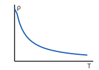
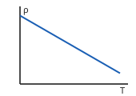
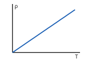
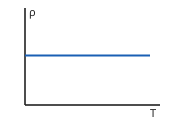
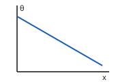
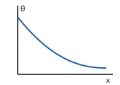
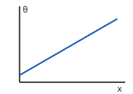
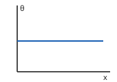
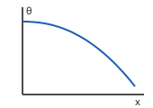

# Thermal Physics sample: teacher review

_Draft, not reviewed. Every item was written by AI, inspired by 20 past-paper MCQs (2016–2025). Nothing here is copied from a paper._

## How to review (about 3 hours)

UniKey is a daily practice app for A/L Physics students, in Sinhala medium. Each item below is a short multiple-choice question. The app marks it, and each wrong option records the mistake a student who picks it probably made. So we need you to check three things for every item:

1. **The physics is right**, and the bold answer is the only correct one.
2. **Each wrong option is a mistake students really make.** Tick ☐ *Real mistake?* if it is. If no student would pick it, leave it unticked and say why under *Fix*.
3. **The Sinhala reads like an A/L paper or the NIE textbook.** The Sinhala was drafted by AI from the English. Correct any word directly in the *Fix* line.

Then tick ☐ *OK*, or write what to change under ☐ *Fix*. Each skill also asks once whether it is the right skill for the item.

- **What's here:** 44 cards · 2 scenario pools (12 scenarios) · 12 templates and statement banks, which the code expands into 649 checked variants. Templates show 3 examples; check the listed mistakes once, then just read the examples.
- **Layers:** L1 = recall a fact, L2 = one idea, L3 = choose the method, L4 = a full problem with numbers that change each time.
- **Correct answer** is in bold. The code beside each wrong option, like `forgot-latent`, is the mistake it records. Their meanings are in the spec and in the tag table below.
- **Constants:** values such as c of water = 4200 J kg⁻¹ K⁻¹ and the latent heat of fusion = 3.36 × 10⁵ J kg⁻¹ are given in each stem. Please check they match what your students use.
- **Already checked by code:** the arithmetic of every variant, units, that no wording is copied from a past paper, option spacing, and answer positions. **Not checked by code:** teaching quality, whether the mistakes are real, and the Sinhala.

## New mistake tags to approve

These Thermal Physics mistake tags are proposed and not yet approved (content spec §12). Tick each one you agree is a real, distinct mistake. Change the student message if it would confuse a student.

| ☐ | Tag | Meaning | Message the student sees |
|---|---|---|---|
| ☐ | `celsius-in-gas-law` | Used °C instead of kelvin in a gas law | Gas laws need the absolute temperature, in kelvin. |
| ☐ | `forgot-latent` | Left out the heat needed to melt or boil | Melting or boiling takes heat too: add mL. |
| ☐ | `heat-during-change` | Thinks the temperature rises while a substance melts or boils | The temperature stays fixed while it melts or boils. |
| ☐ | `ice-all-melts` | Assumes all the ice melts without checking | Check there's enough heat to melt all the ice first. |
| ☐ | `hole-shrinks` | Thinks a hole in a plate gets smaller when the plate is heated | A hole expands as if it were made of the plate's metal. |
| ☐ | `expansion-reading` | Gets the direction of a hot or cold scale's reading error wrong | A hot scale's marks spread apart, so it reads short. |
| ☐ | `rh-vs-absolute` | Thinks a higher relative humidity always means more water vapour | Relative humidity also depends on the temperature. |
| ☐ | `svp-boyle` | Applies Boyle's law to a saturated vapour | Saturated vapour pressure doesn't change with volume. |
| ☐ | `ke-depends-on-gas` | Thinks the mean molecular KE depends on the gas, its pressure or volume | Mean KE depends only on the absolute temperature. |
| ☐ | `absolute-zero-myth` | Thinks water freezes, or gases liquefy, at absolute zero | At 0 K the mean KE of an ideal gas is zero. |
| ☐ | `isothermal-no-heat` | Thinks no heat flows in an isothermal process | Isothermal means ΔU = 0, but heat still flows. |
| ☐ | `adiabatic-constant-t` | Thinks an adiabatic process keeps the temperature constant | Adiabatic means no heat flows, but the temperature changes. |
| ☐ | `cooling-constant-rate` | Assumes an object cools at a steady rate | Cooling slows as the excess temperature falls. |
| ☐ | `room-temp-excess` | Uses the object's temperature, not its excess over the room | Newton's law uses the excess over the surroundings. |
| ☐ | `lagged-linear` | Expects a straight-line temperature fall along an unlagged rod | An unlagged rod loses heat along it, so the gradient changes. |

## Sinhala terms to confirm first

These are the term choices that change many items. Confirm each against the NIE textbook. Tell us the right word once and it changes everywhere.

| English | Used here | Why it needs checking |
|---|---|---|
| mean KE | මධ්‍යන්‍ය චාලක ශක්තිය | The glossary's "mean kinetic energy" uses ගතික, but its "kinetic energy" uses චාලක |
| adiabatic | අනුෂ්ණීය | From the glossary; some texts use ස්ථිරතාපී |
| isothermal | සමෝෂ්ණ | From the glossary |
| ideal gas equation | පරිපූර්ණ වායු සමීකරණය | The glossary spells it පරිසූර්ණ, which looks like a typo |
| heat reservoir | තාප ආශය | The glossary's "reservoir" is ජලාශය, a body of water |
| temperature gradient | උෂ්ණත්ව අනුක්‍රමණය | The glossary's උෂ්ණත්ව ව්‍යාප්තිය means distribution |
| lagged / unlagged | පරිවාරණය කළ / නොකළ | The glossary's "lagging" is පසුවීම, a time lag |
| thickness | ඝනකම | The glossary spells it සනකම |
| Newton's law of cooling | නිවුටන්ගේ සිසිලන නියමය | From the glossary; නිව්ටන් is the usual spelling |
| saturation | සංතෘප්තිය | The glossary also has සන්තෘප්තිය |
| not in the glossary | කාමරය (room), මිනුම් පටිය (measuring tape), කුහරය (hole), ජල තටාකය (water bath), අතිරික්ත උෂ්ණත්වය (excess temperature), චාලක වාදය (kinetic theory) | AI's own choices |

## Coverage against spec §9

| Skill | Type | L1 | L2 | Trap card | L3 pools | L4 | Small pool |
|---|---|---|---|---|---|---|---|
| Linear expansion | procedural | 2 | 3 | yes | 0 | 0 | 1 |
| Method of mixtures | procedural | 1 | 2 | yes | 0 | 1 | 0 |
| Continuous-flow heating | procedural | 0 | 2 | yes | 0 | 0 | 0 |
| Mixtures that melt or boil | procedural | 0 | 3 | yes | 0 | 1 | 0 |
| Latent heat by mixtures: sources of error | conceptual | 1 | 0 | no | 0 | 1 | 0 |
| Gas law graphs | conceptual | 1 | 2 | no | 0 | 0 | 0 |
| Ideal gas equation | procedural | 1 | 2 | yes | 1 | 1 | 0 |
| Mean molecular KE and absolute temperature | conceptual | 1 | 2 | no | 0 | 1 | 0 |
| r.m.s. speed and gas pressure | procedural | 1 | 2 | yes | 0 | 0 | 0 |
| Newton's law of cooling | procedural | 1 | 2 | yes | 0 | 1 | 0 |
| Absolute humidity and the mass of water vapour | procedural | 1 | 0 | no | 0 | 0 | 1 |
| Relative humidity | procedural | 0 | 1 | yes | 0 | 0 | 0 |
| Humidity when air is mixed | procedural | 0 | 1 | yes | 0 | 1 | 0 |
| How relative humidity changes with temperature | conceptual | 0 | 0 | no | 0 | 1 | 0 |
| Dew point | conceptual | 1 | 1 | no | 0 | 0 | 0 |
| First law of thermodynamics | procedural | 1 | 1 | yes | 0 | 1 | 0 |
| Thermodynamic processes | conceptual | 0 | 4 | no | 1 | 0 | 0 |
| Rods in series | procedural | 0 | 1 | no | 0 | 1 | 0 |
| Temperature along lagged and unlagged rods | conceptual | 0 | 3 | no | 0 | 0 | 0 |

## Source 2016-42

### phy.therm.c018 · L1 · F01

Skill: `phy.therm.gas.ideal-gas-equation` (පරිපූර්ණ වායු සමීකරණය / Ideal gas equation). Draft difficulty: 1.

- [ ] This skill is right (asked once per skill)
- [ ] OK
- [ ] Fix:

pV = nRT හි උෂ්ණත්වය T තිබිය යුත්තේ කුමන ඒකකයෙන් ද?  
In pV = nRT, the temperature T must be in?

- **කෙල්වින් / kelvin**
- [ ] °C (`celsius-in-gas-law`). Real mistake?
- [ ] °F (`celsius-in-gas-law`). Real mistake?
- [ ] °C හෝ කෙල්වින් ඕනෑම එකක් / Either °C or kelvin (`celsius-in-gas-law`). Real mistake?

Explanation: වායු නියම නිරපේක්ෂ උෂ්ණත්වය භාවිත කරයි.  
Gas laws use the absolute temperature.

### phy.therm.c019 · L2 · F13

Skill: `phy.therm.gas.ideal-gas-equation` (පරිපූර්ණ වායු සමීකරණය / Ideal gas equation). Draft difficulty: 2.

- [ ] OK
- [ ] Fix:

27 °C හි මුද්‍රා තැබූ වායුවක් නියත පරිමාවේ දී 127 °C දක්වා රත් කෙරේ. පීඩනය × ?  
A sealed gas at 27 °C is heated to 127 °C at constant volume. Pressure × ?

- **4/3**
- [ ] 127/27 (`celsius-in-gas-law`). Real mistake?
- [ ] 1 (`ignored-condition`). Student sees: "නියත පරිමාවේ දී T සමඟ p වැඩි වේ." Real mistake?
- [ ] 3/4 (`inverted`). Real mistake?

Explanation: p ∝ T, කෙල්වින් වලින්: 400 K ÷ 300 K.  
p ∝ T in kelvin: 400 K ÷ 300 K.

### phy.therm.c020 · L2 · F14

Skill: `phy.therm.gas.ideal-gas-equation` (පරිපූර්ණ වායු සමීකරණය / Ideal gas equation). Draft difficulty: 2.

- [ ] OK
- [ ] Fix:

සිසුවා පවසයි: "නියත පරිමාවේ දී වායුවක සෙල්සියස් උෂ්ණත්වය දෙගුණ කිරීම එහි පීඩනය දෙගුණ කරයි." වැරැද්ද කුමක් ද?  
Student says: "Doubling a gas's Celsius temperature doubles its pressure at constant volume." What's wrong?

- **p ∝ T වන්නේ කෙල්වින් වලින් පමණි / p ∝ T only in kelvin**
- [ ] කිසිවක් නැත: p ∝ θ / Nothing: p ∝ θ (`celsius-in-gas-law`). Real mistake?
- [ ] ඒ වෙනුවට පීඩනය අඩක් වේ / The pressure halves instead (`inverted`). Real mistake?
- [ ] පීඩනය උෂ්ණත්වය මත රඳා නොපවතී / Pressure doesn't depend on temperature (`wrong-law`). Student sees: "නියත පරිමාවේ දී p ∝ T, කෙල්වින් වලින්." Real mistake?

Explanation: 20 °C සිට 40 °C යනු 293 K සිට 313 K දක්වා, ආසන්න වශයෙන් 7% ක වැඩි වීමක් පමණි.  
20 °C to 40 °C is 293 K to 313 K, a rise of only about 7%.

### phy.therm.p02 · L3 · F30 · scenario pool

Skill: `phy.therm.gas.ideal-gas-equation` (පරිපූර්ණ වායු සමීකරණය / Ideal gas equation). Draft difficulty: 2.

- [ ] OK
- [ ] Fix:

All scenarios are below.

**phy.therm.p02-01**

බැලූනයක් කාමර උෂ්ණත්වයේ දී සෙමින් තද කෙරේ. එහි නව පීඩනය සෙවිය යුතු ය. වඩාත්ම සෘජු නියමය කුමක් ද?  
A balloon is squeezed slowly at room temperature. You need its new pressure. Most direct law?

- **බොයිල් නියමය / Boyle's law**
- [ ] චාර්ල්ස් නියමය / Charles's law (`wrong-quantity`). Student sees: "චාර්ල්ස් නියමයට නියත පීඩනයක් අවශ්‍ය වන අතර මෙහි එය නියත නොවේ." Real mistake?
- [ ] පීඩන නියමය / The pressure law (`ignored-condition`). Student sees: "මෙහි පරිමාව වෙනස් වේ, එබැවින් පීඩන නියමය අදාළ නොවේ." Real mistake?
- [ ] ඩෝල්ටන් නියමය / Dalton's law (`wrong-law`). Student sees: "ඩෝල්ටන් නියමය වායු මිශ්‍රණයක් සඳහා ය. මෙහි ඇත්තේ එක් වායුවක් පමණි." Real mistake?

Explanation: උෂ්ණත්වය සහ වායු ප්‍රමාණය අචලව පවතී.  
The temperature and the amount of gas stay fixed.

**phy.therm.p02-02**

මුද්‍රා තැබූ සිරිංජයක් එහි උෂ්ණත්වය නොවෙනස්ව සෙමින් ඇතුළට තල්ලු කෙරේ. නව පීඩනය සෙවිය යුතු ය. වඩාත්ම සෘජු නියමය කුමක් ද?  
A sealed syringe is pushed in slowly, with its temperature unchanged. You need the new pressure. Most direct law?

- **බොයිල් නියමය / Boyle's law**
- චාර්ල්ස් නියමය / Charles's law (`wrong-quantity`). Student sees: "චාර්ල්ස් නියමයට නියත පීඩනයක් අවශ්‍ය වන අතර මෙහි එය නියත නොවේ."
- පීඩන නියමය / The pressure law (`ignored-condition`). Student sees: "මෙහි පරිමාව වෙනස් වේ, එබැවින් පීඩන නියමය අදාළ නොවේ."
- ඩෝල්ටන් නියමය / Dalton's law (`wrong-law`). Student sees: "ඩෝල්ටන් නියමය වායු මිශ්‍රණයක් සඳහා ය. මෙහි ඇත්තේ එක් වායුවක් පමණි."

Explanation: අචල ස්කන්ධය සහ උෂ්ණත්වය: pV නියත ය.  
Fixed mass and temperature: pV is constant.

**phy.therm.p02-03**

වායුව ඇති මුද්‍රා තැබූ දෘඪ ටින් එකක් රත් කෙරේ. නව පීඩනය සෙවිය යුතු ය. වඩාත්ම සෘජු නියමය කුමක් ද?  
A sealed, rigid can of gas is heated. You need the new pressure. Most direct law?

- **පීඩන නියමය / The pressure law**
- [ ] බොයිල් නියමය / Boyle's law (`ignored-condition`). Student sees: "මෙහි උෂ්ණත්වය වෙනස් වේ, එබැවින් pV නියත නොවේ." Real mistake?
- චාර්ල්ස් නියමය / Charles's law (`wrong-quantity`). Student sees: "චාර්ල්ස් නියමයට නියත පීඩනයක් අවශ්‍ය වන අතර මෙහි එය නියත නොවේ."
- ඩෝල්ටන් නියමය / Dalton's law (`wrong-law`). Student sees: "ඩෝල්ටන් නියමය වායු මිශ්‍රණයක් සඳහා ය. මෙහි ඇත්තේ එක් වායුවක් පමණි."

Explanation: පරිමාව වෙනස් විය නොහැක, එබැවින් p ∝ T.  
The volume can't change, so p ∝ T.

**phy.therm.p02-04**

වායුව ඇති වසා ඇති වානේ සිලින්ඩරයක් අව්වේ රත් වේ. නව පීඩනය සෙවිය යුතු ය. වඩාත්ම සෘජු නියමය කුමක් ද?  
A closed steel cylinder of gas warms in the sun. You need the new pressure. Most direct law?

- **පීඩන නියමය / The pressure law**
- බොයිල් නියමය / Boyle's law (`ignored-condition`). Student sees: "මෙහි උෂ්ණත්වය වෙනස් වේ, එබැවින් pV නියත නොවේ."
- චාර්ල්ස් නියමය / Charles's law (`wrong-quantity`). Student sees: "චාර්ල්ස් නියමයට නියත පීඩනයක් අවශ්‍ය වන අතර මෙහි එය නියත නොවේ."
- ඩෝල්ටන් නියමය / Dalton's law (`wrong-law`). Student sees: "ඩෝල්ටන් නියමය වායු මිශ්‍රණයක් සඳහා ය. මෙහි ඇත්තේ එක් වායුවක් පමණි."

Explanation: අචල පරිමාව, එබැවින් p ∝ T.  
Fixed volume, so p ∝ T.

**phy.therm.p02-05**

නිදහස්, ඝර්ෂණ රහිත පිස්ටනයක් යට ඇති වායුවක් රත් කෙරේ. එහි නව පරිමාව සෙවිය යුතු ය. වඩාත්ම සෘජු නියමය කුමක් ද?  
Gas under a free, frictionless piston is heated. You need its new volume. Most direct law?

- **චාර්ල්ස් නියමය / Charles's law**
- බොයිල් නියමය / Boyle's law (`ignored-condition`). Student sees: "මෙහි උෂ්ණත්වය වෙනස් වේ, එබැවින් pV නියත නොවේ."
- [ ] පීඩන නියමය / The pressure law (`wrong-quantity`). Student sees: "මෙහි පීඩනය අචල ය. වෙනස් වන්නේ පරිමාවයි." Real mistake?
- ඩෝල්ටන් නියමය / Dalton's law (`wrong-law`). Student sees: "ඩෝල්ටන් නියමය වායු මිශ්‍රණයක් සඳහා ය. මෙහි ඇත්තේ එක් වායුවක් පමණි."

Explanation: පිස්ටනය පීඩනය අචලව තබයි, එබැවින් V ∝ T.  
The piston keeps the pressure fixed, so V ∝ T.

**phy.therm.p02-06**

සබන් බුබුළක වාතය නියත පීඩනයේ දී සිසිල් වේ. එහි නව පරිමාව සෙවිය යුතු ය. වඩාත්ම සෘජු නියමය කුමක් ද?  
A soap bubble's air cools at constant pressure. You need its new volume. Most direct law?

- **චාර්ල්ස් නියමය / Charles's law**
- බොයිල් නියමය / Boyle's law (`ignored-condition`). Student sees: "මෙහි උෂ්ණත්වය වෙනස් වේ, එබැවින් pV නියත නොවේ."
- පීඩන නියමය / The pressure law (`wrong-quantity`). Student sees: "මෙහි පීඩනය අචල ය. වෙනස් වන්නේ පරිමාවයි."
- ඩෝල්ටන් නියමය / Dalton's law (`wrong-law`). Student sees: "ඩෝල්ටන් නියමය වායු මිශ්‍රණයක් සඳහා ය. මෙහි ඇත්තේ එක් වායුවක් පමණි."

Explanation: නියත පීඩනය, එබැවින් V ∝ T.  
Constant pressure, so V ∝ T.

### phy.therm.t04 · L4 · F40 · 25 variants · skill mastery

Skill: `phy.therm.gas.ideal-gas-equation` (පරිපූර්ණ වායු සමීකරණය / Ideal gas equation). Draft difficulty: 4.

- [ ] OK
- [ ] Fix:

Mistakes in this template:

- [ ] `celsius-in-gas-law`: `1 - (p2/p1)*T1/T2`. Real mistake?
- [ ] `stopped-early`: `(p2/p1)*(T1 + 273)/(T2 + 273)`. Student sees: "එය ඉතිරි වූ භාගයයි. එය 1 න් අඩු කරන්න." (That's the fraction left. Subtract it from 1.) Real mistake?
- [ ] `ignored-condition`: `1 - p2/p1`. Student sees: "රත් කිරීම ද පීඩනය වැඩි කළේ ය, එබැවින් T ද සලකන්න." (Heating also raised the pressure, so allow for T.) Real mistake?
- [ ] `inverted`: `1 - (p1/p2)*(T1 + 273)/(T2 + 273)`. Real mistake?
- [ ] `wrong-law`: `1 - (T1 + 273)/(T2 + 273)`. Student sees: "පීඩනය ද වෙනස් විය. n ∝ p/T භාවිත කරන්න." (The pressure changed too. Use n ∝ p/T.) Real mistake?
- [ ] `misread-interval`: `(1 - p2/p1)*(T1 + 273)/(T2 + 273)`. Student sees: "p₂/p₁ සම්පූර්ණයෙන්ම උෂ්ණත්වවලින් පරිමාණය කර, ඉන්පසු 1 න් අඩු කරන්න." (Scale the whole of p₂/p₁ by the temperatures, then subtract from 1.) Real mistake?

**Example 1:** දෘඪ සිලින්ඩරයක 100 kPa සහ 127 °C හි වායුව ඇත. වායුවෙන් කොටසක් කාන්දු වී, ඉතිරිය 227 °C දක්වා රත් කෙරේ. දැන් පීඩනය 90 kPa වේ. කාන්දු වූ වායු භාගය කීය ද?  
A rigid cylinder holds gas at 100 kPa and 127 °C. Some gas leaks out, and the rest is heated to 227 °C. The pressure is now 90 kPa. Fraction of the gas that leaked out?

- 0.08 (`misread-interval`)
- 0.1 (`ignored-condition`)
- 0.2 (`wrong-law`)
- **0.28**
- 0.72 (`stopped-early`)

**Example 2:** දෘඪ සිලින්ඩරයක 240 kPa සහ 27 °C හි වායුව ඇත. වායුවෙන් කොටසක් කාන්දු වී, ඉතිරිය 227 °C දක්වා රත් කෙරේ. දැන් පීඩනය 180 kPa වේ. කාන්දු වූ වායු භාගය කීය ද?  
A rigid cylinder holds gas at 240 kPa and 27 °C. Some gas leaks out, and the rest is heated to 227 °C. The pressure is now 180 kPa. Fraction of the gas that leaked out?

- 0.15 (`misread-interval`)
- 0.25 (`ignored-condition`)
- 0.4 (`wrong-law`)
- 0.45 (`stopped-early`)
- **0.55**

**Example 3:** දෘඪ සිලින්ඩරයක 300 kPa සහ 27 °C හි වායුව ඇත. වායුවෙන් කොටසක් කාන්දු වී, ඉතිරිය 327 °C දක්වා රත් කෙරේ. දැන් පීඩනය 60 kPa වේ. කාන්දු වූ වායු භාගය කීය ද?  
A rigid cylinder holds gas at 300 kPa and 27 °C. Some gas leaks out, and the rest is heated to 327 °C. The pressure is now 60 kPa. Fraction of the gas that leaked out?

- 0.1 (`stopped-early`)
- 0.4 (`misread-interval`)
- 0.5 (`wrong-law`)
- 0.8 (`ignored-condition`)
- **0.9**

Explanation: අචල පරිමාවේ දී n ∝ p/T. ඉතිරි භාගය = (p₂/T₂) ÷ (p₁/T₁), T කෙල්වින් වලින්.  
n ∝ p/T at fixed volume. Fraction left = (p₂/T₂) ÷ (p₁/T₁), with T in kelvin.

## Source 2017-36

### phy.therm.c014 · L1 · F01

Skill: `phy.therm.state.latent-errors` (මිශ්‍රණ ක්‍රමයෙන් ගුප්ත තාපය: දෝෂ ප්‍රභව / Latent heat by mixtures: sources of error). Draft difficulty: 1.

- [ ] This skill is right (asked once per skill)
- [ ] OK
- [ ] Fix:

මිශ්‍රණ ක්‍රමයෙන් අයිස්වල විලයනයේ ගුප්ත තාපය සෙවීමට අයිස් තිබිය යුත්තේ කෙසේ ද?  
To find the latent heat of fusion of ice by mixtures, the ice should be?

- **වියළි සහ 0 °C හි / Dry and at 0 °C**
- තෙත් සහ 0 °C හි / Wet and at 0 °C (`recall-gap`).
- වියළි සහ 0 °C ට බොහෝ පහළින් / Dry and well below 0 °C (`recall-gap`).
- කුඩු කළ සහ තෙත් / Crushed and wet (`recall-gap`).

Explanation: අයිස් මත ඇති ජලය හෝ 0 °C ට පහළ අයිස්, ගණනයෙන් මඟහැරෙන තාප පද එකතු කරයි.  
Water on the ice, or ice below 0 °C, adds heat terms the calculation leaves out.

### phy.therm.b01 · L4 · F42 · 28 variants · skill mastery

Skill: `phy.therm.state.latent-errors` (මිශ්‍රණ ක්‍රමයෙන් ගුප්ත තාපය: දෝෂ ප්‍රභව / Latent heat by mixtures: sources of error). Draft difficulty: 3.

- [ ] OK
- [ ] Fix:

Statement bank (tick each false statement if students really believe it):

- True: කාමරයෙන් ලැබෙන තාපය නිසා මනින ලද අයිස්වල ගුප්ත තාපය ඉතා කුඩා වේ. / Heat taken in from the room makes the measured latent heat of ice too small.
- True: තෙත් අයිස් නිසා මනින ලද අයිස්වල ගුප්ත තාපය ඉතා කුඩා වේ. / Wet ice makes the measured latent heat of ice too small.
- True: 0 °C ට වඩා සීතල අයිස් නිසා මනින ලද ගුප්ත තාපය ඉතා විශාල වේ. / Ice colder than 0 °C makes the measured latent heat too large.
- True: ආරම්භයේ දී කාමර උෂ්ණත්වයට ඉහළින් සිටි තරමටම පහළින් අවසන් කිරීම තාප හුවමාරුවෙන් වැඩි කොටසක් අවලංගු කරයි. / Ending as far below room temperature as you started above it cancels most heat exchange.
- [ ] False (`inverted`): තෙත් අයිස් නිසා මනින ලද අයිස්වල ගුප්ත තාපය ඉතා විශාල වේ. / Wet ice makes the measured latent heat of ice too large.
- [ ] False (`inverted`): 0 °C ට වඩා සීතල අයිස් නිසා මනින ලද ගුප්ත තාපය ඉතා කුඩා වේ. / Ice colder than 0 °C makes the measured latent heat too small.
- [ ] False (`heat-during-change`): අයිස් දිය වන අතරතුර මිශ්‍රණයේ උෂ්ණත්වය ඒකාකාරව වැඩි වේ. / The mixture's temperature rises steadily while the ice melts.
- [ ] False (`forgot-latent`): කැලරිමීටරය මත තුෂාරය ඇති වීමෙන් එයට අමතර තාපයක් නොලැබේ. / Dew forming on the calorimeter gives it no extra heat.

**Example 1:** A: තෙත් අයිස් නිසා මනින ලද අයිස්වල ගුප්ත තාපය ඉතා කුඩා වේ.  
B: කාමරයෙන් ලැබෙන තාපය නිසා මනින ලද අයිස්වල ගුප්ත තාපය ඉතා කුඩා වේ.  
C: 0 °C ට වඩා සීතල අයිස් නිසා මනින ලද ගුප්ත තාපය ඉතා විශාල වේ.  
සත්‍ය වන්නේ කුමක් ද?  
A: Wet ice makes the measured latent heat of ice too small. / B: Heat taken in from the room makes the measured latent heat of ice too small. / C: Ice colder than 0 °C makes the measured latent heat too large. / Which are true?

- A පමණි / A only (`missed-true-statement`)
- A සහ B පමණි / A and B only (`missed-true-statement`)
- A සහ C පමණි / A and C only (`missed-true-statement`)
- B සහ C පමණි / B and C only (`missed-true-statement`)
- **A, B සහ C සියල්ල / A, B and C**

**Example 2:** A: කාමරයෙන් ලැබෙන තාපය නිසා මනින ලද අයිස්වල ගුප්ත තාපය ඉතා කුඩා වේ.  
B: 0 °C ට වඩා සීතල අයිස් නිසා මනින ලද ගුප්ත තාපය ඉතා කුඩා වේ.  
C: තෙත් අයිස් නිසා මනින ලද අයිස්වල ගුප්ත තාපය ඉතා කුඩා වේ.  
සත්‍ය වන්නේ කුමක් ද?  
A: Heat taken in from the room makes the measured latent heat of ice too small. / B: Ice colder than 0 °C makes the measured latent heat too small. / C: Wet ice makes the measured latent heat of ice too small. / Which are true?

- A පමණි / A only (`missed-true-statement`)
- A සහ B පමණි / A and B only (`inverted`)
- **A සහ C පමණි / A and C only**
- B සහ C පමණි / B and C only (`inverted`)
- A, B සහ C සියල්ල / A, B and C (`inverted`)

**Example 3:** A: අයිස් දිය වන අතරතුර මිශ්‍රණයේ උෂ්ණත්වය ඒකාකාරව වැඩි වේ.  
B: තෙත් අයිස් නිසා මනින ලද අයිස්වල ගුප්ත තාපය ඉතා කුඩා වේ.  
C: කාමරයෙන් ලැබෙන තාපය නිසා මනින ලද අයිස්වල ගුප්ත තාපය ඉතා කුඩා වේ.  
සත්‍ය වන්නේ කුමක් ද?  
A: The mixture's temperature rises steadily while the ice melts. / B: Wet ice makes the measured latent heat of ice too small. / C: Heat taken in from the room makes the measured latent heat of ice too small. / Which are true?

- A පමණි / A only (`heat-during-change`)
- A සහ B පමණි / A and B only (`heat-during-change`)
- A සහ C පමණි / A and C only (`heat-during-change`)
- **B සහ C පමණි / B and C only**
- A, B සහ C සියල්ල / A, B and C (`heat-during-change`)

Explanation: ගණනයෙන් මඟහැරෙන ඕනෑම තාපයක් L හි දෝෂයක් ලෙස පෙනේ: කාමරයෙන් හෝ තුෂාරයෙන් තාපය එකතු වේ, තෙත් අයිස් කිසිදා දිය නොවූ ස්කන්ධයක් එකතු කරයි, සහ සීතල අයිස් රත් වීමට අමතර තාපයක් අවශ්‍ය වේ.  
Any heat the calculation leaves out shows up as an error in L: heat from the room or dew adds heat, wet ice adds mass that never melted, and cold ice needs extra heat to warm.

## Source 2018-40

### phy.therm.c041 · L2 · F19

Skill: `phy.therm.cond.composite-rods` (ශ්‍රේණිගත දඬු / Rods in series). Draft difficulty: 2.

- [ ] This skill is right (asked once per skill)
- [ ] OK
- [ ] Fix:

සන්නායකතා k සහ 3k වූ එකම ප්‍රමාණයේ දඬු දෙකක් තාප ආශය දෙකක් අතර කෙළවරින් කෙළවරට සම්බන්ධ කර ඇත. k දණ්ඩ හරහා උෂ්ණත්ව අඩු වීම ÷ මුළු අඩු වීම?  
Two rods of the same size, with conductivities k and 3k, are joined end to end between two reservoirs. Temperature drop across the k rod ÷ total drop?

- **¾**
- [ ] ¼ (`inverted`). Real mistake?
- [ ] ½ (`assumed-symmetry`). Real mistake?
- [ ] 1 (`ignored-condition`). Student sees: "අනෙක් දණ්ඩ හරහා ද උෂ්ණත්ව අඩු වීමක් ඇත." Real mistake?

Explanation: දෙක හරහාම එකම තාපය ගලයි, එබැවින් k කුඩා තැන අඩු වීම විශාල ය: 3 : 1.  
The same heat flows through both, so the drop is larger where k is smaller: 3 : 1.

### phy.therm.t09 · L4 · F40 · 70 variants · skill mastery

Skill: `phy.therm.cond.composite-rods` (ශ්‍රේණිගත දඬු / Rods in series). Draft difficulty: 4.

- [ ] OK
- [ ] Fix:

Mistakes in this template:

- [ ] `inverted`: `(k2*Th + k1*Tc)/(k1 + k2)`. Real mistake?
- [ ] `assumed-symmetry`: `(Th + Tc)/2`. Real mistake?
- [ ] `stopped-early`: `(Th - Tc)*k1/(k1 + k2)`. Student sees: "එය සීතල කෙළවරට වඩා වැඩි වීමයි. සීතල කෙළවරේ උෂ්ණත්වය එකතු කරන්න." (That's the rise above the cold end. Add the cold end's temperature.) Real mistake?
- [ ] `misread-interval`: `Th*k1/(k1 + k2)`. Student sees: "0 °C සිට නොව, කෙළවර දෙක අතර අඩු වීම බෙදන්න." (Share out the drop between the two ends, not from 0 °C.) Real mistake?
- [ ] `sign`: `(k1*Th - k2*Tc)/(k1 + k2)`. Real mistake?

**Example 1:** සමාන දිග සහ හරස්කඩ ඇති, සන්නායකතා 10 සහ 90 W m⁻¹ K⁻¹ වූ දඬු දෙකක් කෙළවරින් කෙළවරට සම්බන්ධ කර පරිවාරණය කර ඇත. පළමු දණ්ඩේ නිදහස් කෙළවර 80 °C හි ද, දෙවැන්නේ නිදහස් කෙළවර 10 °C හි ද තබා ඇත. සන්ධියේ උෂ්ණත්වය කීය ද?  
Two rods of equal length and cross-section, with conductivities 10 and 90 W m⁻¹ K⁻¹, are joined end to end and lagged. The free end of the first is held at 80 °C, and of the second at 10 °C. Temperature of the joint?

- 7 °C (`stopped-early`)
- 8 °C (`misread-interval`)
- **17 °C**
- 45 °C (`assumed-symmetry`)
- 73 °C (`inverted`)

**Example 2:** සමාන දිග සහ හරස්කඩ ඇති, සන්නායකතා 60 සහ 90 W m⁻¹ K⁻¹ වූ දඬු දෙකක් කෙළවරින් කෙළවරට සම්බන්ධ කර පරිවාරණය කර ඇත. පළමු දණ්ඩේ නිදහස් කෙළවර 80 °C හි ද, දෙවැන්නේ නිදහස් කෙළවර 20 °C හි ද තබා ඇත. සන්ධියේ උෂ්ණත්වය කීය ද?  
Two rods of equal length and cross-section, with conductivities 60 and 90 W m⁻¹ K⁻¹, are joined end to end and lagged. The free end of the first is held at 80 °C, and of the second at 20 °C. Temperature of the joint?

- 20 °C (`sign`)
- 24 °C (`stopped-early`)
- 32 °C (`misread-interval`)
- **44 °C**
- 50 °C (`assumed-symmetry`)

**Example 3:** සමාන දිග සහ හරස්කඩ ඇති, සන්නායකතා 200 සහ 50 W m⁻¹ K⁻¹ වූ දඬු දෙකක් කෙළවරින් කෙළවරට සම්බන්ධ කර පරිවාරණය කර ඇත. පළමු දණ්ඩේ නිදහස් කෙළවර 100 °C හි ද, දෙවැන්නේ නිදහස් කෙළවර 30 °C හි ද තබා ඇත. සන්ධියේ උෂ්ණත්වය කීය ද?  
Two rods of equal length and cross-section, with conductivities 200 and 50 W m⁻¹ K⁻¹, are joined end to end and lagged. The free end of the first is held at 100 °C, and of the second at 30 °C. Temperature of the joint?

- 44 °C (`inverted`)
- 56 °C (`stopped-early`)
- 65 °C (`assumed-symmetry`)
- 74 °C (`sign`)
- **86 °C**

Explanation: දඬු දෙක හරහාම එකම තාපය ගලයි: k₁(θ_h − θ) = k₂(θ − θ_c).  
The same heat flows through both rods: k₁(θ_h − θ) = k₂(θ − θ_c).

## Source 2019-13

### phy.therm.c031 · L2 · F13

Skill: `phy.therm.hum.relative-humidity` (සාපේක්ෂ ආර්ද්‍රතාව / Relative humidity). Draft difficulty: 2.

- [ ] This skill is right (asked once per skill)
- [ ] OK
- [ ] Fix:

30 °C හි වාතයක තුෂාර අංකය 20 °C වේ. ජලයේ සංතෘප්ත වාෂ්ප පීඩනය (SVP) 30 °C හි 4.2 kPa ද 20 °C හි 2.3 kPa ද වේ. සාපේක්ෂ ආර්ද්‍රතාව කීය ද?  
Air at 30 °C has a dew point of 20 °C. The SVP of water is 4.2 kPa at 30 °C and 2.3 kPa at 20 °C. Relative humidity?

- **55%**
- [ ] 182% (`inverted`). Real mistake?
- [ ] 67% (`wrong-law`). Student sees: "RH උෂ්ණත්ව නොව, වාෂ්ප පීඩන භාවිත කරයි." Real mistake?
- [ ] 45% (`wrong-quantity`). Student sees: "එය 100% න් RH අඩු කළ අගයයි." Real mistake?

Explanation: වාෂ්ප පීඩනය තුෂාර අංකයේ SVP ට සමාන ය, එබැවින් RH = 2.3 ÷ 4.2.  
The vapour pressure equals the SVP at the dew point, so RH = 2.3 ÷ 4.2.

### phy.therm.c032 · L1 · F01

Skill: `phy.therm.hum.dew-point` (තුෂාර අංකය / Dew point). Draft difficulty: 1.

- [ ] This skill is right (asked once per skill)
- [ ] OK
- [ ] Fix:

තුෂාර අංකය යනු කුමක් සිදු වන උෂ්ණත්වය ද?  
The dew point is the temperature at which?

- **වාතයේම ඇති වාෂ්පය එය හරියටම සංතෘප්ත කරයි / The air's own vapour just saturates it**
- ජලය නැටීමට පටන් ගනී / Water starts to boil (`recall-gap`).
- ජලය මිදීමට පටන් ගනී / Water starts to freeze (`recall-gap`).
- වාතයේ ඇති සියලු වාෂ්ප ඝනීභවනය වේ / All the vapour in the air condenses (`recall-gap`).

Explanation: තුෂාර අංකය දක්වා සිසිල් කළ විට, වාතය දැනටමත් දරන වාෂ්පයෙන් සංතෘප්ත වේ.  
Cooled to the dew point, the air becomes saturated with the vapour it already holds.

### phy.therm.c033 · L2 · F10

Skill: `phy.therm.hum.dew-point` (තුෂාර අංකය / Dew point). Draft difficulty: 2.

- [ ] OK
- [ ] Fix:

නියත උෂ්ණත්වයේ දී සංතෘප්ත වාතයේ පරිමාව අඩු කිරීම එහි වාෂ්ප පීඩනය වැඩි කරයි.  
Reducing the volume of saturated air at constant temperature raises its vapour pressure.

- **අසත්‍ය / False**
- [ ] සත්‍ය / True (`svp-boyle`). Real mistake?

Explanation: අමතර වාෂ්ප ඝනීභවනය වේ, එබැවින් සංතෘප්ත වාෂ්ප පීඩනය නොවෙනස්ව පවතී.  
Extra vapour condenses, so the saturated vapour pressure stays the same.

## Source 2019-15

### phy.therm.c024 · L1 · F01

Skill: `phy.therm.kin.rms-speed` (r.m.s. වේගය සහ වායු පීඩනය / r.m.s. speed and gas pressure). Draft difficulty: 1.

- [ ] This skill is right (asked once per skill)
- [ ] OK
- [ ] Fix:

චාලක වාදය: p = ?  
Kinetic theory: p = ?

- **⅓ρc̄²**
- ½ρc̄² (`recall-gap`).
- ρc̄² (`recall-gap`).
- ⅓ρc̄ (`recall-gap`).

Explanation: p = ⅓ρc̄², මෙහි c̄² යනු මධ්‍යන්‍ය වර්ග වේගයයි.  
p = ⅓ρc̄², where c̄² is the mean square speed.

### phy.therm.c025 · L2 · F12

Skill: `phy.therm.kin.rms-speed` (r.m.s. වේගය සහ වායු පීඩනය / r.m.s. speed and gas pressure). Draft difficulty: 2.

- [ ] OK
- [ ] Fix:

එකම වායුව, නිරපේක්ෂ උෂ්ණත්වය × 4. r.m.s. වේගය × ?  
The same gas, absolute temperature × 4. r.m.s. speed × ?

- **2**
- [ ] 4 (`forgot-square`). Real mistake?
- [ ] 16 (`wrong-power`). Real mistake?
- [ ] ½ (`inverted`). Real mistake?

Explanation: c_rms ∝ √T.  
c_rms ∝ √T.

### phy.therm.c026 · L2 · F13

Skill: `phy.therm.kin.rms-speed` (r.m.s. වේගය සහ වායු පීඩනය / r.m.s. speed and gas pressure). Draft difficulty: 2.

- [ ] OK
- [ ] Fix:

1.2 × 10⁵ Pa හි ඇති වායුවක අණුවල වර්ග මධ්‍යන්‍ය මූල (r.m.s.) වේගය 600 m s⁻¹ වේ. එහි ඝනත්වය කීය ද?  
A gas at 1.2 × 10⁵ Pa has an r.m.s. molecular speed of 600 m s⁻¹. Its density?

- **1.0 kg m⁻³**
- [ ] 0.33 kg m⁻³ (`ignored-condition`). Student sees: "3 ඇතුළත් කරන්න: ρ = 3p ÷ c̄²." Real mistake?
- [ ] 0.67 kg m⁻³ (`wrong-law`). Student sees: "සාධකය ½ නොව, ⅓ වේ." Real mistake?
- [ ] 600 kg m⁻³ (`forgot-square`). Real mistake?

Explanation: ρ = 3p ÷ c̄² = 3.6 × 10⁵ ÷ 3.6 × 10⁵.  
ρ = 3p ÷ c̄² = 3.6 × 10⁵ ÷ 3.6 × 10⁵.

## Source 2019-42

### phy.therm.c006 · L1 · F02

Skill: `phy.therm.heat.mixtures` (මිශ්‍රණ ක්‍රමය / Method of mixtures). Draft difficulty: 1.

- [ ] This skill is right (asked once per skill)
- [ ] OK
- [ ] Fix:

වස්තුවක් රත් කිරීමට තාපය: Q = m c ▢  
Heat to warm a body: Q = m c ▢

- **Δθ**
- θ (`recall-gap`).
- t (`recall-gap`).
- L (`recall-gap`).

Explanation: Q = mcΔθ, උෂ්ණත්ව වෙනස භාවිත කරමින්.  
Q = mcΔθ, using the change in temperature.

### phy.therm.c007 · L2 · F13

Skill: `phy.therm.heat.mixtures` (මිශ්‍රණ ක්‍රමය / Method of mixtures). Draft difficulty: 2.

- [ ] OK
- [ ] Fix:

80 °C හි ජලය 100 g ක් 20 °C හි ජලය 300 g ක් සමඟ, තාප හානියක් නොමැතිව මිශ්‍ර කෙරේ. අවසාන උෂ්ණත්වය කීය ද?  
100 g of water at 80 °C is mixed with 300 g of water at 20 °C, with no heat loss. Final temperature?

- **35 °C**
- [ ] 50 °C (`assumed-symmetry`). Real mistake?
- [ ] 65 °C (`inverted`). Real mistake?
- [ ] 60 °C (`wrong-quantity`). Student sees: "එය උෂ්ණත්ව දෙකේ වෙනසයි." Real mistake?

Explanation: හානි වූ තාපය = ලැබුණු තාපය: 100 × (80 − θ) = 300 × (θ − 20), එබැවින් θ = 35 °C.  
Heat lost = heat gained: 100 × (80 − θ) = 300 × (θ − 20), so θ = 35 °C.

### phy.therm.c008 · L2 · F14

Skill: `phy.therm.heat.mixtures` (මිශ්‍රණ ක්‍රමය / Method of mixtures). Draft difficulty: 2.

- [ ] OK
- [ ] Fix:

සිසුවා පවසයි: "මිශ්‍රණ ක්‍රම පරීක්ෂණයක දී, උණු ලෝහයේ උෂ්ණත්ව අඩු වීම ජලයේ උෂ්ණත්ව වැඩි වීමට සමාන ය." වැරැද්ද කුමක් ද?  
Student says: "In a method-of-mixtures experiment, the hot metal's fall in temperature equals the water's rise." What's wrong?

- **සමාන වන්නේ Δθ නොව, හානි වූ තාපය හා ලැබුණු තාපය ය / Heat lost equals heat gained, not Δθ**
- [ ] කිසිවක් නැත: ශක්තිය සංස්ථිතික ය / Nothing: energy is conserved (`assumed-symmetry`). Real mistake?
- [ ] වෙනස්වීම් සමාන වන්නේ ලෝහ සඳහා පමණි / The changes are equal only for metals (`wrong-law`). Student sees: "ඕනෑම ද්‍රව්‍යයක් සඳහා උෂ්ණත්ව වෙනස්වීම් m සහ c මත රඳා පවතී." Real mistake?
- [ ] දෙකම එකම තාපය දරන තුරු තාපය ගලයි / Heat flows until both hold the same heat (`ignored-condition`). Student sees: "තාපය ගලන්නේ තාපය නොව උෂ්ණත්ව සමාන වන තුරු ය." Real mistake?

Explanation: m₁c₁Δθ₁ = m₂c₂Δθ₂, එබැවින් mc සමාන නොවේ නම් උෂ්ණත්ව වෙනස්වීම් වෙනස් වේ.  
m₁c₁Δθ₁ = m₂c₂Δθ₂, so the temperature changes differ unless mc is equal.

### phy.therm.t03 · L4 · F40 · 32 variants · skill mastery

Skill: `phy.therm.heat.mixtures` (මිශ්‍රණ ක්‍රමය / Method of mixtures). Draft difficulty: 3.

- [ ] OK
- [ ] Fix:

Mistakes in this template:

- [ ] `inverted`: `m1*4200*(Tf - T2)/(m2*(100 - Tf))`. Real mistake?
- [ ] `misread-interval`: `m2*4200*(Tf - T2)/(m1*(100 - T2))`. Student sees: "ලෝහය සිසිල් වන්නේ 100 °C සිට අවසාන උෂ්ණත්වය දක්වා මිස, ජලයේ ආරම්භක උෂ්ණත්වය දක්වා නොවේ." (The metal cools from 100 °C to the final temperature, not to the water's start.) Real mistake?
- [ ] `forgot-mass`: `4200*(Tf - T2)/(100 - Tf)`. Real mistake?
- [ ] `assumed-symmetry`: `4200*m2/m1`. Real mistake?
- [ ] `wrong-quantity`: `m2*4200*(Tf - T2)/(m1*Tf)`. Student sees: "අවසාන උෂ්ණත්වය නොව, ලෝහයේ උෂ්ණත්ව අඩු වීම භාවිත කරන්න." (Use the metal's fall in temperature, not the final temperature.) Real mistake?

**Example 1:** 100 °C හි ඇති 300 g ලෝහ කුට්ටියක් 20 °C හි ජලය 100 g කට දමනු ලැබේ. අවසාන උෂ්ණත්වය 30 °C වේ. තාප හානියක් නොමැති නම්, ලෝහයේ විශිෂ්ට තාප ධාරිතාව කීය ද? (ජලයේ c = 4200 J kg⁻¹ K⁻¹)  
A 300 g metal block at 100 °C is dropped into 100 g of water at 20 °C. The final temperature is 30 °C. Specific heat capacity of the metal, with no heat loss? (c of water = 4200 J kg⁻¹ K⁻¹)

- 175 J kg⁻¹ K⁻¹ (`misread-interval`)
- **200 J kg⁻¹ K⁻¹**
- 600 J kg⁻¹ K⁻¹ (`forgot-mass`)
- 1400 J kg⁻¹ K⁻¹ (`assumed-symmetry`)
- 1800 J kg⁻¹ K⁻¹ (`inverted`)

**Example 2:** 100 °C හි ඇති 500 g ලෝහ කුට්ටියක් 20 °C හි ජලය 150 g කට දමනු ලැබේ. අවසාන උෂ්ණත්වය 40 °C වේ. තාප හානියක් නොමැති නම්, ලෝහයේ විශිෂ්ට තාප ධාරිතාව කීය ද? (ජලයේ c = 4200 J kg⁻¹ K⁻¹)  
A 500 g metal block at 100 °C is dropped into 150 g of water at 20 °C. The final temperature is 40 °C. Specific heat capacity of the metal, with no heat loss? (c of water = 4200 J kg⁻¹ K⁻¹)

- 315 J kg⁻¹ K⁻¹ (`misread-interval`)
- **420 J kg⁻¹ K⁻¹**
- 630 J kg⁻¹ K⁻¹ (`wrong-quantity`)
- 1260 J kg⁻¹ K⁻¹ (`assumed-symmetry`)
- 1400 J kg⁻¹ K⁻¹ (`forgot-mass`)

**Example 3:** 100 °C හි ඇති 100 g ලෝහ කුට්ටියක් 25 °C හි ජලය 300 g කට දමනු ලැබේ. අවසාන උෂ්ණත්වය 30 °C වේ. තාප හානියක් නොමැති නම්, ලෝහයේ විශිෂ්ට තාප ධාරිතාව කීය ද? (ජලයේ c = 4200 J kg⁻¹ K⁻¹)  
A 100 g metal block at 100 °C is dropped into 300 g of water at 25 °C. The final temperature is 30 °C. Specific heat capacity of the metal, with no heat loss? (c of water = 4200 J kg⁻¹ K⁻¹)

- 100 J kg⁻¹ K⁻¹ (`inverted`)
- 300 J kg⁻¹ K⁻¹ (`forgot-mass`)
- 840 J kg⁻¹ K⁻¹ (`misread-interval`)
- **900 J kg⁻¹ K⁻¹**
- 2100 J kg⁻¹ K⁻¹ (`wrong-quantity`)

Explanation: ලෝහයෙන් හානි වූ තාපය = ජලයට ලැබුණු තාපය: m₁c(100 − θ) = m₂ × 4200 × (θ − θ₂).  
Heat lost by the metal = heat gained by the water: m₁c(100 − θ) = m₂ × 4200 × (θ − θ₂).

## Source 2020-13

### phy.therm.c034 · L2 · F13

Skill: `phy.therm.hum.mixing-air` (වාතය මිශ්‍ර වන විට ආර්ද්‍රතාව / Humidity when air is mixed). Draft difficulty: 2.

- [ ] This skill is right (asked once per skill)
- [ ] OK
- [ ] Fix:

RH 50% වූ A කාමරය (පරිමාව 2V) සහ RH 80% වූ B කාමරය (පරිමාව V) එකම උෂ්ණත්වයේ ඇත. ඒවා අතර දොර විවෘතව පවතී. අවසාන RH කීය ද?  
Room A (volume 2V) at RH 50% and room B (volume V) at RH 80% are at the same temperature. The door between them stays open. Final RH?

- **60%**
- [ ] 65% (`assumed-symmetry`). Real mistake?
- [ ] 130% (`sign`). Real mistake?
- [ ] 70% (`inverted`). Real mistake?

Explanation: වාෂ්පය 3V පුරා පැතිරේ: (2 × 50 + 1 × 80) ÷ 3 = 60%.  
The vapour spreads through 3V: (2 × 50 + 1 × 80) ÷ 3 = 60%.

### phy.therm.t07 · L4 · F40 · 56 variants · skill mastery

Skill: `phy.therm.hum.mixing-air` (වාතය මිශ්‍ර වන විට ආර්ද්‍රතාව / Humidity when air is mixed). Draft difficulty: 4.

- [ ] OK
- [ ] Fix:

Mistakes in this template:

- [ ] `assumed-symmetry`: `(ha + hb)/2`. Real mistake?
- [ ] `inverted`: `(VB*ha + VA*hb)/(VA + VB)`. Real mistake?
- [ ] `sign`: `ha + hb`. Real mistake?
- [ ] `ignored-condition`: `hb`. Student sees: "වාෂ්පය කාමර දෙක පුරාම පැතිරේ, එබැවින් B හි RH අඩු වේ." (The vapour spreads through both rooms, so B's RH falls.) Real mistake?
- [ ] `wrong-quantity`: `hb - ha`. Student sees: "එය කාමර අතර වෙනසයි." (That's the difference between the rooms.) Real mistake?

**Example 1:** A කාමරය (50 m³) RH 30% හි ද B කාමරය (10 m³) RH 60% හි ද ඇත, දෙකම එකම උෂ්ණත්වයේ ය. ඒවා අතර දොර දිගු කාලයක් විවෘතව තබයි. අවසාන RH කීය ද?  
Room A (50 m³) is at RH 30% and room B (10 m³) at RH 60%, both at the same temperature. The door between them is left open for a long time. Final RH?

- 30 % (`wrong-quantity`)
- **35 %**
- 45 % (`assumed-symmetry`)
- 55 % (`inverted`)
- 60 % (`ignored-condition`)

**Example 2:** A කාමරය (30 m³) RH 30% හි ද B කාමරය (20 m³) RH 90% හි ද ඇත, දෙකම එකම උෂ්ණත්වයේ ය. ඒවා අතර දොර දිගු කාලයක් විවෘතව තබයි. අවසාන RH කීය ද?  
Room A (30 m³) is at RH 30% and room B (20 m³) at RH 90%, both at the same temperature. The door between them is left open for a long time. Final RH?

- **54 %**
- 60 % (`assumed-symmetry`)
- 66 % (`inverted`)
- 90 % (`ignored-condition`)
- 120 % (`sign`)

**Example 3:** A කාමරය (20 m³) RH 50% හි ද B කාමරය (30 m³) RH 90% හි ද ඇත, දෙකම එකම උෂ්ණත්වයේ ය. ඒවා අතර දොර දිගු කාලයක් විවෘතව තබයි. අවසාන RH කීය ද?  
Room A (20 m³) is at RH 50% and room B (30 m³) at RH 90%, both at the same temperature. The door between them is left open for a long time. Final RH?

- 40 % (`wrong-quantity`)
- 66 % (`inverted`)
- 70 % (`assumed-symmetry`)
- **74 %**
- 140 % (`sign`)

Explanation: එකම උෂ්ණත්වයේ දී RH ∝ m³ එකකට වාෂ්ප, එබැවින් අවසාන RH පරිමාවෙන් බර තැබූ සාමාන්‍යය වේ.  
At the same temperature, RH ∝ vapour per m³, so the final RH is the volume-weighted average.

## Source 2020-34

### phy.therm.c027 · L1 · F01

Skill: `phy.therm.heat.newton-cooling` (නිවුටන්ගේ සිසිලන නියමය / Newton's law of cooling). Draft difficulty: 1.

- [ ] This skill is right (asked once per skill)
- [ ] OK
- [ ] Fix:

නිවුටන්ගේ සිසිලන නියමය: තාප හානි සීඝ්‍රතාව ∝ ?  
Newton's law of cooling: rate of heat loss ∝ ?

- **වටපිටාවට වඩා ඇති අතිරික්ත උෂ්ණත්වය / Excess temperature over the surroundings**
- වස්තුවේ උෂ්ණත්වය / The body's temperature (`recall-gap`).
- වටපිටාවේ උෂ්ණත්වය / The surroundings' temperature (`recall-gap`).
- අතිරික්ත උෂ්ණත්වයේ වර්ගය / The square of the excess temperature (`recall-gap`).

Explanation: හානි සීඝ්‍රතාව ∝ (θ − θ_room).  
Rate of loss ∝ (θ − θ_room).

### phy.therm.c028 · L2 · F13

Skill: `phy.therm.heat.newton-cooling` (නිවුටන්ගේ සිසිලන නියමය / Newton's law of cooling). Draft difficulty: 2.

- [ ] OK
- [ ] Fix:

20 °C කාමරයක ඇති වස්තුවක් 4 min කින් 70 °C සිට 60 °C දක්වා සිසිල් වේ. සාමාන්‍ය උෂ්ණත්ව භාවිතයෙන්, 40 °C සිට 30 °C දක්වා සිසිල් වීමට ගතවන කාලය කීය ද?  
A body in a room at 20 °C cools from 70 °C to 60 °C in 4 min. Using average temperatures, time to cool from 40 °C to 30 °C?

- **12 min**
- [ ] 4 min (`cooling-constant-rate`). Real mistake?
- [ ] 7.4 min (`room-temp-excess`). Real mistake?
- [ ] 1.3 min (`inverted`). Real mistake?

Explanation: සාමාන්‍ය අතිරික්තය 45 K සිට 15 K දක්වා අඩු වේ, එබැවින් සීඝ්‍රතාව තුනෙන් එකක් වන අතර කාලය තුන් ගුණ වේ.  
Average excess falls from 45 K to 15 K, so the rate falls to a third and the time triples.

### phy.therm.c029 · L2 · F14

Skill: `phy.therm.heat.newton-cooling` (නිවුටන්ගේ සිසිලන නියමය / Newton's law of cooling). Draft difficulty: 2.

- [ ] OK
- [ ] Fix:

සිසුවා පවසයි: "තේ 2 min කින් 80 °C සිට 70 °C දක්වා සිසිල් වේ, එබැවින් 50 °C සිට 40 °C දක්වා ද 2 min කින් සිසිල් වේ." වැරැද්ද කුමක් ද?  
Student says: "Tea cools from 80 °C to 70 °C in 2 min, so it cools from 50 °C to 40 °C in 2 min too." What's wrong?

- **කාමර උෂ්ණත්වයට ළං වන විට එය සෙමින් සිසිල් වේ / It cools more slowly nearer room temperature**
- [ ] කිසිවක් නැත: සිසිලනය ඒකාකාර ය / Nothing: cooling is steady (`cooling-constant-rate`). Real mistake?
- [ ] අඩු උෂ්ණත්වවල දී එය වේගයෙන් සිසිල් වේ / It cools faster at lower temperatures (`inverted`). Real mistake?
- [ ] කෝප්පය වසා ඇත්නම් පමණක් එයට 2 min ගත වේ / It takes 2 min only if the cup is covered (`ignored-condition`). Student sees: "ආවරණය කිරීම සීඝ්‍රතාව වෙනස් කරයි, නමුත් තේ සිසිල් වන විට සීඝ්‍රතාව තවමත් අඩු වේ." Real mistake?

Explanation: සිසිලන සීඝ්‍රතාව කාමර උෂ්ණත්වයට වඩා ඇති අතිරික්තයට අනුලෝමව සමානුපාතික ය.  
The rate of cooling is proportional to the excess over room temperature.

### phy.therm.t05 · L4 · F40 · 42 variants · skill mastery

Skill: `phy.therm.heat.newton-cooling` (නිවුටන්ගේ සිසිලන නියමය / Newton's law of cooling). Draft difficulty: 3.

- [ ] OK
- [ ] Fix:

Mistakes in this template:

- [ ] `cooling-constant-rate`: `t1`. Real mistake?
- [ ] `room-temp-excess`: `t1*(a1 + b1)/(a2 + b2)`. Real mistake?
- [ ] `inverted`: `t1*((a2 + b2)/2 - Tr)/((a1 + b1)/2 - Tr)`. Real mistake?
- [ ] `misread-interval`: `t1*(a1 - Tr)/(a2 - Tr)`. Student sees: "ආරම්භක අගය නොව, එක් එක් කාල පරාසයේ සාමාන්‍ය උෂ්ණත්වය භාවිත කරන්න." (Use the average temperature over each interval, not the start.) Real mistake?
- [ ] `wrong-power`: `t1*(((a1 + b1)/2 - Tr)/((a2 + b2)/2 - Tr))**2`. Real mistake?

**Example 1:** 20 °C හි තබා ඇති කාමරයක, වස්තුවක් 3 min කින් 70 °C සිට 60 °C දක්වා සිසිල් වේ. සාමාන්‍ය උෂ්ණත්ව භාවිතයෙන්, එය 55 °C සිට 45 °C දක්වා සිසිල් වීමට ගතවන කාලය කීය ද?  
In a room kept at 20 °C, a body cools from 70 °C to 60 °C in 3 min. Using average temperatures, time for it to cool from 55 °C to 45 °C?

- 2 min (`inverted`)
- 3 min (`cooling-constant-rate`)
- 3.9 min (`room-temp-excess`)
- **4.5 min**
- 6.75 min (`wrong-power`)

**Example 2:** 25 °C හි තබා ඇති කාමරයක, වස්තුවක් 6 min කින් 70 °C සිට 60 °C දක්වා සිසිල් වේ. සාමාන්‍ය උෂ්ණත්ව භාවිතයෙන්, එය 55 °C සිට 45 °C දක්වා සිසිල් වීමට ගතවන කාලය කීය ද?  
In a room kept at 25 °C, a body cools from 70 °C to 60 °C in 6 min. Using average temperatures, time for it to cool from 55 °C to 45 °C?

- 3.75 min (`inverted`)
- 6 min (`cooling-constant-rate`)
- 7.8 min (`room-temp-excess`)
- 9 min (`misread-interval`)
- **9.6 min**

**Example 3:** 15 °C හි තබා ඇති කාමරයක, වස්තුවක් 6 min කින් 80 °C සිට 70 °C දක්වා සිසිල් වේ. සාමාන්‍ය උෂ්ණත්ව භාවිතයෙන්, එය 35 °C සිට 25 °C දක්වා සිසිල් වීමට ගතවන කාලය කීය ද?  
In a room kept at 15 °C, a body cools from 80 °C to 70 °C in 6 min. Using average temperatures, time for it to cool from 35 °C to 25 °C?

- 6 min (`cooling-constant-rate`)
- 15 min (`room-temp-excess`)
- 19.5 min (`misread-interval`)
- **24 min**
- 96 min (`wrong-power`)

Explanation: අඩු වීම් දෙකම 10 K වේ. කාලය කාමරයට වඩා සාමාන්‍ය අතිරික්තයට ප්‍රතිලෝමව සමානුපාතික ය.  
Both drops are 10 K. The time is inversely proportional to the average excess over the room.

## Source 2020-35

### phy.therm.c012 · L2 · F14

Skill: `phy.therm.state.mixtures-with-change` (දිය වන හෝ නටන මිශ්‍රණ / Mixtures that melt or boil). Draft difficulty: 2.

- [ ] This skill is right (asked once per skill)
- [ ] OK
- [ ] Fix:

සිසුවා පවසයි: "0 °C හි අයිස් සහ 0 °C හි ජලය පානයක් සමානව සිසිල් කරයි." වැරැද්ද කුමක් ද?  
Student says: "Ice at 0 °C and water at 0 °C cool a drink equally well." What's wrong?

- **දිය වන අයිස් ගුප්ත තාපය ද ලබා ගනී / Melting ice also takes in latent heat**
- [ ] කිසිවක් නැත: එකම උෂ්ණත්වය, එකම සිසිලනය / Nothing: same temperature, same cooling (`forgot-latent`). Real mistake?
- [ ] ජලයේ c විශාල නිසා ජලය වඩා හොඳින් සිසිල් කරයි / Water cools better, as its c is larger (`inverted`). Real mistake?
- [ ] අයිස් වඩා හොඳ වන්නේ කුඩු කළොත් පමණි / Ice is better only if it is crushed (`ignored-condition`). Student sees: "කුඩු කිරීම වෙනස් කරන්නේ සිසිල් වන වේගය මිස, ලබාගන්නා මුළු තාපය නොවේ." Real mistake?

Explanation: සෑම අයිස් කිලෝග්‍රෑමයක්ම රත් වීමට පෙර දිය වීමට පමණක් ආසන්න වශයෙන් 3.4 × 10⁵ J ලබා ගනී.  
Each kilogram of ice takes in about 3.4 × 10⁵ J just to melt, before it warms.

### phy.therm.c013 · L2 · F10

Skill: `phy.therm.state.mixtures-with-change` (දිය වන හෝ නටන මිශ්‍රණ / Mixtures that melt or boil). Draft difficulty: 2.

- [ ] OK
- [ ] Fix:

අයිස් 0 °C හි දිය වන අතරතුර එය තාපය ලබා ගනී, නමුත් එහි උෂ්ණත්වය 0 °C හි පවතී.  
While ice melts at 0 °C, it takes in heat but its temperature stays at 0 °C.

- **සත්‍ය / True**
- [ ] අසත්‍ය / False (`heat-during-change`). Real mistake?

Explanation: තාපය යන්නේ උෂ්ණත්වය වැඩි කිරීමට නොව, බන්ධන බිඳීමට ය.  
The heat goes into breaking bonds, not into raising the temperature.

### phy.therm.t02 · L4 · F40 · 32 variants · skill mastery

Skill: `phy.therm.state.mixtures-with-change` (දිය වන හෝ නටන මිශ්‍රණ / Mixtures that melt or boil). Draft difficulty: 4.

- [ ] OK
- [ ] Fix:

Mistakes in this template:

- [ ] `forgot-latent`: `m/1000*(2100*(-Ti) + 4200*Tf)/1000`. Real mistake?
- [ ] `ignored-condition`: `m/1000*(336000 + 4200*Tf)/1000`. Student sees: "අයිස් දිය වීමට පෙර 0 °C දක්වා රත් විය යුතු ය." (The ice must warm to 0 °C before it melts.) Real mistake?
- [ ] `wrong-law`: `m/1000*(4200*(-Ti) + 336000 + 4200*Tf)/1000`. Student sees: "අයිස් රත් කිරීමට ජලයේ c නොව, අයිස්වල c වන 2100 භාවිත කරන්න." (Warm the ice with c of ice, 2100, not c of water.) Real mistake?
- [ ] `stopped-early`: `m/1000*336000/1000`. Student sees: "එය දිය වීම පමණි. පෙර සහ පසු රත් වීම එකතු කරන්න." (That's only the melting. Add the warming before and after.) Real mistake?
- [ ] `sign`: `m/1000*(2100*Ti + 336000 + 4200*Tf)/1000`. Real mistake?
- [ ] `forgot-mass`: `(2100*(-Ti) + 336000 + 4200*Tf)/1000`. Real mistake?

**Example 1:** -20 °C හි අයිස් 50 g ක් 20 °C හි ජලය බවට පත් කිරීමට අවශ්‍ය තාපය කීය ද? (අයිස්වල c = 2100, ජලයේ c = 4200 J kg⁻¹ K⁻¹; විලයනයේ ගුප්ත තාපය = 3.36 × 10⁵ J kg⁻¹)  
Heat needed to turn 50 g of ice at -20 °C into water at 20 °C? (c of ice = 2100, c of water = 4200 J kg⁻¹ K⁻¹; latent heat of fusion = 3.36 × 10⁵ J kg⁻¹)

- 6.3 kJ (`forgot-latent`)
- 16.8 kJ (`stopped-early`)
- 21 kJ (`ignored-condition`)
- **23.1 kJ**
- 25.2 kJ (`wrong-law`)

**Example 2:** -10 °C හි අයිස් 200 g ක් 10 °C හි ජලය බවට පත් කිරීමට අවශ්‍ය තාපය කීය ද? (අයිස්වල c = 2100, ජලයේ c = 4200 J kg⁻¹ K⁻¹; විලයනයේ ගුප්ත තාපය = 3.36 × 10⁵ J kg⁻¹)  
Heat needed to turn 200 g of ice at -10 °C into water at 10 °C? (c of ice = 2100, c of water = 4200 J kg⁻¹ K⁻¹; latent heat of fusion = 3.36 × 10⁵ J kg⁻¹)

- 12.6 kJ (`forgot-latent`)
- 71.4 kJ (`sign`)
- **79.8 kJ**
- 84 kJ (`wrong-law`)
- 399 kJ (`forgot-mass`)

**Example 3:** -20 °C හි අයිස් 500 g ක් 50 °C හි ජලය බවට පත් කිරීමට අවශ්‍ය තාපය කීය ද? (අයිස්වල c = 2100, ජලයේ c = 4200 J kg⁻¹ K⁻¹; විලයනයේ ගුප්ත තාපය = 3.36 × 10⁵ J kg⁻¹)  
Heat needed to turn 500 g of ice at -20 °C into water at 50 °C? (c of ice = 2100, c of water = 4200 J kg⁻¹ K⁻¹; latent heat of fusion = 3.36 × 10⁵ J kg⁻¹)

- 126 kJ (`forgot-latent`)
- 168 kJ (`stopped-early`)
- **294 kJ**
- 315 kJ (`wrong-law`)
- 588 kJ (`forgot-mass`)

Explanation: පියවර තුනක්: අයිස් 0 °C දක්වා රත් කරන්න, එය දිය කරන්න, ඉන්පසු ජලය අවසාන උෂ්ණත්වය දක්වා රත් කරන්න.  
Three steps: warm the ice to 0 °C, melt it, then warm the water to the final temperature.

## Source 2021-30

### phy.therm.c035 · L1 · F01

Skill: `phy.therm.thermo.first-law` (තාප ගති විද්‍යාවේ පළමුවැනි නියමය / First law of thermodynamics). Draft difficulty: 1.

- [ ] This skill is right (asked once per skill)
- [ ] OK
- [ ] Fix:

තාප ගති විද්‍යාවේ පළමුවැනි නියමය, ΔW යනු වායුව විසින් කරන ලද කාර්යය ලෙස: ΔQ = ?  
First law of thermodynamics, with ΔW the work done by the gas: ΔQ = ?

- **ΔU + ΔW**
- ΔU − ΔW (`recall-gap`).
- ΔW − ΔU (`recall-gap`).
- ΔU × ΔW (`recall-gap`).

Explanation: ලැබෙන තාපය = අභ්‍යන්තර ශක්තියේ වැඩි වීම + වායුව විසින් කරන ලද කාර්යය.  
Heat in = rise in internal energy + work done by the gas.

### phy.therm.c036 · L2 · F13

Skill: `phy.therm.thermo.first-law` (තාප ගති විද්‍යාවේ පළමුවැනි නියමය / First law of thermodynamics). Draft difficulty: 2.

- [ ] OK
- [ ] Fix:

වායුවක් තාපය 500 J ක් ලබාගෙන වටපිටාව මත 200 J කාර්යයක් කරයි. එහි අභ්‍යන්තර ශක්තියේ වෙනස කීය ද?  
A gas takes in 500 J of heat and does 200 J of work on its surroundings. Change in its internal energy?

- **+300 J**
- [ ] +700 J (`sign`). Real mistake?
- [ ] +500 J (`ignored-condition`). Student sees: "තාපයෙන් කොටසක් කාර්යය ලෙස පිට වේ." Real mistake?
- [ ] −300 J (`inverted`). Real mistake?

Explanation: ΔU = ΔQ − ΔW = 500 − 200.  
ΔU = ΔQ − ΔW = 500 − 200.

### phy.therm.t08 · L4 · F40 · 167 variants · skill mastery

Skill: `phy.therm.thermo.first-law` (තාප ගති විද්‍යාවේ පළමුවැනි නියමය / First law of thermodynamics). Draft difficulty: 4.

- [ ] OK
- [ ] Fix:

Mistakes in this template:

- [ ] `sign`: `(I**2*R*t*60 + p*1000*(V2 - V1))/1000`. Real mistake?
- [ ] `ignored-condition`: `I**2*R*t*60/1000`. Student sees: "වායුව පිස්ටනය තල්ලු කරමින් කාර්යය කරයි, එබැවින් pΔV අඩු කරන්න." (The gas does work pushing the piston, so subtract pΔV.) Real mistake?
- [ ] `wrong-quantity`: `p*1000*(V2 - V1)/1000`. Student sees: "එය වායුව විසින් කරන ලද කාර්යයයි." (That's the work done by the gas.) Real mistake?
- [ ] `forgot-square`: `(I*R*t*60 - p*1000*(V2 - V1))/1000`. Real mistake?
- [ ] `misread-interval`: `(I**2*R*t*60 - p*1000*V2)/1000`. Student sees: "කාර්යය සඳහා අවසාන පරිමාව නොව, පරිමාවේ වෙනස භාවිත වේ." (Work uses the change in volume, not the final volume.) Real mistake?

**Example 1:** නිදහස්, ඝර්ෂණ රහිත පිස්ටනයක් යට ඇති වායුවක් 1.5 A ධාරාවක් ගලන 40 Ω දඟරයකින් 2 min ක් රත් කෙරේ. එය නියත 120 kPa පීඩනයක දී 0.2 m³ සිට 0.25 m³ දක්වා ප්‍රසාරණය වේ. එහි අභ්‍යන්තර ශක්තියේ වැඩි වීම කීය ද?  
A gas under a free, frictionless piston is heated by a 40 Ω coil carrying 1.5 A for 2 min. It expands from 0.2 m³ to 0.25 m³ at a constant 120 kPa. Rise in its internal energy?

- 1.2 kJ (`forgot-square`)
- **4.8 kJ**
- 6 kJ (`wrong-quantity`)
- 10.8 kJ (`ignored-condition`)
- 16.8 kJ (`sign`)

**Example 2:** නිදහස්, ඝර්ෂණ රහිත පිස්ටනයක් යට ඇති වායුවක් 2 A ධාරාවක් ගලන 80 Ω දඟරයකින් 5 min ක් රත් කෙරේ. එය නියත 200 kPa පීඩනයක දී 0.2 m³ සිට 0.3 m³ දක්වා ප්‍රසාරණය වේ. එහි අභ්‍යන්තර ශක්තියේ වැඩි වීම කීය ද?  
A gas under a free, frictionless piston is heated by a 80 Ω coil carrying 2 A for 5 min. It expands from 0.2 m³ to 0.3 m³ at a constant 200 kPa. Rise in its internal energy?

- 20 kJ (`wrong-quantity`)
- 28 kJ (`forgot-square`)
- 36 kJ (`misread-interval`)
- **76 kJ**
- 96 kJ (`ignored-condition`)

**Example 3:** නිදහස්, ඝර්ෂණ රහිත පිස්ටනයක් යට ඇති වායුවක් 2 A ධාරාවක් ගලන 200 Ω දඟරයකින් 10 min ක් රත් කෙරේ. එය නියත 200 kPa පීඩනයක දී 0.4 m³ සිට 0.6 m³ දක්වා ප්‍රසාරණය වේ. එහි අභ්‍යන්තර ශක්තියේ වැඩි වීම කීය ද?  
A gas under a free, frictionless piston is heated by a 200 Ω coil carrying 2 A for 10 min. It expands from 0.4 m³ to 0.6 m³ at a constant 200 kPa. Rise in its internal energy?

- 200 kJ (`forgot-square`)
- 360 kJ (`misread-interval`)
- **440 kJ**
- 480 kJ (`ignored-condition`)
- 520 kJ (`sign`)

Explanation: ΔQ = I²Rt, ΔW = pΔV, සහ ΔU = ΔQ − ΔW.  
ΔQ = I²Rt, ΔW = pΔV, and ΔU = ΔQ − ΔW.

## Source 2021-5

### phy.therm.c021 · L1 · F01

Skill: `phy.therm.kin.mean-ke-temperature` (මධ්‍යන්‍ය අණුක චාලක ශක්තිය සහ නිරපේක්ෂ උෂ්ණත්වය / Mean molecular KE and absolute temperature). Draft difficulty: 1.

- [ ] This skill is right (asked once per skill)
- [ ] OK
- [ ] Fix:

පරිපූර්ණ වායු අණුවක මධ්‍යන්‍ය චාලක ශක්තිය රඳා පවතින්නේ කුමක් මත ද?  
The mean KE of an ideal gas molecule depends on?

- **නිරපේක්ෂ උෂ්ණත්වය පමණි / The absolute temperature only**
- [ ] පීඩනය / The pressure (`ke-depends-on-gas`). Real mistake?
- [ ] පරිමාව / The volume (`ke-depends-on-gas`). Real mistake?
- [ ] වායුවේ මවුලික ස්කන්ධය / The molar mass of the gas (`ke-depends-on-gas`). Real mistake?

Explanation: මධ්‍යන්‍ය චාලක ශක්තිය = (3/2)kT.  
Mean KE = (3/2)kT.

### phy.therm.c022 · L2 · F12

Skill: `phy.therm.kin.mean-ke-temperature` (මධ්‍යන්‍ය අණුක චාලක ශක්තිය සහ නිරපේක්ෂ උෂ්ණත්වය / Mean molecular KE and absolute temperature). Draft difficulty: 2.

- [ ] OK
- [ ] Fix:

නිරපේක්ෂ උෂ්ණත්වය × 2. මධ්‍යන්‍ය අණුක චාලක ශක්තිය × ?  
Absolute temperature × 2. Mean molecular KE × ?

- **2**
- [ ] 4 (`wrong-power`). Real mistake?
- [ ] √2 (`wrong-quantity`). Student sees: "√2 චාලක ශක්තිය සඳහා නොව, r.m.s. වේගය සඳහා ය." Real mistake?
- [ ] 1 (`ignored-condition`). Student sees: "මධ්‍යන්‍ය චාලක ශක්තිය ∝ T, කෙල්වින් වලින්." Real mistake?

Explanation: මධ්‍යන්‍ය චාලක ශක්තිය = (3/2)kT, එබැවින් එය T ට අනුලෝමව සමානුපාතික ය.  
Mean KE = (3/2)kT, so it is proportional to T.

### phy.therm.c023 · L2 · F19

Skill: `phy.therm.kin.mean-ke-temperature` (මධ්‍යන්‍ය අණුක චාලක ශක්තිය සහ නිරපේක්ෂ උෂ්ණත්වය / Mean molecular KE and absolute temperature). Draft difficulty: 2.

- [ ] OK
- [ ] Fix:

හීලියම් (M = 4) සහ ඔක්සිජන් (M = 32) එකම උෂ්ණත්වයේ ඇත. මධ්‍යන්‍ය අණුක චාලක ශක්තිය, හීලියම් : ඔක්සිජන්?  
Helium (M = 4) and oxygen (M = 32) are at the same temperature. Mean molecular KE, helium : oxygen?

- **1 : 1**
- [ ] 8 : 1 (`ke-depends-on-gas`). Real mistake?
- [ ] 1 : 8 (`inverted`). Real mistake?
- [ ] √8 : 1 (`wrong-quantity`). Student sees: "සැහැල්ලු අණු වේගයෙන් චලනය වේ, නමුත් මධ්‍යන්‍ය චාලක ශක්තිය සමාන ය." Real mistake?

Explanation: වායුව කුමක් වුවත්, මධ්‍යන්‍ය චාලක ශක්තිය රඳා පවතින්නේ T මත පමණි.  
Mean KE depends only on T, whatever the gas.

### phy.therm.b02 · L4 · F42 · 29 variants · skill mastery

Skill: `phy.therm.kin.mean-ke-temperature` (මධ්‍යන්‍ය අණුක චාලක ශක්තිය සහ නිරපේක්ෂ උෂ්ණත්වය / Mean molecular KE and absolute temperature). Draft difficulty: 1.

- [ ] OK
- [ ] Fix:

Statement bank (tick each false statement if students really believe it):

- True: 0 K හි දී පරිපූර්ණ වායු අණුවක මධ්‍යන්‍ය චාලක ශක්තිය ශුන්‍ය වේ. / At 0 K, the mean KE of an ideal gas molecule is zero.
- True: පරිපූර්ණ වායුවක මධ්‍යන්‍ය අණුක චාලක ශක්තිය එහි නිරපේක්ෂ උෂ්ණත්වයට අනුලෝමව සමානුපාතික ය. / The mean molecular KE of an ideal gas is proportional to its absolute temperature.
- True: එකම උෂ්ණත්වයේ ඇති පරිපූර්ණ වායු දෙකකට එකම මධ්‍යන්‍ය අණුක චාලක ශක්තිය ඇත. / Two ideal gases at the same temperature have the same mean molecular KE.
- True: එකම උෂ්ණත්වයේ දී සැහැල්ලු අණුවලට වැඩි r.m.s. වේගයක් ඇත. / At the same temperature, lighter molecules have a higher r.m.s. speed.
- [ ] False (`absolute-zero-myth`): ජලය මිදෙන්නේ නිරපේක්ෂ ශුන්‍යයේ දී ය. / Water freezes at absolute zero.
- [ ] False (`ke-depends-on-gas`): එකම උෂ්ණත්වයේ දී බර අණුවලට වැඩි මධ්‍යන්‍ය චාලක ශක්තියක් ඇත. / At the same temperature, heavier molecules have more mean KE.
- [ ] False (`celsius-in-gas-law`): වායුවක සෙල්සියස් උෂ්ණත්වය දෙගුණ කිරීම එහි මධ්‍යන්‍ය අණුක චාලක ශක්තිය දෙගුණ කරයි. / Doubling the Celsius temperature of a gas doubles its mean molecular KE.
- [ ] False (`ke-depends-on-gas`): නියත උෂ්ණත්වයේ දී වායුවක් සම්පීඩනය කිරීම එහි මධ්‍යන්‍ය අණුක චාලක ශක්තිය වැඩි කරයි. / Compressing a gas at constant temperature raises its mean molecular KE.

**Example 1:** A: 0 K හි දී පරිපූර්ණ වායු අණුවක මධ්‍යන්‍ය චාලක ශක්තිය ශුන්‍ය වේ.  
B: එකම උෂ්ණත්වයේ ඇති පරිපූර්ණ වායු දෙකකට එකම මධ්‍යන්‍ය අණුක චාලක ශක්තිය ඇත.  
C: පරිපූර්ණ වායුවක මධ්‍යන්‍ය අණුක චාලක ශක්තිය එහි නිරපේක්ෂ උෂ්ණත්වයට අනුලෝමව සමානුපාතික ය.  
සත්‍ය වන්නේ කුමක් ද?  
A: At 0 K, the mean KE of an ideal gas molecule is zero. / B: Two ideal gases at the same temperature have the same mean molecular KE. / C: The mean molecular KE of an ideal gas is proportional to its absolute temperature. / Which are true?

- A පමණි / A only (`missed-true-statement`)
- A සහ B පමණි / A and B only (`missed-true-statement`)
- A සහ C පමණි / A and C only (`missed-true-statement`)
- B සහ C පමණි / B and C only (`missed-true-statement`)
- **A, B සහ C සියල්ල / A, B and C**

**Example 2:** A: 0 K හි දී පරිපූර්ණ වායු අණුවක මධ්‍යන්‍ය චාලක ශක්තිය ශුන්‍ය වේ.  
B: ජලය මිදෙන්නේ නිරපේක්ෂ ශුන්‍යයේ දී ය.  
C: පරිපූර්ණ වායුවක මධ්‍යන්‍ය අණුක චාලක ශක්තිය එහි නිරපේක්ෂ උෂ්ණත්වයට අනුලෝමව සමානුපාතික ය.  
සත්‍ය වන්නේ කුමක් ද?  
A: At 0 K, the mean KE of an ideal gas molecule is zero. / B: Water freezes at absolute zero. / C: The mean molecular KE of an ideal gas is proportional to its absolute temperature. / Which are true?

- A පමණි / A only (`missed-true-statement`)
- A සහ B පමණි / A and B only (`absolute-zero-myth`)
- **A සහ C පමණි / A and C only**
- B සහ C පමණි / B and C only (`absolute-zero-myth`)
- A, B සහ C සියල්ල / A, B and C (`absolute-zero-myth`)

**Example 3:** A: 0 K හි දී පරිපූර්ණ වායු අණුවක මධ්‍යන්‍ය චාලක ශක්තිය ශුන්‍ය වේ.  
B: පරිපූර්ණ වායුවක මධ්‍යන්‍ය අණුක චාලක ශක්තිය එහි නිරපේක්ෂ උෂ්ණත්වයට අනුලෝමව සමානුපාතික ය.  
C: එකම උෂ්ණත්වයේ දී බර අණුවලට වැඩි මධ්‍යන්‍ය චාලක ශක්තියක් ඇත.  
සත්‍ය වන්නේ කුමක් ද?  
A: At 0 K, the mean KE of an ideal gas molecule is zero. / B: The mean molecular KE of an ideal gas is proportional to its absolute temperature. / C: At the same temperature, heavier molecules have more mean KE. / Which are true?

- A පමණි / A only (`missed-true-statement`)
- **A සහ B පමණි / A and B only**
- A සහ C පමණි / A and C only (`ke-depends-on-gas`)
- B සහ C පමණි / B and C only (`ke-depends-on-gas`)
- A, B සහ C සියල්ල / A, B and C (`ke-depends-on-gas`)

Explanation: මධ්‍යන්‍ය අණුක චාලක ශක්තිය = (3/2)kT. එය රඳා පවතින්නේ නිරපේක්ෂ උෂ්ණත්වය මත පමණි.  
Mean molecular KE = (3/2)kT. It depends only on the absolute temperature.

## Source 2023-10

### phy.therm.c037 · L2 · F11

Skill: `phy.therm.thermo.processes` (තාපගතික ක්‍රියාවලි / Thermodynamic processes). Draft difficulty: 2.

- [ ] This skill is right (asked once per skill)
- [ ] OK
- [ ] Fix:

පරිපූර්ණ වායුවකට දෙන සියලු තාපය වායුව විසින් කරන ලද කාර්යය බවට පත් වන්නේ කුමන ක්‍රියාවලියේ දී ද?  
In which process does all the heat given to an ideal gas become work done by the gas?

- **සමෝෂ්ණ / Isothermal**
- [ ] නියත පරිමාව / Constant volume (`wrong-law`). Student sees: "නියත පරිමාවේ දී කාර්යයක් සිදු නොවේ." Real mistake?
- [ ] නියත පීඩනය / Constant pressure (`ignored-condition`). Student sees: "නියත පීඩනයේ දී තාපයෙන් කොටසක් U වැඩි කරයි." Real mistake?
- [ ] අනුෂ්ණීය / Adiabatic (`adiabatic-constant-t`). Real mistake?

Explanation: සමෝෂ්ණ යනු ΔU = 0, එබැවින් ΔQ = ΔW.  
Isothermal means ΔU = 0, so ΔQ = ΔW.

### phy.therm.c038 · L2 · F11

Skill: `phy.therm.thermo.processes` (තාපගතික ක්‍රියාවලි / Thermodynamic processes). Draft difficulty: 2.

- [ ] OK
- [ ] Fix:

අභ්‍යන්තර ශක්තියේ වැඩි වීම සැපයූ තාපයට සමාන වන්නේ කුමන ක්‍රියාවලියේ දී ද?  
In which process is the rise in internal energy equal to the heat supplied?

- **නියත පරිමාව / Constant volume**
- [ ] නියත පීඩනය / Constant pressure (`ignored-condition`). Student sees: "නියත පීඩනයේ දී වායුව කාර්යය ද කරයි." Real mistake?
- [ ] සමෝෂ්ණ / Isothermal (`isothermal-no-heat`). Real mistake?
- [ ] අනුෂ්ණීය / Adiabatic (`adiabatic-constant-t`). Real mistake?

Explanation: නියත පරිමාවේ දී ΔW = 0, එබැවින් ΔQ = ΔU.  
At constant volume ΔW = 0, so ΔQ = ΔU.

### phy.therm.c039 · L2 · F10

Skill: `phy.therm.thermo.processes` (තාපගතික ක්‍රියාවලි / Thermodynamic processes). Draft difficulty: 2.

- [ ] OK
- [ ] Fix:

අනුෂ්ණීය ප්‍රසාරණයක දී පරිපූර්ණ වායුවක උෂ්ණත්වය නොවෙනස්ව පවතී.  
In an adiabatic expansion, an ideal gas's temperature stays the same.

- **අසත්‍ය / False**
- [ ] සත්‍ය / True (`adiabatic-constant-t`). Real mistake?

Explanation: තාපය ඇතුළට නොගලයි, එබැවින් කරන කාර්යය U මගින් ලැබෙන අතර වායුව සිසිල් වේ.  
No heat flows in, so the work done comes from U and the gas cools.

### phy.therm.c040 · L2 · F10

Skill: `phy.therm.thermo.processes` (තාපගතික ක්‍රියාවලි / Thermodynamic processes). Draft difficulty: 2.

- [ ] OK
- [ ] Fix:

පරිපූර්ණ වායුවක සමෝෂ්ණ ප්‍රසාරණයක දී තාපය වායුව තුළට ගලයි.  
In an isothermal expansion of an ideal gas, heat flows into the gas.

- **සත්‍ය / True**
- [ ] අසත්‍ය / False (`isothermal-no-heat`). Real mistake?

Explanation: ΔU = 0, එබැවින් ලබාගත් තාපය වායුව විසින් කරන ලද කාර්යයට සමාන ය.  
ΔU = 0, so the heat taken in equals the work done by the gas.

### phy.therm.p01 · L3 · F31 · scenario pool

Skill: `phy.therm.thermo.processes` (තාපගතික ක්‍රියාවලි / Thermodynamic processes). Draft difficulty: 2.

- [ ] OK
- [ ] Fix:

All scenarios are below.

**phy.therm.p01-01**

පරිපූර්ණ වායුවක් නියත උෂ්ණත්වයේ දී සෙමින් ප්‍රසාරණය වේ. ශුන්‍ය වන්නේ කුමක් ද?  
An ideal gas expands slowly at constant temperature. Which is zero?

- **ΔU**
- [ ] ΔW (`wrong-law`). Student sees: "වායුව ප්‍රසාරණය වේ, එබැවින් එය කාර්යය කරයි." Real mistake?
- [ ] ΔQ (`isothermal-no-heat`). Real mistake?
- [ ] ඒ කිසිවක් නොවේ / None of them (`ignored-condition`). Student sees: "නියත T හි දී පරිපූර්ණ වායුවක U වෙනස් නොවේ." Real mistake?

Explanation: පරිපූර්ණ වායුවක U රඳා පවතින්නේ T මත පමණක් වන අතර එය වෙනස් නොවේ.  
U of an ideal gas depends only on T, which doesn't change.

**phy.therm.p01-02**

මුද්‍රා තැබූ දෘඪ ටැංකියක ඇති වායුවක් රත් කෙරේ. ශුන්‍ය වන්නේ කුමක් ද?  
A gas in a sealed, rigid tank is heated. Which is zero?

- **ΔW**
- [ ] ΔU (`ignored-condition`). Student sees: "නියත පරිමාවේ දී රත් කිරීම U වැඩි කරයි." Real mistake?
- [ ] ΔQ (`wrong-quantity`). Student sees: "තාපය සැපයේ, එබැවින් ΔQ ශුන්‍ය නොවේ." Real mistake?
- [ ] ඒ කිසිවක් නොවේ / None of them (`wrong-law`). Student sees: "පරිමාව වෙනස් විය නොහැක, එබැවින් කාර්යයක් සිදු නොවේ." Real mistake?

Explanation: පරිමාව වෙනස් විය නොහැක, එබැවින් කාර්යයක් සිදු නොවේ.  
The volume can't change, so no work is done.

**phy.therm.p01-03**

පරිවාරණය කළ සිලින්ඩරයක වායුවක් ඉක්මනින් සම්පීඩනය කෙරේ. ශුන්‍ය වන්නේ කුමක් ද?  
A gas is compressed quickly in an insulated cylinder. Which is zero?

- **ΔQ**
- [ ] ΔU (`adiabatic-constant-t`). Real mistake?
- ΔW (`wrong-law`). Student sees: "වායුව සම්පීඩනය වේ, එබැවින් එය මත කාර්යය කෙරේ."
- ඒ කිසිවක් නොවේ / None of them (`ignored-condition`). Student sees: "පරිවාරණය කළ යනු තාපය නොගලන බවයි."

Explanation: පරිවාරණය කළ සහ ඉක්මන් යනු අනුෂ්ණීය ය: තාපය නොගලයි.  
Insulated and quick means adiabatic: no heat flows.

**phy.therm.p01-04**

විශාල ජල තටාකයක ඇති සිලින්ඩරයක වායුවක් සෙමින් සම්පීඩනය කෙරේ. ශුන්‍ය වන්නේ කුමක් ද?  
A gas is squeezed slowly in a cylinder that sits in a large water bath. Which is zero?

- **ΔU**
- ΔW (`wrong-law`). Student sees: "වායුව සම්පීඩනය වේ, එබැවින් එය මත කාර්යය කෙරේ."
- ΔQ (`isothermal-no-heat`).
- ඒ කිසිවක් නොවේ / None of them (`ignored-condition`). Student sees: "ජල තටාකය T, එබැවින් U ද, නොවෙනස්ව තබයි."

Explanation: ජල තටාකය උෂ්ණත්වය නියතව තබයි, එබැවින් U වෙනස් නොවේ.  
The water bath keeps the temperature constant, so U doesn't change.

**phy.therm.p01-05**

මුද්‍රා තැබූ වානේ සිලින්ඩරයක ඇති වායුවක් රාත්‍රිය පුරා සිසිල් වේ. ශුන්‍ය වන්නේ කුමක් ද?  
A gas in a sealed steel cylinder cools overnight. Which is zero?

- **ΔW**
- ΔU (`ignored-condition`). Student sees: "වායුව සිසිල් වේ, එබැවින් එහි U අඩු වේ."
- ΔQ (`wrong-quantity`). Student sees: "එය සිසිල් වන විට තාපය පිටතට ගලයි."
- ඒ කිසිවක් නොවේ / None of them (`wrong-law`). Student sees: "වානේ සිලින්ඩරයකට පරිමාව වෙනස් කළ නොහැක, එබැවින් කාර්යයක් සිදු නොවේ."

Explanation: පරිමාව අචල ය, එබැවින් ΔW = 0.  
The volume is fixed, so ΔW = 0.

**phy.therm.p01-06**

වායුවක් පිස්ටනයක් තල්ලු කරමින් කපාටයක් හරහා පරිවාරණය කළ සිලින්ඩරයකට ඉක්මනින් ප්‍රසාරණය වේ. ශුන්‍ය වන්නේ කුමක් ද?  
A gas expands quickly through a valve into an insulated cylinder, pushing a piston. Which is zero?

- **ΔQ**
- ΔU (`adiabatic-constant-t`).
- ΔW (`wrong-law`). Student sees: "වායුව පිස්ටනයක් තල්ලු කරයි, එබැවින් එය කාර්යය කරයි."
- ඒ කිසිවක් නොවේ / None of them (`ignored-condition`). Student sees: "පරිවාරණය කළ යනු තාපය නොගලන බවයි."

Explanation: තාපය ගැලිය නොහැක, එබැවින් ක්‍රියාවලිය අනුෂ්ණීය ය.  
No heat can flow, so the process is adiabatic.

## Source 2023-27

### phy.therm.c001 · L1 · F02

Skill: `phy.therm.exp.linear` (රේඛීය ප්‍රසාරණය / Linear expansion). Draft difficulty: 1.

- [ ] This skill is right (asked once per skill)
- [ ] OK
- [ ] Fix:

ΔL = L₀ α ▢  
ΔL = L₀ α ▢

- **Δθ**
- θ (`recall-gap`).
- ΔL (`recall-gap`).
- t (`recall-gap`).

Explanation: දිගෙහි වෙනස් වීම = මුල් දිග × ප්‍රසාරණශීලතාව × උෂ්ණත්ව වෙනස.  
Change in length = original length × expansivity × change in temperature.

### phy.therm.c002 · L1 · F04

Skill: `phy.therm.exp.linear` (රේඛීය ප්‍රසාරණය / Linear expansion). Draft difficulty: 1.

- [ ] OK
- [ ] Fix:

රේඛීය ප්‍රසාරණශීලතාවයේ SI ඒකකය කුමක් ද?  
SI unit of linear expansivity?

- **K⁻¹**
- K (`recall-gap`).
- m K⁻¹ (`recall-gap`).
- m⁻¹ (`recall-gap`).

Explanation: α = ΔL ÷ (L₀ Δθ): දිගක් ÷ දිගක් ÷ උෂ්ණත්වයක්.  
α = ΔL ÷ (L₀ Δθ): a length ÷ a length ÷ a temperature.

### phy.therm.c003 · L2 · F13

Skill: `phy.therm.exp.linear` (රේඛීය ප්‍රසාරණය / Linear expansion). Draft difficulty: 2.

- [ ] OK
- [ ] Fix:

20 °C හි නිවැරදි වානේ මිනුම් පටියක් එළිමහනේ 40 °C හි භාවිත කෙරේ. සැබෑ දිගට සාපේක්ෂව එහි පාඨාංකය?  
A steel tape, correct at 20 °C, is used outdoors at 40 °C. Compared with the true length, its reading is?

- **ඉතා කුඩා / Too small**
- [ ] ඉතා විශාල / Too large (`expansion-reading`). Real mistake?
- [ ] නිවැරදි ය, මන්ද වස්තුව ද ප්‍රසාරණය වන නිසා / Correct, as the object expands too (`ignored-condition`). Student sees: "වස්තුවට කුමක් සිදු වුවත් පටියේ සලකුණු ඈත් වේ." Real mistake?
- [ ] දිගු වස්තු සඳහා පමණක් ඉතා කුඩා / Too small only for long objects (`wrong-law`). Student sees: "සෑම පාඨාංකයක්ම එකම භාගයකින්, αΔθ, අඩු ය." Real mistake?

Explanation: උණුසුම් පටියේ සලකුණු ඈත් වේ, එබැවින් වස්තුව දිගේ ඒවායින් අඩුවෙන් ගැළපේ.  
The hot tape's marks spread apart, so fewer of them fit along the object.

### phy.therm.c004 · L2 · F12

Skill: `phy.therm.exp.linear` (රේඛීය ප්‍රසාරණය / Linear expansion). Draft difficulty: 2.

- [ ] OK
- [ ] Fix:

ලෝහ දණ්ඩක උෂ්ණත්වයේ වැඩි වීම × 2. එහි දිගෙහි වැඩි වීම × ?  
A metal rod's rise in temperature × 2. Increase in its length × ?

- **2**
- [ ] 4 (`wrong-power`). Real mistake?
- [ ] 1 (`ignored-condition`). Student sees: "ΔL, Δθ ට අනුලෝමව සමානුපාතික ය." Real mistake?
- [ ] ½ (`inverted`). Real mistake?

Explanation: ΔL = L₀αΔθ, so ΔL ∝ Δθ.  
ΔL = L₀αΔθ, so ΔL ∝ Δθ.

### phy.therm.t01 · L2 · F40 · 87 variants · FSRS card pool

Skill: `phy.therm.exp.linear` (රේඛීය ප්‍රසාරණය / Linear expansion). Draft difficulty: 3.

- [ ] OK
- [ ] Fix:

Mistakes in this template:

- [ ] `misread-interval`: `L*a*1e-5*t*1000`. Student sees: "උෂ්ණත්වයම නොව, උෂ්ණත්ව වෙනස භාවිත කරන්න." (Use the change in temperature, not the temperature itself.) Real mistake?
- [ ] `wrong-quantity`: `L*a*1e-5*t0*1000`. Student sees: "එය උෂ්ණත්ව වෙනස නොව, ක්‍රමාංකන උෂ්ණත්වය භාවිත කරයි." (That uses the calibration temperature, not the change.) Real mistake?
- [ ] `sign`: `L*a*1e-5*(t + t0)*1000`. Real mistake?
- [ ] `unit-conversion`: `L*a*1e-5*(t - t0)*100`. Real mistake?
- [ ] `ignored-condition`: `L*a*1e-6*(t - t0)*1000`. Student sees: "α යනු × 10⁻⁶ නොව, × 10⁻⁵ වේ." (α is × 10⁻⁵, not × 10⁻⁶.) Real mistake?

**Example 1:** 15 °C හි නිවැරදි වානේ මිනුම් පටියක් 10 m මැනීමට 40 °C හි භාවිත කෙරේ. එහි පාඨාංකයේ දෝෂය mm කීය ද? (වානේවල α = 1.2 × 10⁻⁵ K⁻¹)  
A steel tape, correct at 15 °C, is used at 40 °C to measure 10 m. How far out is its reading, in mm? (α of steel = 1.2 × 10⁻⁵ K⁻¹)

- 0.3 mm (`unit-conversion`)
- 1.8 mm (`wrong-quantity`)
- **3 mm**
- 4.8 mm (`misread-interval`)
- 6.6 mm (`sign`)

**Example 2:** 20 °C හි නිවැරදි වානේ මිනුම් පටියක් 20 m මැනීමට 65 °C හි භාවිත කෙරේ. එහි පාඨාංකයේ දෝෂය mm කීය ද? (වානේවල α = 1.2 × 10⁻⁵ K⁻¹)  
A steel tape, correct at 20 °C, is used at 65 °C to measure 20 m. How far out is its reading, in mm? (α of steel = 1.2 × 10⁻⁵ K⁻¹)

- 1.08 mm (`unit-conversion`)
- 4.8 mm (`wrong-quantity`)
- **10.8 mm**
- 15.6 mm (`misread-interval`)
- 20.4 mm (`sign`)

**Example 3:** 15 °C හි නිවැරදි වානේ මිනුම් පටියක් 50 m මැනීමට 70 °C හි භාවිත කෙරේ. එහි පාඨාංකයේ දෝෂය mm කීය ද? (වානේවල α = 1.2 × 10⁻⁵ K⁻¹)  
A steel tape, correct at 15 °C, is used at 70 °C to measure 50 m. How far out is its reading, in mm? (α of steel = 1.2 × 10⁻⁵ K⁻¹)

- 3.3 mm (`unit-conversion`)
- 9 mm (`wrong-quantity`)
- **33 mm**
- 42 mm (`misread-interval`)
- 51 mm (`sign`)

Explanation: දෝෂය = L × α × Δθ. පටියේ සලකුණු ඈත් වී ඇති නිසා එය අඩුවෙන් පෙන්වයි.  
Error = L × α × Δθ. The tape reads short, because its marks have spread apart.

## Source 2023-9

### phy.therm.c015 · L1 · F03

Skill: `phy.therm.gas.graphs` (වායු නියම ප්‍රස්තාර / Gas law graphs). Draft difficulty: 1.

- [ ] This skill is right (asked once per skill)
- [ ] OK
- [ ] Fix:

නියත උෂ්ණත්වයේ ඇති අචල වායු ස්කන්ධයකි. 1/V ට එරෙහිව p හි ප්‍රස්තාරය කුමක් ද?  
A fixed mass of gas at constant temperature. The graph of p against 1/V is?

- **මූල ලක්ෂ්‍යය හරහා යන සරල රේඛාවක් / A straight line through the origin**
- වක්‍රයක් / A curve (`recall-gap`).
- තිරස් රේඛාවක් / A horizontal line (`recall-gap`).
- සෘණ අනුක්‍රමණයක් ඇති සරල රේඛාවක් / A straight line with a negative gradient (`recall-gap`).

Explanation: pV = නියතයක්, එබැවින් p ∝ 1/V.  
pV = constant, so p ∝ 1/V.

### phy.therm.c016 · L2 · F15

Skill: `phy.therm.gas.graphs` (වායු නියම ප්‍රස්තාර / Gas law graphs). Draft difficulty: 2.

- [ ] OK
- [ ] Fix:

නියත පීඩනයේ ඇති පරිපූර්ණ වායුවක අචල ස්කන්ධයකි. නිරපේක්ෂ උෂ්ණත්වය T ට එරෙහිව එහි ඝනත්වය ρ හි ප්‍රස්තාරය තෝරන්න.  
A fixed mass of ideal gas at constant pressure. Pick the graph of its density ρ against absolute temperature T.

- **පහළ යන වක්‍රය, ρ ∝ 1/T / Falling curve, ρ ∝ 1/T**

  

- [ ] පහළ යන සරල රේඛාව / Falling straight line (`wrong-power`). Real mistake?

  

- [ ] මූල ලක්ෂ්‍යය හරහා ඉහළ යන සරල රේඛාව / Rising straight line through the origin (`inverted`). Real mistake?

  

- [ ] තිරස් රේඛාව / Horizontal line (`ignored-condition`). Student sees: "T සමඟ පරිමාව වැඩි වේ, එබැවින් ඝනත්වය අඩු වේ." Real mistake?

  

Explanation: නියත p හි දී V ∝ T, සහ ρ = m/V, එබැවින් ρ ∝ 1/T.  
V ∝ T at constant p, and ρ = m/V, so ρ ∝ 1/T.

### phy.therm.c017 · L2 · F11

Skill: `phy.therm.gas.graphs` (වායු නියම ප්‍රස්තාර / Gas law graphs). Draft difficulty: 2.

- [ ] OK
- [ ] Fix:

පරිපූර්ණ වායුවක අචල ස්කන්ධයක් නියත උෂ්ණත්වයේ තබා ඇත. එහි පීඩනය වැඩි වන විට pV ගුණිතය?  
A fixed mass of ideal gas is kept at constant temperature. As its pressure rises, the product pV?

- **නොවෙනස්ව පවතී / Stays the same**
- [ ] වැඩි වේ / Increases (`wrong-law`). Student sees: "බොයිල් නියමය: අචල උෂ්ණත්වයක දී pV නියත ය." Real mistake?
- [ ] අඩු වේ / Decreases (`inverted`). Real mistake?
- [ ] වැඩි වී, ඉන්පසු අඩු වේ / Rises, then falls (`graph-shape`). Real mistake?

Explanation: නියත උෂ්ණත්වයේ දී pV = nRT නියත ය.  
At constant temperature, pV = nRT is constant.

## Source 2024-28

### phy.therm.c030 · L1 · F01

Skill: `phy.therm.hum.absolute-humidity` (නිරපේක්ෂ ආර්ද්‍රතාව සහ ජල වාෂ්ප ස්කන්ධය / Absolute humidity and the mass of water vapour). Draft difficulty: 1.

- [ ] This skill is right (asked once per skill)
- [ ] OK
- [ ] Fix:

නිරපේක්ෂ ආර්ද්‍රතාව යනු?  
Absolute humidity is?

- **ඒකක වාත පරිමාවකට ජල වාෂ්ප ස්කන්ධය / Mass of water vapour per unit volume of air**
- වාෂ්ප පීඩනය ÷ සංතෘප්ත වාෂ්ප පීඩනය / Vapour pressure ÷ saturated vapour pressure (`recall-gap`).
- ඒකක වාත ස්කන්ධයකට ජල වාෂ්ප ස්කන්ධය / Mass of water vapour per unit mass of air (`recall-gap`).
- ඒකක වාත පරිමාවකට ජල වාෂ්ප පරිමාව / Volume of water vapour per unit volume of air (`recall-gap`).

Explanation: එය kg m⁻³ හෝ g m⁻³ වලින් මනිනු ලැබේ.  
It is measured in kg m⁻³ or g m⁻³.

### phy.therm.t06 · L2 · F40 · 56 variants · FSRS card pool

Skill: `phy.therm.hum.absolute-humidity` (නිරපේක්ෂ ආර්ද්‍රතාව සහ ජල වාෂ්ප ස්කන්ධය / Absolute humidity and the mass of water vapour). Draft difficulty: 2.

- [ ] OK
- [ ] Fix:

Mistakes in this template:

- [ ] `wrong-law`: `V*a*(1 - rh/100)/1000`. Student sees: "සංතෘප්තියට m³ එකකට a × (1 − RH) නොව, a ÷ RH අවශ්‍ය වේ." (Saturation needs a ÷ RH per m³, not a × (1 − RH).) Real mistake?
- [ ] `stopped-early`: `V*a*100/rh/1000`. Student sees: "එය සංතෘප්තියේ දී මුළු ප්‍රමාණයයි. දැනටමත් ඇති ප්‍රමාණය අඩු කරන්න." (That's the total at saturation. Subtract what's already there.) Real mistake?
- [ ] `ignored-condition`: `a*(100/rh - 1)/1000`. Student sees: "කාමරයේ පරිමාවෙන් ගුණ කරන්න." (Multiply by the room's volume.) Real mistake?
- [ ] `wrong-quantity`: `V*a/1000`. Student sees: "එය දැනටමත් කාමරයේ ඇති වාෂ්පයයි." (That's the vapour already in the room.) Real mistake?
- [ ] `inverted`: `V*a*rh/100/1000`. Real mistake?

**Example 1:** 50 m³ වූ වසා ඇති කාමරයක නිරපේක්ෂ ආර්ද්‍රතාව 12 g m⁻³ ද සාපේක්ෂ ආර්ද්‍රතාව 80% ද වේ. එම උෂ්ණත්වයේ දී එය සංතෘප්ත කිරීමට අවශ්‍ය අමතර ජල වාෂ්ප ප්‍රමාණය කීය ද?  
A closed room of 50 m³ has an absolute humidity of 12 g m⁻³ and a relative humidity of 80%. Extra water vapour needed to saturate it, at the same temperature?

- 0.12 kg (`wrong-law`)
- **0.15 kg**
- 0.48 kg (`inverted`)
- 0.6 kg (`wrong-quantity`)
- 0.75 kg (`stopped-early`)

**Example 2:** 50 m³ වූ වසා ඇති කාමරයක නිරපේක්ෂ ආර්ද්‍රතාව 24 g m⁻³ ද සාපේක්ෂ ආර්ද්‍රතාව 60% ද වේ. එම උෂ්ණත්වයේ දී එය සංතෘප්ත කිරීමට අවශ්‍ය අමතර ජල වාෂ්ප ප්‍රමාණය කීය ද?  
A closed room of 50 m³ has an absolute humidity of 24 g m⁻³ and a relative humidity of 60%. Extra water vapour needed to saturate it, at the same temperature?

- 0.48 kg (`wrong-law`)
- 0.72 kg (`inverted`)
- **0.8 kg**
- 1.2 kg (`wrong-quantity`)
- 2 kg (`stopped-early`)

**Example 3:** 120 m³ වූ වසා ඇති කාමරයක නිරපේක්ෂ ආර්ද්‍රතාව 30 g m⁻³ ද සාපේක්ෂ ආර්ද්‍රතාව 40% ද වේ. එම උෂ්ණත්වයේ දී එය සංතෘප්ත කිරීමට අවශ්‍ය අමතර ජල වාෂ්ප ප්‍රමාණය කීය ද?  
A closed room of 120 m³ has an absolute humidity of 30 g m⁻³ and a relative humidity of 40%. Extra water vapour needed to saturate it, at the same temperature?

- 1.44 kg (`inverted`)
- 2.16 kg (`wrong-law`)
- 3.6 kg (`wrong-quantity`)
- **5.4 kg**
- 9 kg (`stopped-early`)

Explanation: සංතෘප්තියේ දී නිරපේක්ෂ ආර්ද්‍රතාව a × 100/RH වේ. අමතර ප්‍රමාණය V × (එම අගය − a) වේ.  
At saturation the absolute humidity would be a × 100/RH. The extra is V × (that − a).

## Source 2024-33

### phy.therm.c011 · L2 · F13

Skill: `phy.therm.state.mixtures-with-change` (දිය වන හෝ නටන මිශ්‍රණ / Mixtures that melt or boil). Draft difficulty: 2.

- [ ] OK
- [ ] Fix:

පරිවාරණය කළ ෆ්ලාස්කුවක 30 °C හි ජලය −10 °C හි අයිස් හා මිශ්‍ර වේ. 0 °C දක්වා සිසිල් වීමේ දී ජලය 12.6 kJ දෙයි, නමුත් අයිස් රත් වී සම්පූර්ණයෙන් දිය වීමට 35.7 kJ අවශ්‍ය වේ. අවසාන තත්ත්වය කුමක් ද?  
Water at 30 °C meets ice at −10 °C in an insulated flask. The water gives 12.6 kJ cooling to 0 °C, but the ice needs 35.7 kJ to warm and fully melt. Final state?

- **0 °C, අයිස් කොටසක් ඉතිරිව / 0 °C, with some ice left**
- [ ] 10 °C, සාමාන්‍යය / 10 °C, the average (`assumed-symmetry`). Real mistake?
- [ ] 0 °C ට ඉහළින්, සියලු අයිස් දිය වී / Above 0 °C, with all the ice melted (`ice-all-melts`). Real mistake?
- [ ] 0 °C ට පහළින්, සියලු ජලය මිදී / Below 0 °C, with all the water frozen (`ignored-condition`). Student sees: "අයිස් 0 °C ට ළඟා වීමට අවශ්‍ය තාපයට වඩා ජලයට දිය හැකි තාපය වැඩි ය." Real mistake?

Explanation: 12.6 kJ යනු 35.7 kJ ට වඩා අඩු ය, එබැවින් අයිස්වලින් කොටසක් පමණක් දිය වී මිශ්‍රණය 0 °C හි පවතී.  
12.6 kJ is less than 35.7 kJ, so only part of the ice melts and the mix stays at 0 °C.

## Source 2024-47

### phy.therm.c042 · L2 · F15

Skill: `phy.therm.cond.temperature-profile` (පරිවාරණය කළ සහ නොකළ දඬු දිගේ උෂ්ණත්වය / Temperature along lagged and unlagged rods). Draft difficulty: 2.

- [ ] This skill is right (asked once per skill)
- [ ] OK
- [ ] Fix:

ඒකාකාර තඹ දණ්ඩක් සම්පූර්ණයෙන් පරිවාරණය කර, එහි කෙළවර θ₁ සහ θ₂ (θ₁ > θ₂) හි තබා ඇත. අනවරත අවස්ථාවේ දී දණ්ඩ දිගේ උෂ්ණත්වය θ හි ප්‍රස්තාරය තෝරන්න.  
A uniform copper bar is fully lagged, and its ends are held at θ₁ and θ₂ (θ₁ > θ₂). Pick the graph of temperature θ along the bar, in steady state.

- **θ₁ සිට θ₂ දක්වා පහළ යන සරල රේඛාව / Straight line falling from θ₁ to θ₂**

  

- [ ] මුලින් තියුණුව, ඉන්පසු සෙමින් පහළ යන වක්‍රය / Curve falling steeply, then gently (`ignored-condition`). Student sees: "පරිවාරණය කළ දණ්ඩකින් තාපය පිට නොවේ, එබැවින් අනුක්‍රමණය දිගේම සමාන ය." Real mistake?

  

- [ ] දණ්ඩ දිගේ ඉහළ යන සරල රේඛාව / Straight line rising along the bar (`inverted`). Real mistake?

  

- [ ] තිරස් රේඛාව / Horizontal line (`wrong-quantity`). Student sees: "අනවරත අවස්ථාව යනු සමාන උෂ්ණත්ව නොව, නොවෙනස් උෂ්ණත්වයි." Real mistake?

  

Explanation: සෑම කොටසක් හරහාම එකම තාපය ගලයි, එබැවින් උෂ්ණත්ව අනුක්‍රමණය නියත ය.  
The same heat flows through every section, so the temperature gradient is constant.

### phy.therm.c043 · L2 · F15

Skill: `phy.therm.cond.temperature-profile` (පරිවාරණය කළ සහ නොකළ දඬු දිගේ උෂ්ණත්වය / Temperature along lagged and unlagged rods). Draft difficulty: 2.

- [ ] OK
- [ ] Fix:

එම තඹ දණ්ඩම, දැන් පරිවාරණය නොකර, එහි කෙළවර θ₁ සහ θ₂ (θ₁ > θ₂) හි තබා ඇත. අනවරත අවස්ථාවේ දී දණ්ඩ දිගේ θ හි ප්‍රස්තාරය තෝරන්න.  
The same copper bar, now unlagged, with its ends held at θ₁ and θ₂ (θ₁ > θ₂). Pick the graph of θ along the bar, in steady state.

- **මුලින් තියුණුව, ඉන්පසු සෙමින් පහළ යන වක්‍රය / Curve falling steeply, then gently**

  

- [ ] θ₁ සිට θ₂ දක්වා පහළ යන සරල රේඛාව / Straight line falling from θ₁ to θ₂ (`lagged-linear`). Real mistake?

  

- [ ] මුලින් සෙමින්, ඉන්පසු තියුණුව පහළ යන වක්‍රය / Curve falling gently, then steeply (`inverted`). Real mistake?

  

- [ ] තිරස් රේඛාව / Horizontal line (`wrong-quantity`). Student sees: "අනවරත අවස්ථාව යනු සමාන උෂ්ණත්ව නොව, නොවෙනස් උෂ්ණත්වයි." Real mistake?

  

Explanation: තාපය පැතිවලින් කාන්දු වේ, එබැවින් ඉදිරියට ගලන්නේ අඩුවෙන් වන අතර අනුක්‍රමණය කුඩා වේ.  
Heat leaks out of the sides, so less flows further along and the gradient gets smaller.

### phy.therm.c044 · L2 · F10

Skill: `phy.therm.cond.temperature-profile` (පරිවාරණය කළ සහ නොකළ දඬු දිගේ උෂ්ණත්වය / Temperature along lagged and unlagged rods). Draft difficulty: 2.

- [ ] OK
- [ ] Fix:

අනවරත අවස්ථාවේ ඇති පරිවාරණය නොකළ දණ්ඩක සෑම හරස්කඩක් හරහාම එකම තාපය ගලයි.  
In an unlagged bar in steady state, the same heat flows through every cross-section.

- **අසත්‍ය / False**
- [ ] සත්‍ය / True (`lagged-linear`). Real mistake?

Explanation: පැතිවලින් තාපය පිට වේ, එබැවින් ඈත කෙළවරට ළඟා වන්නේ අඩු තාපයකි.  
Heat escapes from the sides, so less heat reaches the far end.

## Source 2025-20

### phy.therm.c009 · L2 · F12

Skill: `phy.therm.heat.continuous-flow` (අඛණ්ඩ ගැලීම් තාපනය / Continuous-flow heating). Draft difficulty: 2.

- [ ] This skill is right (asked once per skill)
- [ ] OK
- [ ] Fix:

අචල ජවයක් ඇති තාපකයක් හරහා ජලය ගලයි. ගැලීම් ශීඝ්‍රතාව × 2. උෂ්ණත්වයේ වැඩි වීම × ?  
Water flows through a heater of fixed power. Flow rate × 2. Rise in temperature × ?

- **½**
- [ ] 2 (`inverted`). Real mistake?
- [ ] 1 (`ignored-condition`). Student sees: "දෙගුණයක් ජලය සෑම තත්පරයකම එකම තාපය බෙදා ගනී." Real mistake?
- [ ] ¼ (`wrong-power`). Real mistake?

Explanation: P = (m/t) c Δθ, එබැවින් P අචල විට Δθ ∝ 1 ÷ ගැලීම් ශීඝ්‍රතාව.  
P = (m/t) c Δθ, so with P fixed, Δθ ∝ 1 ÷ flow rate.

### phy.therm.c010 · L2 · F13

Skill: `phy.therm.heat.continuous-flow` (අඛණ්ඩ ගැලීම් තාපනය / Continuous-flow heating). Draft difficulty: 2.

- [ ] OK
- [ ] Fix:

ජලය 2.1 kW තාපකයක් හරහා මිනිත්තුවට 0.5 kg බැගින් ගලයි. උෂ්ණත්වයේ වැඩි වීම කීය ද? (ජලයේ c = 4200 J kg⁻¹ K⁻¹)  
Water flows through a 2.1 kW heater at 0.5 kg per minute. Rise in temperature? (c of water = 4200 J kg⁻¹ K⁻¹)

- **60 K**
- [ ] 1 K (`unit-conversion`). Real mistake?
- [ ] 15 K (`wrong-law`). Student sees: "තත්පරයකට ස්කන්ධයෙන් බෙදන්න, ගුණ නොකරන්න." Real mistake?
- [ ] 30 K (`forgot-mass`). Real mistake?

Explanation: මිනිත්තුවට 0.5 kg යනු 1/120 kg s⁻¹ කි. Δθ = 2100 ÷ (1/120 × 4200) = 60 K.  
0.5 kg per minute is 1/120 kg s⁻¹. Δθ = 2100 ÷ (1/120 × 4200) = 60 K.

## Source 2025-23

### phy.therm.b03 · L4 · F42 · 25 variants · skill mastery

Skill: `phy.therm.hum.rh-temperature` (උෂ්ණත්වය සමඟ සාපේක්ෂ ආර්ද්‍රතාව වෙනස් වන ආකාරය / How relative humidity changes with temperature). Draft difficulty: 3.

- [ ] This skill is right (asked once per skill)
- [ ] OK
- [ ] Fix:

Statement bank (tick each false statement if students really believe it):

- True: නියත නිරපේක්ෂ ආර්ද්‍රතාවයක දී, වාතය රත් වන විට සාපේක්ෂ ආර්ද්‍රතාව අඩු වේ. / At constant absolute humidity, the relative humidity falls as the air warms.
- True: වාතය එහි තුෂාර අංකය දක්වා සිසිල් කිරීම එහි සාපේක්ෂ ආර්ද්‍රතාව 100% දක්වා ගෙන එයි. / Cooling air to its dew point brings its relative humidity to 100%.
- True: තුෂාර අංකයට පහළින් වාෂ්පයෙන් කොටසක් ඝනීභවනය වේ. / Below the dew point, some of the vapour condenses.
- True: සංතෘප්ත වාෂ්ප පීඩනය උෂ්ණත්වය සමඟ වැඩි වේ. / Saturated vapour pressure rises with temperature.
- [ ] False (`rh-vs-absolute`): ඉහළ සාපේක්ෂ ආර්ද්‍රතාවක් යනු සැමවිටම m³ එකකට වැඩි ජල වාෂ්පයකි. / A higher relative humidity always means more water vapour per m³.
- [ ] False (`inverted`): වාෂ්පය වෙනස් නොකර වාතය රත් කිරීම එහි සාපේක්ෂ ආර්ද්‍රතාව වැඩි කරයි. / Warming air with no change in its vapour raises its relative humidity.
- [ ] False (`svp-boyle`): නියත උෂ්ණත්වයේ දී සංතෘප්ත වාෂ්ප සම්පීඩනය කිරීම එහි පීඩනය වැඩි කරයි. / Compressing saturated vapour at constant temperature raises its pressure.
- [ ] False (`rh-vs-absolute`): සංතෘප්ත වාතය සෑම උෂ්ණත්වයකදීම m³ එකකට එකම වාෂ්ප ස්කන්ධයක් දරයි. / Saturated air holds the same mass of vapour per m³ at every temperature.

**Example 1:** A: නියත නිරපේක්ෂ ආර්ද්‍රතාවයක දී, වාතය රත් වන විට සාපේක්ෂ ආර්ද්‍රතාව අඩු වේ.  
B: වාතය එහි තුෂාර අංකය දක්වා සිසිල් කිරීම එහි සාපේක්ෂ ආර්ද්‍රතාව 100% දක්වා ගෙන එයි.  
C: තුෂාර අංකයට පහළින් වාෂ්පයෙන් කොටසක් ඝනීභවනය වේ.  
සත්‍ය වන්නේ කුමක් ද?  
A: At constant absolute humidity, the relative humidity falls as the air warms. / B: Cooling air to its dew point brings its relative humidity to 100%. / C: Below the dew point, some of the vapour condenses. / Which are true?

- A පමණි / A only (`missed-true-statement`)
- A සහ B පමණි / A and B only (`missed-true-statement`)
- A සහ C පමණි / A and C only (`missed-true-statement`)
- B සහ C පමණි / B and C only (`missed-true-statement`)
- **A, B සහ C සියල්ල / A, B and C**

**Example 2:** A: ඉහළ සාපේක්ෂ ආර්ද්‍රතාවක් යනු සැමවිටම m³ එකකට වැඩි ජල වාෂ්පයකි.  
B: වාතය එහි තුෂාර අංකය දක්වා සිසිල් කිරීම එහි සාපේක්ෂ ආර්ද්‍රතාව 100% දක්වා ගෙන එයි.  
C: නියත නිරපේක්ෂ ආර්ද්‍රතාවයක දී, වාතය රත් වන විට සාපේක්ෂ ආර්ද්‍රතාව අඩු වේ.  
සත්‍ය වන්නේ කුමක් ද?  
A: A higher relative humidity always means more water vapour per m³. / B: Cooling air to its dew point brings its relative humidity to 100%. / C: At constant absolute humidity, the relative humidity falls as the air warms. / Which are true?

- A පමණි / A only (`rh-vs-absolute`)
- A සහ B පමණි / A and B only (`rh-vs-absolute`)
- A සහ C පමණි / A and C only (`rh-vs-absolute`)
- **B සහ C පමණි / B and C only**
- A, B සහ C සියල්ල / A, B and C (`rh-vs-absolute`)

**Example 3:** A: වාතය එහි තුෂාර අංකය දක්වා සිසිල් කිරීම එහි සාපේක්ෂ ආර්ද්‍රතාව 100% දක්වා ගෙන එයි.  
B: නියත උෂ්ණත්වයේ දී සංතෘප්ත වාෂ්ප සම්පීඩනය කිරීම එහි පීඩනය වැඩි කරයි.  
C: නියත නිරපේක්ෂ ආර්ද්‍රතාවයක දී, වාතය රත් වන විට සාපේක්ෂ ආර්ද්‍රතාව අඩු වේ.  
සත්‍ය වන්නේ කුමක් ද?  
A: Cooling air to its dew point brings its relative humidity to 100%. / B: Compressing saturated vapour at constant temperature raises its pressure. / C: At constant absolute humidity, the relative humidity falls as the air warms. / Which are true?

- A පමණි / A only (`missed-true-statement`)
- A සහ B පමණි / A and B only (`svp-boyle`)
- **A සහ C පමණි / A and C only**
- B සහ C පමණි / B and C only (`svp-boyle`)
- A, B සහ C සියල්ල / A, B and C (`svp-boyle`)

Explanation: RH = වාෂ්ප පීඩනය ÷ SVP. උෂ්ණත්වය සමඟ SVP වැඩි වේ, එබැවින් එකම වාෂ්පය සහිත වාතය රත් කිරීම එහි RH අඩු කරයි.  
RH = vapour pressure ÷ SVP. SVP rises with temperature, so warming air with the same vapour lowers its RH.

## Source 2025-42

### phy.therm.c005 · L2 · F14

Skill: `phy.therm.exp.linear` (රේඛීය ප්‍රසාරණය / Linear expansion). Draft difficulty: 2.

- [ ] OK
- [ ] Fix:

පිත්තල තහඩුවක ඇති කුහරයක් යකඩ බෝලයකට තරමක් කුඩා ය. සිසුවා පවසයි: "තහඩුව රත් කළ විට පිත්තල කුහරය තුළට ප්‍රසාරණය වන නිසා කුහරය කුඩා වේ." වැරැද්ද කුමක් ද?  
A brass plate has a hole slightly too small for an iron ball. Student says: "Heating the plate shrinks the hole, as the brass expands into it." What's wrong?

- **කුහරය පිත්තලවලින් සෑදූවා සේ විශාල වේ / The hole grows as if it were made of brass**
- [ ] කිසිවක් නැත: පිත්තල කුහරය පුරවයි / Nothing: the brass fills the hole (`hole-shrinks`). Real mistake?
- [ ] කුහරය එකම ප්‍රමාණයෙන් පවතී / The hole stays the same size (`ignored-condition`). Student sees: "කුහරයේ විෂ්කම්භය ද ඇතුළුව තහඩුවේ සෑම දිගක්ම වැඩි වේ." Real mistake?
- [ ] තහඩුව තුනී නම් පමණක් කුහරය විශාල වේ / The hole grows only if the plate is thin (`wrong-law`). Student sees: "ඝනකම වැදගත් නොවේ: සියලු දිග එකම භාගයකින් වැඩි වේ." Real mistake?

Explanation: මුළු තහඩුවම විශාල වේ, එබැවින් කුහරය ද ඒ සමඟ විශාල වේ.  
The whole plate scales up, so the hole scales up with it.
